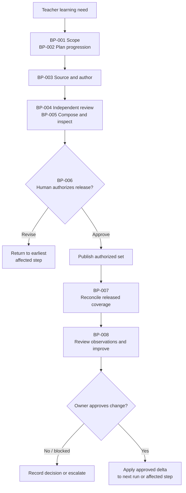
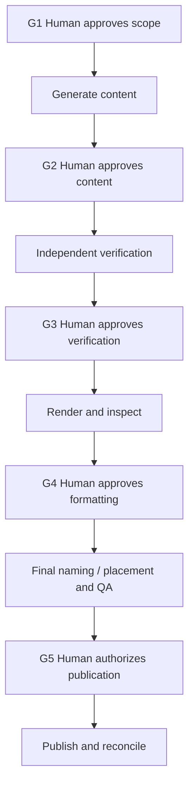

# MTS: Business Architecture

```yaml
artifact_id: BUSINESS-ARCHITECTURE-MTS
artifact_type: business-architecture
station: M2
status: draft
version: 0.6
owner: MTS / Krishna Chaitanya
approvers: []
source_ids:
  - PRODUCT-MTS
  - ONTOLOGY-MTS
  - source-material/mts/ela/business-architecture/business-architecture-2026-11-05-v1.md
  - source-material/mts/math/business-architecture/business-architecture-2026-11-06-v1.md
requirement_ids: []
atomic_entity_ids: []
delta_ids: []
supersedes: []
downstream_ids: [REQUIREMENT-VERIFICATION-MAPPING-MTS]
last_verified_against: []
```

## Holistic Overview

**MTS turns approved learning needs into reviewed, delivered materials, then learns from coverage and defects.** This is the business flow: what happens and who decides, not software architecture.

### Business Process Flow



This is the end-to-end [business process flow](#business-process-flow). Material defects may enter BP-008 before release; revisions return to the earliest affected step. The flow serves Math and ELA with subject-specific review. All five Math checkpoints remain mandatory; ELA requires independent review and human publication approval. [Rules](#business-rules) and [processes](#business-processes) define the handoffs.

**Status: Draft, not ratified or proven implemented.** Version 0.6 aligns the functional-area sequence with [product.md](product.md#functional-areas-and-capabilities). Business capability IDs, rules and gates are unchanged. Evidence is unassessed. Key gaps are ELA checkpoints, exception authority, profiles and release semantics; see [open decisions](#open-decisions).

## Value Streams

A value stream follows a need to its result; a capability is an enduring ability; a process uses capabilities through decisions and handoffs.

| ID | Trigger -> value | Participants |
|---|---|---|
| <a id="vs-001"></a>VS-001 Learning Intent to Trusted Material | Approved learning need/source assessment -> reviewed, authorized and reconciled delivery | Teacher, curriculum owner, author, reviewers, release operator, learner |
| <a id="vs-002"></a>VS-002 Observation to Improvement | Feedback, coverage or defect -> reviewed correction and regression | Curriculum, subject and quality owners |

VS-002 can start before release. Coverage counts only confirmed delivery; neither stream implies a separate team or automated system.

BP-009 lessons/references and BP-010 diagnostics are selected variations: they extend content planning/authoring before the same review, composition and release controls. Math's five checkpoints refine its path below; ELA's detailed checkpoint mapping remains open.

## Functional Areas and Capabilities

This catalog owns business decomposition; [ontology](ontology.md#terms-and-boundaries) owns meaning. Product areas use the corresponding FA-##-XXX IDs; business capabilities retain the CAP IDs below. Historical source IDs retain their original meanings. Area names/groupings remain proposed.

| Sequence | Business functional area | Product area | Responsibility / capabilities |
|---:|---|---|---|
| 1 | <a id="fa-001"></a>FA-001 Curriculum Design | FA-01-CUR | Scope and progression: CAP-001, 002 |
| 2 | <a id="fa-002"></a>FA-002 Content Management | FA-02-SRC | Provenance and content: CAP-003-005 |
| 3 | <a id="fa-003"></a>FA-003 Practice and Assessment Design | FA-03-ASM | Items, support and assessment: CAP-006-010 |
| 4 | <a id="fa-004"></a>FA-004 Educational Material Production | FA-04-MAT | Composition and representations: CAP-011, 012 |
| 5 | <a id="fa-005"></a>FA-005 Verification and Validation | FA-05-QLT | Independent review: CAP-013 |
| 6 | <a id="fa-006"></a>FA-006 Release and Delivery | FA-06-REL | Publication and reconciliation: CAP-014 |
| 7 | <a id="fa-007"></a>FA-007 Coverage and Improvement | FA-07-IMP | Coverage and learning: CAP-015, 016 |

| ID | Capability -> business result | Product priority |
|---|---|---|
| <a id="cap-001"></a>CAP-001 | Define curriculum, learner and run scope -> approved scope/exclusions | Initial |
| <a id="cap-002"></a>CAP-002 | Plan progression and assessment -> objectives, prerequisites, standards and mix | Initial |
| <a id="cap-003"></a>CAP-003 | Discover/check/document sources -> origin and permission basis | Initial |
| <a id="cap-004"></a>CAP-004 | Select, transform or author content -> faithful/authorized content | Initial |
| <a id="cap-005"></a>CAP-005 | Produce lessons/references -> objective-aligned teaching material | Later |
| <a id="cap-006"></a>CAP-006 | Design practice/source-based assessments -> suitable items and profiles | Initial |
| <a id="cap-007"></a>CAP-007 | Produce answers/solutions/rubrics -> defensible matched support | Initial |
| <a id="cap-008"></a>CAP-008 | Provide short diagnostics/readiness checks -> bounded diagnostic scope | Later |
| <a id="cap-009"></a>CAP-009 | Analyze learner performance/recommend practice -> skill/error summaries | Deferred |
| <a id="cap-010"></a>CAP-010 | Estimate SAT/ACT scores -> exam basis, calibration and uncertainty | Deferred |
| <a id="cap-011"></a>CAP-011 | Compose/render student and teacher materials -> matched, readable exports | Initial |
| <a id="cap-012"></a>CAP-012 | Represent Math notation/visuals -> accurate mathematics and figures | Initial |
| <a id="cap-013"></a>CAP-013 | Independently verify content/artifacts -> applicable review evidence | Initial |
| <a id="cap-014"></a>CAP-014 | Approve/publish/reconcile -> human-authorized delivery | Initial |
| <a id="cap-015"></a>CAP-015 | Track released curriculum coverage -> confirmed-release coverage | Initial |
| <a id="cap-016"></a>CAP-016 | Capture defects/improve production -> corrections and regressions | Initial |

## Business Processes

| Process | Capabilities | Input -> output/decision | Responsible role |
|---|---|---|---|
| <a id="bp-001"></a>BP-001 Scope/preflight | 001, 002 | Request/curriculum/profile -> approved scope, exclusions, overrides | Curriculum owner |
| <a id="bp-002"></a>BP-002 Plan progression/content | 002, 006 | Objectives/grade -> content, mix and assessment plan | Curriculum / subject reviewer |
| <a id="bp-003"></a>BP-003 Source/author | 003, 004, 006, 007 | Plan/sources -> content, lineage, selected items and support | Curator / author |
| <a id="bp-004"></a>BP-004 Subject review | 007, 012, 013 | Content/source basis -> independent findings/evidence | Subject reviewer |
| <a id="bp-005"></a>BP-005 Compose/inspect | 011-013 | Reviewed content/profile -> exports and artifact review | Production / quality reviewers |
| <a id="bp-006"></a>BP-006 Authorize/publish | 013, 014 | Evidence -> human decision -> reconciled release or rejection/block | Human approver / operator |
| <a id="bp-007"></a>BP-007 Reconcile coverage | 015 | Confirmed release -> curriculum coverage | Curriculum owner / operator |
| <a id="bp-008"></a>BP-008 Learn/improve | 016 | Observation -> diagnosis, owned proposal and regression | Product/domain / quality owner |
| <a id="bp-009"></a>BP-009 Later lessons/references | 005, 011, 013 | Objective -> reviewed teaching/reference artifact | Teacher / subject reviewer |
| <a id="bp-010"></a>BP-010 Later diagnostics | 008, 011, 013 | Diagnostic scope -> reviewed diagnostic material | Teacher / assessment reviewer |

Capability numbers above use the CAP namespace. Later processes are variations, not separate engines. Deferred analytics/estimates have no active process.

The [business process flow](#business-process-flow) shows the end-to-end sequence and decision path; this table specifies each process's inputs, outputs and responsible roles.

### Math checkpoint flow



All five apply to specific revisions. Changes return to the earliest affected review. G4 precedes final naming/placement; G5 is publication authority, not certification. The staging/final-placement boundary remains open.

### ELA review and release

Approved scope -> sourced/authored content and support -> independent semantic review -> export inspection -> named human approval -> reconciled release. Revision requests return to affected work. Detailed ELA checkpoints remain open; Math numbering is not automatically imposed.

## Subject and Offering Variations

- **Math weekly/class:** Curriculum and run-specific F/C/S/R mix; independent solutions and reasoning.
- **Math mocks:** Authorized fidelity of wording, values, options, scoring, notation and figures; source-specific profiles.
- **ELA reading/vocabulary:** Passage evidence, contextual meaning and applicable line references.
- **ELA grammar/writing:** Standalone or passage tasks; defensible responses/rubrics, not necessarily a unique answer.
- **Practice modes:** Explicit audience, purpose, source and profile for single-topic/homework/revision/remediation/enrichment.
- **Offering boundaries:** Support and source mocks are initial; standalone teaching/references and diagnostics later; analytics/estimates deferred. Estimates must never appear official.

## Business Rules

Rules own business policy; [ontology invariants](ontology.md#invariants) preserve its semantic implications; [requirements/checks](requirement-verification-mapping.md) specify conformance.

| ID | Policy and scope |
|---|---|
| <a id="rule-001"></a>RULE-001 | Run intake/release: only selected, approved grades/courses; distinguish exclusions |
| <a id="rule-002"></a>RULE-002 | Sourcing: record origin/permissions; reproduce or transform only as authorized |
| <a id="rule-003"></a>RULE-003 | Composition/review: student items and support share selected identities/revisions |
| <a id="rule-004"></a>RULE-004 | Subject QA: independently review every released assessable item/support; self-assessment is insufficient |
| <a id="rule-005"></a>RULE-005 | Review/release: bind evidence/approval to revisions; invalidate affected dependencies after change |
| <a id="rule-006"></a>RULE-006 | QA/release: mandatory failure or missing evidence blocks certification except under applicable authorized exception policy; named human publication approval remains required |
| <a id="rule-007"></a>RULE-007 | Math: require all five checkpoints before their downstream activities |
| <a id="rule-008"></a>RULE-008 | ELA weekly worksheets/keys: target two pages each; legibility first; human approval for exceptions |
| <a id="rule-009"></a>RULE-009 | Math weekly student sheets: two-page maximum; explicitly resolve conflicts without silent shrinking, clipping or content loss |
| <a id="rule-010"></a>RULE-010 | Relevant source-based Math mock profile only: four-page default ceiling and diagram policy; applicability review pending |
| <a id="rule-011"></a>RULE-011 | Artifact/release QA: inspect actual exports; reconcile authorized files/destination after publication |
| <a id="rule-012"></a>RULE-012 | Coverage/learning: count reconciled releases only; link defects to correction and regression |
| <a id="rule-013"></a>RULE-013 | Scope/configuration: counts, ratios, source modes and templates vary only by approved run/profile; overrides do not silently persist |

Historical Math mock detail: US Letter, two columns, intact questions, 75% initial diagram scale, 70% floor and 6 pt clearance. These are source-profile details pending applicability review, not universal defaults.

## Decisions and Responsibilities

Product/curriculum owners approve intent/scope/variation. Authors create content and provenance. Subject reviewers independently judge pedagogy, correctness and source fidelity; quality reviewers report actual results and applicability. A named human authorizes release; the operator confirms delivery. Factory services supply mechanisms, not subject correctness or approval authority.

Roles may overlap only where independence/approval policy allows; authoring is not its own independent verification. Named assignments, exception authority and separation of duties remain open.

## Capability Coverage Summary

Verification asks whether specified conditions hold; validation asks whether the product serves its intended use. Both are needed. The [M3 coverage table](requirement-verification-mapping.md#capability-coverage-and-disposition) tracks each capability's draft checks and gaps. No capability's execution evidence has been assessed.

## Measures and Traceability

Business measures follow the [product outcomes](product.md#product-outcomes). For example, trusted answers connect OUT-MTS-002 -> CAP-007/013 -> BP-004/005 -> RULE-003/004 -> [REQ-MTS-003/004 and their checks](requirement-verification-mapping.md#requirement-and-acceptance-catalog). This is a draft trace, not execution evidence.

BP-008 implements the business improvement flow; the [factory L1/L2/L3 policy](strategy/ai-sdlc/ai-sdlc-software-factory-strategy.md#3d-closed-loop-convergence-and-recovery) governs repair versus specification/intent changes.

## Source Reconciliation

ELA VS-01/02, P-01-06 and C01-C08/supplementary capabilities, and Math VS-01/02, BP-01-10 and CAP-01-12, are consolidated by meaning into this catalog. Historical IDs are not aliases. Subject rules remain specialized.

The later human decision requiring five Math gates supersedes older configured bypass options. Broader portfolio entries follow product priorities, not maturity claims. November 6-7 Math sources cite a November 9 run; provenance remains unresolved.

## Open Decisions

Ratify shared scope/meaning and IDs/owners; establish subject homes as needed; define ELA checkpoints and exception classes; resolve Math placement/publication and profile conflicts; complete subject criteria and inventory evidence. See the [gap register](requirement-verification-mapping.md#gaps-and-next-decisions).

## Sources

- [Product](product.md) and [ontology](ontology.md).
- ELA historical [business architecture](source-material/mts/ela/business-architecture/business-architecture-2026-11-05-v1.md) and [ontology](source-material/mts/ela/ontology/ontology-2026-11-06-v1.md).
- Math historical [business architecture](source-material/mts/math/business-architecture/business-architecture-2026-11-06-v1.md) and [ontology](source-material/mts/math/ontology/ontology-2026-11-06-v1.md).
- [Source inventory](source-material/README.md) and [factory strategy](strategy/ai-sdlc/ai-sdlc-software-factory-strategy.md).
