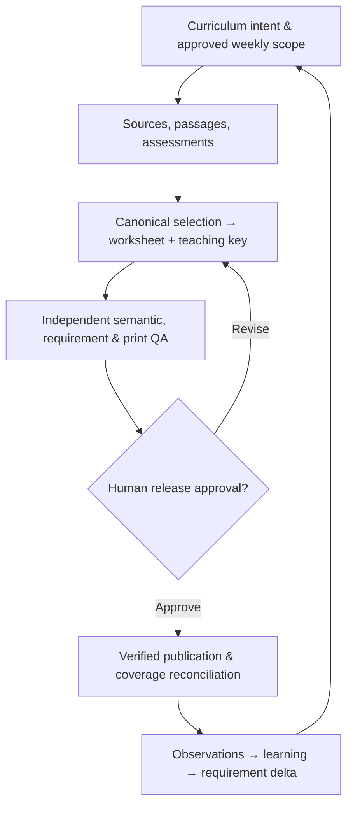
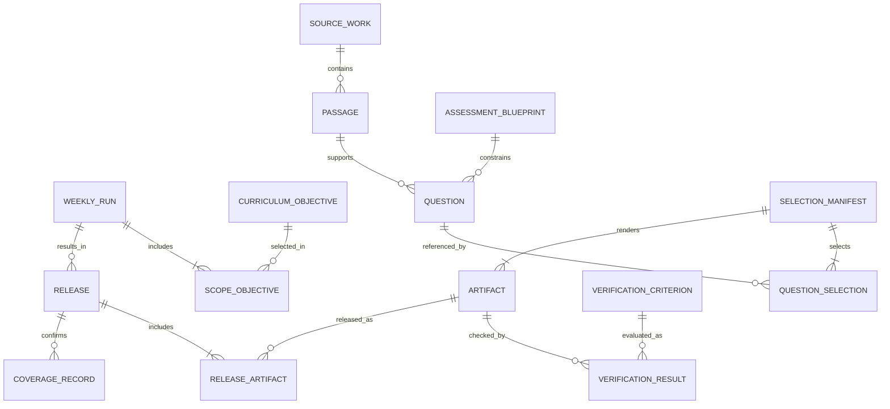

# Ontology — MTS ELA Worksheet Generation

> **Draft for review.** Derived from the [approved ELA PRODUCT.md v1.1](https://chatgpt.com/library?file_id=libfile_52c90a9ae7408191bf95d0776f0fccbb&account_id=personal) and [proposed ELA business-architecture v0.1](https://chatgpt.com/library?file_id=libfile_bd60d59032c88191ad9b3a703c30ba94&account_id=personal). The [AI-SDLC Strategy](strategy/ai-sdlc-software-factory-strategy.md) governs the engineering method. Product decisions below are approved only where the PRODUCT source says so; proposed BA constructs remain proposed.

## 1. One-page mental model

A teacher approves what students should learn. A curator chooses faithful source material. An author creates exercises and explanations. An independent reviewer checks the content, key and printed pages. A named human authorizes release. The factory publishes with evidence and learns from each run.



Four orthogonal concepts must not be conflated:

| Concept | Meaning | Example |
|---|---|---|
| **Subject and domain** | What is taught | ELA → reading comprehension, vocabulary, grammar, writing |
| **Educational capability** | Enduring business ability | Curate passages; design assessments; independently verify |
| **Educational artifact type** | What is produced | Worksheet, teacher key, diagnostic, rubric, study guide |
| **Production instance** | Specific scoped execution | Grade 6 weekly RC worksheet and key for one instructional week |

A capability can produce several artifact types; the same artifact can support several capabilities. Topic, genre, grade and curriculum objective are additional relationships, not all mandatory parts of a single compound ID.

## 2. Factory versus educational product boundary

| Reusable factory responsibility | ELA product/domain responsibility |
|---|---|
| M0–M8 station orchestration, human gates, trace IDs, immutable runs and evidence | Curriculum objectives, grades, genre progression, source fidelity |
| Generic schema validation, test/eval runners, evidence ledger, observability and delta routing | RC/poetry comprehension, vocabulary-in-context, grammar, writing, question/rubric semantics |
| Rendering engines, document storage and publishing connectors | Two-page **target** with legibility priority, correct font/layout, source line alignment, worksheet/key parity |
| Model/IDE adapters and release workflow infrastructure | Which grade is GENERATE, assessment quotas, approved teaching-key explanations, human release policy |

The factory is not restricted to education. Math and ELA may reuse infrastructure, but domain-specific correctness must remain under their respective owners. `PRODUCT.md` defines product why/who/boundaries; `requirements.md` defines objectively testable behavior; this ontology defines **entities, relationships and vocabulary**.

## 3. Business architecture entities

### Value streams

| ID | Value stream | Start → achieved value |
|---|---|---|
| VS-01 | Curriculum-to-Classroom Materials | Approved weekly scope → verified, human-authorized published worksheet/key |
| VS-02 | Delivery-to-Improvement | Release or defect observation → updated coverage, requirements and regression checks |

### Functional areas and capability catalog

The eight product IDs **ELA-C01…ELA-C08** retain their approved meanings. The four supplementary `ELA-BA-*` IDs come from a **proposed** business-architecture catalog.

| Functional area | Capability IDs | Business ability |
|---|---|---|
| FA-01 Curriculum Management | ELA-C01, ELA-BA-C02 (proposed) | Approve scope; track grade/genre/skill coverage |
| FA-02 Content & Assessment | ELA-C02, ELA-C03, ELA-C04 | Source-faithful curation; grade-appropriate assessment across ELA; evidence-based teaching explanations |
| FA-03 Worksheet Production | ELA-BA-C06 (proposed), ELA-C05 | Synchronize student/key through one manifest; produce readable print |
| FA-04 Quality & Release | ELA-C06, ELA-BA-C09 (proposed), ELA-C07 | Verify independently; record human release decision; publish/confirm authorized pairs |
| FA-05 Learning & Improvement | ELA-C08, ELA-BA-C12 (proposed) | Reconcile released coverage; convert defects to requirement deltas and regression checks |

### Processes (sequence, not capability identity)

| ID | Process | Input → output |
|---|---|---|
| P-01 | Approve run intake | Weekly request → authorized dated, grade-scoped contract |
| P-02 | Curate and author | Contract → source manifest, questions, teaching explanations |
| P-03 | Assemble paired artifacts | Canonical question selection → student/key artifacts |
| P-04 | Independently verify | Candidate outputs → criterion-scoped evidence and gate outcomes |
| P-05 | Human-authorize and publish | Mandatory QA + named approval → verified release |
| P-06 | Reconcile and learn | Release/observations → coverage, learning and regression backlog |

A value stream crosses functional areas. A capability is enduring; a process may change with technology or automation without changing the business ability.

## 4. Core information ontology

The proposed `ENT-*` IDs identify **entity types**, not production instance IDs. The authoritative stores below are logical ownership boundaries, not prescribed databases.

| Type | Entity | Meaning / key fields | Source of truth |
|---|---|---|---|
| ENT-01 | Curriculum Objective | Standard, skill, grade, goal, prerequisite, version | Curriculum Manager |
| ENT-02 | Weekly Run / Scope | Run ID, date, explicit GENERATE grades, objectives, quotas, approver, status | Approved Run Manifest |
| ENT-03 | Subject / Domain / Topic | ELA subject, RC/vocabulary/grammar/writing domain, genre, topic relations | Domain catalog |
| ENT-04 | Source Work | Title, author, edition, rights, location, provenance | Source Register |
| ENT-05 | Passage / Excerpt | Passage ID, source, exact text/revision, boundaries, presented line map | Passage corpus/manifest |
| ENT-06 | Assessment Blueprint | Grade/domain question types, counts, difficulty, policy version | Approved run configuration |
| ENT-07 | Question / Item | Item ID/version, stem, response form, options, source/context, difficulty | Canonical item bank |
| ENT-08 | Answer / Explanation | Item ID, answer, evidence, rationale, misconception, rubric version | Item bank / key spec |
| ENT-09 | Selection Manifest | Immutable ordered item IDs/revisions for worksheet/key pair | Selection manifest |
| ENT-10 | Artifact Revision | Artifact ID, role, format, hash, template, manifest link | Artifact registry |
| ENT-11 | Verification Criterion | Atomic QA check, AC/QAS link, applicability, mandatory status | Verification specification |
| ENT-12 | Verification Result / Evidence | Criterion, test, actual, status, reviewer, evidence link, timestamp | QA evidence ledger |
| ENT-13 | Gate / Decision | Gate, evidence baseline, named human decision, exception | Approval record |
| ENT-14 | Release / Publication | Exact approved artifacts/hashes, destination, remote check, authorization | Immutable release manifest |
| ENT-15 | Curriculum Coverage | Released grade/skill/genre/week and release reference | Curriculum Manager |
| ENT-16 | Observation / Learning / Delta | Symptom, root cause, owner, corrective change, regression link | Learning register |
| ENT-17 | Learner / Cohort Context | Grade/audience; individual records only if separately authorized | Product/privacy policy |

**Important distinction:** an assessment's *student performance result* is different from the factory's *verification result* certifying worksheet quality. Do not reuse the same entity or status field for both.

### Core relationships and cardinalities



- A run may have **zero releases** when blocked, and may contain more than one grade/artifact pair.
- Some grammar and writing items have no passage; passage links are conditional on item type.
- Every student/key pair comes from the same immutable selection-manifest revision.
- A released file is identified by exact revision/hash; corrected versions create new provenance, never silent replacement.
- A criterion is reusable across runs; a result is a run-specific execution of that criterion.
- Released coverage is distinct from drafted/generated coverage.

## 5. Requirements-to-evidence ontology

```text
OUT-* outcome → VS-* → ELA-C* capability → P-* process / BR-* rule
 → REQ-* requirement → AC-* acceptance criterion
 → VC-* verification criterion → TEST-* / EVAL-* → EVD-* evidence
 → GATE-* decision → ART-* / REL-* → OBS-* → LRN-* → DELTA-*
```

- **Requirement:** what must happen.
- **Acceptance Criterion (AC):** measurable condition for the requirement.
- **Verification Criterion (VC):** atomic QA checklist obligation linked to AC/QAS.
- **Test/Evaluation:** how the criterion is independently checked.
- **Evidence:** actual result, context, reviewer and artifact version.
- **Gate decision:** whether evidence is sufficient to move on, with named authority.
- **Release/Observation:** what went live and whether it delivered the intended outcome.

QA values: **PASS**, **FAIL**, **NOT VERIFIED**, **NOT APPLICABLE**, **OUT OF SCOPE**. Out-of-scope grades do not inflate the active QA denominator. Zero failures **does not** imply readiness when mandatory checks remain NOT VERIFIED.

Requirement states (proposed): `Proposed, Ready, In Progress, Implemented, Verified, Released, Observed, Accepted, Superseded`. These must not be collapsed into one `done` state.

## 6. Invariants derived from product and business rules

These summarize the proposed BA BR-01…BR-09 and approved PRODUCT principles; full acceptance detail belongs in `requirements.md`.

1. **Explicit scope:** Only approved `GENERATE` grades are produced; out-of-scope grades are shown separately.
2. **Source provenance:** Passage work, edition/location/excerpt, usage status and presented-line references are verifiable.
3. **Canonical parity:** Student, key, QA and release reference identical selected question IDs/revisions; answers are reverified after changes or option shuffling.
4. **Independent semantics:** ELA meaning, ambiguity, distractor plausibility and evidence require independent review; a generator's own claim is not proof.
5. **Print usability:** Student and teacher key each target **two pages**; readable content takes priority over forcing page count. Exceptions are reviewable.
6. **QA completeness:** Every in-scope mandatory criterion has recorded evidence, not merely a listed test.
7. **Human authority:** Mandatory failures/unverified checks block release; a named human approves release even after gates pass.
8. **Publication integrity:** Remote artifacts match approved names, hashes and destinations.
9. **Learning loop:** Update released coverage only after confirmed publication; material defects link to an owner, requirement delta and regression verification.

## 7. Examples

**Grade 6 poetry worksheet.** Subject ELA → RC domain → poetry genre → ELA-C03 assessment design → student worksheet + key. The weekly run explicitly authorizes Grade 6. The source has citation/excerpt/line mapping. A configured blueprint sets this week's question and vocabulary quotas. A single manifest drives both outputs. Independent semantic and PDF QA produce evidence; human authorization precedes release.

**Vocabulary-only practice.** ELA → vocabulary → ELA-C03/C04 → practice sheet + explanatory key. Sentence-level context may replace a passage, while curriculum objectives, source/context, answer evidence and verification remain mandatory.

**Missing vocabulary quota.** If approved blueprint requires two vocabulary items and the manifest contains one, `ELA-C03 → P-02/P-04 → REQ/AC → VC → TEST → EVD(FAIL)` blocks release. The observation becomes a reviewed delta and regression test; rerun creates new evidence.

## 8. Open ontology decisions — human review required

| ID | Open question |
|---|---|
| ONT-DEC-01 | Separate factory-wide and product-specific ontology catalogs? Proposed yes; root location is interim. |
| ONT-DEC-02 | Which ELA-BA capabilities should join a cross-subject educational capability catalog? |
| ONT-DEC-03 | Stable IDs, revision identity, and persistence for excerpt, question, selection and release? |
| ONT-DEC-04 | Standardize poetry analysis naming (PQYA vs YPQA) and rubrics? |
| ONT-DEC-05 | Which constraints are product invariants versus versioned grade/week configuration? |
| ONT-DEC-06 | Evidence retention, licensing, privacy and student/cohort data ownership? |
| ONT-DEC-07 | What is genuinely reusable across ELA and Math after a second verified vertical slice? |

**Next drill-down:** `requirements.md` R1 Curriculum & Run Intake; allocate stable REQ/AC/VC IDs to the approved run, explicit grade scope, objective/assessment quotas, out-of-scope treatment and G0 evidence.

### Provenance

- ELA [PRODUCT.md v1.1](https://chatgpt.com/library?file_id=libfile_52c90a9ae7408191bf95d0776f0fccbb&account_id=personal), approved 2026-11-05.
- ELA [business-architecture(1).md v0.1](https://chatgpt.com/library?file_id=libfile_bd60d59032c88191ad9b3a703c30ba94&account_id=personal), proposed 2026-11-05.
- [Governing strategy](strategy/ai-sdlc-software-factory-strategy.md).
- [MCQ assessment contract](contracts/assessment/mcq-question-bank.schema.json), implemented initial slice (not universally applied).
- [Historical handoff](strategy/source-history/mts-educational-factory-conversation.md), fallback only.

No code execution or release-readiness claim is made by this ontology.
