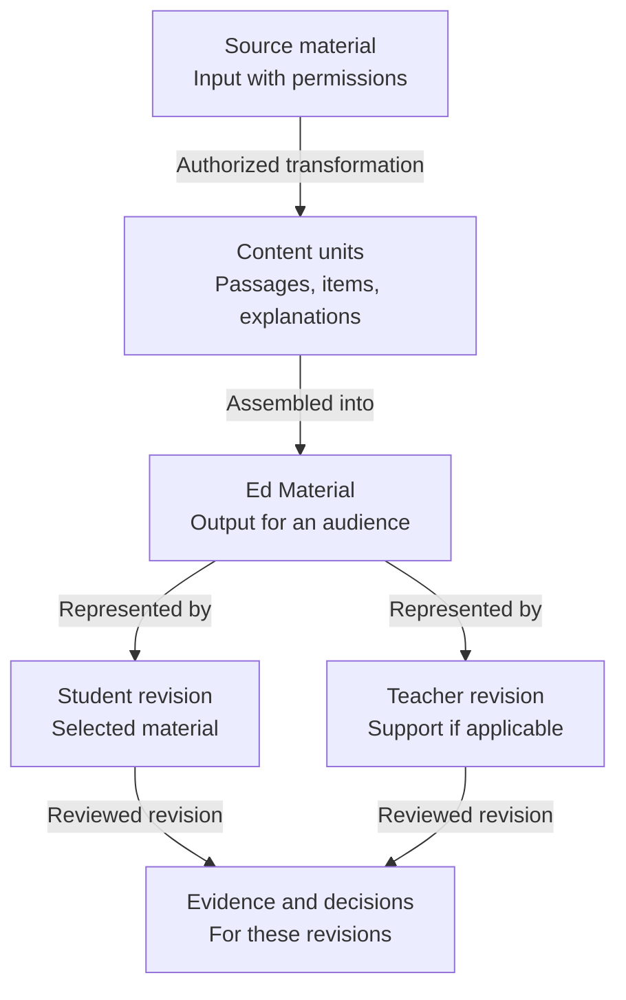

# MTS: Ontology

```yaml
artifact_id: ONTOLOGY-MTS
artifact_type: ontology
station: M1
status: review
version: 0.4
owner: MTS / Krishna Chaitanya
approvers: []
approval_history:
  - version: 0.1
    approver: MTS product owner (human approval in conversation)
    date: 2026-11-08
    clarification: Earlier approval was later clarified as not full document approval.
source_ids:
  - PRODUCT-MTS
  - source-material/mts/ela/ontology/ontology-2026-11-06-v1.md
  - source-material/mts/math/ontology/ontology-2026-11-06-v1.md
  - source-material/mts/ela/business-architecture/business-architecture-2026-11-05-v1.md
  - source-material/mts/math/business-architecture/business-architecture-2026-11-06-v1.md
requirement_ids: []
atomic_entity_ids: []
delta_ids: []
supersedes: []
downstream_ids: [BUSINESS-ARCHITECTURE-MTS, REQUIREMENT-VERIFICATION-MAPPING-MTS]
last_verified_against: []
```

## Holistic Overview

**Ontology gives MTS one shared meaning for its concepts and records.** It prevents errors such as treating a source as a finished material, a new PDF as already reviewed, or staging as delivery.



A teacher-approved run selects objectives, learners, content and profiles. Student items and teacher support share selected identities/revisions. Evidence supports review; a human authorizes release; confirmed delivery supports coverage.

**Status: Under review, not fully approved.** The November 8 clarification of the earlier v0.1 approval is retained above. Ed Material additions remain unapproved; v0.4 simplifies presentation without changing IDs or meaning. Revision/retention, subject methods and permissions remain [open](#open-decisions).

This document owns meaning, not technology or process policy. [Business architecture](business-architecture.md) owns rules/handoffs; [requirements/verification](requirement-verification-mapping.md) own assessable conditions.

## Terms and Boundaries

| ID | Term | Meaning |
|---|---|---|
| <a id="term-001"></a>TERM-001 | Subject | Educational field: currently Math or ELA, not delivery purpose |
| <a id="term-002"></a>TERM-002 | Domain/topic | Area/concept within a subject, such as vocabulary or fractions |
| <a id="term-003"></a>TERM-003 | Capability | Enduring business ability; a process exercises it |
| <a id="term-004"></a>TERM-004 | Artifact type | Output representation kind: worksheet, key, mock test, rubric |
| <a id="term-005"></a>TERM-005 | Source mode | Source-based, teacher-authored, generated or hybrid |
| <a id="term-006"></a>TERM-006 | Transformation | Reproduction, selection, reformatting, permitted adaptation, synthesis or original authoring |
| <a id="term-007"></a>TERM-007 | Instructional method | Teacher-selected explanation/reasoning method with approved name/rubric |
| <a id="term-008"></a>TERM-008 | Run | Scoped production instance: week, session, topic or assessment |
| <a id="term-009"></a>TERM-009 | Priority | Initial/later/deferred sequencing, not maturity |
| <a id="term-010"></a>TERM-010 | Ed Material | Educational output for an audience: worksheet, test, key, cheat/summary sheet or lesson; format/status can vary |
| <a id="term-011"></a>TERM-011 | Source material | Input used to select, transform or create content, not the resulting Ed Material |

## Entity Catalog

IDs identify types, not individual records. Logical homes below are intended, not approved storage/database designs.

| ID | Entity: meaning | Intended logical home |
|---|---|---|
| <a id="ent-001"></a>ENT-001 | Subject/domain: field and topics | Subject catalog |
| <a id="ent-002"></a>ENT-002 | Learner context: grade/course/cohort; individual data only when authorized | Run scope / privacy policy |
| <a id="ent-003"></a>ENT-003 | Curriculum objective: intended learner outcome | Approved curriculum |
| <a id="ent-004"></a>ENT-004 | Concept/standard: learning idea, prerequisites and external expectation, each with its own identity | Curriculum / standards sources |
| <a id="ent-005"></a>ENT-005 | Run/scope: bounded instance, selections and exclusions | Approved run record |
| <a id="ent-006"></a>ENT-006 | Run contract: versioned objectives, sources, artifacts, gates and overrides | Approved contract |
| <a id="ent-007"></a>ENT-007 | Source work: origin, version/location and permission status | Source register |
| <a id="ent-008"></a>ENT-008 | Source unit: identifiable passage, excerpt, item or figure | Source/content manifest |
| <a id="ent-009"></a>ENT-009 | Transformation record: creation/adaptation/selection and lineage | Source/content manifest |
| <a id="ent-010"></a>ENT-010 | Content unit: lesson, example, passage, question, explanation or reference | Content specification |
| <a id="ent-011"></a>ENT-011 | Assessment item: stable prompt identity, response format, objective and applicable source/assets | Item specification |
| <a id="ent-012"></a>ENT-012 | Answer/solution/rubric: accepted response, explanation or method for an item | Content/answer specification |
| <a id="ent-013"></a>ENT-013 | Selection manifest: ordered content/item identities and revisions | Versioned selection record |
| <a id="ent-014"></a>ENT-014 | Artifact profile: approved audience, format, template and presentation | Versioned profile policy |
| <a id="ent-015"></a>ENT-015 | Artifact revision: particular Ed Material version/representation, with role and provenance | Artifact record |
| <a id="ent-016"></a>ENT-016 | Verification criterion: applicable assessable condition linked to a requirement | Verification catalog |
| <a id="ent-017"></a>ENT-017 | Verification result/evidence: actual finding, method and reviewer for a revision | Evidence record |
| <a id="ent-018"></a>ENT-018 | Gate decision: named decision on scope, revision and evidence | Human decision record |
| <a id="ent-019"></a>ENT-019 | Release/publication: authorized set, destination and reconciliation | Release record |
| <a id="ent-020"></a>ENT-020 | Coverage: curriculum actually released, linked to release | Coverage register |
| <a id="ent-021"></a>ENT-021 | Observation/proposed delta: feedback/defect and governed change, with distinct identities when separately managed | Learning/change records |
| <a id="ent-022"></a>ENT-022 | Visual/Math asset: figure, graph or formula with origin | Content/asset specification |
| <a id="ent-023"></a>ENT-023 | Ed Material: audience-specific output assembled from content, with possible multiple formats/revisions | Ed Material/artifact records |

## Relationships

| ID | Relationship and qualification |
|---|---|
| <a id="rel-001"></a>REL-001 | Run selects subject, learner context and objectives; enabled grades are not automatically selected |
| <a id="rel-002"></a>REL-002 | Run follows an approved contract revision; one-time overrides do not silently persist |
| <a id="rel-003"></a>REL-003 | Objective targets concepts and may map to standards; preserve source/version/enrichment distinctions |
| <a id="rel-004"></a>REL-004 | Concept builds on another concept; prerequisite does not imply next-week pacing |
| <a id="rel-005"></a>REL-005 | Source work contains source units with traceable location/permission basis |
| <a id="rel-006"></a>REL-006 | Content derives from sources via transformation; original content need not have an external source, hybrids retain item-level lineage |
| <a id="rel-007"></a>REL-007 | Item addresses an objective or approved source-assessment scope; not all ELA items need passages |
| <a id="rel-008"></a>REL-008 | Item has applicable answer/solution/rubric; open responses may admit several valid answers |
| <a id="rel-009"></a>REL-009 | Selection references content/item revisions shared by corresponding student/teacher artifacts |
| <a id="rel-010"></a>REL-010 | Artifact revision derives from selection/profile revisions; not every teaching artifact has questions/a key |
| <a id="rel-011"></a>REL-011 | Result evaluates a criterion using evidence; record applicability and reviewed revision |
| <a id="rel-012"></a>REL-012 | Gate decision considers scoped evidence/revisions; certification is not publication approval |
| <a id="rel-013"></a>REL-013 | Release contains authorized artifact revisions and destination reconciliation |
| <a id="rel-014"></a>REL-014 | Coverage references confirmed release, not draft/staged content |
| <a id="rel-015"></a>REL-015 | Observation informs proposed change/regression; adoption requires applicable human authority |
| <a id="rel-016"></a>REL-016 | Item/explanation uses an asset whose meaning and provenance are reviewable |
| <a id="rel-017"></a>REL-017 | Ed Material comprises reusable content units; questions, passage or separate key are not universal requirements |
| <a id="rel-018"></a>REL-018 | Artifact revision represents an Ed Material; each retains identity, provenance, verification and approval |

## Invariants

An invariant is a condition that must remain true. Detailed applicability and exceptions belong in requirements/policy.

| ID | Condition |
|---|---|
| <a id="inv-001"></a>INV-001 | Only approved selections enter scope; exclusions differ from unverified work |
| <a id="inv-002"></a>INV-002 | External origin/permission is recorded; authorized fidelity/transformation is not silently changed |
| <a id="inv-003"></a>INV-003 | Corresponding student/answer artifacts share selected item identities/revisions |
| <a id="inv-004"></a>INV-004 | Released assessable items/support receive independent subject review, not generator self-assessment |
| <a id="inv-005"></a>INV-005 | Changed review inputs invalidate affected evidence/approvals, not unrelated work |
| <a id="inv-006"></a>INV-006 | Mandatory failed/unverified checks block certification except under authorized applicable exception policy; human release approval remains required |
| <a id="inv-007"></a>INV-007 | Approval identifies a revision; staging/certification is not publication approval or delivery |
| <a id="inv-008"></a>INV-008 | Released coverage reflects reconciled publication |
| <a id="inv-009"></a>INV-009 | Math gate decisions remain distinct and revision-bound through [all five checkpoints](business-architecture.md#math-checkpoint-flow) |
| <a id="inv-010"></a>INV-010 | Presentation constraints are profile-specific; preserve [ELA legibility](business-architecture.md#rule-008) and [Math maximum/conflict policy](business-architecture.md#rule-009) |
| <a id="inv-011"></a>INV-011 | Unofficial estimates are never official scores; SAT/ACT estimation is deferred |

## Subject Specializations

Math has concepts, units, solutions, notation, figures and independently qualified reasoning. F/C/S/R describes instructional role, not response format; an R label is not qualification. Counts/ratios depend on the run/profile. Source mocks preserve authorized content under their own profile.

ELA has passages, contextual meaning, interpretation and rubrics; grammar/writing may stand alone or admit several valid responses. PQYA/YPQA names and rubrics need confirmation, not assumed equivalence.

## State and Evidence

| State/fact | Meaning |
|---|---|
| Draft/staged | Prepared, not necessarily reviewed or delivered |
| Verified/certified | Applicable specified conditions have supporting evidence |
| Publication approved | Named human authorizes the specific revision |
| Published/reconciled | Delivery is confirmed |
| Observed | Outcome evidence exists |

This is conceptual, not an implemented state machine. Changed/rejected revisions return to affected review. Math checkpoints precede their activities; detailed ELA transitions remain open.

Pass, fail, unverified, authorized skip/waiver and out-of-scope are distinct. Exclusions are not unverified checks or passes. Proposed, implemented, verified, released, observed and accepted are separate evidence-backed claims; acceptance need not follow one fixed order.

## Examples

A poetry worksheet/key share item revisions and passage/line evidence. A Math weekly worksheet ties independently reviewed reasoning/support to approved curriculum and five gates. Standalone grammar practice has no required passage, but still has an objective, support and review.

## Amendment Impact

The v0.2 Ed Material/source distinction and content-to-artifact relationships remain under review. Product/business views use them; subject/requirement/evidence impact is not yet assessed. V0.3 linked policy and draft requirements; v0.4 changes presentation only. The clarified v0.1 approval history is preserved.

Semantic changes require approval, consumer impact analysis and renewed affected evidence under the [convergence policy](strategy/ai-sdlc/ai-software-factory-intent-quartet-deepdive.md#5-intent-supported-convergence).

## Open Decisions

Resolve subject/shared boundaries, ID collisions and owners; establish canonical revision/retention identities; confirm ELA methods and gates, Math profiles and exception authority; define privacy/permissions/accessibility before learner-data collection; link approved requirements/evidence. [Draft mapping](requirement-verification-mapping.md) does not close these decisions.

## Sources

- [Product](product.md) and [business architecture](business-architecture.md).
- ELA historical [ontology](source-material/mts/ela/ontology/ontology-2026-11-06-v1.md) and [business architecture](source-material/mts/ela/business-architecture/business-architecture-2026-11-05-v1.md).
- Math historical [ontology](source-material/mts/math/ontology/ontology-2026-11-06-v1.md) and [business architecture](source-material/mts/math/business-architecture/business-architecture-2026-11-06-v1.md).
- [Source inventory](source-material/README.md) and [factory strategy](strategy/ai-sdlc/ai-sdlc-software-factory-strategy.md).
