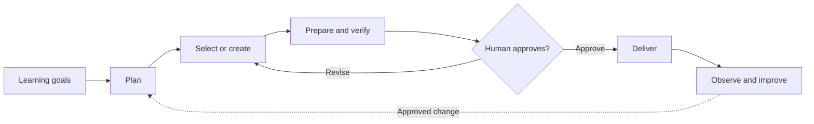

# MTS Learning, Practice & Assessment

```yaml
artifact_id: PRODUCT-MTS
artifact_type: product
station: M1
status: draft
version: 0.8
owner: MTS / Krishna Chaitanya
approvers: []
source_ids:
  - source-material/mts/ela/product/product-2026-11-05-v1.md
  - source-material/mts/ela/product/product-2026-11-07-v1.md
  - source-material/mts/math/product/product-2026-08-23-v1.md
  - source-material/mts/math/product/product-2026-11-06-v1.md
  - source-material/mts/math/product/product-2026-11-07-v1.md
requirement_ids: []
atomic_entity_ids:
  - INT-MTS-001
  - OUT-MTS-001
  - OUT-MTS-002
  - OUT-MTS-003
  - OUT-MTS-004
  - OUT-MTS-005
  - FA-01-CUR
  - FA-02-SRC
  - FA-03-ASM
  - FA-04-MAT
  - FA-05-QLT
  - FA-06-REL
  - FA-07-IMP
delta_ids: []
supersedes: []
downstream_ids: [BUSINESS-ARCHITECTURE-MTS, ONTOLOGY-MTS, REQUIREMENT-VERIFICATION-MAPPING-MTS]
last_verified_against: []
```

## 1. Holistic Overview

**MTS helps teachers turn learning goals into trustworthy Math and ELA materials.** Teachers set the educational intent; MTS helps plan, prepare and verify materials; a human authorizes publication.



MTS is the educational product; the Software Factory is the system used to develop it. The product is **draft** and the quartet is not yet sufficient to create the full declared scope end to end. Remaining gaps are tracked in the [requirement-verification mapping](requirement-verification-mapping.md#gaps-and-next-decisions).

## 2. Intent and Users

<a id="int-mts-001"></a>**INT-MTS-001:** Help teachers turn approved learning goals into trustworthy educational materials, improving preparation and learning through accountable review and feedback.

| User | Product value |
|---|---|
| Teachers / curriculum owners | Plan learning and prepare materials |
| Students / families | Learn and practice with dependable materials |
| Subject reviewers / release operators | Review evidence and deliver the approved set |

Runs may be weekly, class-based, topic-based or source-based. Required formats and detail depend on the approved subject and artifact profile.

## 3. Functional Areas and Capabilities

<a id="functional-areas-and-capabilities"></a>

The sequence follows value creation. Area IDs combine sequence and a short name; capability IDs remain in the [business architecture](business-architecture.md#functional-areas-and-capabilities).

| Sequence | Functional area | Key capabilities and scope |
|---:|---|---|
| 1 | <a id="fa-01-cur"></a>**FA-01-CUR — Curriculum & Run Planning** | Define learners, courses and run scope; plan objectives, progression and assessment. **Initial** |
| 2 | <a id="fa-02-src"></a>**FA-02-SRC — Content & Source Management** | Discover sources; select, transform or author content (**initial**). Standalone lessons and references are **later**. |
| 3 | <a id="fa-03-asm"></a>**FA-03-ASM — Learning, Practice & Assessment** | Design practice and assessments; provide answers, solutions and rubrics (**initial**). Diagnostics are **later**; learner analysis and SAT/ACT estimates are **deferred**. |
| 4 | <a id="fa-04-mat"></a>**FA-04-MAT — Educational Material Production** | Compose and render student/teacher materials; support Math notation and visuals. **Initial** |
| 5 | <a id="fa-05-qlt"></a>**FA-05-QLT — Quality & Verification** | Independently review educational content and rendered artifacts. **Initial** |
| 6 | <a id="fa-06-rel"></a>**FA-06-REL — Release & Delivery** | Authorize, publish and reconcile the approved materials. **Initial** |
| 7 | <a id="fa-07-imp"></a>**FA-07-IMP — Coverage & Improvement** | Track confirmed curriculum coverage and learn from defects. **Initial** |

**Priority** describes intended product scope, not implementation maturity. Math and ELA are current subjects; other subjects are not committed scope.

## 4. Educational Material

The catalog combines shared deliverables and records subject-specific structure in notes. `#` gives the overall priority sequence. Periodicity is a typical trigger, not a fixed calendar.

| # | Educational material | Short description | Subject | Periodicity | Math notes / structure | ELA notes / structure |
|---:|---|---|---|---|---|---|
| 1 | Weekly practice worksheet | Builds planned practice across the instructional period. | Math, ELA | Weekly | Grade/course and week; daily sections; approved practice mix; questions. | Grade/week; passages; comprehension and vocabulary; evidence references as applicable. |
| 2 | Answer and solution key | Provides teacher answers and support matched to assessable materials. | Math, ELA | With each assessable worksheet/test | Item-matched answers; worked methods; scoring where applicable. | Item-matched answers; passage evidence/rationale; acceptable responses where relevant. |
| 3 | Topic cheatsheet / summary sheet | Supports concise review and recall. | Math, ELA | Per topic, unit or revision period | Concepts/formulas; method steps; checked examples; conditions. | Key language/reading/writing concepts; concise rules; examples or vocabulary. |
| 4 | Mock / benchmark assessment | Measures learning under specified assessment conditions. | Math, ELA | Per assessment window or request | Selected questions; preserve source notation/figures; timing/scoring when specified. | Selected passages/items; timing/scoring when specified; answer mapping. |
| 5 | Class / topic practice | Focuses practice on a lesson, session or skill. | Math, ELA | Per class, topic or assignment | Learning target; examples/directions; sequenced practice; key as needed. | Grammar, vocabulary, writing or reading tasks; texts/prompts; rubric/key as needed. |
| 6 | Lesson plan / teaching notes | Guides instruction for a lesson or sequence. | Math, ELA | Per lesson or unit | Objectives; teaching sequence; activities/examples; checks for understanding. | Objectives; teaching sequence; texts/examples; activities; checks for understanding. |
| 7 | Diagnostic / readiness assessment | Identifies readiness or gaps for a bounded purpose. | Math, ELA | When a readiness decision is needed | Target skills/items; scoring assumptions; interpretation and uncertainty. | Reading/language targets; diagnostic prompts; scoring rubric; interpretation and uncertainty. |

## 5. Product Outcomes

<a id="product-outcomes"></a>

These are intended results, not claims of achieved performance. Detailed requirements and checks live in the [M3 mapping](requirement-verification-mapping.md).

| Outcome | Intended result |
|---|---|
| <a id="out-mts-001"></a>**OUT-MTS-001 — Scope fidelity** | Approved objectives and artifacts are accounted for; exclusions are respected. |
| <a id="out-mts-002"></a>**OUT-MTS-002 — Educational correctness** | Released assessable content and its support receive independent review. |
| <a id="out-mts-003"></a>**OUT-MTS-003 — Source integrity** | Source, permission and required fidelity are clear. |
| <a id="out-mts-004"></a>**OUT-MTS-004 — Artifact and release integrity** | The approved materials are matched, checked and delivered to the confirmed destination. |
| <a id="out-mts-005"></a>**OUT-MTS-005 — Improvement** | Baseline evidence and observations guide approved improvements. |

Set numerical targets only after measures, privacy controls and a baseline are agreed.

## 6. Boundaries and Decision Rights

- Teachers own learning goals; the product owner owns product scope and priorities.
- Subject reviewers judge educational suitability; a named human authorizes publication.
- MTS does not silently change intent, bypass source permissions or treat staging as publication.
- Business flows and rules belong in [business architecture](business-architecture.md); shared terms belong in the [ontology](ontology.md); acceptance and evidence belong in the [M3 mapping](requirement-verification-mapping.md).

## 7. Open Decisions

Close the subject-specific behavior, artifact profiles, exception authority, release semantics and verification criteria needed for the agreed Math and ELA scope. Establish current maturity and outcome baselines with evidence. The [gap register](requirement-verification-mapping.md#gaps-and-next-decisions) is the authoritative detail.

Historical inputs and their provenance are recorded in the document metadata and [source inventory](source-material/README.md); they are evidence, not automatic authority.
