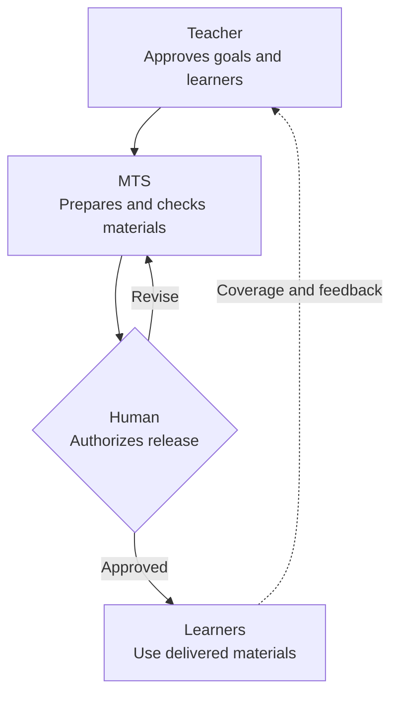

# MTS Learning, Practice & Assessment

```yaml
artifact_id: PRODUCT-MTS
artifact_type: product
station: M1
status: draft
version: 0.3
owner: MTS / Krishna Chaitanya
approvers: []
source_ids:
  - source-material/mts/ela/product/product-2026-11-05-v1.md
  - source-material/mts/ela/product/product-2026-11-07-v1.md
  - source-material/mts/math/product/product-2026-08-23-v1.md
  - source-material/mts/math/product/product-2026-11-06-v1.md
  - source-material/mts/math/product/product-2026-11-07-v1.md
requirement_ids: []
atomic_entity_ids: [INT-MTS-001, OUT-MTS-001, OUT-MTS-002, OUT-MTS-003, OUT-MTS-004, OUT-MTS-005]
delta_ids: []
supersedes: []
downstream_ids: [BUSINESS-ARCHITECTURE-MTS, ONTOLOGY-MTS, REQUIREMENT-VERIFICATION-MAPPING-MTS]
last_verified_against: []
```

## 1. Holistic Overview

**MTS helps teachers turn learning goals into trustworthy, age- and course-appropriate materials.** Teachers choose what students should learn; MTS supports preparation and independent review; a human authorizes publication.

The educational offering is **MTS Learning, Practice & Assessment**. The **Software Factory** is the reusable system that develops it and other products, not a limit to education.



Math and ELA are current subjects. The [portfolio](#3-portfolio-and-priorities) starts with curriculum, practice, answer support, source-based assessments and release controls. Standalone teaching/reference materials and diagnostics come later; learner analytics and SAT/ACT estimates are deferred.

Success means suitable scope, trustworthy answers, responsible sources, usable delivery and measurable improvement. [Outcome measures](#7-quality-and-outcome-measures) define those directions; targets require baselines.

**Status: Draft, not fully ratified.** Individual product decisions are preserved, but implementation/release maturity is unassessed. The quartet is not yet sufficient for full-product creation: subject criteria, profiles, exceptions and evidence remain [open](requirement-verification-mapping.md#gaps-and-next-decisions). Version 0.3 shortens presentation without changing scope or gates.

## Intent and Outcome Baseline

<a id="int-mts-001"></a>**INT-MTS-001:** Help teachers turn approved learning goals into trustworthy educational materials, improving preparation and learning through accountable review and feedback.

This document owns purpose, audience, portfolio and outcomes. [Business architecture](business-architecture.md) owns value delivery and rules; [ontology](ontology.md) owns meaning; [requirements and verification](requirement-verification-mapping.md) own completion conditions. Together they follow the [minimum sufficient intent model](strategy/ai-sdlc/ai-software-factory-intent-quartet-deepdive.md).

## 2. Audience, Inputs and Outputs

| Who | Need and value |
|---|---|
| Teachers / curriculum owners | Plan progression and prepare materials with less correction work |
| Students / families | Understand, practice and demonstrate learning with dependable explanations |
| Subject reviewers / release operators | Inspect quality evidence and deliver the authorized set |
| Future school/program partners | Adapt materials through explicit, approved variation |

**Inputs:** Learners/grade/course, objectives, period, curriculum/standards evidence, source permissions, purpose, artifacts, answer depth, profile and destination.

**Outputs:** Student/teacher materials, applicable answers or rubrics, source/selection records, verification, approval, publication, coverage and observations.

A run may cover a week, class, topic or source assessment. Editable/print-ready formats depend on the selected supported profile.

## 3. Portfolio and Priorities

| Priority | Offering and scope |
|---|---|
| Initial | Curriculum planning, progression, pacing evidence and released coverage |
| Initial | Math weekly/class worksheets and genuine reasoning |
| Initial | ELA reading, vocabulary, grammar, writing and integrated activities |
| Initial | Single-topic practice, homework, revision, remediation and enrichment |
| Initial | Keys, concise explanations, worked solutions, approved teacher methods, model responses and writing rubrics |
| Initial | Faithful or authorized transformed source-based mock tests and benchmarks |
| Initial | Accurate Math notation, graphs and diagrams |
| Initial | Provenance, independent quality review, human release approval and publication tracking |
| Later | Lesson plans, guided activities and standalone topic explanations |
| Later | Study notes, cheat sheets, formula sheets and language-rule references |
| Later | Short diagnostics and readiness checks |
| Deferred | Learner performance/error analysis and suggested next practice |
| Deferred | SAT estimates/interpretation and ACT estimates/interpretation |

Support explanations are initial even though standalone lessons are later. Source-based mocks are initial even though diagnostics are later. Curriculum/release tracking is initial; student-level analytics are not.

Priority is sequencing, not proof of maturity or implementation authority. Previously approved ELA scope is retained. Physics/Science are future possibilities, not current commitments.

## Functional Areas and Capabilities

The [business catalog](business-architecture.md#functional-areas-and-capabilities) groups capabilities into curriculum, content, practice/assessment, Ed Material production, release, and verification/improvement. It owns their definitions and decomposition.

Earlier product labels `MTS-C01` through `MTS-C16` correspond to `CAP-001` through `CAP-016` in this consolidated draft only; historical source IDs retain their own meanings.

## 4. Subject Scope and Pedagogy

| Subject | Required emphasis |
|---|---|
| Math | Grade/course progression; focused/current/spiral/reasoning (F/C/S/R) practice with run-specific counts, ratios and schedules. Review results, methods, units and assumptions; a requested method must not invalidate other correct methods. |
| Math representation | Preserve meaning across words, equations, tables, graphs and figures. Check grouping, labels, axes, scales, geometry and readability through extraction/editing/export; distinguish source figures from new illustrations. |
| ELA | Reading, vocabulary, grammar, writing; literary/informational prose and poetry as appropriate. Review suitability, source fidelity, passage evidence, line references, distractors and defensible interpretations. |
| ELA support | Contextual vocabulary, editing, composition, model responses and rubrics. Confirm the approved PQYA/YPQA method; writing/interpretation can admit several valid responses. |

## 5. Product Variation and Source Integrity

Each approved run selects learner context, objectives, period, purpose, source/transformation, artifact set, answer depth, presentation and destination.

Sources may be ready-made content, raw text/tests, teacher-authored, generated or hybrid. Transformations range from faithful reproduction and selection to permitted adaptation, synthesis and original authoring. Record origin/version, permissions and item-level lineage; identify generated/adapted content honestly. Missing or unauthorized sources require a decision, not silent substitution.

Run overrides do not become global defaults. Enabled grades are not automatically selected. Profiles own controlled counts, typography and formats; approval governs their applicability.

## 6. Presentation and Release

Use the approved subject/artifact profile, not a universal page limit. [Business rules](business-architecture.md#business-rules) own the exact ELA weekly target, Math weekly maximum and source-mock limits. [REQ-MTS-009](requirement-verification-mapping.md#req-mts-009) checks actual exports for readability, intact content, notation and correspondence.

Math retains **five distinct human checkpoints**: scope, content, verification, formatting and publication; see the [checkpoint flow](business-architecture.md#math-checkpoint-flow). ELA requires independent semantic/artifact review, mandatory QA and named human publication approval; detailed ELA checkpoints remain open.

Evidence/approval is revision-bound. Renew affected reviews after change. Certification or staging is not publication authority.

## 7. Quality and Outcome Measures

| Outcome | Agreed measure |
|---|---|
| <a id="out-mts-001"></a>OUT-MTS-001 Scope fidelity | Account for every approved objective/artifact, including authorized exceptions |
| <a id="out-mts-002"></a>OUT-MTS-002 Educational correctness | Independently review every released assessable item and answer/rubric for correctness and suitability |
| <a id="out-mts-003"></a>OUT-MTS-003 Source integrity | Record every external item's provenance/permission and preserve authorized fidelity/transformation |
| <a id="out-mts-004"></a>OUT-MTS-004 Artifact/release integrity | Check matching artifacts, required QA, human approval and actual destination |
| <a id="out-mts-005"></a>OUT-MTS-005 Improvement | Baseline preparation time, review effort, rework, escaped defects and learning outcomes before numerical targets |

Checks report pass, fail, unverified and justified exclusions/exceptions separately. Missing mandatory evidence blocks certification unless an applicable authorized exception permits it; human release approval remains required. Material-quality checks alone do not prove learning improvement.

## 8. Ownership and Product Boundaries

The product owner approves intent/priority; teachers and subject reviewers judge educational suitability; a named human approves release and an operator confirms delivery. Factory services support orchestration/versioning/evidence but do not own educational judgment.

MTS must not choose learning goals without teacher approval, publish unselected grades, bypass source rights, count self-review as independence or present unofficial estimates as official scores. Privacy, consent, retention, accessibility and detailed authorization remain requirements work.

## Product Information

The [ontology catalog](ontology.md#entity-catalog) defines the records behind a release: objective/audience, run/profile, source/transformation, selected content/support, verification/decision, release/coverage and observation/change. It owns their identities and relationships.

## 9. Maturity and Evidence

Assess each capability by subject, scope and version, with separate evidence for proposed, implemented, verified, released, observed and accepted states.

Historical sources claim comparatively mature Math weekly production, ELA reading production and Math mock formatting. These are not current verified assignments. November 6-7 Math documents cite a November 9 batch: resolve the date/evidence before relying on it.

## 10. Open Decisions and Next Work

Ratify the named product/release scope; reconcile shared/subject meaning and ownership; close subject/profile, exception and evidence gaps; inventory actual maturity; baseline effort and learning measures with privacy/consent controls. The [gap register](requirement-verification-mapping.md#gaps-and-next-decisions) tracks owners and affected gates.

## 11. Source Provenance

Historical inputs are preserved, not automatically authoritative:

- [ELA November 5 baseline](source-material/mts/ela/product/product-2026-11-05-v1.md): approved subject scope, print target and release authority.
- [ELA November 7 revision](source-material/mts/ela/product/product-2026-11-07-v1.md): proposed broader modes, sources and support.
- [Math August retrospective](source-material/mts/math/product/product-2026-08-23-v1.md): unapproved synthesis of requirements/design, including five gates.
- [Math November 6 candidate](source-material/mts/math/product/product-2026-11-06-v1.md) and [November 7 revision](source-material/mts/math/product/product-2026-11-07-v1.md): broader practice/assessment, visuals and proposed estimates.
- [Source inventory](source-material/README.md) and [factory strategy](strategy/ai-sdlc/ai-sdlc-software-factory-strategy.md): provenance and engineering method.
