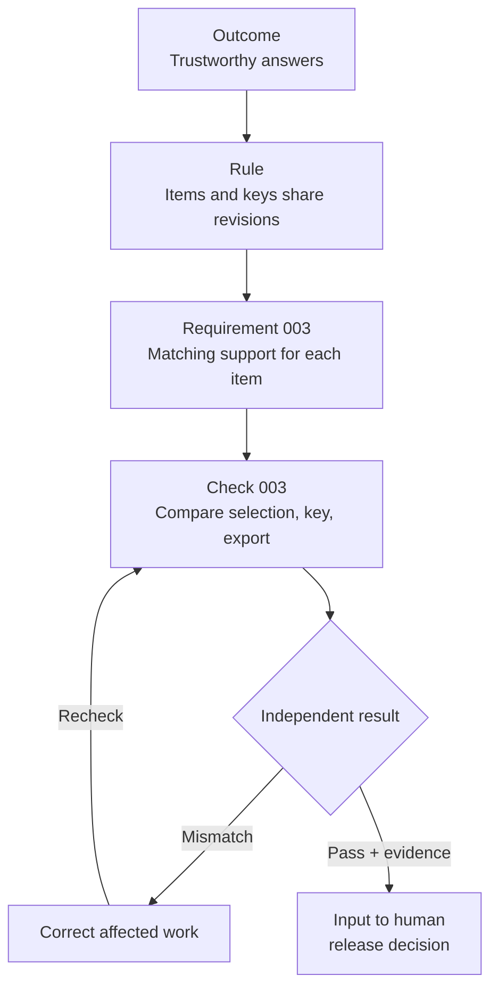

# MTS: Requirement-Verification Mapping

```yaml
artifact_id: REQUIREMENT-VERIFICATION-MAPPING-MTS
artifact_type: requirement-verification-mapping
station: M3
status: draft
version: 0.3
owner: MTS product owner / quality owner
approvers: []
source_ids: [PRODUCT-MTS, BUSINESS-ARCHITECTURE-MTS, ONTOLOGY-MTS, docs/requirements/assessment-mcq-quality.md]
requirement_ids: [REQ-MTS-001, REQ-MTS-002, REQ-MTS-003, REQ-MTS-004, REQ-MTS-005, REQ-MTS-006, REQ-MTS-007, REQ-MTS-008, REQ-MTS-009]
atomic_entity_ids:
  - AC-MTS-001.1
  - AC-MTS-002.1
  - AC-MTS-003.1
  - AC-MTS-004.1
  - AC-MTS-005.1
  - AC-MTS-006.1
  - AC-MTS-007.1
  - AC-MTS-008.1
  - AC-MTS-009.1
  - VG-MTS-001
  - VC-MTS-001
  - VC-MTS-002
  - VC-MTS-003
  - VC-MTS-004
  - VC-MTS-005
  - VC-MTS-006
  - VC-MTS-007
  - VC-MTS-008
  - VC-MTS-009
delta_ids: []
supersedes: []
downstream_ids: []
last_verified_against: []
```

## Holistic Overview

**This document says what MTS must do and what would prove it.** It connects [product outcomes](product.md#7-quality-and-outcome-measures), [business rules](business-architecture.md#business-rules) and [shared meaning](ontology.md) to requirements, acceptance conditions and independent checks.

Here is one concrete chain, not a claim of passing evidence:



**Status: Draft, not approved or executed.** Nine shared controls are mapped. Twelve capabilities have only partial design coverage, two are later and two deferred; see [coverage](#capability-coverage-and-disposition). Subject behavior, profiles, quality rubrics and authority gaps mean the quartet is not yet sufficient for full-product creation.

**Next decision:** Name the product/release creation scope and close its material gaps. A sufficient slice is not a sufficient whole product. Version 0.3 simplifies presentation; shared-control records remain draft v0.1.

## Requirement and Acceptance Catalog

These are the draft records' authoritative homes; existing catalogs remain pinned, accessible dependencies. Proposed requirement owner: product/domain owner, approval pending. Conditions apply to the approved run and subject/profile, without redefining source policy.

AC means **acceptance criterion**: the observable condition for accepting a requirement.

| Requirement / acceptance ID | Required condition | Governing trace |
|---|---|---|
| <a id="req-mts-001"></a>REQ-MTS-001 Scope / <a id="ac-mts-001-1"></a>AC-MTS-001.1 | Every selected objective/artifact is produced or has an authorized disposition; no excluded grade/course enters output | [OUT-001](product.md#out-mts-001), [CAP-001](business-architecture.md#cap-001), [BP-001](business-architecture.md#bp-001), [RULE-001](business-architecture.md#rule-001), [INV-001](ontology.md#inv-001) |
| <a id="req-mts-002"></a>REQ-MTS-002 Sources / <a id="ac-mts-002-1"></a>AC-MTS-002.1 | Every external unit has origin, permission and authorized transformation; fidelity-required content matches, with discrepancies resolved before release | [OUT-003](product.md#out-mts-003), [CAP-003](business-architecture.md#cap-003), [BP-003](business-architecture.md#bp-003), [RULE-002](business-architecture.md#rule-002), [INV-002](ontology.md#inv-002) |
| <a id="req-mts-003"></a>REQ-MTS-003 Correspondence / <a id="ac-mts-003-1"></a>AC-MTS-003.1 | Required support matches every selected item's identity/revision and reordered answer position; non-assessable material has explicit applicability | [OUT-002](product.md#out-mts-002), [CAP-007](business-architecture.md#cap-007), [BP-005](business-architecture.md#bp-005), [RULE-003](business-architecture.md#rule-003), [REL-009](ontology.md#rel-009) |
| <a id="req-mts-004"></a>REQ-MTS-004 Independent review / <a id="ac-mts-004-1"></a>AC-MTS-004.1 | Every applicable item/support receives revision-bound independent correctness/suitability review, findings and adjudication; self-review is insufficient | [OUT-002](product.md#out-mts-002), [CAP-013](business-architecture.md#cap-013), [BP-004](business-architecture.md#bp-004), [RULE-004](business-architecture.md#rule-004), [INV-004](ontology.md#inv-004) |
| <a id="req-mts-005"></a>REQ-MTS-005 Revision evidence / <a id="ac-mts-005-1"></a>AC-MTS-005.1 | Content/source/asset/profile changes identify dependent checks/decisions; stale results cannot satisfy changed revisions; affected reviews are renewed | [OUT-004](product.md#out-mts-004), [CAP-013](business-architecture.md#cap-013), [BP-006](business-architecture.md#bp-006), [RULE-005](business-architecture.md#rule-005), [INV-005](ontology.md#inv-005) |
| <a id="req-mts-006"></a>REQ-MTS-006 Release / <a id="ac-mts-006-1"></a>AC-MTS-006.1 | Applicable mandatory evidence, subject checkpoints and human decisions authorize the exact set; actual files/destination are reconciled; staging/certification is not publication authority | [OUT-004](product.md#out-mts-004), [CAP-014](business-architecture.md#cap-014), [BP-006](business-architecture.md#bp-006), [RULE-006](business-architecture.md#rule-006)/[007](business-architecture.md#rule-007)/[011](business-architecture.md#rule-011), [INV-007](ontology.md#inv-007) |
| <a id="req-mts-007"></a>REQ-MTS-007 Coverage / <a id="ac-mts-007-1"></a>AC-MTS-007.1 | Every coverage entry identifies objective/content and confirmed release; drafted/staged content does not count as delivered | [OUT-001](product.md#out-mts-001), [CAP-015](business-architecture.md#cap-015), [BP-007](business-architecture.md#bp-007), [RULE-012](business-architecture.md#rule-012), [REL-014](ontology.md#rel-014) |
| <a id="req-mts-008"></a>REQ-MTS-008 Improvement / <a id="ac-mts-008-1"></a>AC-MTS-008.1 | Material defect/change links symptom, root-cause evidence, owner, proposal, affected baseline, authorization, correction and regression, or explicit block; intent never changes silently | [OUT-005](product.md#out-mts-005), [CAP-016](business-architecture.md#cap-016), [BP-008](business-architecture.md#bp-008), [RULE-012](business-architecture.md#rule-012), [REL-015](ontology.md#rel-015) |
| <a id="req-mts-009"></a>REQ-MTS-009 Rendered usability / <a id="ac-mts-009-1"></a>AC-MTS-009.1 | Actual exports meet applicable profile/readability/semantic conditions without silent clipping, distortion or content loss; resolve conflicts before release | [OUT-004](product.md#out-mts-004), [CAP-011](business-architecture.md#cap-011)/[012](business-architecture.md#cap-012), [BP-005](business-architecture.md#bp-005), [RULE-008](business-architecture.md#rule-008)/[009](business-architecture.md#rule-009)/[010](business-architecture.md#rule-010) |

## Verification Catalog

VC means **verification criterion**: a check, its pass rule and required evidence.

<a id="vg-mts-001"></a>**VG-MTS-001 Shared integrity/release controls:** No parent group; risk is incorrect, unauthorized or untraceable delivery. Applies to selected runs; exclusions need recorded reasons. Groups organize reporting, not substitute for AC links.

All VCs are draft v0.1, release-blocking when applicable, with proposed quality owner and independent evaluator. Every result needs requirement/check versions, reviewed input/artifact hashes, method/oracle, actual evaluator, run/environment, findings and decision. Rubrics, formats and evaluator assignments remain incomplete.

| Check -> AC | Method / pass rule | Evidence focus / adverse cases |
|---|---|---|
| <a id="vc-mts-001"></a>VC-MTS-001 -> [AC-001.1](#ac-mts-001-1) | Reconcile contract/output; all obligations accounted for, zero unauthorized scope | Contract/manifest comparison; omitted objective, enabled-but-unselected grade, persisted override |
| <a id="vc-mts-002"></a>VC-MTS-002 -> [AC-002.1](#ac-mts-002-1) | Inspect lineage/permission and compare faithful text, values, options, scoring/assets; every applicable unit resolved | Source/version, authorization, findings; missing permission, substituted source, altered figure/value |
| <a id="vc-mts-003"></a>VC-MTS-003 -> [AC-003.1](#ac-mts-003-1) | Compare selected item/support revisions and option mappings; all match, no stale/orphan support | Selection/key/export comparison; reordered choices with stale key, removed item |
| <a id="vc-mts-004"></a>VC-MTS-004 -> [AC-004.1](#ac-mts-004-1) | Independent subject review against source/domain evidence and approved rubric; every applicable item reviewed, no unresolved blocking finding | Reviewer/role, rubric, uncertainty/adjudication; second defensible MCQ answer, fake/self-only review |
| <a id="vc-mts-005"></a>VC-MTS-005 -> [AC-005.1](#ac-mts-005-1) | Change reviewed inputs; reject all affected stale decisions/results until renewed, preserve unaffected evidence | Before/after revisions, impact and renewed decisions; source, key, figure or profile-only changes |
| <a id="vc-mts-006"></a>VC-MTS-006 -> [AC-006.1](#ac-mts-006-1) | Inspect mandatory evidence/gates and reconcile authorized/actual delivery; missing authority/evidence blocks absent applicable authorized exception | Named revision decisions, policy, destination; QA-only authority, bypassed Math gate, wrong files/destination |
| <a id="vc-mts-007"></a>VC-MTS-007 -> [AC-007.1](#ac-mts-007-1) | Join coverage to confirmed release/content; every counted entry has delivery | Coverage/release comparison; staged content or partial/failed delivery counted as complete |
| <a id="vc-mts-008"></a>VC-MTS-008 -> [AC-008.1](#ac-mts-008-1) | Inspect observation/cause/change/authority/regression chain; complete links/results or explicit block, never false completion | Baseline, hypothesis, attempts, authorization, regression; no progress, unapproved semantic change, weakened criterion |
| <a id="vc-mts-009"></a>VC-MTS-009 -> [AC-009.1](#ac-mts-009-1) | Inspect actual exports for profile, counts, legibility, notation, figures and intact content; satisfy conditions or authorized conflict resolution | Profile/export and independent visual/domain findings; clipping, lost glyphs, illegible scaling, inappropriate universal limit |

These are planned checks, not executed passes. ELA checkpoint/exception design, subject rubrics and controller runtime checks remain open.

## Capability Coverage and Disposition

Priorities follow the [product](product.md#3-portfolio-and-priorities). Numbers in the middle column are REQ-MTS suffixes. **Partial** means shared controls only, not capability completion.

| Capability | Mapped controls | Missing behavior/design |
|---|---|---|
| [CAP-001](business-architecture.md#cap-001) Scope | 001, 005, 006 | Partial: full contract/overrides |
| [CAP-002](business-architecture.md#cap-002) Progression | 001, 007 | Partial: prerequisites, standards, pacing/mix |
| [CAP-003](business-architecture.md#cap-003) Sources | 002 | Partial: permissions authority/unavailable sources |
| [CAP-004](business-architecture.md#cap-004) Authoring | 002, 004 | Partial: subject/source-mode transformation |
| [CAP-005](business-architecture.md#cap-005) Lessons/references | Shared controls on activation | Later: offering criteria |
| [CAP-006](business-architecture.md#cap-006) Practice/assessment | 001, 003, 004 | Partial: subject, format, difficulty/scoring |
| [CAP-007](business-architecture.md#cap-007) Support | 003, 004 | Partial: methods, explanations/writing rubrics |
| [CAP-008](business-architecture.md#cap-008) Diagnostics | Shared controls on activation | Later: validity/interpretation |
| [CAP-009](business-architecture.md#cap-009) Analytics | None active | Deferred: scope/privacy/outcomes before activation |
| [CAP-010](business-architecture.md#cap-010) Estimates | None active | Deferred: calibration/uncertainty/unofficial labels |
| [CAP-011](business-architecture.md#cap-011) Rendering | 003, 005, 009 | Partial: profile matrix/accessibility |
| [CAP-012](business-architecture.md#cap-012) Math visuals | 002, 004, 009 | Partial: notation/figure oracles and applicability |
| [CAP-013](business-architecture.md#cap-013) QA | 004, 005, 006 | Partial: reviewers/rubrics/exceptions/evidence |
| [CAP-014](business-architecture.md#cap-014) Release | 005, 006 | Partial: ELA gates, staging, partial delivery/recovery |
| [CAP-015](business-architecture.md#cap-015) Coverage | 001, 007 | Partial: curriculum/release identities |
| [CAP-016](business-architecture.md#cap-016) Improvement | 008 | Partial: baselines, outcome signals/controller integration |

### Existing MCQ Requirements Retain Their Home

[Assessment MCQ quality](docs/requirements/assessment-mcq-quality.md) owns ELA-ANS-DIST-016 and ELA-DISTRACTOR-017 thresholds/scope. They specialize CAP-006/007/013 and REQ-MTS-003/004, without renaming or supersession.

The initial review slice has [structural tests](tests/test_mcq_quality.py), but publishing integration and semantic adjudication remain gaps. Metadata validation cannot establish true independent semantic review. No execution, universal integration or release claim is added here.

## Completion and Evidence Accounting

Before execution, approve and pin a feature completion contract (FCC): INT/OUT and scope, requirement/check versions, mandatory thresholds, exceptions, regressions, evidence, human gates, outcome observations, budgets and stop/restart rules. None is instantiated by this draft.

Reports reference separate evidence records, not manual pass flags. Keep applicability, design, execution, verification, acceptance, release and observation distinct. Report NOT_APPLICABLE, NOT_DESIGNED, NOT_EXECUTED, BLOCKED, PASSED, FAILED, INCONCLUSIVE and authorized WAIVED. Define denominators from pinned scope; excluded/deferred or waived work is not passing work.

**Evidence state: Not assessed.** Nine AC/VC links are design linkage only, not proof of subject completeness or delivery.

## Gaps and Next Decisions

These are review gaps, not fabricated runtime failures. Owners are proposed, not yet assigned.

| Gap | Needed decision/design | Owner / affected gate |
|---|---|---|
| <a id="gap-intent-mts-001"></a>GAP-INTENT-MTS-001 | Name/ratify creation scope and quartet meaning, distinct from execution slice | Product/domain owner / intent sufficiency |
| <a id="gap-intent-mts-002"></a>GAP-INTENT-MTS-002 | Subject behavior: F/C/S/R, reasoning, ELA methods/rubrics, scoring, adverse cases | Subject/curriculum owner / REQ/AC/VC readiness |
| <a id="gap-intent-mts-003"></a>GAP-INTENT-MTS-003 | ELA gates, waiver authority, separation of duties, Math placement/publication | Product/release/quality / approval and release |
| <a id="gap-intent-mts-004"></a>GAP-INTENT-MTS-004 | Profiles, readability/accessibility quality scenarios, oracles, evidence/revision contracts | Domain/quality / verification validity |
| <a id="gap-intent-mts-005"></a>GAP-INTENT-MTS-005 | Privacy, retention, consent, source authorization, partial-delivery/recovery constraints | Product/quality/release / data operations and release |
| <a id="gap-intent-mts-006"></a>GAP-INTENT-MTS-006 | Actual implementation/release inventory and November 9 provenance conflict | Slice/release / maturity and reuse |
| <a id="gap-intent-mts-007"></a>GAP-INTENT-MTS-007 | Effort/defect/learning baselines, observation methods and validation owners | Product/curriculum / outcome targets |
| <a id="gap-intent-mts-008"></a>GAP-INTENT-MTS-008 | Approved FCC, budgets/state, validator/publishing integration and independent bounded repair | Slice/factory/quality / execution loops |

Resolve the smallest blocking gap incrementally. Apply the [creation/completion/removal/change tests](strategy/ai-sdlc/ai-software-factory-intent-quartet-deepdive.md#how-to-test-minimum-and-sufficiency) to the whole named scope; a slice pass does not close wider gaps. Use [L1/L2/L3 routing](strategy/ai-sdlc/ai-sdlc-software-factory-strategy.md#3d-closed-loop-convergence-and-recovery) without weakening criteria or human authority.
