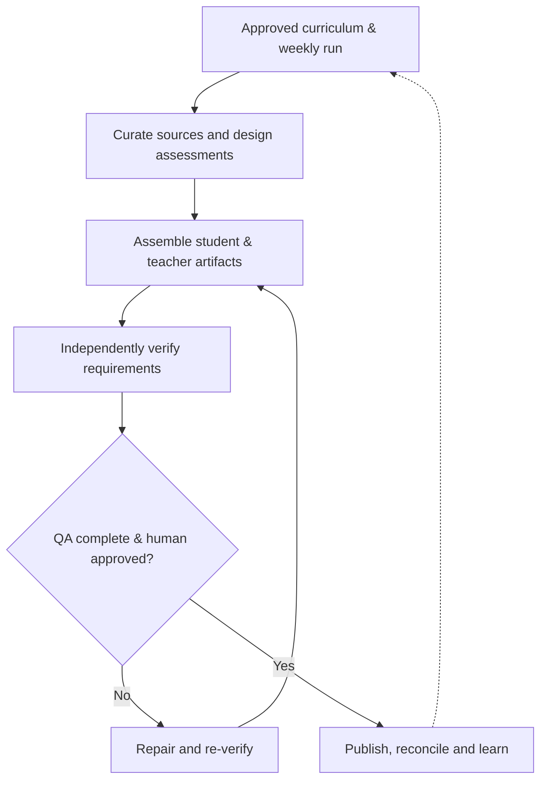

# MTS ELA Worksheet Generation — Business Architecture

> **Status:** Proposed architecture baseline for review · **Version:** 0.1 · **Date:** 2026-11-05  
> **Owner:** MTS / Krishna Chaitanya · **Parent:** [PRODUCT.md](PRODUCT.md)  
> **Scope:** Reading comprehension, vocabulary, grammar and writing; RC is the first mature implementation.  
> **Governance:** Two-page print target with legibility priority; independent QA; named human approval before release.

## 1. Business architecture on one page

**Plain-English model:** The curriculum owner decides what to teach. The product finds suitable source material, constructs educational exercises, checks both the content and printed pages independently, gets human approval, publishes the approved pair, and learns from every run.

| View | Question answered | ELA example |
|---|---|---|
| **Value stream** | How does value reach the teacher/student? | Approved plan → verified worksheet and teaching key |
| **Functional area** | Who/what kind of work owns the ability? | Content & Assessment |
| **Capability** | What must we be consistently able to do? | Verify source fidelity |
| **Process** | In what sequence is work done? | Source selection → transcription check → approval |
| **Business rule** | What condition must always hold? | Referenced source location must be recorded |
| **Requirement / test** | How do we specify and prove it? | Atomic AC → independent test → evidence |

**Business outcome:** Improve reading, language and writing skills while reducing weekly production effort, missing requirements and released defects. Achievement is measured using the product outcome metrics in `PRODUCT.md`.

## 2. Value streams and boundaries

| ID | Value stream | Trigger → terminal value | Primary users |
|---|---|---|---|
| **VS-01** | **Curriculum-to-Classroom Materials** | Approved weekly scope → human-approved, verified worksheet/key published | Curriculum owner, teacher, student |
| **VS-02** | **Delivery-to-Improvement** | Released materials / observations → updated coverage, requirements and regression checks | Curriculum owner, QA reviewer |

VS-02 closes the improvement loop and may begin with an observed defect before publication. Source rights/provenance, QA evidence and release authorization are mandatory controls inside VS-01, not separate value streams.

## 3. Functional areas and capability catalog

These IDs are intentionally stable and named by enduring business ability. A capability can support multiple value streams; process ownership need not match its reporting group.

| Functional area | Capability ID | Capability | Value stream(s) | Product link |
|---|---|---|---|---|
| **FA-01 Curriculum Management** | **ELA-C01** | Define and approve weekly run scope | VS-01 | Product C01 |
| FA-01 | **ELA-BA-C02** | Track grade, genre and skill coverage | VS-01, VS-02 | Product C08 |
| **FA-02 Content & Assessment** | **ELA-C02** | Curate source-faithful passages and provenance | VS-01 | Product C02 |
| FA-02 | **ELA-C03** | Design grade-appropriate assessments across ELA domains | VS-01 | Product C03 |
| FA-02 | **ELA-C04** | Provide evidence-based teaching explanations and keys | VS-01 | Product C04 |
| **FA-03 Worksheet Production** | **ELA-BA-C06** | Synchronize student/key artifacts from one selection manifest | VS-01 | Product C05, C07 |
| FA-03 | **ELA-C05** | Produce readable, print-ready pages | VS-01 | Product C05 |
| **FA-04 Quality & Release** | **ELA-C06** | Independently verify educational and artifact quality | VS-01 | Product C06 |
| FA-04 | **ELA-BA-C09** | Authorize release and record decision | VS-01 | Product C06, C07 |
| FA-04 | **ELA-C07** | Publish and verify authorized artifact pairs | VS-01 | Product C07 |
| **FA-05 Learning & Improvement** | **ELA-C08** | Reconcile released curriculum coverage and observations | VS-02 | Product C08 |
| FA-05 | **ELA-BA-C12** | Convert defects into requirement deltas and regression checks | VS-02 | Product C08 |

**ID convention:** Existing `ELA-C01…ELA-C08` IDs retain their product meaning. New `ELA-BA-Cxx` identifiers distinguish supplementary architecture capabilities without renumbering the approved product baseline. The catalog is a draft for human review, not a newly approved requirement set.

**Reusable factory vs. ELA domain:** Curriculum management, passage fidelity, question semantics and teaching explanations are domain abilities. Orchestration, document rendering engine, artifact storage, telemetry, generic test runners and publication connectors are shared factory services. The ELA product still owns the business rules for what constitutes a valid worksheet and key.

## 4. Essential business process flows

| Process ID | Process | Entry → exit | Key capabilities |
|---|---|---|---|
| **P-01** | Approve run intake | Weekly request → dated, grade-scoped approved contract | ELA-C01 |
| **P-02** | Curate and author | Approved contract → source manifest, assessments and explanations | ELA-C02–C04 |
| **P-03** | Assemble paired artifacts | Canonical selection manifest → PDFs and key with matching IDs | ELA-BA-C06, ELA-C05 |
| **P-04** | Independently verify | Generated outputs → criterion-by-criterion evidence and gate outcomes | ELA-C06 |
| **P-05** | Human-authorize and publish | Passing mandatory gates → recorded approval, verified release or blocked exception | ELA-BA-C09, ELA-C07 |
| **P-06** | Reconcile and learn | Released manifest and observations → updated tracker and regression backlog | ELA-C08, ELA-BA-C12 |

**Exception path:** Any mandatory failed or unverified criterion blocks final release. A permitted policy exception requires explicit justification and human decision; it is never silently interpreted as PASS. If the reviewer requests changes, P-03/P-04 rerun and evidence is refreshed.

## 5. Business rules — illustrative baseline

Rules below express business constraints; implementation details and full acceptance criteria belong in `requirements.md`. EARS-style wording is used where an event makes the obligation clear.

| Rule ID | Rule | Verify through |
|---|---|---|
| **BR-01** | When a weekly run is initiated, the product shall use only grades explicitly approved as GENERATE. | Scope-manifest comparison |
| **BR-02** | When a passage is selected, the product shall record its source, location, excerpt bounds and permitted-use status. | Provenance evidence |
| **BR-03** | When questions are assembled, the product shall generate student and teacher artifacts from the same canonical selected-question identifiers. | Manifest parity |
| **BR-04** | When a source contains line-based references, the product shall verify cited line references against the actual presented passage. | Text/layout source comparison |
| **BR-05** | When a worksheet or key exceeds the two-page target, the product shall preserve readability and record the exception for review. | PDF inspection and exception |
| **BR-06** | If mandatory QA evidence is absent or any critical check fails, release shall be blocked pending resolution. | Gate ledger |
| **BR-07** | When all mandatory QA gates pass, publication shall still require a named human release decision. | Sign-off audit record |
| **BR-08** | When a release is confirmed, the coverage tracker shall reflect released—not merely generated—materials. | Release/tracker reconciliation |
| **BR-09** | When a defect is accepted, it shall be linked to corrective action and a regression verification where feasible. | Observation ledger |

These draft rules must be reconciled with existing grade-specific and domain-specific policy before adoption. Quantitative question quotas and source-selection constraints remain versioned *run configuration*, never assumed universal rules.

## 6. Traceability and quality contract

`Business Outcome → VS → FA / Capability → Process + Business Rule → Requirement → Acceptance Criterion → Verification Criterion → Test Case → Evidence → QA Gate → Release`

**Example: missing vocabulary questions**

| Level | Example |
|---|---|
| Value stream | VS-01 |
| Capability | ELA-C03, ELA-C06 |
| Process / rule | P-02, P-04; configured question-type quota |
| Proposed requirement | R2: Enforce approved type distribution |
| Proposed acceptance criterion | Count of qualifying vocabulary-in-context questions equals the approved per-passage quota |
| Verification | Independently classify/count manifest questions and compare to configuration |
| Evidence | Expected count, actual count, question IDs, pass/fail |
| Release implication | Missing quota = failed content gate; cannot publish without resolved disposition |

QA reports distinguish **PASS, FAIL, NOT VERIFIED, NOT APPLICABLE and OUT OF SCOPE**. Out-of-scope grades are excluded from the active denominator and shown separately. A zero-failure total does not imply success if mandatory checks remain unverified.

## 7. Decisions and next drill-down

**Carry-forward approved product decisions:** All ELA domains; two-page target not hard maximum; human release authority after independent verification.

**Pending architecture decisions for review:**

1. Confirm the two value streams and five functional areas.
2. Confirm or adjust the new `ELA-BA-Cxx` capability boundaries and ownership.
3. Decide whether the capability catalog should eventually be shared across Math and ELA for common educational capabilities, while retaining domain-specific rules.

**Next specification: R1 — Curriculum & Run Intake.** Define weekly-run entities, active grade selection, objectives, source constraints, assessment quotas, exception handling, sign-off and explicit out-of-scope treatment. Assign atomic requirement/acceptance IDs and map each to `ELA-C01`, P-01, BR-01, G0 and independently inspectable evidence. Continue with R2–R5 only after the R1 run contract is reviewable.

---

**Architecture reference:** User-provided `business-architecture.md` example (value streams, business functions, capabilities, processes and EARS rules); adapted to avoid excessive hierarchical decomposition and to preserve existing MTS product IDs.