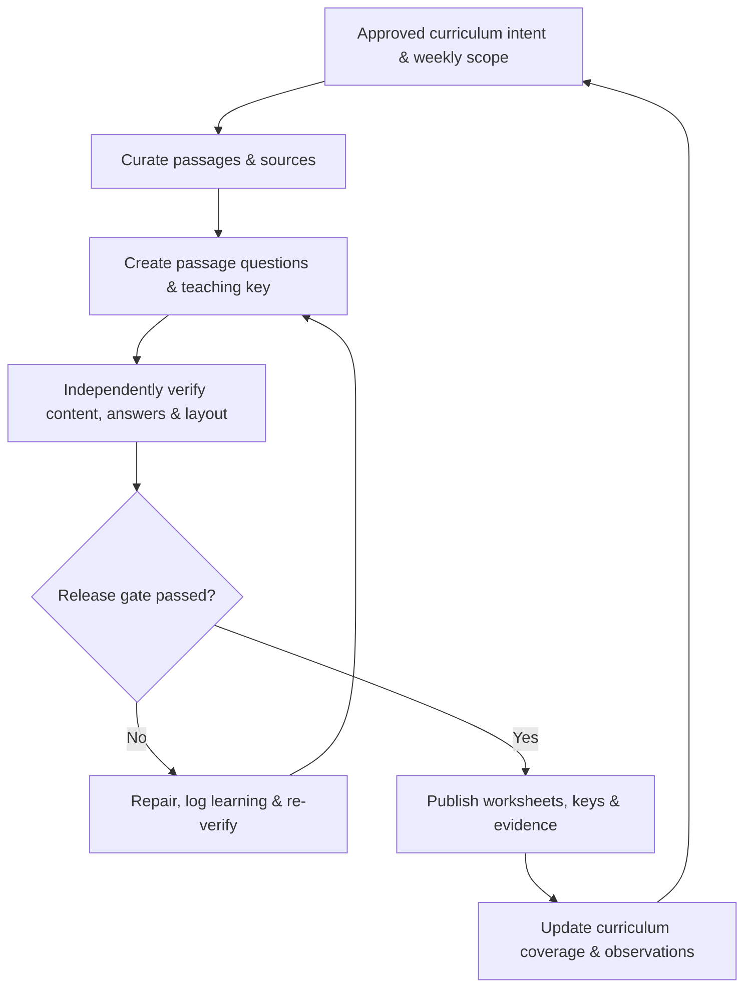
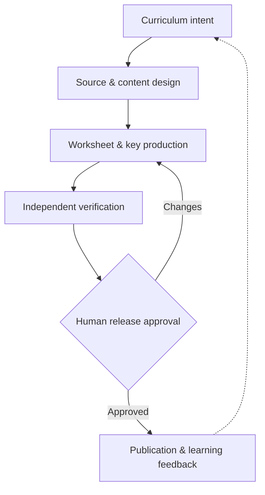

# MTS ELA Worksheet Generation — Product Definition

> **Status:** Product baseline approved · **Version:** 1.1 · **Date:** 2026-11-05  
> **Owner:** MTS / Krishna Chaitanya · **Boundary:** ELA-specific product built on reusable Software Factory capabilities
> **Approved product decisions:** All ELA domains in scope; two-page pagination is a target subject to legibility; human-authorized release after QA.

## 1. The product on one page

### One-sentence promise

**Turn an approved weekly ELA curriculum plan into classroom-ready, source-faithful worksheets and teaching keys—then prove that every published artifact meets the approved intent.**

**The Feynman explanation:** Imagine a small textbook publisher. A teacher chooses what children should learn; an editor chooses suitable reading; a question writer checks understanding; a separate proofreader checks the questions and answers; a printer checks the pages; and a librarian records what was published. This product makes that whole chain repeatable and inspectable.

| Why it exists | Who it serves | Value delivered |
|---|---|---|
| Weekly manual work, inconsistent quality, missing requirements, pagination defects, key mismatches, and weak audit trails | **Primary:** MTS curriculum owner/teacher. **Secondary:** students, reviewers, publishers, future workflow operators | Better reading comprehension and vocabulary transfer; predictable weekly production; fewer defects; traceable evidence; less rework |

### End-to-end product picture

**What goes in:** week/date, explicitly selected grades, curriculum objectives, passage/source constraints, approved assessment design, typography/layout policy, publication destination.  
**What comes out:** per-grade student PDF, synchronized teacher-key PDF, selection/source manifest, drill-down QA report, machine-readable verification evidence, publication record, updated curriculum register and learnings.

### Product outcomes (targets to ratify, not measured achievements)

| Outcome | Proposed measure / target |
|---|---|
| Correctness | **100%** of released questions have a verified correct answer, passage evidence and unambiguous wording |
| Intent coverage | **100%** of active, in-scope acceptance criteria have passing evidence or explicit approved exceptions; no silent omissions |
| Publication integrity | **100%** of released worksheet/key pairs match the approved manifest and remote files open correctly |
| Print usability | Student worksheet and teacher key each target **2 pages**, without clipping, illegible shrinking or forced truncation |
| Repeatability | Every run produces a stable run ID, versioned inputs, artifacts, gate decision and reviewable QA record |
| Efficiency | Track elapsed time, human review time, correction loops and escaped defects; baseline first, then set improvement goals |

### Business architecture — the value-delivery map

A **value stream** follows the value a teacher receives; a **capability** names an enduring ability; a **process** describes the order in which work happens. Business functions group related responsibilities. These are complementary views, not a rigid hierarchy.

| Functional area | Core business capabilities | Value contributed |
|---|---|---|
| **FA-01 Curriculum Management** | Define weekly scope; track grade/skill coverage | A clear learning contract |
| **FA-02 Content & Assessment** | Curate sources; design RC, vocabulary, grammar and writing assessments; explain answers | Suitable, defensible learning content |
| **FA-03 Worksheet Production** | Assemble synchronized worksheet/key; make print-ready artifacts | Usable classroom materials |
| **FA-04 Quality & Release** | Verify intent, semantics and print; document evidence; authorize release | Trustworthy published output |
| **FA-05 Learning & Improvement** | Reconcile coverage; capture observations; prevent regressions | Better future runs |

**Cross-cutting factory services:** execution orchestration, artifact storage, logging, reusable QA utilities and publishing integrations support these ELA capabilities without becoming ELA-specific business functions. The full value-stream, capability and process map lives in [`business-architecture.md`](business-architecture.md). Detailed rules and testable contracts live in `requirements.md`.

## 2. Product boundaries and decisions

### In scope

1. **Plan:** read the authoritative Curriculum Manager/Weekly Matrix; confirm week, grade scope, skills, reading genres and special instructions.
2. **Source:** identify, verify and preserve passage attribution, exact source location, authorized use and continuity.
3. **Author:** adapt/select passages; compose grade-appropriate reading comprehension, vocabulary, grammar, writing and assessment items as specified for that run; produce answer explanations and evidence. Reading comprehension is the first mature product line; the same product contract extends to other ELA lines as their configurations and verification rubrics are approved.
4. **Assemble:** synchronize student questions and teacher-key selections from **one canonical question manifest**; apply print templates and filenames.
5. **Verify:** perform mechanical tests, independent content/answer review, source and line-reference checks, PDF text extraction and visual inspection; report pass/fail/not-verified/out-of-scope separately.
6. **Release:** publish only approved artifacts, verify destination files, update curriculum and coverage registers, archive evidence and feed defects back into regression tests.

### Not the product's responsibility

- Replacing the teacher's choice of curriculum goals or final educational judgment.
- Automatically declaring a subjective interpretation correct without passage evidence and review.
- Publishing grades not explicitly marked **GENERATE** for the run.
- Building the whole general-purpose Software Factory inside this ELA product; shared orchestration, observability and release infrastructure belong to the factory platform.

### Principles / non-negotiables

| Principle | Practical rule |
|---|---|
| Curriculum is the contract | No grade or skill is inferred into release scope; distinguish **out of scope** from **unverified** |
| Evidence before confidence | A plausible question/key is not a verified one; independent answer and ambiguity checks must inspect source evidence |
| One source of selection truth | Student PDF, teacher key, QA and publication manifest reference the same selected question IDs |
| Print is part of correctness | Check actual exported PDFs, not only source markup; legibility beats arbitrary page-count compression |
| Human accountable, automation helpful | Humans approve intent and exceptions; deterministic checks enforce objective conditions; specialized review handles meaning |
| Learning closes the loop | Every escaped or recurring defect maps to a requirement delta, corrective action and regression verification |

## 3. Capabilities and product-level acceptance contract

| ID | Capability / user story | Product acceptance condition (summary) |
|---|---|---|
| **ELA-C01** | As curriculum owner, specify a weekly run | Week, scope, objectives, source constraints and print policy captured and approved before generation |
| **ELA-C02** | As content curator, select faithful passages | Source title, location, excerpt boundaries, attribution and usage status recorded; text checked against source |
| **ELA-C03** | As author, build rigorous grade-appropriate assessments | Genre, length, question types/counts, difficulty, distractor quality and vocabulary quotas follow **versioned per-grade configuration** |
| **ELA-C04** | As teacher, receive a useful key | Each selected question has answer, evidence, explanation and appropriate analytical method; poetry uses enhanced PQYA/YPQA-style analysis per approved rubric |
| **ELA-C05** | As student, receive readable print pages | Approved font/layout, no blank overflow pages, clipping, truncation, orphaned choices or excessive whitespace; two pages each for student/key are preferred, while legibility takes priority; exceptions are logged and human-approved |
| **ELA-C06** | As reviewer, trust the release | Every applicable criterion traces to test/evidence; no critical failures or unverified mandatory checks at final release gate |
| **ELA-C07** | As publisher, retrieve the right files | Canonical dated filenames, paired key, verified remote publication, release manifest, recoverable version history and recorded human release approval |
| **ELA-C08** | As planner, learn from each week | Coverage tracker reflects **released**, not merely drafted, material; observations produce owner, action and regression check |

### Run-specific policy examples (configuration, not universal product rules)

- Recent Grades **4 and 6** reading-comprehension runs call for poetry plus prose, with specified passage lengths, 8–10 A–D items per passage and exactly two vocabulary-in-context questions; consult the approved weekly configuration for the precise numbers.
- Student and key PDFs target **two pages each**, not an inflexible maximum. If readability conflicts with pagination, surface an exception for human approval rather than shrinking or dropping content silently.
- Canonical names currently follow `MTS-ELA-RC-{Grade}-WeeklyWorksheet-YYYY-MM-DD.pdf` and `...-KEY.pdf` for applicable RC products.
- QA presentation: **expandable, human-readable report** (preferred) + printable PDF (secondary) + structured JSON evidence. Explicitly separate PASS, FAIL, NOT VERIFIED, NOT APPLICABLE and OUT OF SCOPE.

## 4. Quality gates and traceability

| Gate | Question it answers | Minimum evidence |
|---|---|---|
| **G0 Intent ready** | Do we know exactly what to make? | Approved week/grades, objectives, constraints, acceptance baseline |
| **G1 Content ready** | Did we use the right sources and write the right assessment? | Passage provenance, question manifest, genre/coverage checks |
| **G2 Semantics verified** | Are answers defensible and choices fair? | Independently reviewed answers, text evidence, ambiguity and distractor review |
| **G3 Print verified** | Are both exported PDFs correct and usable? | Extracted PDF checks, page/typography tests, visual inspection |
| **G4 Release verified** | Is the approved pair actually published and registered? | Artifact hashes/IDs, remote-open check, tracker reconciliation and release decision |

**Trace chain:** `Outcome → Value Stream → Capability → Process/Rule → Requirement → Acceptance Criterion → Verification Criterion → Test Case → Evidence → Gate Decision → Released Artifact`. Each item receives a stable ID. A **QA criterion** is a report checklist row, not a replacement for its parent acceptance criterion. The release gate blocks if mandatory evidence is absent, even when observed failures are zero.

## 5. Product information model and ownership

| Product entity | Meaning | Source of truth |
|---|---|---|
| Weekly Run | The dated, scoped production request | Approved run manifest |
| Curriculum Objective | What the student should learn | Curriculum Manager |
| Passage Source | Where reading text originated | Source/provenance register |
| Question + Answer | Single assessable item with evidence | Question bank + canonical selection manifest |
| Verification Result | Status, test, reviewer, evidence, timestamp | QA evidence ledger |
| Release | Exactly what was approved and published | Immutable release manifest |
| Observation / Requirement Delta | What to improve next time | Learning/backlog register |

**Decision rights:** Product owner approves learning goals, scope, exceptions and release policy; curriculum/ELA reviewer approves educational quality; automated validators check reproducible facts; **a named human authorizes each release after mandatory QA gates pass**; release operator verifies publication. The same AI generation pass cannot count as its own independent semantic verification. Full automatic publication is not authorized by this baseline.

## 6. Ratified decisions and next drill-downs

| Decision | Approved baseline |
|---|---|
| Product scope | **All ELA**: reading comprehension, vocabulary, grammar and writing. RC is the first mature implementation. |
| Pagination | **Two-page target** for student worksheet and separate answer key; legibility wins, with documented human approval for exceptions. |
| Release authority | **Human approval required** after QA; gates passing alone never trigger publication. |

**Detailed policies to resolve in requirements:** permitted waiver classes for unavailable checks; source-use approval rubric; per-domain assessment rubrics; release approver identity and audit record.

**Drill-down documents (separate from this product brief):** `business-architecture.md` (value streams, functional areas, capabilities and processes); `requirements.md` (stories and atomic acceptance criteria); `ela-policy.yaml` (grade/week variations); `workflow.md` (stations and orchestration); `verification-plan.md` (test taxonomy and evidence); `release-gates.md`; `data-model.md`; `observations-and-learnings.md`; `ADRs/` (decisions and trade-offs).

### Next: requirements.md, in five reviewable slices

| Order | Requirements slice | First acceptance-criteria examples |
|---|---|---|
| **R1** | Run intake and curriculum contract | Explicit `GENERATE` grades; dated scope; measurable skill/genre/format coverage; out-of-scope isolation |
| **R2** | Content and assessment authoring | Source fidelity; grade/domain-specific item quotas; distractor quality; independent key evidence; domain rubrics |
| **R3** | Artifact assembly and print | Canonical selected-question manifest; synchronized keys; dated naming; two-page target; extraction and visual QA |
| **R4** | QA, release and traceability | AC → verification → test → evidence; PASS/FAIL/NOT VERIFIED/OUT OF SCOPE; blocked mandatory checks; human sign-off; verified publication |
| **R5** | Curriculum tracking and learning loop | Released-content reconciliation; recorded defects; requirement deltas; regression tests; rerun reproducibility |

Each slice should define user stories, uniquely identified **atomic acceptance criteria**, evidence-producing test methods, boundary cases, and the associated release gate. The first implementation-ready step is **R1**, because every downstream verification depends on the approved weekly contract.

---

### Design references

- Existing MTS ELA workflow, release gates, QA lessons and recent weekly-run decisions (product-specific baseline).
- [Atlassian — Product Requirements Document](https://www.atlassian.com/agile/product-management/requirements): goals, scope, user stories, assumptions and measures.
- [GitHub Spec Kit — Specification Template](https://github.com/github/spec-kit/blob/main/templates/spec-template.md): testable requirements, scenarios and measurable success criteria.
- MTS AI-SDLC Software Factory Strategy: separation of product intent from implementation detail and evidence-driven release.