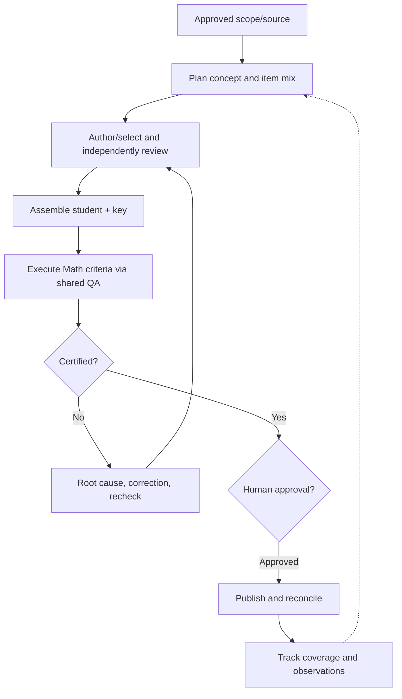
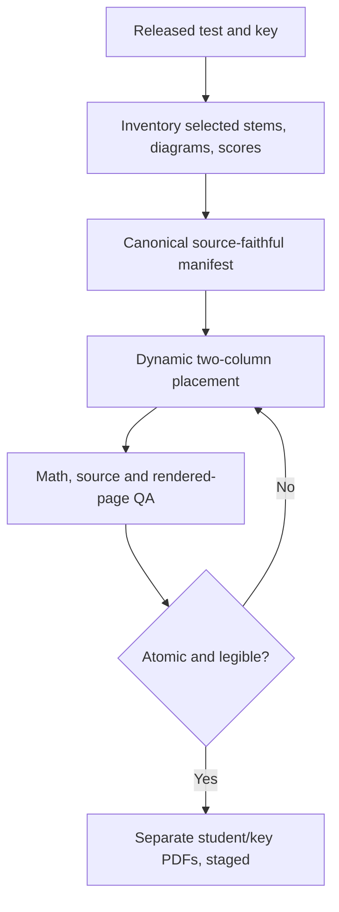

# MTS Math — Business Architecture

> **Status:** Finalized review candidate; not approved or committed · **Version:** 1.0-rc1 · **Date:** 2026-11-06  
> **Boundary:** Math-specific value delivery, independent of implementation tools. Shared QA infrastructure remains a factory service.

## 1. Business outcome and value streams

**Outcome:** A teacher can direct a Math learning or assessment need and receive independently verified, printable, human-approved materials—with a closed feedback loop.

| ID | Value stream | Trigger → realized value | Main customer |
|---|---|---|---|
| VS-01 | Curriculum/Source-to-Verified-Material | Approved weekly curriculum or source test → certified student/key pair → human-authorized delivery | MTS teacher and students |
| VS-02 | Observation-to-Improved-Learning-Production | Coverage/defect/feedback observation → governed delta and regression → better next run | MTS curriculum/product owner |

## 2. Functional areas and enduring capabilities

| Area | Capability ID | Business capability | Value stream |
|---|---|---|---|
| FA-01 Curriculum & Learning Design | CAP-01 | Resolve authorized curriculum scope and run contract | VS-01 |
| FA-01 | CAP-02 | Model prerequisite/current/future Math progression and standards | VS-01, VS-02 |
| FA-02 Math Content & Assessment | CAP-03 | Allocate daily and weekly assessment mix | VS-01 |
| FA-02 | CAP-04 | Author/select suitable Math questions | VS-01 |
| FA-02 | CAP-05 | Independently verify mathematical solutions | VS-01 |
| FA-02 | CAP-06 | Qualify nonroutine reasoning and puzzles | VS-01 |
| FA-02 | CAP-07 | Preserve external test source fidelity | VS-01 |
| FA-03 Material Production | CAP-08 | Assemble synchronized student and teacher artifacts | VS-01 |
| FA-04 Quality & Release | CAP-09 | Certify against executable Math verification criteria | VS-01 |
| FA-04 | CAP-10 | Govern human authorization and release reconciliation | VS-01 |
| FA-05 Learning & Improvement | CAP-11 | Reconcile curriculum coverage and repetition | VS-02 |
| FA-05 | CAP-12 | Diagnose observations and prevent regressions | VS-02 |

**Not a rigid containment hierarchy:** Value streams describe value movement; functional areas group responsibilities; capabilities describe durable business abilities; processes instantiate behavior; rules constrain behavior. A capability may support multiple value streams.

## 3. Process catalog and capability mapping

| Process | Name | Capabilities | Input → output / decision |
|---|---|---|---|
| BP-01 | Intake and preflight | CAP-01 | Request, current curriculum/config → explicit approved grade/week contract; conflict blocks |
| BP-02 | Curriculum progression mapping | CAP-02 | Pacing, standards, concept graph → focused/current/spiral targets |
| BP-03 | Question allocation | CAP-03 | Grade counts and F/C/S/R proportions → integer per-day mix with stable item slots |
| BP-04 | Question authoring/selection | CAP-04, CAP-07 | Plan or source manifest → canonical question set and preliminary solutions |
| BP-05 | Independent Math and reasoning review | CAP-05, CAP-06 | Canonical items → independently verified answers, R verdicts, issues |
| BP-06 | Source assessment transformation | CAP-07, CAP-08 | Selected paper/questions/key → faithful manifest and diagram-safe layout plan |
| BP-07 | Template-based artifact assembly | CAP-08 | Reviewed item set, approved master revisions → student/key PDFs |
| BP-08 | Hierarchical QA certification | CAP-09 | Actual PDFs, contract, review evidence → grade-wise checks, status, evidence, hashes |
| BP-09 | Gate decision and publication | CAP-10 | Certified approved set → publication records, remote validation or rejection |
| BP-10 | Coverage and observation loop | CAP-11, CAP-12 | Released items, defects, parent/teacher feedback → updated tracker, delta, regression |

### BP-01–BP-09: weekly path

1. Read governing instructions, `design.md`, Math configuration, approved grade matrix and template manifest. Resolve explicit grades only; keep out-of-scope grades separate.
2. Resolve progression through stable concept backbone, district pacing and NC standards, validating cache freshness when required.
3. Derive quotas by largest remainder, rotate ties using recorded run state, distribute across weekdays and interleave F/C/S/R. Reconcile totals before item creation.
4. Create one canonical, grade-aware item specification (ID, day, category, prompt, answer, standard/objective and needed assets).
5. Independently verify every solution and every R item; preserve named evidence. Edits invalidate the affected prior review and all dependent gates.
6. Apply versioned weekly/class template pair correctly; regenerate both student and key from the same spec.
7. Inspect rendered final PDFs mechanically and visually. Execute shared QA registry with Math domain rules and independent-review evidence.
8. Present gates according to configuration. Final certification remains separate from the explicit human approval to publish.
9. Publish exactly the authorized complete set, validate names, MIME types, folder parent and file IDs, and record release/coverage.

### BP-06: source-based mock-test variation

The four-page ceiling is a **maximum, not a target**. Full-width placement is allowed when necessary. For diagram assets, preserve vectors, measure complete labels/ink bounds, add 6 pt clearance and use 75% initial scaling with a 70% minimum. No split, clipping, answer leakage or unnecessary work boxes. The source identity remains concise; publisher navigation is removed. Any missing official answer or uncertain reconstruction blocks source-fidelity certification until resolved.

## 4. Business rules and variation points

| ID | Rule | State |
|---|---|---|
| RULE-001 | Only grades explicitly included in the approved run contract may be generated/released | Established |
| RULE-002 | Counts, weekday quotas, worksheet type and template profile must agree across approved contract/config/spec | Established |
| RULE-003 | Weekly F/C/S/R allocation uses an approved ratio and integer reconciliation, with categories interleaved daily | Established |
| RULE-004 | Every R item must pass independent semantic assessment; numeric labeling alone never suffices | Established |
| RULE-005 | Every question and teacher answer must match by stable identity, day and ordering | Established |
| RULE-006 | Changed question content invalidates related answer/reasoning verification and downstream gates | Established |
| RULE-007 | Changed master or print contract invalidates affected rendering and visual QA | Established |
| RULE-008 | Mandatory FAIL or NOT VERIFIED blocks QA certification; SKIPPED requires reason and authorized policy | Established |
| RULE-009 | Out-of-scope grades must be presented separately and excluded from active QA denominators | Established |
| RULE-010 | No staging or QA status constitutes human authorization to publish | Established |
| RULE-011 | Source-based mock-test items preserve source values, notation, choices, scoring and complete diagrams | Established |
| RULE-012 | Publication is complete only when exact authorized PDF pairs and remote parent/IDs are reconciled | Established |
| RULE-013 | Delivered curriculum tracking records released rather than merely drafted items | Proposed uniform formalization |
| RULE-014 | Every released item carries explicit concept/standard linkage or documented enrichment | Proposed uniform formalization |

| Variation | Explicitly selected by | Key distinction |
|---|---|---|
| VAR-01 Weekly vs class worksheet | User request/approved run contract | Master set, sections and slot capacity |
| VAR-02 Grade/course | Approved scope and grade config | Question totals, conceptual level, pacing |
| VAR-03 F/C/S/R distribution | Weekly matrix or approved override | Ratios, allocation, reasoning quota |
| VAR-04 Benchmark/source mock test | Source assessment manifest | Fidelity, numbering, scoring, columns and ceiling |
| VAR-05 Diagnostic/SAT-style | Assessment-specific profile | Sections, scoring calibration and uncertainty |
| VAR-06 Review-gate configuration | Explicit authorized gate policy | Intermediate stops; never implicit publish authority |

## 5. Release authority and shared QA boundary

| Actor/responsibility | Business decision rights |
|---|---|
| MTS product/curriculum owner | Approves objectives, grade scope, nonstandard policies, exceptions and final release |
| Math content reviewer | Reviews solution correctness, difficulty, ambiguity, standards and meaningful reasoning |
| QA execution/review function | Runs reproducible checks and records reviewable evidence; cannot silently mark subjective checks PASS |
| Release operator | Publishes only specifically approved files and validates the exact destination and complete artifact set |
| Factory platform | Provides generic runners, traceability, evidence/fingerprint formats, reports and storage infrastructure |

**Human checkpoints:** G1 curriculum → G2 questions → G3 verification → G4 formatting → G5 final QA and publication approval. These are Math operational gates, not the Software Factory's M-stations. A run may be `QA_CERTIFIED_STAGED` and still *not* be `PUBLISHED`.

**Verification trace example:** `VS-01 → FA-02 → CAP-06 → BP-05 → RULE-004 → REQ (TBD) → AC (TBD) → VC (TBD) → independent R-item review + regression → evidence → G5`. REQ/AC/VC IDs will be assigned when the corresponding atomic requirements and verification catalog are reconciled; this document must not invent passed tests for unexecuted runs.

## 6. Learning and observability

BP-10 compares approved curriculum and released content; monitors repeated problems, R-quality defects, arithmetic mistakes, source/reference drift, excessive white space, clipped figures, orphan slots and publication mismatches. Each material observation records expected/actual behavior, owning requirement/rule, root cause, repair, reviewer and regression result. Bounded repair returns to the earliest impacted process/gate without discarding unaffected approvals.

**Companions:** [product.md](product.md), [ontology.md](ontology.md), future `requirements.md`, `verification-criteria.md` and the operational run/QA records.
