# Weekly Math Worksheet System Design

**Status:** Approved and ready for implementation

**Design Approval:** 2026-08-23

## Table Of Contents

1. [Overview And Objectives](#1-overview-and-objectives)
  - [Entity Hierarchy](#11-entity-hierarchy)
  - [Two-Dimensional Design Organization](#12-two-dimensional-design-organization)
2. [Requirements Recap And Traceability Scope](#2-requirements-recap-and-traceability-scope)
3. [Architecture Characteristics And Constraints](#3-architecture-characteristics-and-constraints)
4. [Sources Consulted](#4-sources-consulted)
5. [C1: System Context](#5-c1-system-context)
6. [C2: Functional-Area And Entity Container Architecture](#6-c2-functional-area-and-entity-container-architecture)
  - [Functional-Area Flow](#61-functional-area-flow)
  - [Foundation Containers: FA-01 And FA-02](#62-foundation-containers-fa-01-and-fa-02)
  - [Cycle, Worksheet, And Delivery Containers: FA-03 Through FA-05](#63-cycle-worksheet-and-delivery-containers-fa-03-through-fa-05)
7. [High-Level ERD: Functional-Area And Entity Model](#7-high-level-erd-functional-area-and-entity-model)
  - [Fundamental Entity Hierarchy](#71-fundamental-entity-hierarchy)
  - [Functional-Area Entity Ownership](#72-functional-area-entity-ownership)
8. [C3: Component Design And Data Flows](#8-c3-component-design-and-data-flows)
  - [FA-03: Cycle Preparation](#82-fa-03-cycle-preparation)
  - [FA-04: Generation And Verification](#83-fa-04-generation-and-verification)
  - [FA-05: Formatting And Publication](#84-fa-05-formatting-and-publication)
9. [C4: Code-Level Design And Proposed File Layout](#9-c4-code-level-design-and-proposed-file-layout)
  - [Cycle Preparation Classes](#91-cycle-preparation-classes)
  - [Worksheet And GradeWorksheet Classes](#92-worksheet-and-gradeworksheet-classes)
  - [GradeWorksheet Formatting And Delivery Classes](#93-gradeworksheet-formatting-and-delivery-classes)
  - [Code Partition](#94-code-partition)
  - [Data Partitions](#95-data-partitions)
  - [Consolidated Folder Structure](#96-consolidated-folder-structure)
10. [Low-Level ERD: Logical Data Model](#10-low-level-erd-logical-data-model)
   - [Subject, Grade, And Cycle Records](#101-fa-01-to-fa-03-subject-grade-and-cycle-records)
   - [Worksheet And GradeWorksheet Records](#102-fa-04-worksheet-and-gradeworksheet-records)
   - [Formatting And Delivery Records](#103-fa-05-formatting-and-delivery-records)
11. [Interfaces, Contracts, States, And Scenarios](#11-interfaces-contracts-states-and-scenarios)
12. [Error Handling, Observability, Security, Privacy, And Recovery](#12-error-handling-observability-security-privacy-and-recovery)
13. [Risks, Assumptions, Open Questions, And ADR Candidates](#13-risks-assumptions-open-questions-and-adr-candidates)
14. [Implementation Handoff And Traceability Matrix](#14-implementation-handoff-and-traceability-matrix)

## 1. Overview And Objectives

This draft designs a deterministic, human-supervised worksheet system for MTS. It moves runtime control from conversational state and Markdown instructions into tested Python code and versioned structured data while retaining Markdown for requirements, design evidence, and human review.

The system is organized around five functional areas:

1. FA-01 Setup Subject and Standards
2. FA-02 Configure Worksheet System
3. FA-03 Prep Cycle
4. FA-04 Generate Worksheet
5. FA-05 Format Worksheet

### 1.1 Entity Hierarchy

The system's primary entity hierarchy is:

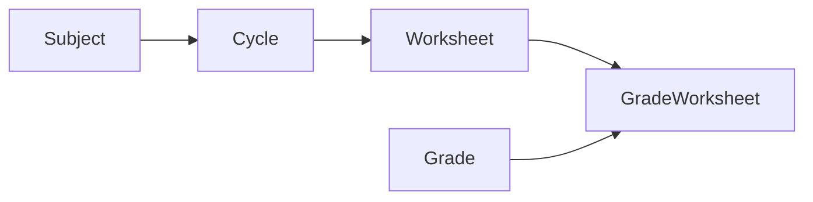

`Subject` is the reusable academic root. `Grade` is a reusable grade or course within that subject. `Cycle` is the Weekly or Special planning boundary that dynamically resolves curriculum for its selected grades. `Worksheet` is the shared delivery definition for one Cycle and worksheet type. Each `GradeWorksheet` is the independently generated, verified, formatted, and published artifact for one Grade.

### 1.2 Two-Dimensional Design Organization

Functional areas and the entity hierarchy are co-equal design dimensions. Functional areas answer **what capability owns the work**; entity hierarchy answers **which business object owns the data, lifecycle, and evidence**. Every diagram, module, interface, state transition, task, and test must be traceable through both dimensions.

| Functional Area | Primary Entity Scope | Responsibility Boundary |
|---|---|---|
| FA-01 Setup Subject and Standards | Subject, Grade | Owns curriculum sources, mappings, and reusable grades for the academic root. |
| FA-02 Configure Worksheet System | WorksheetType, GradeBlueprint | Owns reusable worksheet behavior applied when a Worksheet is created. |
| FA-03 Prep Cycle | Cycle | Owns date resolution, selected grades, current-week curriculum, overrides, and Gate 1. |
| FA-04 Generate Worksheet | Worksheet, GradeWorksheet, WorksheetSpec | Owns content creation, Gate 2, and verification through Gate 3. |
| FA-05 Format Worksheet | GradeWorksheet, RenderArtifact, PublishRecord | Owns templates, rendering, QA, Gate 4, and Gate 5 publication. |

The hierarchy is intentionally one-directional: a Subject can have many Cycles; a Cycle selects many Grades and creates one shared Worksheet per type; a Worksheet contains one GradeWorksheet per selected Grade. Supporting records never redefine their owning Subject, Grade, Cycle, Worksheet, or GradeWorksheet.

## 2. Requirements Recap And Traceability Scope

### 2.1 Functional Requirements

| Area | Requirement IDs | Design Intent |
|---|---|---|
| FA-01 | FR-01 to FR-03 | Maintain versioned subject, CCS pacing, and NC standards evidence. |
| FA-02 | FR-04 to FR-06 | Resolve worksheet-type policy from configuration without storing runtime state in global defaults. |
| FA-03 | FR-07 to FR-10 | Dynamically resolve the current CCS instructional week and obtain Gate 1 approval. |
| FA-04 | FR-11 to FR-13 | Produce independently verifiable grade-level worksheet content from a canonical spec. |
| FA-05 | FR-14 to FR-18 | Format, quality-check, and publish verified worksheet/key pairs under Gates 4 and 5. |

Requirements are also traced by entity hierarchy: FR-01 to FR-03 establish Subject and Grade data; FR-07 to FR-10 establish Cycle data; FR-11 to FR-17 establish Worksheet and GradeWorksheet behavior; FR-18 spans Cycle and Worksheet execution evidence.

### 2.2 Non-Functional Requirements

| Driver | Requirement IDs | Design Response |
|---|---|---|
| Deterministic control | NFR-01, NFR-02 | Explicit persisted state machine and revision-bound gate decisions. |
| Correctness and evidence | NFR-03, NFR-04 | Immutable Worksheet Spec revisions, verification results, and curriculum provenance. |
| Reliability and auditability | NFR-05, NFR-06 | Checkpointed runs, idempotent stage boundaries, artifact lineage. |
| Delivery quality | NFR-07 | Template manifests, render invariants, visual QA records. |
| Operations | NFR-08 to NFR-10 | Secret isolation, telemetry, versioned data, and testable adapters. |

### 2.3 Exclusions

- No removal, merging, or automation of the five human approval gates.
- No database in the initial release; versioned YAML and JSON records are the persistent store.
- No claim that inferred pacing is official CCS pacing.
- No replacement of Google Docs or Google Drive as current delivery integrations.

## 3. Architecture Characteristics And Constraints

The top drivers are correctness and approval integrity, recoverability and auditability, and deterministic workflow control. Supporting drivers are curriculum freshness, template fidelity, maintainability, observability, privacy, and efficient execution.

The system uses `America/New_York` for cycle dates. Current user instructions override YAML defaults for a run only. The configured source order remains CCS, NC DPI, NC Standard Course of Study, then logical inference. Existing Google credentials remain in `.secrets/` and never enter subject, cycle, worksheet, or run records.

## 4. Sources Consulted

- [Requirements](requirements.md)
- [Existing workflow design](../../docs/design.md)
- [Runtime configuration](../../config/mts-math-worksheet-config.yaml)
- [Template registry](../../templates/template-links.md)
- [Optimization roadmap](../../docs/optimization/mts-worksheet-optimization/README.md)
- [Optimization success criteria](../../docs/optimization/mts-worksheet-optimization/success-criteria.md)
- Existing delivery scripts: `scripts/render_docs_from_template.py` and `scripts/publish_to_drive.py`

## 5. C1: System Context

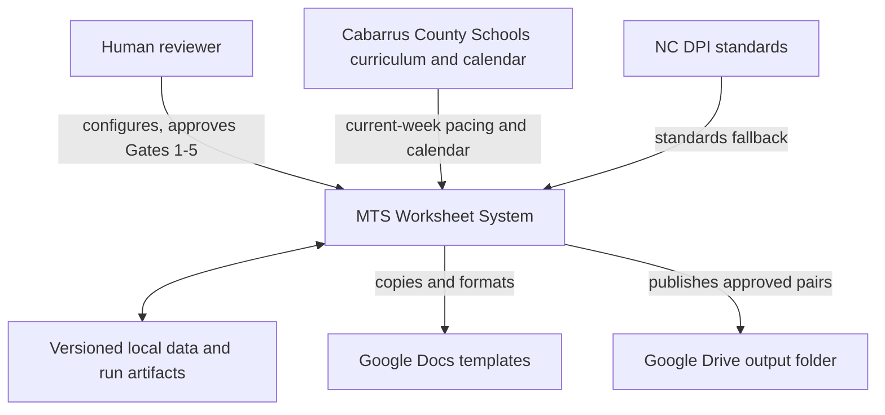

Trust and approval boundaries: external curriculum claims become usable only when recorded with provenance and confidence; no artifact can cross a gate without a persisted human decision; Google integrations are delivery adapters outside the orchestration core.

## 6. C2: Functional-Area And Entity Container Architecture

Each container has both a functional-area owner and an entity boundary. The flow follows the containment path `Subject -> Cycle -> Worksheet -> GradeWorksheet`; `Grade` is reusable subject data selected into a Cycle and attached to its GradeWorksheet. A later container cannot create or mutate an entity without the approved ancestor context.

### 6.1 Functional-Area Flow

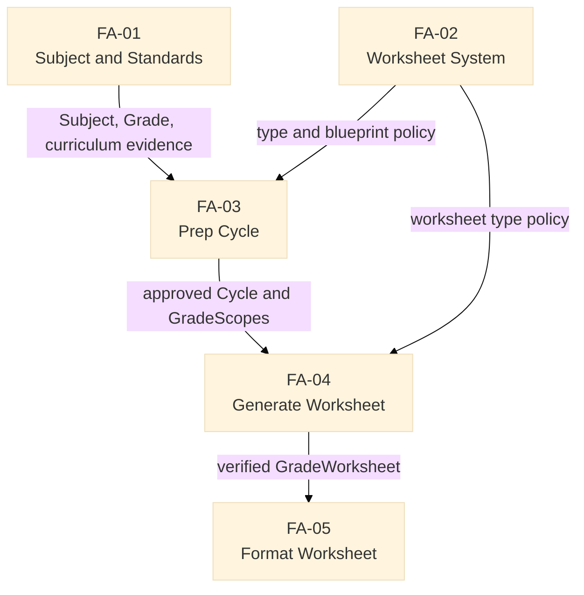

### 6.2 Foundation Containers: FA-01 And FA-02

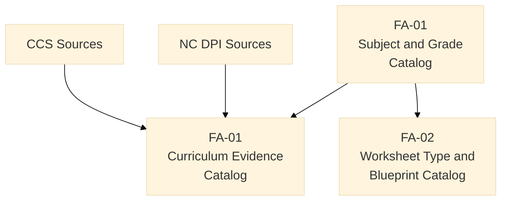

### 6.3 Cycle, Worksheet, And Delivery Containers: FA-03 Through FA-05

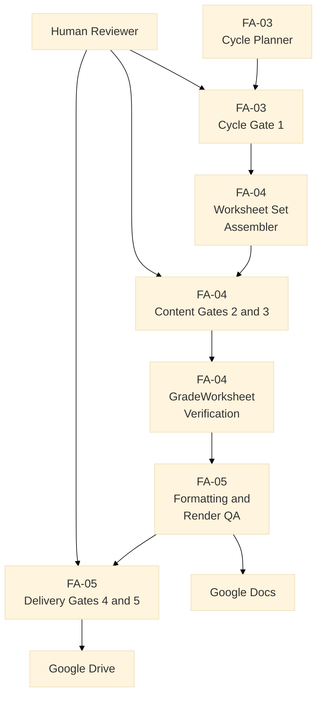

| Functional Area | Full Container Names |
|---|---|
| FA-01 | Subject and Grade Catalog; Curriculum Evidence Catalog |
| FA-02 | Worksheet Type and Grade Blueprint Catalog |
| FA-03 | Cycle Planner; Cycle, GradeScope, and CurriculumResolution Store; Cycle Gate 1 Approval Ledger |
| FA-04 | Worksheet Set Assembler; GradeWorksheet Specification Store; GradeWorksheet Verification Service; GradeWorksheet Gate 2 and 3 Approval Ledger |
| FA-05 | Template Manifest Catalog; GradeWorksheet Formatting Service; GradeWorksheet Render QA Service; GradeWorksheet Gate 4 and 5 Approval Ledger; Render Artifact and Publication Store |

The existing renderer and publisher become FA-05 adapters. Approval ledgers are entity-specific: Gate 1 approves Cycle curriculum resolution, Gates 2 and 3 approve GradeWorksheet content and specification revisions, and Gates 4 and 5 approve GradeWorksheet formatting and delivery revisions.

## 7. High-Level ERD: Functional-Area And Entity Model

The conceptual ERD shows the fundamental hierarchy as the central spine. Supporting entities are grouped by the functional area that owns them, rather than appearing as an undifferentiated record list.

### 7.1 Fundamental Entity Hierarchy

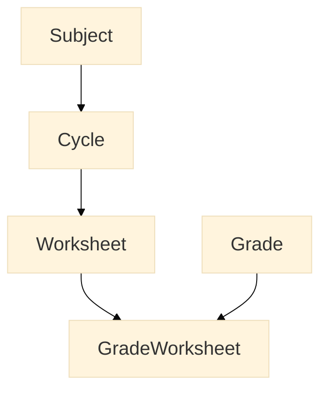

The entity spine is `Subject -> Cycle -> Worksheet -> GradeWorksheet`. `Grade` joins through the GradeWorksheet, preserving a shared multi-grade Cycle and Worksheet while making every grade-level artifact independently auditable.

### 7.2 Functional-Area Entity Ownership

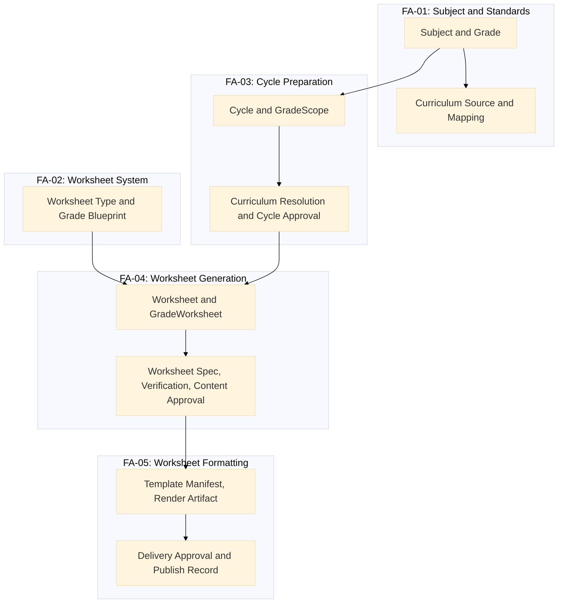

The first ERD diagram establishes entity containment. The second establishes functional-area ownership of supporting entities and the handoff between areas.

## 8. C3: Component Design And Data Flows

### 8.1 FA-01 And FA-02: Subject And Worksheet System Configuration

`SubjectGradeCatalog` resolves reusable Subject and Grade records. `CurriculumEvidenceCatalog` reads immutable CCS/NC curriculum mappings and freshness metadata. `WorksheetTypePolicyCatalog` resolves user overrides, YAML defaults, and design defaults into a Worksheet policy snapshot. `TemplateManifestCatalog` serves validated template metadata to the GradeWorksheet formatting area.

### 8.2 FA-03: Cycle Preparation

`CycleCalendarResolver` identifies the active instructional week. `CycleCurriculumResolver` uses CCS evidence first and follows configured fallbacks only if needed. `CyclePlanner` persists the Cycle, GradeScopes, CurriculumResolutions, overrides, and a Gate 1 proposal. `CycleApprovalLedger` denies Worksheet generation until the reviewed resolution revision has Gate 1 approval.

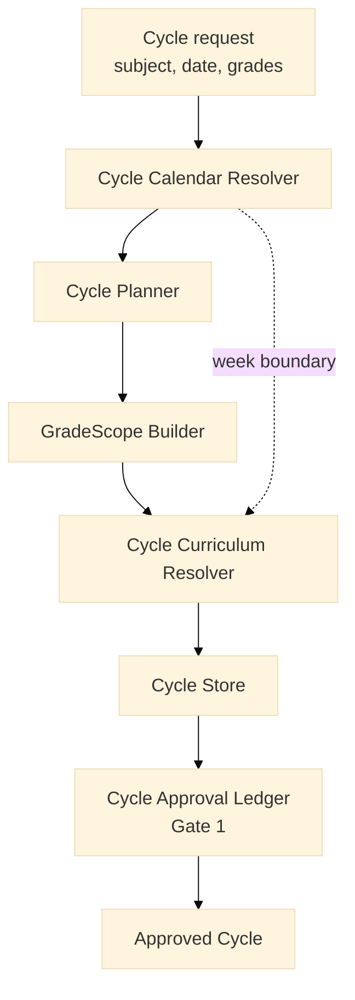

This component flow owns only Cycle preparation. It creates no Worksheet content and cannot continue without the Cycle-level Gate 1 decision.

### 8.3 FA-04: Generation And Verification

`WorksheetSetAssembler` creates one parent Worksheet and one GradeWorksheet per selected Grade. `GradeWorksheetSpecBuilder` creates a revisioned Worksheet Spec. `GradeWorksheetQuestionDraftingAdapter` is a bounded drafting adapter. `GradeWorksheetVerificationService` runs deterministic validators and records items needing reasoning review. `GradeWorksheetContentApprovalLedger` requires Gate 2 before verification and a passing result plus Gate 3 before formatting.

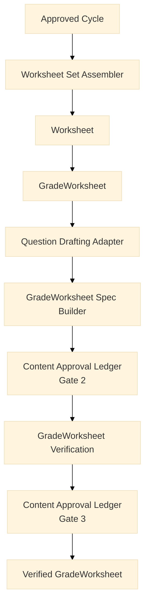

The parent Worksheet is shared across selected grades; every GradeWorksheet follows this flow independently after creation.

### 8.4 FA-05: Formatting And Publication

`GradeWorksheetFormattingService` selects the template manifest, calls the Google Docs adapter, and records RenderArtifacts. `GradeWorksheetRenderQaService` validates structured and visual invariants. `GradeWorksheetDeliveryApprovalLedger` requires Gate 4 before finalization and Gate 5 before delivery. `GradeWorksheetPublicationService` creates or updates the worksheet/key pair transactionally and records a PublishRecord.

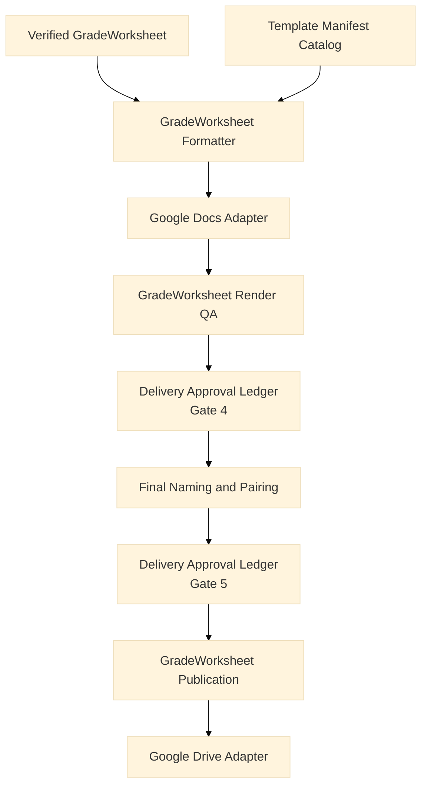

Formatting and delivery are isolated from content generation: a render or publication retry operates on the verified GradeWorksheet revision without re-drafting questions.

### 8.5 State Flow

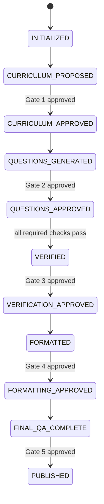

Any declined gate or failed validation preserves the current revision and returns only the affected Cycle, GradeWorksheet, or formatting stage to a revisable state. State transitions retain their owning entity: Gate 1 applies to the Cycle, Gates 2 and 3 apply to the GradeWorksheet and WorksheetSpec, and Gates 4 and 5 apply to the GradeWorksheet's render and publication revisions.

## 9. C4: Code-Level Design And Proposed File Layout

### 9.1 Cycle Preparation Classes

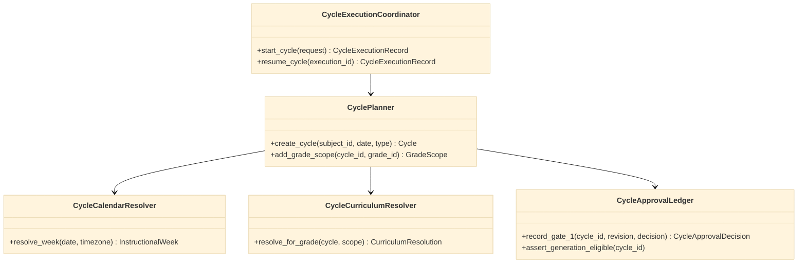

### 9.2 Worksheet And GradeWorksheet Classes

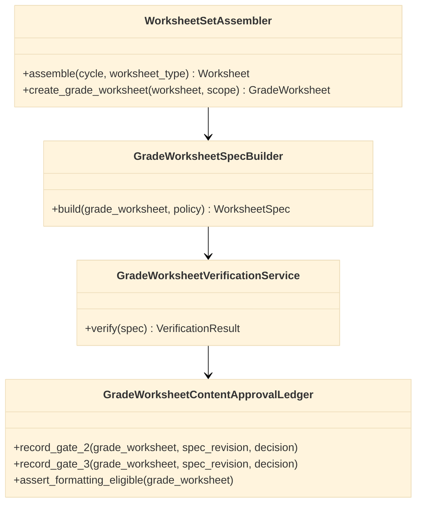

### 9.3 GradeWorksheet Formatting And Delivery Classes

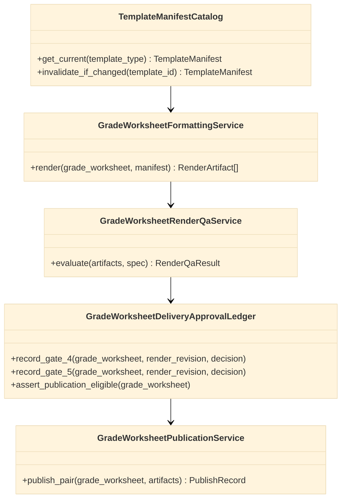

### 9.4 Code Partition

```text
src/mts_worksheet/
  subject_standards/
    subject_grade_catalog.py      # FA-01 Subject and Grade records
    curriculum_evidence_catalog.py # FA-01 CCS/NC source and mapping records
  worksheet_system/
    worksheet_type_policy_catalog.py # FA-02 type, blueprint, and policy snapshots
  cycle_preparation/
    cycle_planner.py              # FA-03 Cycle, GradeScope, and override creation
    cycle_calendar_resolver.py    # FA-03 instructional-week determination
    cycle_curriculum_resolver.py  # FA-03 CCS-first CurriculumResolution
    cycle_approval_ledger.py      # FA-03 Gate 1 decisions
  worksheet_generation/
    worksheet_set_assembler.py    # FA-04 Worksheet and GradeWorksheet creation
    gradeworksheet_spec_builder.py # FA-04 revisioned WorksheetSpec creation
    gradeworksheet_verification.py # FA-04 Gate 2/3 and verification evidence
  worksheet_formatting/
    template_manifest_catalog.py  # FA-05 template revision and invariant records
    gradeworksheet_formatter.py   # FA-05 Google Docs formatting adapter use
    gradeworksheet_render_qa.py   # FA-05 render invariant validation
    gradeworksheet_publication.py # FA-05 Gate 4/5 and Drive delivery
  cycle_execution/
    cycle_execution_coordinator.py # Cycle-owned stage coordination and resumption
    cycle_execution_ledger.py     # execution checkpoints and telemetry
  adapters/
    google_docs.py                # Google Docs implementation
    google_drive.py               # Google Drive implementation
  repositories/
    filesystem.py                 # YAML/JSON persistence
tests/                            # Entity, functional-area, contract, and fixture tests
```

### 9.5 Data Partitions

```text
config/                                      # Configuration partition: runtime defaults
  mts-math-worksheet-config.yaml              # existing global default configuration

data/master/                                 # Master-data partition: reusable, versioned knowledge
  subjects/
    math.yaml                                 # Subject and Grade definitions
  curriculum/
    nc/math/
      grade-1.yaml
      grade-4.yaml
      grade-5.yaml
      grade-6.yaml
      math-1.yaml
      math-2.yaml
    ccs/<school-year>/
      grade-1.yaml
      grade-4.yaml
      grade-5.yaml
      grade-6.yaml
      math-1.yaml
      math-2.yaml
  worksheet-system/
    worksheet-types/class.yaml                # WorksheetType policy
    grade-blueprints/<grade-key>.yaml         # GradeBlueprint policy
    template-manifests/<template-type>.yaml   # Template revision and invariants

data/transactions/                           # Transactional-data partition: Cycle execution evidence
  cycles/<cycle-id>/
    cycle.yaml                                # Cycle, GradeScopes, overrides
    curriculum-resolutions.yaml               # Gate 1 input evidence
    cycle-approvals.yaml                      # Gate 1 decisions
  worksheets/<worksheet-id>/
    worksheet.yaml                            # shared parent Worksheet
    grade-worksheets/<grade-worksheet-id>/
      worksheet-spec-r<revision>.yaml         # versioned WorksheetSpec
      verification-r<revision>.yaml           # VerificationResult
      content-approvals.yaml                  # Gate 2 and Gate 3 decisions
      render-artifacts.yaml                   # RenderArtifact and QA evidence
      delivery-approvals.yaml                 # Gate 4 and Gate 5 decisions
      publish-record.yaml                     # paired publication outcome
  executions/<execution-id>/
    execution.yaml                            # CycleExecutionRecord and checkpoints
    telemetry.json                            # timing, retries, cache and tool metrics
```

The configuration partition contains only runtime defaults. The master-data partition changes through controlled versioning and refresh review. The transactional-data partition is append/revision-oriented evidence for a specific Cycle, Worksheet, GradeWorksheet, or execution; it must not be used as a new source of global defaults.

### 9.6 Consolidated Folder Structure

```text
mts-new/
  .github/
    prompts/                                  # Copilot command entry points
    skills/                                   # Detailed workflow instructions
    instructions/                             # Path-specific editing rules
    copilot-instructions.md                   # Repository-level Copilot behavior
  .secrets/                                   # Local credentials; never commit
  config/                                     # Configuration partition
    mts-math-worksheet-config.yaml            # Runtime defaults
  data/
    master/                                   # Reusable, versioned knowledge
      subjects/
        math.yaml                             # Subject and Grade master records
      curriculum/                             # Authoritative curriculum evidence
        nc/math/                              # NC standards by grade/course
          grade-1.yaml                        # Grade 1 standards and concepts
          grade-4.yaml                        # Grade 4 standards and concepts
          grade-5.yaml                        # Grade 5 standards and concepts
          grade-6.yaml                        # Grade 6 standards and concepts
          math-1.yaml                         # High-school Math 1 standards
          math-2.yaml                         # High-school Math 2 standards
        ccs/<school-year>/                    # CCS pacing by school year
          grade-1.yaml                        # Weekly Grade 1 pacing evidence
          grade-4.yaml                        # Weekly Grade 4 pacing evidence
          grade-5.yaml                        # Weekly Grade 5 pacing evidence
          grade-6.yaml                        # Weekly Grade 6 pacing evidence
          math-1.yaml                         # Weekly Math 1 pacing evidence
          math-2.yaml                         # Weekly Math 2 pacing evidence
      worksheet-system/
        worksheet-types/
          class.yaml                          # Shared policy for class worksheets
        grade-blueprints/
          <grade-key>.yaml                    # Counts, content mix, and section rules
        template-manifests/
          <template-type>.yaml                # Template revision, slots, and invariants
    transactions/                             # Cycle and GradeWorksheet evidence
      cycles/<cycle-id>/
        cycle.yaml                            # Cycle dates, type, selected Grades, overrides
        curriculum-resolutions.yaml           # Current-week CCS/NC resolution by GradeScope
        cycle-approvals.yaml                  # Gate 1 approval evidence
      worksheets/<worksheet-id>/              # Shared Worksheet delivery definition
        worksheet.yaml                        # Worksheet type and policy revision
        grade-worksheets/<grade-worksheet-id>/
          grade-worksheet.yaml                # Grade, status, and current spec revision
          worksheet-spec-r<revision>.yaml     # Questions, answers, standards, and QA expectations
          verification-r<revision>.yaml       # Per-question and aggregate verification evidence
          content-approvals.yaml              # Gate 2 and Gate 3 approval evidence
          render-artifacts.yaml               # Docs/PDF locations and render-QA results
          delivery-approvals.yaml             # Gate 4 and Gate 5 approval evidence
          publish-record.yaml                 # Paired worksheet/key publication outcome
      executions/<execution-id>/
        execution.yaml                        # Cycle execution state and resumable checkpoints
        telemetry.json                         # Timings, retries, cache behavior, and tool metrics
  docs/                                       # Enduring human-readable guidance
    design.md                                 # Legacy workflow-design context
    optimization/
  reports/                                    # Generated local drafts and final exports
    drafts/<date>/
    final/<date>/
    imports/
  scripts/                                    # Transitional command-line adapters
    render_docs_from_template.py
    publish_to_drive.py
  specs/
    01.generate-weekly-math-worksheets/       # Approved requirements and design
      requirements.md
      design.md
      plan.md
      todo.md
      archive/
  src/
    mts_worksheet/                            # Production code, by functional area
      subject_standards/                      # FA-01 Subject and standards services
        subject_grade_catalog.py              # Read and validate Subject/Grade master data
        curriculum_evidence_catalog.py        # Read, refresh, and version CCS/NC evidence
      worksheet_system/                       # FA-02 Worksheet policy services
        worksheet_type_policy_catalog.py      # Merge defaults and resolve WorksheetType policies
      cycle_preparation/                      # FA-03 Cycle preparation services
        cycle_planner.py                      # Create Cycles, GradeScopes, and overrides
        cycle_calendar_resolver.py            # Resolve instructional week in configured timezone
        cycle_curriculum_resolver.py          # Resolve CCS-first current-week curriculum
        cycle_approval_ledger.py              # Persist and enforce Gate 1 decisions
      worksheet_generation/                   # FA-04 Content generation services
        worksheet_set_assembler.py            # Create Worksheet and GradeWorksheet records
        gradeworksheet_spec_builder.py        # Build revisioned WorksheetSpec records
        gradeworksheet_verification.py        # Verify questions and enforce Gates 2/3
        validators/                           # Deterministic math-validation modules
          arithmetic.py                       # Arithmetic answer checks
          fractions.py                        # Fraction answer checks
          decimals.py                         # Decimal answer checks
          equations.py                        # Equation and algebra checks
          patterns.py                         # Pattern and sequence checks
      worksheet_formatting/                   # FA-05 Formatting and publication services
        template_manifest_catalog.py          # Read and invalidate template manifests
        gradeworksheet_formatter.py           # Create worksheet/key render requests
        gradeworksheet_render_qa.py           # Apply structured and visual QA invariants
        gradeworksheet_publication.py         # Enforce Gates 4/5 and publish artifact pairs
      cycle_execution/                        # Cross-area Cycle execution services
        cycle_execution_coordinator.py        # Coordinate stages and resume valid checkpoints
        cycle_execution_ledger.py             # Record state changes and telemetry events
      adapters/                               # External-system implementations
        google_docs.py                        # Google Docs rendering adapter
        google_drive.py                       # Google Drive publication adapter
      repositories/                           # Storage-boundary implementations
        configuration_repository.py           # Read configuration partition
        master_data_repository.py             # Read/write controlled master-data revisions
        transaction_repository.py             # Read/write Cycle and Worksheet transactions
  templates/                                  # External template registry and references
    template-links.md
  tests/                                      # Unit, contract, fixture, and regression tests
    subject_standards/                        # FA-01 catalog and freshness tests
    worksheet_system/                         # FA-02 policy-resolution tests
    cycle_preparation/                        # FA-03 calendar, resolution, and Gate 1 tests
    worksheet_generation/                     # FA-04 spec, validator, and Gate 2/3 tests
    worksheet_formatting/                     # FA-05 manifest, QA, and Gate 4/5 tests
    fixtures/                                 # Representative curriculum, spec, and render data
```

This structure keeps executable code, stable configuration, reusable master data, transaction evidence, generated reports, and human-facing design artifacts separate. The `scripts/` folder remains transitional until its behavior is migrated into `src/mts_worksheet/adapters/`.

The existing scripts are migrated incrementally into `adapters/google_docs.py` and `adapters/google_drive.py`; their authentication behavior is retained but their direct CLI control is replaced by `CycleExecutionCoordinator`.

The file layout follows both dimensions: `subject/`, `cycle/`, `generation/`, and `formatting/` organize functional ownership, while typed models and repository records preserve Subject, Grade, Cycle, Worksheet, and GradeWorksheet lifecycle ownership across those modules.

## 10. Low-Level ERD: Logical Data Model

### 10.1 FA-01 To FA-03: Subject, Grade, And Cycle Records

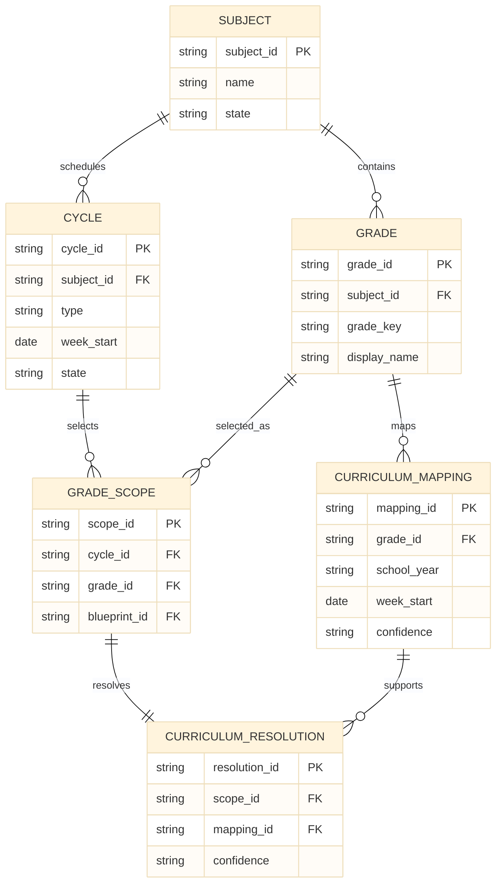

### 10.2 FA-04: Worksheet And GradeWorksheet Records

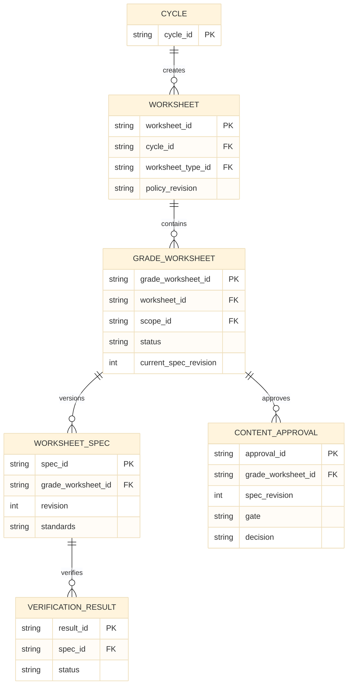

### 10.3 FA-05: Formatting And Delivery Records

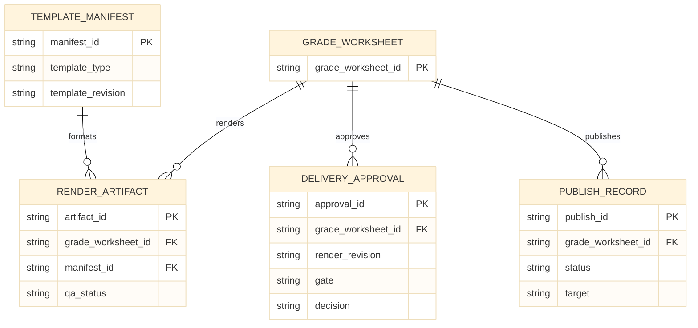

| Entity | Key Attributes | Ownership And Lifecycle |
|---|---|---|
| Subject | `subject_id`, `name`, `state` | FA-01; stable reusable record. |
| Grade | `grade_id`, `subject_id`, `grade_key`, `display_name`, `state` | FA-01; reusable instructional level within a Subject. |
| CurriculumSource | `source_id`, `authority`, `url`, `last_verified_at`, `revision` | FA-01; changes by controlled refresh. |
| CurriculumMapping | `mapping_id`, `subject_id`, `grade_id`, `school_year`, `week_start`, `standards`, `confidence`, `source_id` | FA-01; immutable mapping revision. |
| WorksheetType | `worksheet_type_id`, `name`, `policy_revision` | FA-02; reusable behavior shared by a Worksheet set. |
| GradeBlueprint | `blueprint_id`, `worksheet_type_id`, `grade_id`, `question_count`, `content_mix` | FA-02; grade-specific rules for a Worksheet type. |
| Cycle | `cycle_id`, `subject_id`, `type`, `week_start`, `week_end`, `state`, `policy_revision` | FA-03; one weekly or special planning boundary. |
| GradeScope | `scope_id`, `cycle_id`, `grade_id`, `blueprint_id`, `template_type` | FA-03; selected Grade in a Cycle. |
| CurriculumResolution | `resolution_id`, `scope_id`, `mapping_id`, `current_topics`, `spiral_topics`, `confidence`, `resolved_at` | FA-03; binds current-week evidence to a scope. |
| CycleApprovalDecision | `approval_id`, `cycle_id`, `resolution_revision`, `gate`, `decision`, `approved_by`, `approved_at` | FA-03; Gate 1 approval evidence. |
| Worksheet | `worksheet_id`, `cycle_id`, `worksheet_type_id`, `policy_revision` | FA-04; parent of grade artifacts. |
| GradeWorksheet | `grade_worksheet_id`, `worksheet_id`, `scope_id`, `status`, `current_spec_revision` | FA-04; independently processed artifact. |
| WorksheetSpec | `spec_id`, `grade_worksheet_id`, `revision`, `questions`, `key_entries`, `standards`, `qa_expectations` | FA-04; immutable after Gate 2 approval. |
| VerificationResult | `result_id`, `spec_id`, `status`, `checks`, `verified_at` | FA-04; blocks formatting unless pass. |
| GradeWorksheetContentApproval | `approval_id`, `grade_worksheet_id`, `spec_revision`, `gate`, `decision`, `approved_by`, `approved_at` | FA-04; Gate 2 and 3 approval evidence. |
| TemplateManifest | `manifest_id`, `template_type`, `template_revision`, `slots`, `style_rules`, `invariants` | FA-05; invalidated by template revision. |
| RenderArtifact | `artifact_id`, `grade_worksheet_id`, `spec_id`, `manifest_id`, `kind`, `location`, `qa_status` | FA-05; draft/final rendition. |
| GradeWorksheetDeliveryApproval | `approval_id`, `grade_worksheet_id`, `render_revision`, `gate`, `decision`, `approved_by`, `approved_at` | FA-05; Gate 4 and 5 approval evidence. |
| PublishRecord | `publish_id`, `grade_worksheet_id`, `worksheet_artifact_id`, `key_artifact_id`, `target`, `status` | FA-05; paired publication outcome. |
| CycleExecutionRecord | `execution_id`, `cycle_id`, `state`, `started_at`, `updated_at`, `telemetry` | Cycle execution, recovery, and cross-area evidence record. |

All references are by immutable IDs. A child revision cannot replace an approved parent revision; it creates a new revision that requires the applicable gate decision.

## 11. Interfaces, Contracts, States, And Scenarios

| Interface | Input | Output | Failure Behavior |
|---|---|---|---|
| Cycle curriculum resolver | Cycle, GradeScope, curriculum evidence | CurriculumResolution | Records insufficient evidence for Cycle Gate 1; never promotes inference to official. |
| GradeWorksheet spec builder | Approved GradeScope and Worksheet policy | WorksheetSpec revision | Rejects invalid grade counts, splits, or content mix. |
| GradeWorksheet verification service | WorksheetSpec revision | VerificationResult | Blocks GradeWorksheet formatting on failure or ambiguity. |
| GradeWorksheet formatter | Verified spec and TemplateManifest | Worksheet/key RenderArtifacts | Records partial failure; retries only GradeWorksheet formatting. |
| GradeWorksheet publication service | Gate 5 delivery approval and paired artifacts | PublishRecord | Records failure; retries only GradeWorksheet publication and avoids duplicate pairs. |

Primary scenarios are normal weekly Cycle, special-cycle override, missing/insufficient CCS source, a failed GradeWorksheet verification, formatting retry after a renderer error, and publication retry after a Drive error. Each scenario retains its state and evidence in the `CycleExecutionRecord`.

## 12. Error Handling, Observability, Security, Privacy, And Recovery

Domain errors are explicit: invalid configuration, unavailable curriculum evidence, invalid state transition, missing approval, invalid worksheet spec, verification failure, render failure, and publish failure. Each records an event with run ID, stage, entity ID, revision, and non-sensitive context.

Telemetry records stage timestamps, elapsed time, tool calls, cache hits, retries, generated/regenerated questions, validation failures, and documents read/written. Secrets are restricted to `.secrets/`; Drive identifiers are operational metadata, not credentials. Recovery resumes only from a persisted valid state, allowing a render or publication retry without re-generating approved content.

## 13. Risks, Assumptions, Open Questions, And ADR Candidates

| ID | Item | Status | Resolution Needed |
|---|---|---|---|
| OQ-01 | CCS current-week pacing may be unavailable for a grade/course. | Resolved | Curriculum evidence is fresh when verified during the current school year. Refresh is required at a new school year, when source metadata changes, when a source is missing or insufficient, or when the user requests fresh verification. Gate 1 presents the resulting confidence and source basis. |
| OQ-02 | Local YAML/JSON storage may need conflict control for concurrent editors. | Resolved | Initial release assumes no concurrent editing of the same run records. No file locking is required; repositories remain abstracted for a later storage upgrade if concurrency becomes necessary. |
| ADR-01 | Versioned local files before a database. | Accepted | Use versioned local YAML/JSON files for the initial release; preserve repository interfaces for a future backend. |
| ADR-02 | Worksheet parent plus independent GradeWorksheet children. | Accepted | Use independent GradeWorksheet children to isolate grade-level correction, retry, and publication. |
| ADR-03 | Persisted gate decisions bound to revisions. | Accepted | Bind each approval decision to the reviewed entity and revision to prevent reuse after content changes. |
| ADR-04 | Google Docs and Drive behind adapters. | Accepted | Keep Google integrations behind adapters to support test doubles and future delivery targets. |

## 14. Implementation Handoff And Traceability Matrix

| Requirement Group | Components And Entities | Plan Slice | Verification Evidence |
|---|---|---|---|
| FR-01 to FR-06, NFR-04, NFR-10 | SubjectGradeCatalog, CurriculumEvidenceCatalog, WorksheetTypePolicyCatalog | 1-2 | Entity schemas, configuration tests, and provenance fixtures. |
| FR-07 to FR-10, NFR-01, NFR-02 | CycleCalendarResolver, CycleCurriculumResolver, CyclePlanner, CycleApprovalLedger | 3 | Cycle state and Gate 1 integration tests. |
| FR-11 to FR-13, NFR-03, NFR-06 | WorksheetSetAssembler, GradeWorksheetSpecBuilder, GradeWorksheetVerificationService | 4-5 | WorksheetSpec, validator, Gate 2/3, and grade-isolation tests. |
| FR-14 to FR-17, NFR-05, NFR-07 | TemplateManifestCatalog, GradeWorksheetFormattingService, GradeWorksheetRenderQaService, GradeWorksheetPublicationService | 6-7 | Manifest invalidation, render QA, Gate 4/5, and paired-publication tests. |
| FR-18, NFR-05, NFR-09 | CycleExecutionCoordinator, CycleExecutionLedger, filesystem repositories | 1 and 8 | Cycle resumption, idempotency, and telemetry tests. |

This design, its ADRs, and the delivery plan are approved for implementation.