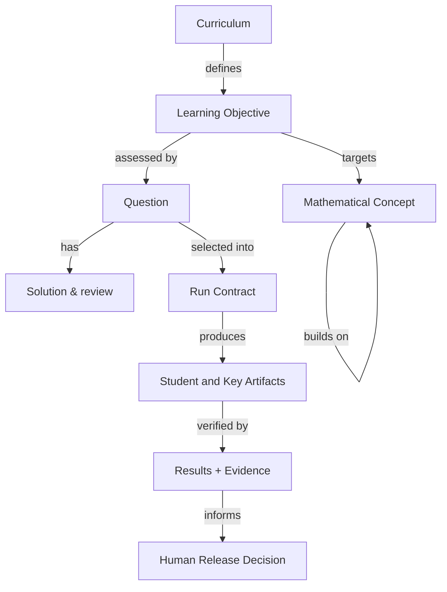

# MTS Math — Domain Ontology

> **Status:** Finalized review candidate; not approved or committed · **Version:** 1.0-rc1 · **Date:** 2026-11-06  
> **Purpose:** Canonical Math product terms, entity semantics, relationships and invariants for authoring, verification, artifacts, release and feedback.

## 1. Semantic boundaries

The **Math domain** owns mathematical concepts, learning objectives, problems, solutions, pedagogical categories, source fidelity and applicable artifact rules. The **shared factory** owns generic execution, test/evidence recording, report presentation, storage and release mechanisms. Math specializes those shared entities without duplicating the underlying infrastructure.

**One fact, one home:** Course/standards truth lives in governed curriculum sources; weekly selection in an approved run contract; question truth in the canonical item spec; evidence truth in the executed verification ledger; published truth in the release manifest.

## 2. Canonical terms and entities

| ID | Entity/term | Canonical meaning / authority |
|---|---|---|
| ENT-001 | Grade/Course | Explicit educational level/course; approved scope/config |
| ENT-002 | Curriculum | Ordered instructional expectations and concepts; curriculum manager |
| ENT-003 | Mathematical Concept | Stable idea such as place value, fractions or proportional relationships; concept backbone |
| ENT-004 | Learning Objective | Assessable learning outcome tied to concept and selected week; approved matrix |
| ENT-005 | Standard Alignment | Link to adopted standard or a declared enrichment distinction; source register |
| ENT-006 | Assessment Source | Released paper/item source, source location, version, answer provenance and rights status |
| ENT-007 | Weekly/Assessment Run | Dated production attempt with explicit grade/course scope; run manifest |
| ENT-008 | Run Contract | Versioned approved counts, percentages, template variant, gates, names and constraints |
| ENT-009 | Question | Atomic assessed prompt, answer requirements, identifiers, placement and assets; canonical item spec |
| ENT-010 | Question Role | F Focused, C Current Curriculum, S Spiral Review, R Reasoning; instructional classification |
| ENT-011 | Solution | Answer plus defensible mathematical method/explanation, including units when relevant |
| ENT-012 | Reasoning Qualification | Independent judgment that an R item is genuinely nonroutine, with rationale and archetype |
| ENT-013 | Diagram/Asset | Complete visual, labels, dimensions, provenance, bounds and placement linked to an item |
| ENT-014 | Template Profile | Approved weekly/class/mock-test master, revision, geometry and slot policy |
| ENT-015 | Student Artifact | Rendered question-bearing document intended for students, never containing a key |
| ENT-016 | Teacher-Key Artifact | Separately rendered matching answers/solutions for the same selected question IDs |
| ENT-017 | Verification Criterion | Atomic, independently assessable criterion linked to AC/rule, test and applicability |
| ENT-018 | Verification Result | Executed status for a criterion and relevant grade/artifact/item, not an assertion of intended behavior |
| ENT-019 | Verification Evidence | Measured/reviewed expected and actual, method, reviewer, timestamp and applicable fingerprints |
| ENT-020 | Quality/Human Gate | Governed transition requiring specified evidence and, when configured, explicit human decision |
| ENT-021 | Release Set | Exactly the authorized published student/key pairs with file identities and destination |
| ENT-022 | Coverage Record | Objectives and items actually delivered to students, not merely generated |
| ENT-023 | Observation/Defect | A diagnosed mismatch or improvement signal with source, impact and current status |
| ENT-024 | Requirement Delta | Governed intent, rule, design or test update resulting from an observation |

### Important distinctions

| Terms | Distinction |
|---|---|
| Objective vs Concept | Objective states desired learning behavior; concept is the enduring Math idea |
| Standard vs Objective | External adopted expectation vs MTS-selected learning target |
| F/C/S/R category vs question type | *Why* a question is assigned vs its format (MCQ, constructed response, puzzle, investigation) |
| R assignment vs R qualification | Planning label vs evidence-backed independent verdict |
| Question ID vs printed number | Stable trace identity vs display number that can restart each weekday |
| Verified question vs certified run | Individual mathematical approval vs all mandatory run-level criteria satisfied |
| QA certification vs human approval vs publication | Evidence status vs discretionary release authority vs verified remote delivery |
| SKIPPED vs OUT OF SCOPE | A documented nonapplicability within scoped evaluation vs an excluded grade/criterion outside its denominator |

## 3. Semantic relationships



| ID | Relationship | Constraint |
|---|---|---|
| REL-001 | Concept `builds_from` Concept | Directed prerequisite graph; detect unintended cycles |
| REL-002 | Concept `leads_to` Concept | Progressive future context, not necessarily immediate next-week pacing |
| REL-003 | Objective `maps_to` Standard | Grade/course, source version and enrichment status retained |
| REL-004 | Question `assesses` Objective | At least one intended objective or explicit assessment-source exception |
| REL-005 | Question `classified_as` F/C/S/R | Exactly one primary role per weekly item under current allocation contract |
| REL-006 | Question `has_solution` Solution | Stable ID parity across the canonical spec and artifacts |
| REL-007 | Question `uses` Diagram | Entire figure is part of the atomic question package |
| REL-008 | Question `derived_from` Assessment Source | Source question ID/page/version retained for transformation |
| REL-009 | Run `governed_by` Run Contract | Only an approved contract version authorizes work scope |
| REL-010 | Artifact `rendered_from` Question Set + Template Revision | Artifact fingerprint binds exact source and renderer state |
| REL-011 | Criterion `verified_by` Test/Review yielding Result | Status must be grounded in performed work and applicability |
| REL-012 | Result `supported_by` Evidence | Fingerprints bind reviewed content and reviewer decisions |
| REL-013 | Release `contains` Authorized Artifacts | No missing or extra grade/key pair |
| REL-014 | Observation `proposes` Requirement Delta | Repair and regression impact must be traceable |

## 4. Normative invariants

| ID | Invariant |
|---|---|
| INV-001 | Explicit in-scope grades/courses alone define a run's test and publication denominator |
| INV-002 | Total weekly questions equal the sum of weekday counts and sum of F/C/S/R quotas |
| INV-003 | Each selected question has one stable ID, one intended weekday/position and exactly one matching key entry |
| INV-004 | Printed weekday numbering follows its configured sequence and is independent of stable IDs |
| INV-005 | All released mathematical answers are independently verified, including nonnumeric responses, units and diagrams |
| INV-006 | An R label cannot satisfy the reasoning quota without item-specific independent qualification |
| INV-007 | An item's Math role/ID remains internal and must not leak into the student prompt |
| INV-008 | The student artifact and teacher-key artifact derive from the same selected question set |
| INV-009 | Source-based mock-test transformation preserves relevant stem, values, notation, choices, diagrams and scoring |
| INV-010 | No atomic question or required diagram may be split, clipped or rendered outside printable bounds |
| INV-011 | Changed question or review input invalidates dependent content verification and downstream approvals |
| INV-012 | Changed template/revision invalidates dependent rendering and visual evidence |
| INV-013 | Verification PASS requires executed evidence; mandatory FAIL/NOT VERIFIED blocks certification |
| INV-014 | SKIPPED requires scoped applicability rationale; OUT OF SCOPE contributes to no active result counts |
| INV-015 | `QA_CERTIFIED_STAGED` does not imply `PUBLISH_APPROVED` or `PUBLISHED` |
| INV-016 | Publication requires explicit human authorization and reconciliation of exact file IDs, names, type and destination |
| INV-017 | Delivered curriculum coverage reflects released content, not content merely drafted or staged |

## 5. Logical schemas (illustrative, not runtime claims)

```yaml
run:
  id: "MATH-2026-11-09"
  week_start: "2026-11-09"
  in_scope_grades: [1, 4, 5, 6]  # historical example; never infer future scope
  out_of_scope_grades: ["9-10"]
  product_line: "weekly"
  contract_version: "approved-fingerprint"
  release_state: "QA_CERTIFIED_STAGED"
question:
  id: "G5-Q017"
  grade: 5
  weekday: "Wednesday"
  display_number: 7
  role: "R"
  objective_ids: ["OBJ-005"]
  prompt: "..."
  answer: "..."
  reasoning_qualification:
    verdict: "PENDING_INDEPENDENT_REVIEW"
    archetype: "constraint_puzzle"
    rationale: "..."
```

The example ID syntax describes meaning; actual implementation schemas and code paths must be reconciled before fields become normative. An alternative diagnostic/mock-test item may carry source numbering and scoring rather than weekday and role.

## 6. State semantics and invalidation

Run lifecycle (enabled gates interleave these transitions):

`INITIALIZED → CURRICULUM_PROPOSED → CURRICULUM_APPROVED → QUESTIONS_GENERATED → QUESTIONS_APPROVED → VERIFIED → DOCUMENTS_GENERATED → FINAL_QA_COMPLETE → QA_CERTIFIED_STAGED → PUBLISH_APPROVED → PUBLISHED`

`QA_CERTIFIED_STAGED` is an evidence outcome. `PUBLISH_APPROVED` is a distinct named human act. `PUBLISHED` requires remote reconciliation. A change to the run contract, question content, answer, diagram, source, template or evidence fingerprint invalidates the earliest dependent state. Preserved unaffected upstream decisions remain recorded, not silently erased.

**Criterion result vocabulary:** PASS / FAIL / NOT VERIFIED / documented SKIPPED. OUT OF SCOPE is reported separately as scope, not a passing check. Distinguish automated vs independent semantic review, and do not treat the generator's own answer assertion as independent verification.

## 7. Software Factory alignment

| Math domain information | Shared factory analogue |
|---|---|
| Objectives, concepts, question roles, source and Math rules | M1 ontology and M2 business rules |
| Run contract and quality expectations | M3 requirements/acceptance and verification criteria |
| Canonical question schema, rendering bounds | M4–M5 architecture/design |
| Generator and template integrations | M6 implementation |
| Criteria, executed Math validators, reviewer evidence | M7 shared execution/evidence engine with Math extensions |
| Defects, coverage and deltas | M8 feedback/convergence |

**Companions:** [product.md](product.md), [business-architecture.md](business-architecture.md). Downstream atomic `REQ`, `AC`, `VC`, `TEST` and `EVD` identities must be assigned against the actual implementation and run catalog, not assumed from this draft.
