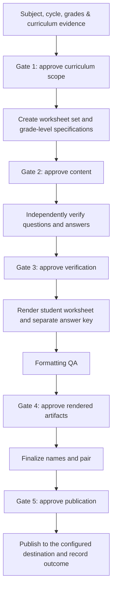
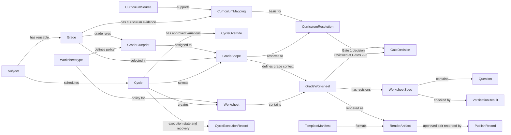

# MTS Math Worksheet System — Product Definition

> **Status:** Retrospective source-derived draft; this product definition was not an original 2026-08-23 artifact and was not separately approved on that date.  
> **Product baseline:** 2026-08-23 · **Archive snapshot:** v1 · **Synthesis date:** 2026-11-07  
> **Scope:** The MTS Math worksheet system described by the August 23 requirements and approved system design; not the later, broader Math product portfolio.

## 1. The product on one page

### Promise

**Prepare, verify, format, and publish approved MTS Math worksheets and matching answer keys for explicitly selected grades—using traceable curriculum evidence and persisted human approvals at every protected step.**

**In plain language:** A curriculum owner chooses which grades and instructional period to prepare. The system gathers and explains the curriculum basis, proposes worksheet content, and keeps each grade's work independently reviewable. It checks the questions and answers before formatting, checks the rendered worksheet and key before publication, and records the decisions and evidence so interrupted work can resume safely.

| Who it serves | Need | Value the product is intended to provide |
|---|---|---|
| MTS curriculum owner and human reviewers | Know what curriculum each grade's worksheet represents and retain control over release | Clear, revision-bound review and approval |
| Teachers and students | Receive grade-appropriate Math practice with a reliable answer key | Usable worksheet and key grounded in the approved scope |
| Run and publication operators | Recover work, isolate corrections, and see what was generated or delivered | Repeatable processing with traceable artifacts and outcomes |

**Inputs:** Subject and selected grades/courses; weekly or special-cycle dates; current curriculum and standards evidence; worksheet-type and grade policies; approved one-time overrides; versioned template policy; and human decisions at the required gates.

**Outputs:** A versioned specification for each grade; a student worksheet and separate answer key derived from that same specification; verification and formatting evidence; persisted approvals and run state; and a publication record for the approved pair.

## 2. Functional areas and entity model

The product has two complementary views. **Functional areas** show which capability is responsible for work; **entities** show which business records own the data, lifecycle, approvals, and evidence. A capability may work with several related entities, but it does not change their ownership boundaries.

### Functional areas

| ID | Functional area | Responsibility | Main entities |
|---|---|---|---|
| **FA-01** | Setup Subject and Standards | Maintain reusable subjects and grades, curriculum sources, and versioned CCS pacing and North Carolina standards evidence with provenance and confidence. | Subject, Grade, CurriculumSource, CurriculumMapping |
| **FA-02** | Configure Worksheet System | Define worksheet-type behavior and grade-level blueprints. Resolve defaults without persisting run-specific overrides globally. | WorksheetType, GradeBlueprint |
| **FA-03** | Prep Cycle | Determine the instructional period, select grades, resolve curriculum and approved overrides, and obtain Gate 1 approval. | Cycle, GradeScope, CurriculumResolution, CycleOverride, GateDecision, CycleExecutionRecord |
| **FA-04** | Generate Worksheet | Create one worksheet set and independently managed grade worksheets; maintain each canonical specification; obtain Gate 2 and verify content through Gate 3. | Worksheet, GradeWorksheet, WorksheetSpec, Question, VerificationResult, GateDecision |
| **FA-05** | Format Worksheet | Render the approved grade worksheet and key, perform formatting QA, obtain Gates 4 and 5, and record paired publication. | GradeWorksheet, TemplateManifest, RenderArtifact, GateDecision, PublishRecord |

### Entities and relationships

The core lifecycle is a shared Cycle and Worksheet with independent grade-level work. Supporting records carry the evidence and policy used at each step; they do not replace or redefine their owning entity.

| Entity | Meaning and relationship |
|---|---|
| **Subject, Grade** | Reusable academic subject and grade/course; a Cycle belongs to a Subject and selects Grades through GradeScope records. |
| **CurriculumSource, CurriculumMapping** | Source authority and versioned curriculum knowledge for a subject, grade/course, and school year; a mapping records provenance and confidence. |
| **WorksheetType, GradeBlueprint** | Shared worksheet policy and its grade-specific counts, content mix, or structure; policy informs the Worksheet and the blueprint is assigned to a GradeScope. |
| **Cycle, GradeScope, CurriculumResolution, CycleOverride** | A Weekly or Special planning boundary, its selected grades, each grade's resolved curriculum basis, and any approved cycle-specific variation. Gate 1 approves the relevant cycle resolution. |
| **Worksheet, GradeWorksheet** | One parent Worksheet for a Cycle and worksheet type; one independently processed GradeWorksheet per selected Grade. |
| **WorksheetSpec, Question, VerificationResult** | Revisioned source of truth for one GradeWorksheet's questions, answers, and QA expectations; question-level checks roll into verification evidence for that revision. |
| **TemplateManifest, RenderArtifact** | Versioned layout contract and the resulting student/key artifacts with render and QA status. |
| **GateDecision, PublishRecord, CycleExecutionRecord** | Revision-bound human approvals; the publication outcome for the paired artifacts; and persisted execution state, checkpoints, and telemetry. |

**Ownership rule:** FA-01 owns reusable subject, grade, and curriculum knowledge; FA-02 owns reusable worksheet policy; FA-03 owns Cycle planning and Gate 1; FA-04 owns content specifications, questions, verification, and Gates 2–3; FA-05 owns template manifests, rendered artifacts, QA, publication, and Gates 4–5. A GradeWorksheet can be corrected or retried without invalidating another GradeWorksheet in its parent Worksheet.

## 3. Product boundaries

### In scope

1. **Maintain reusable Math context.** Keep subject and grade/course records, Cabarrus County Schools (CCS) pacing and North Carolina standards evidence versioned with source, freshness, and confidence. Clearly distinguish official pacing from strongly inferred or inferred pacing.
2. **Configure worksheet behavior.** Resolve worksheet-type and grade-blueprint policies from the runtime configuration. The August requirements identify `class` as the current worksheet type; grade enablement, duration, content mix, verification, gates, templates, formatting, and publishing are policy-controlled.
3. **Prepare a cycle.** Determine the instructional week using `America/New_York`; create a Weekly or Special cycle for one subject and selected grades; resolve current-week curriculum; record approved temporary overrides; and obtain Gate 1 approval before generating questions.
4. **Generate grade-level work.** Create one parent Worksheet per Cycle and worksheet type, with an independently controlled GradeWorksheet for every selected grade. Each GradeWorksheet has a versioned Worksheet Spec that supplies the student questions, key entries, standards mapping, numbering, difficulty, and QA expectations.
5. **Verify before rendering.** Obtain Gate 2 approval of the content, independently verify every approved question, block formatting on a failed or ambiguous result, and obtain Gate 3 approval after successful verification.
6. **Format and publish under control.** Render an editable Google Docs worksheet and its separate answer key using a versioned TemplateManifest. Perform formatting QA, obtain Gate 4 approval before final naming or placement, and require explicit Gate 5 approval before publishing the pair to the configured destination.
7. **Persist and recover.** Retain cycle and grade-level state, revisions, approvals, artifacts, and telemetry. A formatting or publication retry reuses approved content and does not invalidate completed work for other grades.

### Outside the product boundary

- Choosing instructional goals or approving curriculum scope on behalf of the responsible human.
- Presenting inferred curriculum as official or confirmed CCS pacing.
- Removing, combining, or silently bypassing any of the five approval gates.
- Introducing a database in the initial release; the approved design specifies versioned local YAML/JSON records.
- Replacing Google Docs or Google Drive as the initial rendering and delivery integrations.
- Treating a proposed design or product document as proof that the corresponding software has been implemented or verified.

## 4. Product-level acceptance outcomes

| Outcome | Acceptance direction |
|---|---|
| Curriculum is explainable | Each grade's current-week resolution records its school year, source and supporting evidence, freshness, confidence, and basis; Gate 1 presents the topic, standards, spiral topics, count, difficulty, and source/basis. |
| Scope is explicit | A cycle records its type and date range, subject, selected grade scopes, curriculum resolutions, and override revisions. A one-time override does not silently change global defaults. |
| Grade work is isolated | The parent Worksheet contains one GradeWorksheet per selected Grade. A correction, retry, verification, formatting, or publication operation on one GradeWorksheet does not invalidate another. |
| Questions and key agree | The student questions and answer-key entries derive from the same immutable Worksheet Spec revision. A change to approved content requires the applicable approval and verification to be repeated. |
| Math content is checked | Every approved question is independently verified before rendering. A failed check or unresolved ambiguity blocks the GradeWorksheet from advancing. |
| Rendered artifacts are reviewable | The template revision, placement slots, style rules, and render invariants are recorded. Formatting QA records counts, numbering, layout, whitespace, wrapping, notation, placeholders, and key integrity. |
| Publication is authorized | No final worksheet/key pair is placed in the configured destination without Gate 5 approval for the applicable rendered revision. The publication record identifies the paired artifacts, target, status, and timestamps. |
| Runs are recoverable and auditable | Every GradeWorksheet traces to its subject, grade, cycle, parent Worksheet, curriculum resolution, approvals, specification revision, verification, rendered artifacts, and publication outcome. A run resumes from a valid persisted state. |

These are source-defined acceptance directions, not claims of measured performance. The August inputs do not establish quantified speed, cost, or educational-outcome targets.

## 5. Operating rules and human decisions

### Configuration and curriculum

- Resolve a run using this precedence: **current user instruction → configuration file → design default**.
- Keep cycle-specific inputs, run state, and one-time overrides outside global configuration. Persist an override as a default only when explicitly requested.
- Resolve CCS evidence first. Use the configured fallback order—NC DPI, NC Standard Course of Study, then logical inference—only when CCS evidence is unavailable or insufficient, and retain the actual source and confidence.
- Record the instructional week, its start and end, and the calendar basis in the configured `America/New_York` timezone.
- An enabled grade/course is not automatically included in a run; the selected grade scope is explicit.

### Approval gates

| Gate | Decision being made | Required before |
|---|---|---|
| **Gate 1** | Approve the cycle's grade-specific curriculum resolutions and their source basis | Question generation |
| **Gate 2** | Approve the GradeWorksheet's specified questions and content revision | Independent verification |
| **Gate 3** | Approve the verification result for that GradeWorksheet revision | Formatting |
| **Gate 4** | Approve the rendered worksheet/key and formatting QA | Final naming or placement |
| **Gate 5** | Explicitly authorize publication of the approved worksheet/key pair | Publication |

Each decision is persisted against the artifact revision reviewed. A changed revision cannot reuse an approval for the previous revision. A declined gate or failed validation preserves the current work and returns only the affected cycle, grade worksheet, or formatting stage for revision.

### Product-specific invariants

- A Grades 9 & 10 combined GradeWorksheet contains 16 Grade 9 questions followed by 16 Grade 10 questions unless a current-run override is approved.
- A GradeWorksheet's student worksheet and answer key are rendered separately, from the same approved specification.
- A template change requires its TemplateManifest to be revalidated before the changed template is used.
- Credentials remain outside subject, cycle, worksheet, and run records; persisted records contain only necessary operational data.

## 6. Product model and source status

The product's central lifecycle is **Subject → Cycle → Worksheet → GradeWorksheet**. A reusable Grade belongs to a Subject and is selected into a Cycle. The Cycle owns the approved date range and curriculum resolutions; the parent Worksheet shares cycle/type policy; each GradeWorksheet owns its specification, verification, render, approvals, and publication evidence.

The source design is approved and ready for implementation, but that status applies to the **design**, not to this retrospective product synthesis or to implementation completion. The source documents describe the intended workflow and proposed implementation; they do not establish which capabilities have since shipped.

### Source provenance

- [August 23 Math requirements](../requirements/requirements-2026-08-23-v1.md) — functional and non-functional requirements, entities, and workflow invariants.
- [August 23 Math system design](../design/design-2026-08-23-v1.md) — approved workflow, gates, architecture, data model, risks, and implementation traceability.

This product definition consolidates those two source artifacts without adding the later Math product lines or decisions found in November materials. The source artifacts remain authoritative historical inputs; this file is a derived, non-authoritative product candidate for review.
