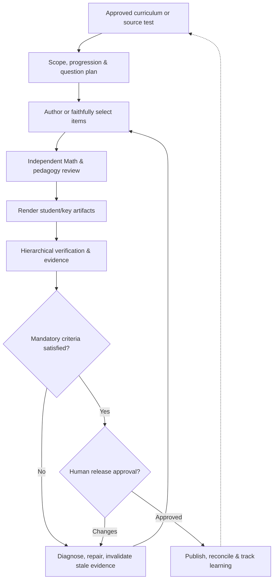

# MTS Math Worksheet & Assessment Generation — Product Definition

> **Status:** Finalized review candidate; not approved or committed  
> **Version:** 1.0-rc1 · **Date:** 2026-11-06 · **Owner:** MTS / Krishna Chaitanya  
> **Decisions:** All Math product lines in scope; weekly worksheets are the mature core; shared QA infrastructure with Math-specific criteria; human release authority.

## 1. The product on one page

**Promise.** Transform an approved Math curriculum or assessment source into mathematically correct, educationally useful, classroom-ready student worksheets and matching teacher keys—and provide inspectable evidence before a human authorizes publication.

**Plain-language picture.** The curriculum owner decides what students should learn. A planner selects the right balance of practice and thinking. A Math author creates or selects problems. An independent reviewer solves and challenges them. Production formats pages. Verification inspects the *actual* PDFs. A teacher approves the release, and the operation records what was delivered and learned.

| Who benefits | Problem addressed | Product outcome |
|---|---|---|
| MTS owner and instructors | Repetitive weekly preparation; inconsistent scope and difficulty | Predictable, controlled preparation |
| Students and families | Wrong answers, weak reasoning, unreadable diagrams | Reliable, engaging materials |
| Reviewer and release operator | Missing evidence, answer-key mismatch, unverified publication | Traceable, defensible release decisions |

**Inputs:** date/week; explicitly selected grades/courses; curriculum matrix and topic overrides; applicable standards; assessment source and official key when relevant; approved F/C/S/R allocation; template and output policies; human gate settings.  
**Outputs:** canonical run/question manifest; student PDFs and separate synchronized teacher-key PDFs; review decisions; human-readable drill-down QA, structured evidence, artifact fingerprints; approved release record; coverage and observation updates.

### Outcome measures (product targets, not claimed measured results)

| Outcome | Acceptance direction |
|---|---|
| Mathematical validity | Every released answer independently recomputed or reason-reviewed; no unresolved ambiguity |
| Curriculum intent | 100% of in-scope objectives, item quotas and mandatory criteria accounted for, or explicitly approved exceptions |
| Authentic reasoning | Every R-designated question independently qualifies and carries item-specific rationale |
| Artifact integrity | Student/key parity, legibility, pagination and diagram safety verified on exported files |
| Release integrity | Exactly the approved grade-specific PDF pairs published to the approved destination and remotely reconciled |
| Repeatability | Identified run, source/config/template versions, approvals, evidence and reproducible correction loops |
| Efficiency | Capture elapsed time, reruns, review effort and escaped defects before setting quantitative speed targets |

### Business architecture at a glance

| Functional area | Enduring capabilities | Business value |
|---|---|---|
| FA-01 Curriculum & Learning Design | Resolve weekly scope; map concept progression | Appropriate learning intent |
| FA-02 Math Content & Assessment | Allocate mix; author/select items; verify solutions and reasoning; preserve sources | Defensible questions |
| FA-03 Material Production | Compose worksheet/key; render layouts and diagrams | Usable printed materials |
| FA-04 Quality & Release | Verify against criteria; govern human approval and publication | Trusted, controlled output |
| FA-05 Learning & Improvement | Track curriculum coverage; close observation/regression loops | Better subsequent runs |

Two value streams: **VS-01 Curriculum/Source-to-Verified-Material** and **VS-02 Observation-to-Improved-Learning-Production**. See [business-architecture.md](business-architecture.md) for process and capability IDs and [ontology.md](ontology.md) for canonical terms.

## 2. Product boundaries

| Product line | Scope and maturity | Governing variations |
|---|---|---|
| PL-01 Weekly Worksheets | **Primary, most mature**; repeated dated grade-specific generation | Five weekday sections; approved F/C/S/R allocation, current templates and daily quotas |
| PL-02 Class Worksheets | Supported on explicit request | Class template/profile; not a silent substitute for weekly |
| PL-03 Source-based Math Mock Tests | Established specialized workflow | Source wording/notation/diagrams/scoring preserved; two-column dynamic packing; four-page default ceiling |
| PL-04 SAT-style/diagnostic Math Assessments | In scope, less standardized | Source/scoring assumptions and estimator confidence must be documented; detailed criteria still to ratify |

**Outside the product:** selecting educational goals on behalf of the teacher without approval; treating automatic scoring as certified pedagogy; publishing excluded grades; overriding publisher rights; building generic orchestration, evidence storage or connectors that belong to the shared Software Factory.

### Stable decisions and current operational defaults

- Grades 1, 4 and 5 use **50 weekly questions / 10 daily**; Grade 6 uses **40 / 8 daily**, each across five weekdays, unless the explicitly approved run contract changes. Other grades/courses require their own configuration; enablement does not imply inclusion in a particular run.
- **F** Focused, **C** Current Curriculum, **S** Spiral Review and **R** Reasoning are internal question roles. Percentages are *run-specific*: 25% each was the November 2 example, not a universal default. Largest-remainder allocation, rotating ties and within-day interleaving apply where configured.
- Use registered, versioned MTS masters: weekly worksheet + key masters for weekly output, class masters only for class output. Internal IDs and bucket labels must not appear in student pages.
- Regular non-benchmark weekly worksheets presently have a **maximum two student pages** in the recent Math workflow; the teacher key is separate. Never shrink, clip or silently drop content to meet a page limit: expose a blocking conflict for authorized resolution.
- Source-based mock tests default to US Letter, two columns and `page_ceiling=4`, preserve original vectors if possible, treat items atomically, target 75% diagram scale with a 70% floor and at least 6 pt clearance.
- All enabled human gates remain binding. Even when an authorized run bypasses intermediate review checkpoints for staging, final QA and a **separate explicit human publication approval** remain mandatory.

## 3. Product capability acceptance contract

| Capability | User-visible acceptance outcome |
|---|---|
| CAP-01 Scope curriculum | Run contract records date, grades, objectives, overrides, exclusions and source/config provenance |
| CAP-02 Model learning progression | Prerequisites, current concepts, next concepts and standards are distinguishable |
| CAP-03 Plan question allocation | Weekly/day counts, bucket quotas and interleaving match the approved grade contract |
| CAP-04 Author/select questions | Stable IDs, prompt, answer, target objective, source and weekday/position are maintained |
| CAP-05 Independently verify Math | Numeric, symbolic, visual and explanatory answers are checked; changed items reopen verification |
| CAP-06 Qualify mathematical reasoning | Every R item has a recognized nonroutine archetype, specific rationale and independent verdict |
| CAP-07 Preserve assessment sources | Selected source questions, diagrams, notation, choices and scores remain faithful |
| CAP-08 Assemble printable artifacts | Correct master, numbering, US Letter layout, diagram bounds and student/key parity on final PDFs |
| CAP-09 Certify quality | In-scope criteria produce actual PASS/FAIL/NOT VERIFIED/SKIPPED results, review evidence and fingerprints; exclusions segregated |
| CAP-10 Govern release | Human authorizes exact certified files; publication IDs, names, parent folder and complete set verified |
| CAP-11 Track coverage | Only released material updates the delivered curriculum record; deliberate review is labeled |
| CAP-12 Improve from evidence | Observation links to impacted rule, root cause, delta, repair and regression verification |

## 4. Quality governance and traceability

The canonical workflow retains five human checkpoints: **G1 curriculum**, **G2 questions**, **G3 verification**, **G4 formatting**, **G5 final QA/release**. These are *run-level gates*, distinct from the Software Factory's M0–M8 lifecycle stations. QA certification is **not** permission to publish.

**Shared QA ownership:** The factory supplies criterion registry mechanics, status semantics, test execution, evidence schema, reviewer identity, fingerprints, report UI, invalidation and traceability. Math owns mathematical validity, F/C/S/R semantics, grade/standards alignment, template-specific layout, diagrams and source fidelity. The preferred report is an expandable human-readable checklist with grade-wise summary and domain → criterion → test → expected/actual/evidence drill-down; PDF summary and JSON are secondary outputs.

**Statuses:** PASS, FAIL, NOT VERIFIED and documented SKIPPED apply only to in-scope criteria. OUT OF SCOPE grades/criteria appear separately, never in the evaluated denominator. No mandatory NOT VERIFIED or FAIL permits certification; approved exceptions require explicit applicability/waiver policy and human authority. The latest November 9 batch *reported* 154 PASS, five SKIPPED, zero FAIL/NOT VERIFIED across 159 checks—historical run evidence, not a perpetual guarantee.

**Trace chain:** `INT/OUT → VS → FA/CAP → BP/RULE → REQ → AC → VC → TEST/EVAL → EVD → Gate → Artifact/Release`. Stable IDs and the cross-reference matrix belong in implementation-level requirements/verification files. A QA checklist criterion is an inspectable verification row, not a substitute for its parent acceptance criterion.

## 5. Decision rights and information ownership

| Decision/data | Accountable owner / source of truth |
|---|---|
| Curriculum, weekly objectives, exceptional scope | MTS curriculum owner; approved run matrix |
| Mathematical methods and educational quality | Math reviewer; canonical question record plus independent review evidence |
| Run-specific counts, templates, source IDs | Approved run contract referring to current configuration and template manifest |
| Verification results | Executed shared QA ledger with Math criteria and artifact fingerprints |
| Publication | Named human approver and immutable release manifest; publisher verifies destination |
| Learning feedback | Coverage register and observation/delta ledger |

## 6. Remaining requirements drill-down

1. **R1 Intake & contract:** grade scope, pacing, overrides, counts, profile and gate reconciliation.
2. **R2 Authoring & pedagogical quality:** F/C/S/R semantics, difficulty, puzzle validity, independent solutions and standards.
3. **R3 Source-test variants:** question/diagram/scoring fidelity and diagnostic estimator rules.
4. **R4 Rendering:** template versioning, slots, question identity, pagination, figures, visual inspection.
5. **R5 Verification & release:** atomic AC/VC/test mapping, failure/invalidation, evidence schema, human sign-off, remote reconciliation.
6. **R6 Learning loop:** coverage, repeat detection, observations, root cause and regression checks.

**To ratify:** Product line PL-04 scoring contracts; explicit waiver taxonomy; grade 9–10 course profiles and defaults; handling of print-limit conflicts; threshold for treating a verified key as independently reviewed. These are deliberately not presented as already implemented.

**Primary baseline references:** recent MTS Math `design.md`, `worksheet-generation.md`, weekly run and QA decisions through November 9, 2026; MTS Math mock-test policy; MTS ELA product/architecture convention; AI-SDLC Software Factory strategy.
