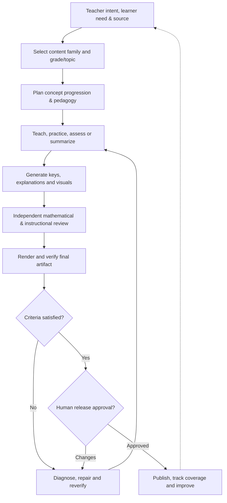

# MTS Math — Learning Content, Practice & Assessment Product

> **Status:** Holistic revision for human review; **not approved as canonical**  
> **Document version:** 1.2-rc1 · **Revision date:** 2026-11-07  
> **Revision name/comment:** **Holistic Math portfolio plus notation, diagramming and SAT/ACT extrapolation** — expands the 2026-11-06 worksheet-and-assessment baseline into an integrated Math learning-content product: lesson plans, topic summaries, cheat sheets, practice, homework, mock tests, diagnostics, answer/solution modes, multiple source modes, mathematical typesetting, visualization, standardized-test scoring/extrapolation, curriculum tracking and evidence-governed release.  
> **Owner:** MTS / Krishna Chaitanya · **Source predecessor:** `source-material/mts/math/product/product-2026-11-06-v1.md` (v1.0-rc1)  
> **Decisions retained:** All Math product lines in scope; shared factory QA with Math-specific verification; readability and mathematical correctness before page-density targets; **explicit human approval before publication**.

## 1. Product in one page

### One-sentence promise

**Turn a teacher's Math learning intent—whether a full week of instruction, a single topic, a source test, or a diagnostic question—into the right kind of lesson, practice, assessment, explanation or reference material, then independently establish that its content and printed form are trustworthy.**

**Feynman explanation.** Think of an excellent Math teaching studio. A curriculum designer decides *what to learn*. A teacher explains *why it works*. A practice designer creates *how to exercise it*. An assessor measures *what the student can do*. A mathematician checks every answer. A publishing editor makes the material readable. Finally, the lead teacher decides what parents and students receive. The product supports each activity and makes them work together.

| Problem | Users | Value delivered |
|---|---|---|
| Fragmented lesson notes, worksheets, mock tests, sources, keys, templates and verification steps | **Primary:** MTS instructor/curriculum owner; **secondary:** learners, parents, reviewers, publishers | Better mathematical understanding, structured progression, reuse of trusted source content, fast reproducible generation and auditable release |

### Outcome contract (targets, not assertions of past performance)

| Outcome | Product-level target |
|---|---|
| Mathematical accuracy | 100% of released answer-bearing items independently checked for correct result, method, notation and units |
| Pedagogical effectiveness | Materials match learning objective, prerequisite knowledge, intended cognitive demand and teacher-selected teaching approach |
| Intent/variation fidelity | Explicit product type, grade, source mode, solution mode and print policy govern each run; no accidental switching |
| Assessment integrity | Source fidelity, question/key parity, reasoning quality, scoring assumptions and fair difficulty independently reviewed |
| Readable delivery | Final exported artifact visually checked for font, spacing, diagrams, glyphs, cutoffs, question integrity and page limits |
| Verifiable release | Every mandatory in-scope criterion has evidence; only a named human can authorize final publication |
| Learning feedback | Released coverage, student findings, defects and useful teaching insights update future plans and regression criteria |

## 2. Product portfolio — what MTS Math creates

The product is broader than a **Worksheet Generator**. A worksheet is only one output format within a full **Math Learning, Practice & Assessment** portfolio.

| Family | Product examples | Primary purpose | Evidence of maturity |
|---|---|---|---|
| **Learning / Teaching** | Lesson plan, teaching sequence, concept explanation, topic summary, worked example, visual concept map | Build understanding | Topic notes/teaching interactions have occurred; standardized repeatable pipeline **proposed** |
| **Practice / Homework** | Weekly worksheet, class worksheet, single-topic worksheet, skill drill, focused intervention, homework sheet, puzzles/games, enrichment | Build fluency and reasoning | Weekly workflow **mature**; class/topic/puzzle formats demonstrated or configured; homework variants less standardized |
| **Assessment / Diagnostic** | Source-based NY state mock, benchmark-style test, SAT/ACT-style modules, short diagnostic, readiness check, score estimate and interpretation | Measure understanding and gaps | Mock-test formatting **established**; algebra/linear and SAT-style diagnostics demonstrated in individual runs; calibrated SAT/ACT estimation remains **evolving** |
| **Answer / Teaching Support** | Answer-only key, key plus concise solution, complete worked solutions, teacher-method explanation, misconception notes | Support teaching, feedback and self-correction | Separate matching keys and independent answer verification **established**; configurable pedagogical solution styles **to formalize** |
| **Reference / Revision** | Formula sheet, topic cheatsheet, concept summary, step-by-step method card, quick revision guide | Aid recall, synthesis and transfer | Math cheatsheet requests and topic references exist; standardized verification/template contract **emerging** |
| **Progress / Analytics** | Curriculum tracker, topic coverage, diagnostic skill profile, error-pattern report, recommendation for next practice | Close the learning loop | Curriculum/run tracking **established in parts**; diagnostic analytics/personalization **proposed extension** |
| **Mathematical Representation** | Accurate equations, typeset notation, geometric figures, graphs, number lines, coordinate planes, tables and visual models | Express mathematics without changing its meaning | Source diagram preservation and print QA **established for mock tests**; general generation/typesetting conformance **to formalize** |

Product line and output type must be separate concepts: one lesson can generate a teacher note, student handout, worked examples, exercises and a key; one source test can yield an exact mock, a shorter diagnostic and a coverage analysis, with separately approved transformation contracts.

## 3. Configurable product dimensions

Avoid creating a separate hard-coded workflow for every combination. Define one stable content object and explicit, validated variations.

| Dimension | Supported values / intent | Governing rule |
|---|---|---|
| **Teaching purpose** | Introduce, explain, explore, practice, reinforce, review, diagnose, assess, summarize | Driven by teacher's learning intent |
| **Audience / level** | Elementary, middle, high school, grade-specific or course-specific (e.g., Algebra I, geometry, higher Math topics) | Grade/course scope explicit; enrichment distinguished from standard alignment |
| **Time structure** | Single topic/session, class period, weekday, 4- or 5-day week, unit, benchmark | Select timing deliberately; not every artifact uses five day-blocks |
| **Practice type** | Weekly, class, single-topic, homework, puzzle/game, mock test, mini-diagnostic | Explicit profile, counts and template |
| **Source mode** | Published/released test; ready-made curated source; raw book/PDF/notes; teacher-authored; AI-generated from approved objectives; hybrid | Record provenance, version, allowed transformation and source authority |
| **Transformation** | Reproduce faithfully, select subset, reflow/reformat, adapt with permission, synthesize from source, generate original | Never silently treat a derived question as source-identical |
| **Question mode** | MCQ, numeric answer, constructed response, short reasoning, multi-step problem, table/graph, geometric diagram, puzzle/investigation | Match objective, cognitive level and necessary response space |
| **Key mode** | Answer only; answer + concise method; detailed worked solution; teacher-preferred method; multiple valid methods | Same item IDs/order; correctness independently checked; teacher method recorded if specified |
| **Cognitive mix** | F focused, C current, S spiral, R reasoning; difficulty and skill objectives | Percentages/quotas per approved run, not a universal global ratio |
| **Presentation** | Student vs teacher; editable Doc, printable PDF, compact handout, two-column mock test, formula sheet | Governed by named print profile; print QA on exported output |
| **Notation/diagram mode** | Preserve original vector, generate mathematically accurate figure, render symbolic expression, reflow verified formula | Verify mathematical semantics separately from appearance |
| **Scoring mode** | Official conversion, evidence-calibrated estimate, rough extrapolation, skill-only diagnostic | Identify validity level and uncertainty; never represent a rough estimate as official |
| **Delivery** | Review/stage, publish to approved destination, track coverage and observe | Explicit human release approval even after QA certification |

### Source policy and provenance

1. **Published test papers:** preserve original question wording, quantities, notation, options, diagrams, scores and permitted numbering when the intent is faithful reformatting. Cite title/year/grade and retain original question identifiers in the manifest.
2. **Ready-made instructional content:** identify publisher/book, edition, chapters/pages or exact source location and record whether reproduced, selected or adapted.
3. **Raw sources:** inspect scans, tables, handwritten notes and diagrams; detect extraction uncertainty; require review for any recreated mathematical figure or symbol.
4. **Teacher/MTS methods:** retain user-provided reasoning order, notation and pedagogical priorities distinctly from the mathematically canonical answer.
5. **AI-origin content:** identify as generated, map to objectives, independently solve, inspect ambiguity, and screen against prior released item snapshots for accidental repetition.
6. **Hybrid content:** maintain provenance and transformation lineage at the item level. No fictitious citation or unverified claim of published origin.

## 4. Pedagogical principles

**Understanding before memorized procedure** is the teaching spine. The product should connect concrete situations, diagrams, mathematical language, symbolic methods and transfer to unfamiliar questions.

| Principle | In practical material |
|---|---|
| Concept progression | `builds_from → current concept → leads_to`; prerequisites explicitly revisited |
| Number sense & mental Math | Efficient strategies, estimation, properties and multiple approaches where appropriate |
| Reasoning, not labels | Nonroutine R items require genuine inference, constraints or strategic exploration; independent semantic PASS |
| Gradual challenge | Accessible entry → increasing complexity → transfer, with grade/course-appropriate extensions |
| Representation fluency | Words, tables, coordinate plots, shapes, units, equations and real contexts agree |
| Misconception-aware teaching | Explanations identify why a plausible wrong approach fails, when appropriate |
| Teacher-method fidelity | If MTS specifies a method, show it accurately without declaring other valid approaches incorrect |
| Application & retention | Current learning, spiral review, and real-world use are intentionally selected |

This teaching spine applies to lesson plans, explanations, worksheets, diagnostics and cheat sheets, but each uses a suitable rubric rather than one uniform worksheet checklist.

## 5. Product architecture and core capabilities

Two value streams: **VS-01 Intent-to-Trusted-Learning-Material** (teaching, practice, assessment, support) and **VS-02 Learning/Operations-Observation-to-Improvement**. The canonical business decomposition belongs in `business-architecture.md`; the shared entities/relationships belong in `ontology.md`. This revision proposes corresponding expansion there **after product review**, not silent synchronization.

| Functional area | Capability | Coverage |
|---|---|---|
| FA-01 Learning Design | CAP-01 Scope curriculum and learner need; CAP-02 model concept progression; CAP-03 plan lesson and assessment objectives | All families |
| FA-02 Content & Sources | CAP-04 discover/validate sources; CAP-05 preserve or transform source material; CAP-06 generate teaching, practice and reference content | All families |
| FA-03 Math Pedagogy & Assessment | CAP-07 plan question mix and difficulty; CAP-08 independently verify Math; CAP-09 qualify reasoning/puzzles; CAP-10 design explanations and teacher methods; CAP-11 evaluate diagnostic performance | Practice, assessment, teaching support |
| FA-04 Artifact Production | CAP-12 compose student/teacher variants; CAP-13 format text, formulas, tables and diagrams; CAP-14 produce editable/printable formats; **CAP-19 ensure mathematical notation/typesetting; CAP-20 produce and validate mathematical visualizations** | All document families |
| FA-05 Quality & Release | CAP-15 execute hierarchical evidence-backed QA; CAP-16 run human gates and publish/reconcile authorized artifacts | All releases |
| FA-06 Learning & Improvement | CAP-17 track curriculum coverage and repetition; CAP-18 analyze learner/production observations and regressions | Cross-cutting feedback |
| FA-03 Math Pedagogy & Assessment | **CAP-21 estimate and interpret standardized-test scores** with documented conversion or extrapolation basis | SAT/ACT and other assessment profiles |

**Factory versus domain:** Shared factory provides execution scheduling, traceability engine, artifact/version storage, verification result schemas, report rendering and publication connectors. Math provides the actual mathematical rules, assessment rubrics, solution verification, pedagogy, standards mappings and content/diagram acceptance criteria.

## 6. Workflow variations and proven operating rules

### Weekly / homework / class practice

- Establish current grade, calendar, approved CCS pacing and NC standards provenance. Weekly worksheets are the most mature path.
- Current demonstrated weekly grade baseline: G1/G4/G5 **50 items, 10/day**, G6 **40 items, 8/day**, in five weekday blocks. The grade 9–10 and other profiles must be explicitly configured and selected.
- Convert run-specific F/C/S/R percentages to exact integer quotas; interleave active buckets during each day; record stable question IDs separate from printed numbering.
- The November 2 example used 25% per bucket, not an eternal default. R items must independently qualify as puzzles/reasoning, with item-specific evidence.
- Use registered versioned weekly/class templates. Student pages exclude internal category tags and answer leakage. Staged editable Docs and final PDFs are different artifacts and states.

### Source-based mock/benchmark tests

- Inventory source stems, choices, tables, diagrams, point values and official answer references; record chosen scope.
- Preserve mathematical content exactly when source fidelity is requested; remove only unnecessary publisher furniture.
- Default US Letter, two-column student layout, **four-page ceiling** (not a target), atomic questions and dynamic packing.
- Preserve original vectors when possible, measure whole-ink bounds and 6 pt clearance; fit diagrams at **75% initially, down to no less than 70%**; move an intact item when necessary.
- Produce a distinct teacher key and visually inspect every page for clipping, whitespace, glyphs and source mismatch.

### Short diagnostics, SAT-style and other assessments

- Choose objective coverage, difficulty, item count, time budget and source/score method before authoring or selection.
- Proven isolated examples include 20–30 minute SAT mini-diagnostic requests and a compact Algebra/Linear diagnostic; consistent calibrated scoring and broad analytics are **not yet a mature uniform product contract**.
- Report raw correct/incorrect counts, skill evidence and uncertainty; a full-scale score prediction must describe its extrapolation method and limitations, rather than imply official score equivalence.

### CAP-21 — Standardized-test score calculation and extrapolation (SAT/ACT)

- Verify each scored response against the correct form/module/key and report raw score by subject or section.
- Where an authoritative, form-applicable raw-to-scaled conversion exists, use it and disclose the source/version. Where it does not, label results as **estimated** and retain assumptions, uncertainty and calibration status.
- For partial SAT modules, mini-tests and abbreviated ACT sections, distinguish simple proportional extrapolation from calibrated prediction. Never imply an unofficial estimate is an official SAT/ACT score.
- Handle SAT Math, Reading/Writing and total-score estimates, and ACT section/composite estimates under **separate exam-specific scoring policies**, including any weighting and rounding rules that apply to the chosen version.
- Return evidence-based strengths/weaknesses, score range where supportable, caveats and next instructional actions. ACT-specific scoring and generalized calibration are **proposed**, not claimed implemented.

### CAP-19 — Mathematical notation and typesetting

- Preserve and accurately render fractions, radicals, powers, inequalities, equations, sets, intervals, matrices, vectors, summations, limits, integrals, geometric symbols and units across source extraction, editing, PDF conversion and print.
- Validate mathematical semantics, grouping, exponents/subscripts, alignment and glyph integrity independently of mere visual appearance. Use suitable structured math representations (such as LaTeX/MathML) where supported.
- Broken operators, lost minus signs, altered fractions, ambiguous grouping or substituted symbols are release-blocking errors when they change meaning.

### CAP-20 — Mathematical visualization and diagramming

- Support accurate construction **and** preservation of geometry figures, graphs, coordinate planes, number lines, fraction models, tables and statistical displays.
- Verify labels, axes, scales, tick marks, legends, dimensions, angle markings, plotted values, relative relationships and response-space placement.
- Differentiate faithful source preservation, original diagram generation and explanatory illustrations. A schematic must be labeled as such when not drawn to scale.
- The mock-test-specific 75% initial scale, 70% minimum and 6 pt clearance rules remain **profile-specific**, not universal scaling policy. Every exported figure must still be readable and uncropped.

### Lesson plans, summaries and cheat sheets

- Start from learning objective, prerequisite graph, illustrative representations, explanation sequence, worked examples, common errors and short checks for understanding.
- Cheat sheets prioritize quick retrieval: grouped formulas, notation/units, conditions for use and one small example per essential idea. They may be one or two pages by request, but no invisible omissions to meet density.
- Topics can range from arithmetic to algebra, coordinate geometry, functions, quadratics and advanced subjects such as linear algebra; actual content and quality rubric depend on course level. A named topic does not itself prove a pre-existing automated pipeline.

### Answer and solution variants

| Mode | Contents | Verification |
|---|---|---|
| KEY_ONLY | Number/ID → exact answer | Independent result check and student/key parity |
| KEY_WITH_BRIEF_METHOD | Answer and concise reasoning/formula | Independently correct answer and method |
| WORKED_SOLUTIONS | Full steps, assumptions, units, diagrams as needed | Step-level mathematical validation and legibility |
| TEACHER_METHOD | Approved MTS instructional method, possibly alternative methods | Match teacher's actual method, preserve mathematical validity and identify alternatives accurately |

All answer-bearing variants refer to the *same canonical question identity*. If the question changes, dependent answers, solutions, semantic review and printed artifacts must be reverified.

## 7. Presentation and quality policy

**Print profiles are specific to artifact type.** A compact weekly practice sheet, a source-faithful mock test and a formula reference sheet need different page contracts. Fonts, margins, line spacing, column count, diagram handling and response-space budget are validated profile fields, not hidden prompt guesses.

| Profile | Current baseline or policy | Notes |
|---|---|---|
| Weekly non-benchmark student sheet | **Maximum 2 pages** in the most recent Math workflow | Separate teacher key; no clipping or silent content removal |
| Source-based mock test | **Four-page default ceiling**; 2 columns | Diagrams 75% first, 70% floor, 6 pt bounds; source values preserved |
| Dense diagnostic | Compact layout including ~9 pt examples where verified | Readability, question atomicity and page utilization must be inspected |
| Lesson/topic/cheat sheet | Configured by content goal and requested compactness | No generic two-page mandate; distinguish target vs ceiling |

**Mandatory quality dimensions:** intent/grade scope; source and rights provenance; objective/concept alignment; item completeness and uniqueness; independent answer correctness; reasoning and assessment fairness; key parity; mathematical notation/semantic fidelity; formula and unit consistency; constructed/source diagram geometry and labels; SAT/ACT scoring provenance and uncertainty; final PDF visual integrity; evidence freshness; exact publication identity.

The preferred review experience is the established **expandable human-readable QA report**: summary cards, in-scope grade views, separate out-of-scope section, domain → criterion → evidence drill-down, expected/actual/method/reviewer/fingerprint, and item-level reasoning review. Machine-readable JSON and optional printable evidence are companion artifacts. The historical November 9 run reported **154 PASS, 5 documented SKIPPED, zero FAIL/NOT VERIFIED across 159 checks**; that result certifies only that staged run, not all product lines.

## 8. Governance, traceability and learning loop

**Run gates:** G1 curriculum/scope, G2 questions/content, G3 independent verification, G4 formatting, G5 final certification and explicit publication approval as configured. Even if intermediate staging checkpoints are permissibly bypassed, **no automatic parent-facing publication** follows from QA success.

**Trace chain:** `Learning intent/outcome → value stream → capability/process/rule → requirement → acceptance criterion → verification criterion → test/eval → evidence → gate decision → released artifact → coverage/observation → proposed delta`.

- **PASS** means an executed check with evidence; **FAIL** is a detected mismatch; **NOT VERIFIED** is an incomplete check; **SKIPPED** requires documented applicability decision. **OUT OF SCOPE** is shown separately and never counted in the verified denominator.
- Changed questions, source content, diagrams, print profiles or templates invalidate their dependent approval and evidence fingerprints. Corrections loop to the earliest affected process without pretending previously executed tests remain current.
- Human owner authorizes intent, instructional exceptions and release. Separate semantic and mathematical review must challenge—not merely echo—the generator's assertion.
- Curriculum tracking records what was actually released; student mistakes and quality defects feed observation, root-cause, requirement delta, correction and regression prevention.

## 9. Product information model

| Entity | Why it matters | Authoritative record |
|---|---|---|
| Learning intent / audience / objective | Establishes purpose and level | Approved curriculum/teacher direction |
| Concept / prerequisite / standard | Preserves learning progression | Concept graph, current pacing and authoritative standard references |
| Source / transformation lineage | Prevents invented provenance or fidelity drift | Source catalog and item manifest |
| Content unit | Lesson, example, problem, solution, formula or concept summary | Canonical typed content specification |
| Output profile | Defines worksheet, assessment, teaching note, reference and answer variants | Validated artifact/print configuration |
| Verification result/evidence | Demonstrates actual mathematical and print QA | Shared QA ledger with Math-specific validators |
| Release / delivered coverage | Distinguishes staged from approved/published | Release manifest and curriculum tracker |
| Observation / delta | Turns defects and learning findings into improvements | Feedback and governed change register |

## 10. Scope maturity and next decisions

| Area | Current status | Next formalization |
|---|---|---|
| Weekly Math generation + matching keys | Repeated established workflow | Strengthen traceability and cross-grade regression coverage |
| Source-preserving Math mock-test formatting | Established specialized workflow | Standardize manifest, source diffs and diagram QA across sources |
| Math QA hierarchy and evidence report | Recently implemented/certified for a batch | Generalize reusable engine across teaching, practice, diagnostic and reference outputs |
| Single-topic, class, homework and puzzle variants | Practiced/configured in varying degrees | Product profiles, counts, source and template contracts |
| Full worked solutions and teacher-style explanations | Individual outputs/requirements observed | Solution-mode schema, method fidelity and independent review rubrics |
| Lesson plans, notes and Math cheat sheets | Individual teaching/reference tasks observed | Authoring, visual explanation, citation and print verification contracts |
| Diagnostic scoring and personalized recommendations | Early examples, not uniformly calibrated | Validity, scoring/extrapolation, evidence and uncertainty contract |
| Mathematical notation and typesetting (CAP-19) | Required across Math outputs, with demonstrated source/print checks | Formal symbol-semantic round-trip and rendered glyph checks |
| Mathematical diagramming (CAP-20) | Source-preservation established in specialized mock format | General generated-figure geometry, scale, labels and profile-specific safety tests |
| SAT/ACT score extrapolation (CAP-21) | Partial SAT-style extrapolation explored; ACT coverage not yet proven | Separate official, calibrated and heuristic conversion policies with defensible uncertainty |

### Proposed first requirements slices

1. **R1 — Intent, taxonomy and configuration:** product family, teaching purpose, audience, time structure, source and transformation mode, output profile, gate contract.
2. **R2 — Curriculum/pedagogy:** standards, concept graph, sequencing, F/C/S/R logic, difficulty and representations.
3. **R3 — Source and content generation:** ready-made/raw/published/AI/hybrid provenance; original vs transformed item lineage; lesson/problem/reference generation.
4. **R4 — Solutions and assessment:** key modes, independent mathematical verification, R/puzzle quality, SAT/ACT scoring/extrapolation, diagnostics and uncertainty.
5. **R5 — Formatting and assets:** typed content model, registered templates, math symbol rendering, original/generated mathematical figures, print profiles, vector assets, layout and visual QA.
6. **R6 — Verification and release:** shared QA, Math-specific VC groups, fingerprints, evidence, human gates and publication reconciliation.
7. **R7 — Learning and evolution:** curriculum coverage, performance/error signals, observation-to-delta and regression loops.

### Decisions requested before promoting this revision

1. Is the overarching product name **MTS Math Learning, Practice & Assessment** preferable to **MTS Math Worksheet Generation**? (Recommended: overarching name; worksheet generation is a product family.)
2. Should lesson plans, cheat sheets and topic summaries be treated as **first-class in-scope products** even though their repeatable automation is not yet mature? (Recommended: yes, with accurate maturity labels.)
3. Should the future `business-architecture.md` and `ontology.md` be expanded in the next revision to describe typed **Content Units**, **Instructional Methods**, **Source Transformation**, **Assessment/Evaluation** and **Artifact Profiles**? (Recommended: yes, after product sign-off.)

**Not changed here:** earlier historical v1 snapshot, current running implementations, other architecture files, released content, or GitHub branch. This document is a review candidate only.
