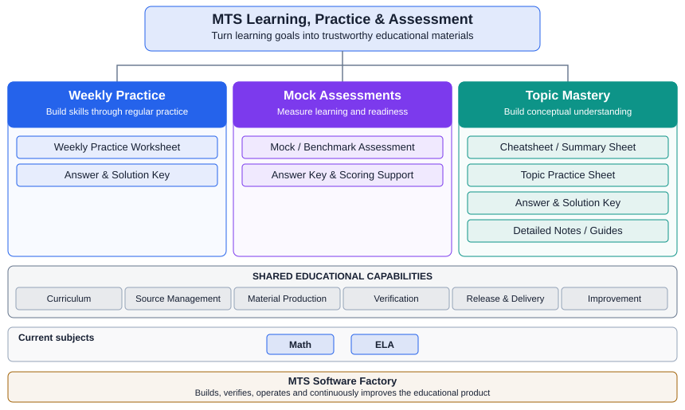
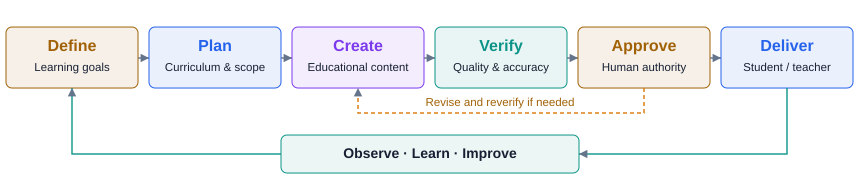

# P1 — Product Intent Canvas

[MVP overview](../README.md) · [Level 1 index](README.md) · [Next: 02-architecture](02-architecture.md) · 1 of 4
**ID:** RVC-P1-MTS · **Canonical perspective:** P1 · **Scope:** Factory / MTS product · **State:** To-Be · **Status:** Approved review view · **Revision:** 1 · **Discipline:** Reviewability Engineering 1.0.0 · **Owner:** MTS product owner

## Product intent

**MTS Learning, Practice & Assessment** helps educators turn approved learning goals into trustworthy Math and ELA educational materials, supporting effective learning, practice, revision and assessment.

The product's objective is educational value. The Software Factory enables efficient creation, verification, delivery and continuous improvement. Product workflows and the factory that builds and improves them are distinct.

## Product landscape

Three educational artifact families are the primary review grouping, not replacements for existing functional-area IDs. Topic Mastery includes detailed topic notes/guides, distinct from deferred standalone lessons.

## Educational product value stream

Approval and verification are distinct; changes require affected checks to be repeated. Feedback informs governed improvement.

## Scope and boundaries

| Aspect | Current review scope |
|---|---|
| Primary users | Teachers and curriculum owners |
| Beneficiaries | Students and families |
| Other stakeholders | Subject reviewers and release operators |
| Subjects | Math and ELA |
| Core artifact families | Weekly Practice, Mock Assessments, Topic Mastery |
| Supporting capabilities | Curriculum, sources, production, verification, release/delivery and improvement |
| Deferred | Standalone lessons, diagnostics as a separate capability, broader learner analytics, additional subjects |
| Final release authority | Human |

Deliver trustworthy, readable and maintainable materials within agreed resource limits, respecting source permissions, student privacy and human release authority. Preserve model/harness portability where feasible.

## Intended product outcomes

| ID | Outcome | Success means |
|---|---|---|
| OUT-MTS-001 | Scope fidelity | Deliver what the educator requested |
| OUT-MTS-002 | Educational correctness | Independently reviewed content and answers |
| OUT-MTS-003 | Source integrity | Appropriate source selection, permissions and fidelity |
| OUT-MTS-004 | Release integrity | Correct, matched and approved deliverables |
| OUT-MTS-005 | Continuous improvement | Feedback and evidence improve subsequent materials |

Numerical targets and detailed criteria belong to [architecture overlays](02-architecture.md#q1--quality-attribute-matrix) and [V1](03-definition-of-done.md). No new numerical targets or security controls are ratified here.

## Authority and review metadata

Source references: [product intent](../../../product.md), [business architecture](../../../business-architecture.md), [verification mapping](../../../requirement-verification-mapping.md), reviewed against repository revision 5a97d62ccc7e2e2e2f4b5fa2fd36932911e995bb. Underlying quartet remains draft/review; this approval is for the P1 review view, not full product ratification, implementation or release.

Human approval: product content approved in conversation; both canonical revision-1 visuals explicitly approved for check-in in conversation on 2026-11-20. Canonical visuals are faithful transcriptions of earlier inline diagrams, subsequently rendered from their standalone sources and approved by the human.

| Canonical SVG | SHA-256 of approved source |
|---|---|
| factory-mts-P1-product-landscape-to-be.svg | dee7921df5ddc8d3d99fd9e7cf5b56804f7ec5ab221ff84062956161a9a31a6a |
| factory-mts-P1-value-stream-to-be.svg | f17da4121f56e91b0bc9f9e4654c089fa357129e6316c2d31f3c93fac51f3bf8 |

Review pattern: P1 Product Landscape + conceptual value-stream companion. Evidence limits: conceptual intent review, not runtime verification. Git history records persistence revisions.

---

[MVP overview](../README.md) · [Level 1 index](README.md) · [Next: 02-architecture](02-architecture.md)
