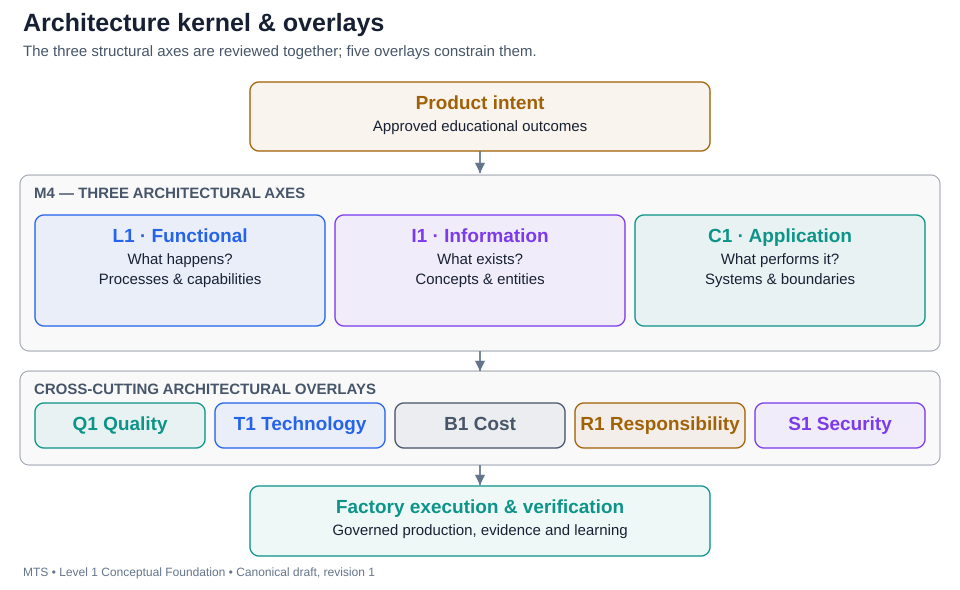
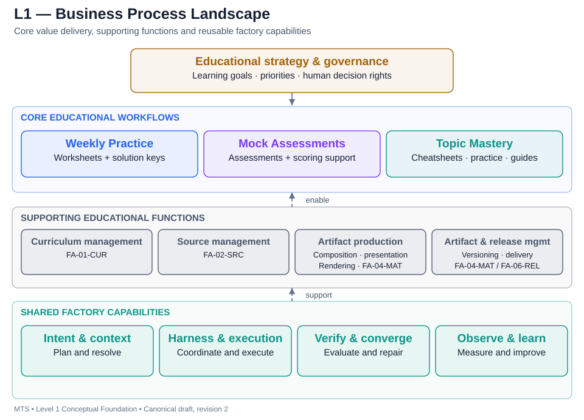
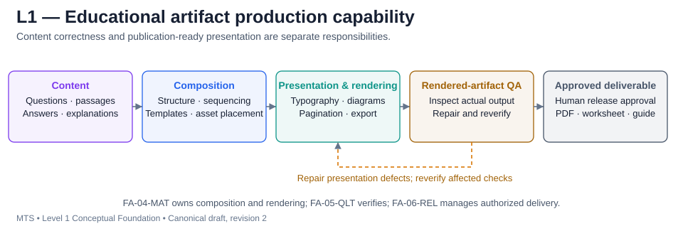
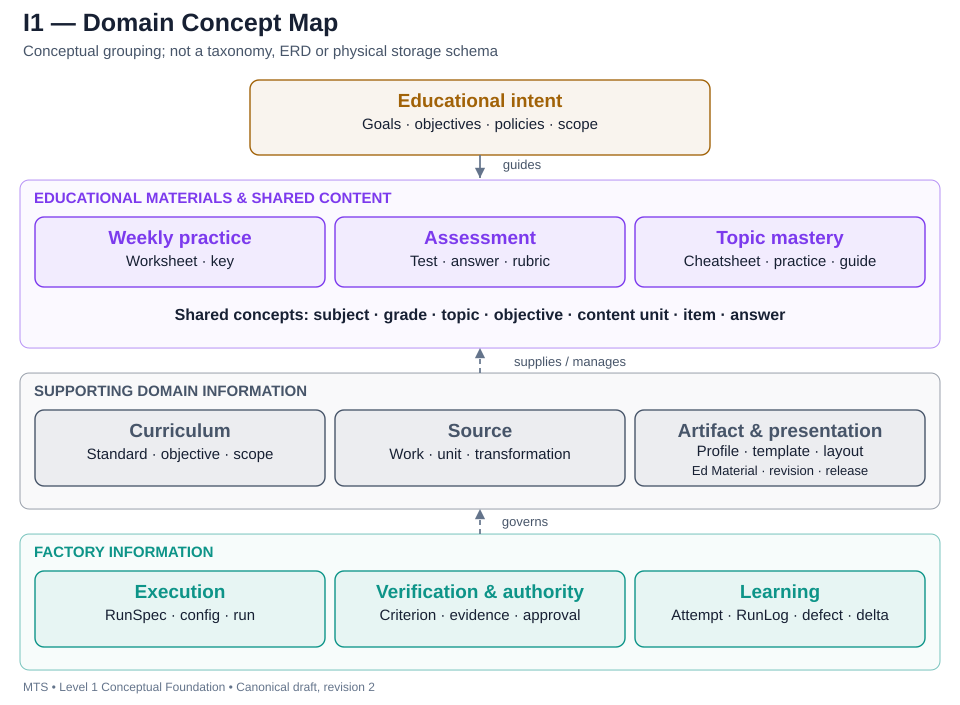
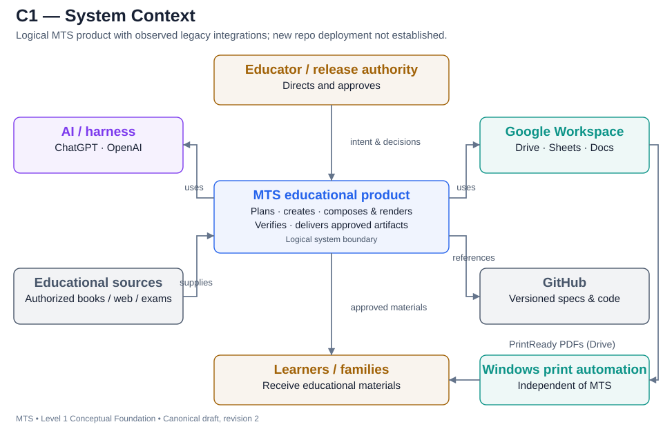
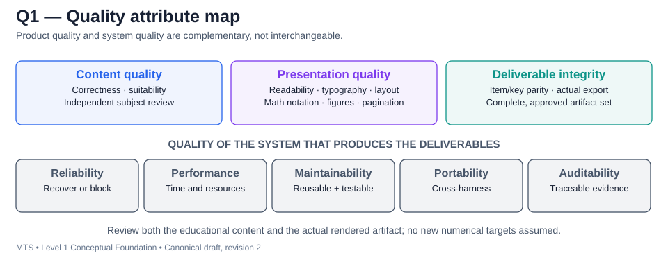
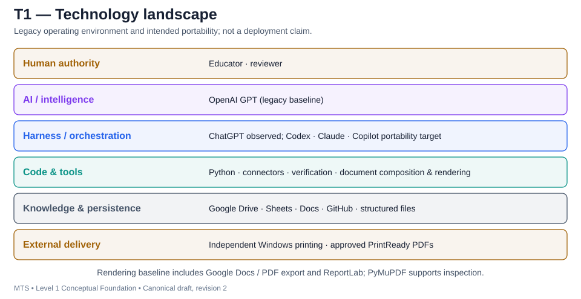
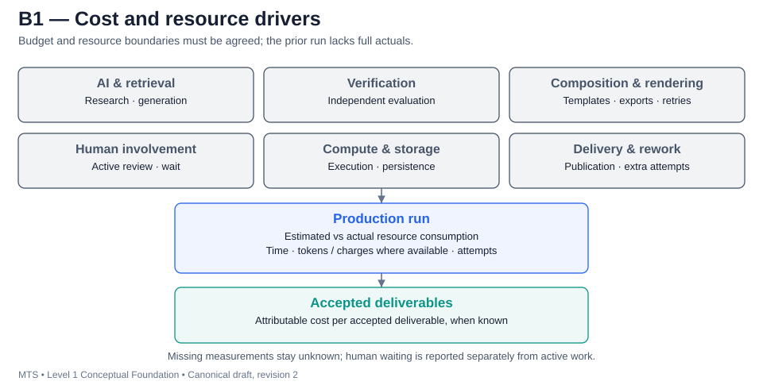
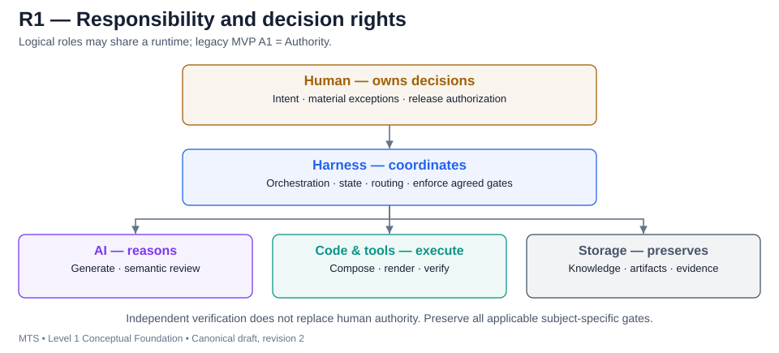
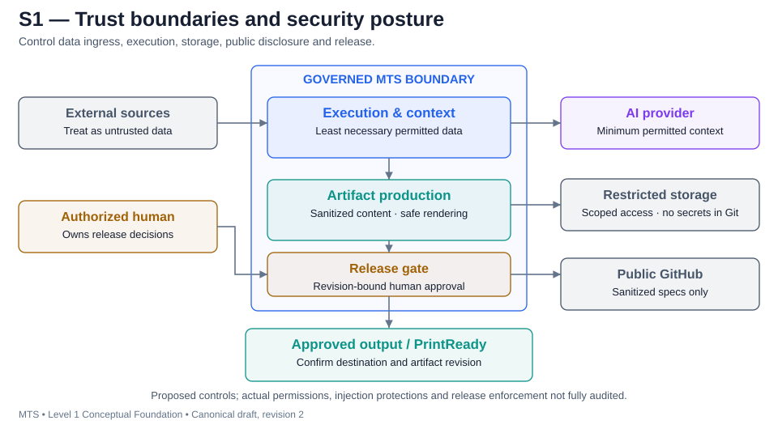

# Level 1 — Architecture axes and overlays

[Previous: 01-product](01-product.md) · [Level 1 index](README.md) · [Next: 03-definition-of-done](03-definition-of-done.md) · 2 of 4
**ID:** RVC-ARCH-MTS-L1 · **State:** To-be conceptual review with known operating context · **Status:** Approved conceptual review view · **Revision:** 2 · **Discipline:** Reviewability Engineering 1.1.0 · **Owner:** MTS architecture owner (role)

**Candidate revision:** Documentation Engineering v0.1 pilot; not approved. Historical status/revision above refers to the baseline, not this candidate. [Baseline and checks](REVIEW-REPORT.md).

## Reading guide
- [Overview](#holistic-overview) · [Business process](#l1--business-process-landscape-rvc-l1-bpl) · [Information](#i1--domain-concept-map-rvc-i1-dcm) · [System context](#c1--system-context-rvc-c1-scd) · [Cross-axis review](#cross-axis-review)
- [Quality](#q1--quality-attribute-matrix) · [Technology](#t1--technology-landscape) · [Cost](#b1--cost--resource-model) · [Responsibility](#r1--responsibility--authority-matrix) · [Security](#s1--trust-boundary--security-map) · [Approval evidence](#review-approval-and-source-fidelity)

## Architecture in plain language
A trustworthy educational artifact requires coordinated work, information and participating systems. The three axes describe these separate views of the same product; overlays constrain them rather than create five more independent systems. The canonical overview below shows the relationships. Existing legacy evidence and proposed controls must remain distinct.

| View | Question | Illustrative MTS example |
|---|---|---|
| Functional | What work occurs? | Select questions, compose worksheet, check answers |
| Information | What concepts and relationships are managed? | Question, source, answer and artifact revision |
| Application | Which systems participate? | Generation tooling and delivery services |
| Overlay | What constraint applies across the axes? | Human release authority, privacy, quality and resource limits |

Computing analogy: a function, its data model and its runtime differ but work together. Human physiology analogy: digestion is a function, nutrients are material inputs, and organs carry out the work; biological organs are not software components. These analogies clarify viewpoints, not implementation mappings.

## Holistic overview

Three axes explain what MTS does, what information it manages and which systems participate. Five overlays constrain all three. Use the current implementation as the starting point, not as proof that every target control works. The minimum controls below guide [execution](04-factory.md) and [completion](03-definition-of-done.md).

**Baseline:** [legacy weekly implementation mapping](https://github.com/krishna-chaitanya-kondapi/mts-crossmodel/blob/master/specs/generate_weekly_practice_worksheets/README.md), derived from the November 16, 2026 Math/ELA retrospective, and inspected legacy gate/publisher/printer code. The current repository contains an [MCQ validator](../../../src/mts_factory/assessment/mcq_quality.py), [schema](../../../contracts/assessment/mcq-question-bank.schema.json) and [tests](../../../tests/test_mcq_quality.py); presence is not execution evidence. Baseline labels: **Observed** = recorded in prior workflow mapping; **Repo** = code exists; **Partial** = integration or coverage incomplete; **Proposed** = new target. No fresh production run or security audit was conducted.

## L1 — Business Process Landscape (RVC-L1-BPL)

Source Management covers discovery, access/qualification, arrangement, cataloging, selection and usage tracking. It supports all workflows without dominating the landscape.

| Review grouping | Existing product-area trace |
|---|---|
| Core workflows | FA-03-ASM, FA-04-MAT |
| Curriculum | FA-01-CUR |
| Sources | FA-02-SRC |
| Artifact management | FA-04-MAT, FA-06-REL |
| Quality and improvement | FA-05-QLT, FA-07-IMP |

See [canonical capability and process catalog](../../../business-architecture.md#functional-areas-and-capabilities). Grouping is a review perspective; it does not redefine approved capability boundaries.

### Educational artifact production — FA-04-MAT

| Capability | Responsibility |
|---|---|
| Content generation | Create meaningful questions, passages, answers and explanations |
| Composition | Organize sections, ordering, templates and assets |
| Presentation | Make information readable and understandable through typography, tables, figures and notation |
| Rendering | Produce actual deliverable formats such as PDF, Google Docs, SVG or HTML |
| Rendered-artifact verification | Inspect actual output: readability, page limits, scaling, clipping, content/key parity and integrity |
| Release and delivery | Publish the approved revision and reconcile delivery |

FA-04-MAT owns educational composition, presentation and rendering; FA-05-QLT independently verifies; FA-06-REL governs authorized delivery. The shared factory provides reusable composition and rendering mechanisms for educational materials and its own diagrams, RunSpecs, QA reports and dashboards. Artifact production is distinct from artifact/release management.

## I1 — Domain Concept Map (RVC-I1-DCM)

These are conceptual groups, not inheritance or cardinality. Presentation concepts explicitly include approved profiles, templates, layouts, figures and artifact revisions; their detailed semantics and relationships belong to I2/I3, not new entity IDs in this view. Use the [ontology entity catalog](../../../ontology.md#entity-catalog) for canonical definitions. Source catalog and usage-log concepts are review proposals where not yet mapped; resolve semantic deltas there rather than mint competing IDs.

## C1 — System Context (RVC-C1-SCD)

MTS explicitly includes composition, presentation and rendering as product responsibilities. Renderer/service decomposition belongs to C2/C3. MTS is the logical product boundary; ChatGPT is the observed hosting/harness environment for earlier educational runs, not proof that this new repository is deployed. Google Workspace includes Drive, Sheets and Docs. No script-level invocation is asserted here. Verify actual usage per slice against release evidence.

## Cross-axis review

| Function | Information | Participating systems |
|---|---|---|
| Weekly practice / mock / topic mastery | Ed Material, item, support, objective | MTS, AI, Workspace |
| Artifact production and presentation | Content units, profiles, templates, layouts, assets, revisions | MTS, rendering and composition tools |
| Rendered artifact verification | Actual output, criteria, findings and evidence | MTS, AI reviewers, deterministic tools |
| Curriculum and source management | Curriculum, source, usage | Workspace, external sources |
| Release and improvement | Revision, approval, evidence, defect | MTS, Workspace, GitHub, independent printer where applicable |

All five overlays below apply to these axes. Resolve detailed boundaries at C2 only when a slice requires them. See [3D strategy](../../../strategy/ai-sdlc/ai-sdlc-software-factory-strategy.md#4-m4-the-3d-architecture-kernel).

## Q1 — Quality Attribute Matrix

| Quality goal | Minimum expectation / review method | Baseline |
|---|---|---|
| Correctness and suitability | Independent Math solving and ELA evidence/rubric review; applicable checks accounted for | Partial: prior Math recomputation and ELA QA recorded, full QA coverage not demonstrated |
| Reliability and recoverability | Complete or explicitly blocked run; targeted correction, safe resume; inspect failure/restart evidence | Partial: chat-managed repair observed, persistent automated recovery not proven |
| Performance | Agree run window; compare measured active, wait and elapsed durations to estimate | Partial: complete prior telemetry unavailable |
| Presentation quality / usability | Inspect typography, notation, diagrams, scaling, page limits, clipping and readability on actual exports | Prior checks observed; comprehensive coverage not established |
| Deliverable integrity | Verify actual student/key parity, revision and complete approved set | Prior checks observed; comprehensive coverage not established |
| Maintainability and portability | Separate subject workflows, portable specs; regression and cross-harness tests | Repo assets exist; cross-harness equivalence unverified |
| Auditability | Revision-bound decisions and traceable evidence, no silent gaps | Partial: prior release records and reconstructed logs; completeness pending |

Numerical targets beyond existing approved criteria are TBD with the owner before a pilot. See [V1](03-definition-of-done.md).

## T1 — Technology Landscape

| Layer | Current baseline | Boundary / next decision |
|---|---|---|
| Human / intelligence | Educator, OpenAI GPT | Human retains authority |
| Harness | ChatGPT project and tool calls (observed) | Codex, Claude, Copilot portability proposed; no equivalence claim |
| Execution | Python, Drive/Docs/Sheets connectors, Google Docs/PDF export, ReportLab rendering and PyMuPDF inspection (legacy observed baseline); legacy Math renderer/verification modules (Repo) | Pin actual model/tool/code versions per run; do not assume legacy invocation |
| Knowledge / persistence | Google Drive, Sheets, GitHub, JSON/YAML/Markdown | Resolve references and access per run |
| Delivery | Drive flat PrintReady; independent Windows printer (observed architecture; script Repo) | Preserve dated originals; non-atomic replacement; schedule before print |

References: [legacy component mapping](https://github.com/krishna-chaitanya-kondapi/mts-crossmodel/blob/master/specs/generate_weekly_practice_worksheets/README.md), [publisher](https://github.com/krishna-chaitanya-kondapi/mts-crossmodel/blob/master/scripts/publish_weekly_artifacts.py), [printer](https://github.com/krishna-chaitanya-kondapi/mts-crossmodel/blob/master/scripts/print_worksheets.py). Combined publisher rollback and full ELA integration remain partial.

## B1 — Cost & Resource Model

| Driver | Capture per run |
|---|---|
| Retrieval, generation, verification, repair | Model/tool calls, tokens and attributable charges where exposed; attempts |
| Composition, presentation, rendering and rerendering | Actual durations, renderer/tool usage, retries and attributable charges where available |
| Human review | Active intervention and approval wait separately |
| Compute and storage | Measured execution duration, applicable charges and allocated subscriptions where known |
| Unit economics | Total attributable cost / accepted deliverables, with explicit allocation and known/unknown coverage |

Baseline: complete actual runtime and cost were not available for the previous weekly run. Do not substitute estimates for actuals or assume unavailable usage is zero. Approve time, retry and any monetary ceilings before execution; stop at a ceiling or when required budget monitoring is unavailable. No dollar or token target is invented.

## R1 — Responsibility & Authority Matrix

Legacy MVP identifier: A1 (Authority); preserve historical references.

Human decides; AI reasons; harness coordinates; code executes and verifies; storage preserves. These are logical responsibilities, not necessarily separate runtimes. AI may make presentation decisions within approved profiles; tools compose and render; independent review inspects the result.

| Activity | Human | AI / harness | Code / tools |
|---|---|---|---|
| Intent / scope | Own, approve | Draft and resolve context | Validate inputs |
| Generate | Direct | Reason, generate, coordinate | Transform |
| Compose and render | Approve applicable presentation constraints | Make permitted design decisions; coordinate | Compose, render, inspect actual output |
| Verify | Adjudicate | Separate semantic review | Independent objective checks |
| Repair | Approve material changes | Diagnose, coordinate correction | Recheck and invalidate stale evidence |
| Release | Authorize exact revision | Prepare, orchestrate | Enforce gate, publish and reconcile |
| Learn | Approve deltas | Analyze and propose | Capture evidence |

Baseline: human chat approvals and independent Math checks observed; [legacy gates](https://github.com/krishna-chaitanya-kondapi/mts-crossmodel/blob/master/src/mts/workflow_management/gates.py) implement revision-scoped approval and invalidation (Repo). Keep all five applicable Math checkpoints; two primary boundaries do not replace them. Full live gate enforcement remains partial.

## S1 — Trust Boundary & Security Map

| Concern | Minimum proposed control / current gap |
|---|---|
| Privacy and secrets | Keep student/family records, private source copies, tokens and sensitive logs out of public GitHub. Legacy printer uses external OAuth token file (Repo); credential handling not audited. |
| Access | Verify identity, destination and least necessary permissions. Inspected legacy publisher/printer request broad Drive OAuth scope; narrower scope feasibility and actual grants require review. |
| Untrusted material | Treat sources as data, not instructions; validate provenance and permitted transformation. Prompt-injection defense not verified. |
| Release integrity | Require revision-bound human approval and destination reconciliation; no bypass or destructive operation outside approved scope. Live enforcement partial. |
| Audit and recovery | Log sanitized security events; stop/escalate on suspected disclosure, unauthorized access or unsafe recovery. No security test evidence asserted. |

Repository visibility was reported public at initial scaffold inspection. Treat as public unless verified otherwise. Do not store real secrets or protected content in these review lenses.

## Overlay evolution — minimum depth by decision

| View | Level 1: boundaries | Level 2: design | Level 3: realization | Level 4: inspect |
|---|---|---|---|---|
| Q1 | Goals | Quality scenarios | Fitness tests | Threshold/test internals |
| T1 | Landscape | Choices/ADRs | Component mapping | Dependencies/config |
| B1 | Drivers and ceilings | Slice estimates | Usage measurement | Optimization |
| R1 (legacy A1) | Decision rights | Activity ownership | Gate enforcement | Authorization logic |
| S1 | Assets/trust | Threat model | Implemented controls | Config/security tests |

Elaborate only as needed for the selected slice. These are review lenses, not additional mandatory documents or approved new requirements.

## Artifact production across review levels

| Perspective | 1 — Conceptual Foundation | 2 — Logical Design | 3 — Implementation Review | 4 — Technical Details |
|---|---|---|---|---|
| Functional | Production capability | Composition/rendering flow | Implementation swimlane | Execution logic |
| Information | Profiles/templates/layouts/artifacts | Presentation ontology | Entity model | Layout schemas |
| Application | System boundary | Rendering services | Renderer components | Code |
| Quality | Presentation quality goals | Readability scenarios | Rendered-output QA | Page and clipping checks |
| Technology | Rendering landscape | Selection decisions | Artifact-to-renderer map | Library configuration |
| Cost | Resource drivers | Estimates | Consumption | Optimization |
| Responsibility | Design and approval authority | Activity ownership | Gate enforcement | Authorization logic |
| Security | Artifact trust boundaries | Rendering threats | Safeguards | Sanitization and permissions |

## Review approval and source fidelity

Human approved the revised Level 1 Architecture content and all canonical visuals in conversation on 2026-11-20, including the unchanged overview (revision 1) and nine revision-2 SVGs. Scope: factory/MTS product conceptual review, to-be with legacy as-is evidence. Approval does not ratify the full underlying quartet, authorize implementation or establish a successful deployment. No new performance/security numerical targets are approved. Original SVG footers say draft: retained unchanged to preserve exact approved bytes; this metadata records their subsequent approval status.

All sources were read from prior approved revision; document baseline: c060938ea136aed190bcaba91b0d3a1958da557b. Approved visual source checksums (SHA-256 and Git blob IDs calculated from the exact workspace files):

| Canonical companion | SHA-256 | Git blob |
|---|---|---|
| [B1-cost-driver-map](diagrams/02-architecture/factory-mts-B1-cost-driver-map-to-be.svg) | `94c8e1d2e2266fa72fd209dd4b45bb6979909fea23a99d32840e9dc679874703` | `a07b010c7aeda818f9d8823a7aa403458376de6f` |
| [C1-system-context](diagrams/02-architecture/factory-mts-C1-system-context-to-be.svg) | `5af5a9ee404503e272ed1a7d71036618bdd63295778fed398efb635aab9960fb` | `07904b71ff5d124976faa4329e74e96c937ed0f4` |
| [I1-DCM](diagrams/02-architecture/factory-mts-I1-DCM-to-be.svg) | `37fc20ede8ae81b2bfd860cf5fb201c48c1d1ab4cfd056a6683992323e327ae2` | `50257c5179f37ed8cb3827b30b3256e0fe0d4255` |
| [L1-BPL](diagrams/02-architecture/factory-mts-L1-BPL-to-be.svg) | `50177bebb0c51e5020802478a87f4811969f8b64fd7499c130d91d9a8001d2bf` | `6e508eeaa0123efcf2de970dbede4da69436468e` |
| [L1-artifact-production-capability](diagrams/02-architecture/factory-mts-L1-artifact-production-capability-to-be.svg) | `0872e910581930fec3e2506b2702ebd717613f894d27b6c1d991282e85aee2a0` | `44b49f7280ce80acab02febd88cc453797715f8e` |
| [Q1-quality-attribute-map](diagrams/02-architecture/factory-mts-Q1-quality-attribute-map-to-be.svg) | `9d204a117f0abb4c332ba4bfce71f07286a4f8abd125f09f0b5d2212ebd1afda` | `1d1363a59abbdab2a4d5f2d2d4bbc6010399608c` |
| [R1-decision-rights-map](diagrams/02-architecture/factory-mts-R1-decision-rights-map-to-be.svg) | `fe01022c1608ac7617d0d329ad7d66545482376ae2c6d36d48b0da264352000d` | `2e62188baa3cdd00022fe287cde30fb746142a22` |
| [S1-trust-boundary-map](diagrams/02-architecture/factory-mts-S1-trust-boundary-map-to-be.svg) | `36ee8898d46f3d333738f035e40380f6b609b6fd4a0e1fa8a03b1a6b46ae39bd` | `ec0a43fa9746c6922628ada3060e88d5d786d11b` |
| [T1-technology-landscape](diagrams/02-architecture/factory-mts-T1-technology-landscape-to-be.svg) | `be5df98941ec25c8a5cf3fba0c793f00ba991eb4d2b267525d7e636070864c2f` | `7e3ba3a4e0f788a8f9a3aa87b5ddc6ebfc783152` |
| [L1-I1-C1-architecture-overview](diagrams/02-architecture/factory-mts-L1-I1-C1-architecture-overview-to-be.svg) | `a3b8e40b3eac63208f0d86f4ec8bd3cf1861edc6c25812391527522774eca1c2` | `057de098affc8c4b34d906148a21aee0041390be` |

Visual fidelity is verified by equality with these source Git blob IDs; the human reviewed PNG renderings of these sources. Independent post-commit browser rendering is a separate check; do not infer it from byte identity. The original inline graphics were not exportable byte-for-byte; the actual standalone SVG renderings were explicitly approved. See [RE standard](../../../strategy/reviewability-engineering/REVIEWABILITY-STANDARD.md).

---

[Previous: 01-product](01-product.md) · [Level 1 index](README.md) · [Next: 03-definition-of-done](03-definition-of-done.md)
