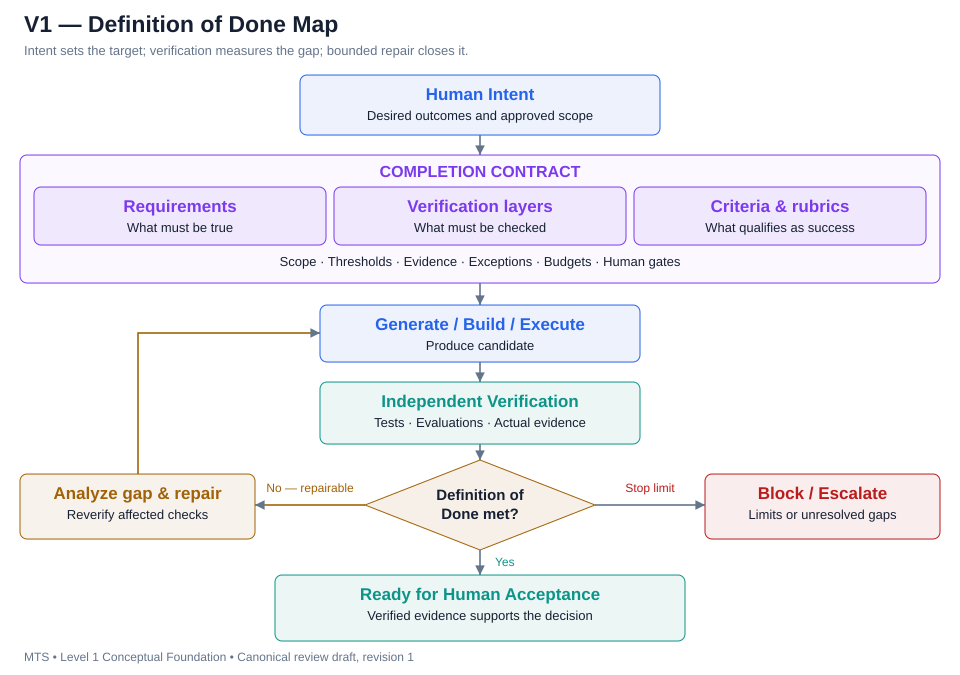
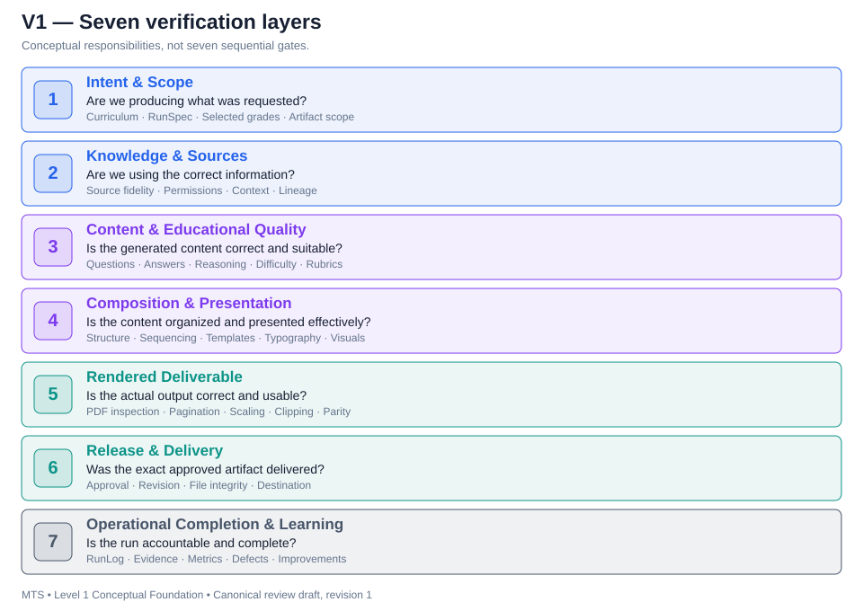
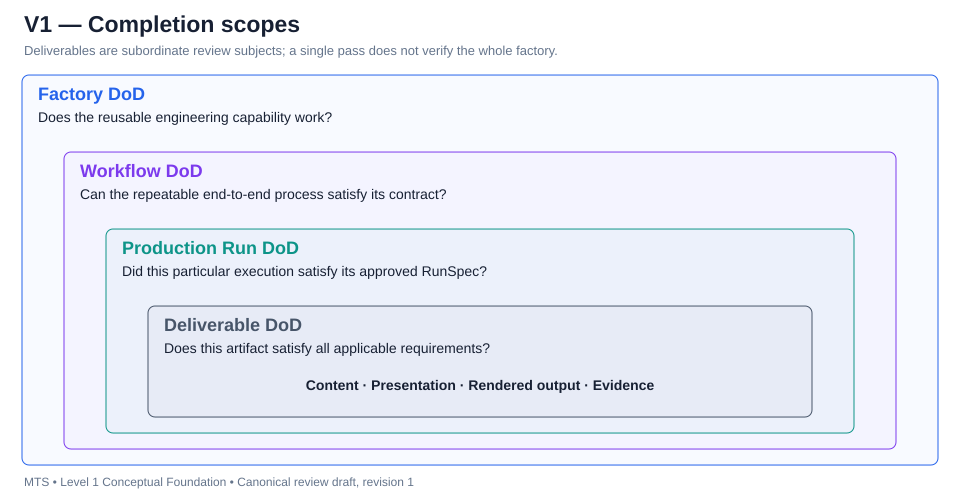
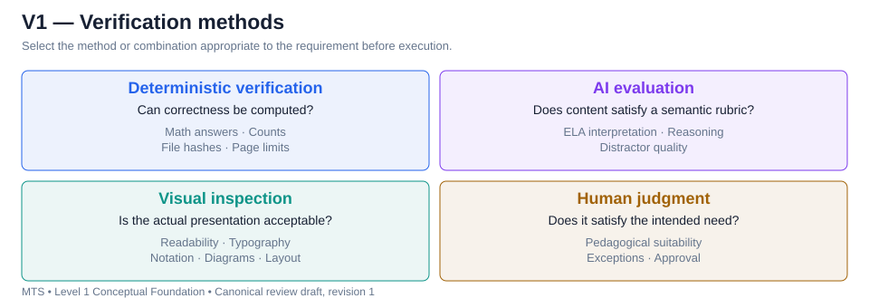
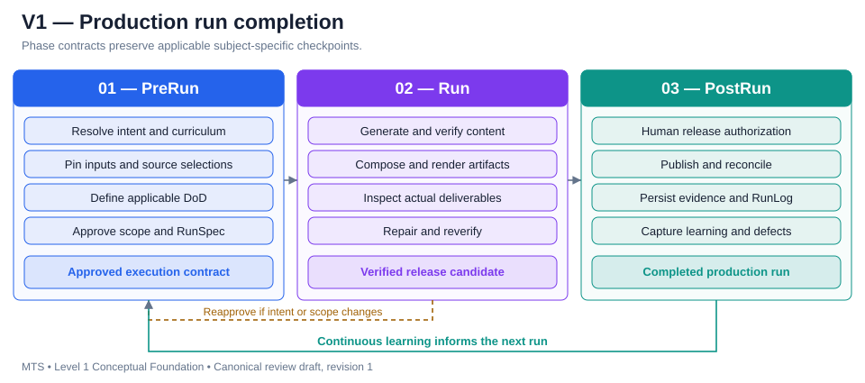
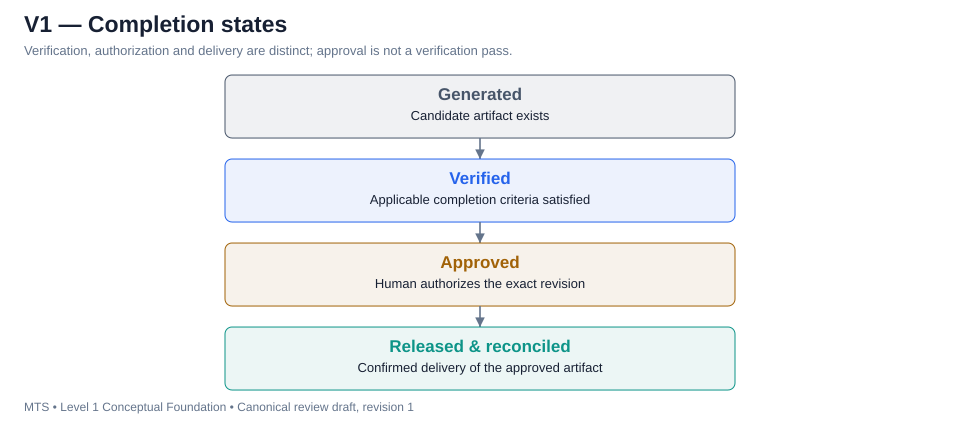
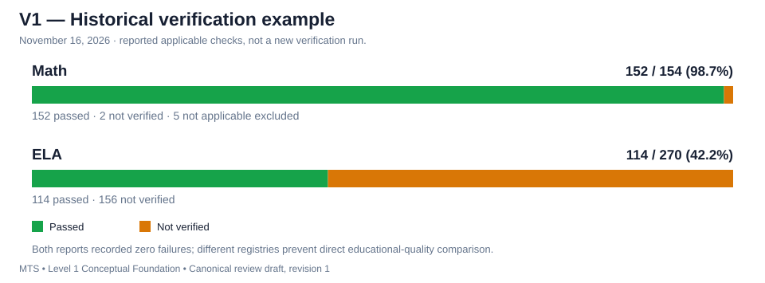

# V1 — Definition of Done Matrix

[Previous: 02-architecture](02-architecture.md) · [Level 1 index](README.md) · [Next: 04-factory](04-factory.md) · 3 of 4
**ID:** RVC-V1-MTS · **State:** To-be review contract · **Status:** Approved conceptual review view · **Revision:** 1 · **Discipline:** Reviewability Engineering 1.1.0 · **Owner:** product/quality owner (roles)

Completion is evidence against the approved scope, not confidence in generated content. The actual run uses a revision-bound completion contract (FCC) selecting applicable criteria, thresholds, rubrics, regression scope, budgets, evidence and human gates.

## Holistic Definition of Done

**Definition of Done = applicable requirements + verification layers + criteria and rubrics + completion and acceptance rules.** Establish the contract before execution; independent evidence measures the actual state against it. Repair only within the authorized scope and budget, otherwise block/escalate.

## Seven verification layers

These are conceptual responsibilities, not seven independent teams or sequential gates. Composition/presentation is distinct from actual rendered-deliverable inspection. Revision evidence and overlay controls apply across layers.

## Completion scopes

Factory, workflow and production run are the engineering scopes. A deliverable is a subordinate review subject. A passing artifact or run alone cannot establish whole-workflow or whole-factory completion.

## Verification methods

Select deterministic checks, independent AI evaluations, visual inspection and human judgment as appropriate, before execution. Independently solve Math items; use evidence-based ELA reasoning; inspect actual exported artifacts for both subjects. Combine methods when required; structural checks alone cannot establish semantic correctness.

## Minimum completion review

The nine existing shared controls are referenced below, not redefined. Each link goes to the governing verification criterion and corresponding acceptance condition.

| Stage | Criterion | Evidence / pass condition | Method |
|---|---|---|---|
| PreRun / Run | [VC-MTS-001](../../../requirement-verification-mapping.md#vc-mts-001) Scope | All obligations accounted for; no unauthorized scope | Contract and output reconciliation |
| PreRun / Run | [VC-MTS-002](../../../requirement-verification-mapping.md#vc-mts-002) Sources | Applicable lineage, permission, fidelity and discrepancies resolved | Source inspection/comparison |
| Run | [VC-MTS-003](../../../requirement-verification-mapping.md#vc-mts-003) Correspondence | Item/support identity, revision and option mapping match | Deterministic comparison |
| Run | [VC-MTS-004](../../../requirement-verification-mapping.md#vc-mts-004) Independent review | All applicable items reviewed; no unresolved blocking findings | Independent subject review/eval |
| All | [VC-MTS-005](../../../requirement-verification-mapping.md#vc-mts-005) Revision evidence | Changed inputs invalidate affected stale evidence | Impact and regression checks |
| Run | [VC-MTS-009](../../../requirement-verification-mapping.md#vc-mts-009) Rendered usability | Actual exports meet agreed profile and semantic/visual conditions | PDF checks and visual review |
| PostRun | [VC-MTS-006](../../../requirement-verification-mapping.md#vc-mts-006) Release | Mandatory evidence and human decisions authorize exact reconciled set | Gate and readback inspection |
| PostRun | [VC-MTS-007](../../../requirement-verification-mapping.md#vc-mts-007) Coverage | Count only confirmed released content | Release/coverage join |
| All / PostRun | [VC-MTS-008](../../../requirement-verification-mapping.md#vc-mts-008) Improvement | Material gaps traced to correction/regression or explicit block | Evidence chain review |

## Stage and overall gate

The phase contracts preserve every applicable subject-specific checkpoint, including the five Math checkpoints. Reapprove material scope or intent changes; invalidate affected evidence.

| Stage | Proposed minimum exit |
|---|---|
| PreRun | Scope, applicable criteria, inputs, budget, destinations and approval pinned |
| Run | Complete candidate, applicable content and export checks satisfied, evidence revision-bound |
| PostRun | Human approval, exact publication reconciliation, coverage and mandatory RunLog/evidence persisted |
| Overall | Every mandatory applicable condition satisfied or explicitly authorized exception under governing policy; no silent omissions |

Mandatory failures, unknown applicability or missing evidence block the affected gate unless governing policy explicitly permits an authorized exception. Human acceptance is separate from verification; outcome validation may continue after release. Record applicable, not designed, not executed, blocked, passed, failed, inconclusive, not applicable and authorized waived distinctly.

## Completion states and evidence accounting

Generated, verified, approved and released are distinct. Human authorization does not convert a failed or unverified criterion into a pass. Outcome validation may continue after release.

Historical example from the November 16 retrospective, not a fresh assessment: Math 152 passed of 154 applicable checks (5 not applicable excluded); ELA 114 passed of 270 reported checks, 156 not verified. Both reports recorded zero failures, but the differing registries prevent direct comparison of educational quality. Evidence sources: [Math release manifest](https://drive.google.com/file/d/1eodgkzSEyK9XbqZhha0p7koLhQDVhaMR/view), [ELA QA record](https://drive.google.com/file/d/1iOP30qUMEdrAoD-SIH-32trQsaCGhSQJ/view); access and historical metrics have not been independently reverified in this document revision. These numbers are illustrative, not targets.

Define denominators from pinned scope. Distinguish applicability, designed, executed, passed, failed, inconclusive, blocked, not verified, not applicable and authorized waiver; never count an omission or exception as a pass.

**DoD for the first slice must still be instantiated.** The [mapping](../../../requirement-verification-mapping.md) explicitly records partial capability coverage; this review view does not close those gaps. Agree subject-specific rubric/thresholds, exception authority, gate owners and RunLog requirements before execution. Factory telemetry and usage-log requirements that lack canonical checks need approved requirement deltas. See [completion and evidence accounting](../../../requirement-verification-mapping.md#completion-and-evidence-accounting) and [strategy verification design](../../../strategy/ai-sdlc/ai-sdlc-software-factory-strategy.md#3c-verification-driven-development-and-hierarchical-evidence).

## Overlay completion checks — proposed additions for pilot instantiation

These are review check candidates, not newly approved VC IDs. Existing mapped criteria remain authoritative; where no criterion covers a control, obtain an approved requirement/VC delta before representing it as mandatory verified scope.

| Overlay | Candidate condition | Evidence / disposition |
|---|---|---|
| Q1 | Applicable quality profile and checks complete; agreed performance/recovery limits met | VC-MTS-004/009 and independent results; new recovery/performance criteria as required |
| T1 | Approved dependencies and versions recorded; actual invocation traceable | Run manifest and compatibility evidence; proposed delta |
| B1 | Approved budget and retry ceilings respected; mandatory usage recorded or explicitly blocked | Estimate/actual ledger, attempt events; proposed delta |
| R1 (legacy A1) | All applicable gates signed for exact revisions; stale approvals rejected | VC-MTS-005/006, approval records and invalidation tests |
| S1 | Source permission and destination valid; no restricted data/credentials in public outputs; approved access and security controls verified | VC-MTS-002/006 for source/release; security checklist/test evidence and new criteria for uncovered controls |
| O1 | Mandatory RunLog and evidence complete, with actual/unknown measurements distinguished | VC-MTS-008 supports improvement trace; telemetry completeness requires delta |

PreRun: resolve applicability, owners, thresholds and evidence before approval. Run: failed mandatory applicable controls trigger bounded repair or block; security incidents stop affected actions and escalate. PostRun: human release authority does not silently waive unmet criteria; authorized exceptions are separately reported under policy. Missing evidence is not a pass. No new runtime verification was performed in this documentation revision.

## Review approval and fidelity

Human approved V1 content and seven conceptual verification layers, then explicitly approved all seven canonical SVGs for check-in in conversation on 2026-11-20. This is approval of the Level 1 review view, not ratification of the underlying draft VC catalog, first-slice FCC, execution or release. Source baseline: 1db5ae075719551b78d6d9f5ab75ade5daf96a16. Original draft footer retained to preserve exact approved source bytes.

| Canonical companion | SHA-256 | Git blob |
|---|---|---|
| [completion-scopes](diagrams/03-definition-of-done/factory-mts-V1-completion-scopes-to-be.svg) | `6dfc338e4ecb5b15bf76fa861e6f2c381d70141360a575f15ac1fe9b67a8145d` | `f32b8d0c5070acb8c5b3a698c4629ed7aa13555e` |
| [completion-states](diagrams/03-definition-of-done/factory-mts-V1-completion-states-to-be.svg) | `7312f17fcd79ce3974e9261afc43db30b455f98c51a35466378d1e075d1422dc` | `ce5df74146fd250161277dd85c39459434c6ca24` |
| [definition-of-done-map](diagrams/03-definition-of-done/factory-mts-V1-definition-of-done-map-to-be.svg) | `cd389e05772dee4c59f8b97b19732985279c86952a4fe9505cfe45326b545f98` | `97598edfd5fe6d25b497006517d6126e5cb4fddd` |
| [historical-verification-example](diagrams/03-definition-of-done/factory-mts-V1-historical-verification-example-to-be.svg) | `cfa59188aaf8272133d11058ecdb1dbc5e81e25567d633d9417bae9c3f78c870` | `278e9691b43c4ee20e16e14edccbde9dec900351` |
| [production-run-completion](diagrams/03-definition-of-done/factory-mts-V1-production-run-completion-to-be.svg) | `954ef5ea8029072ae5bff35144ea951b262ec0a09446a3b51f4ef8dffdaca6e4` | `1d7a52a48b2d739e9e2f874ffc10c6e9a83639a0` |
| [verification-layers](diagrams/03-definition-of-done/factory-mts-V1-verification-layers-to-be.svg) | `2fc9529826eae0a988e1c922320fd61f7c53cc16136982a72a1946857b9777af` | `ad170bf0109115737e321f76976088e75490fe55` |
| [verification-methods](diagrams/03-definition-of-done/factory-mts-V1-verification-methods-to-be.svg) | `f1ddcc48389f47c74a772da2f6bda20723bee1a33ce92a7a270a688e052b24e0` | `b9fe2a5962933cffe4477fa48d66469bd4d865cb` |

Canonical source byte identity is checked by matching approved local Git blob IDs before and after commit. Human reviewed previews rendered from these sources. Independent post-commit browser rendering is separate and not established by byte identity. Historical metrics are reported evidence only. No new requirements or numeric thresholds were authorized by this review.

---

[Previous: 02-architecture](02-architecture.md) · [Level 1 index](README.md) · [Next: 04-factory](04-factory.md)
