# Level 1 — Factory operating model

[Previous: 03-definition-of-done](03-definition-of-done.md) · [Level 1 index](README.md) · [Next level](../level-2-logical-detail-and-structured-contracts/README.md) · 4 of 4
**ID:** RVC-FACTORY-MTS-L1 · **State:** To-be minimum operating model · **Status:** Approved conceptual review view · **Revision:** 1 · **Discipline:** Reviewability Engineering 1.1.0 · **Owner:** factory owner (role)

**Candidate revision:** Documentation Engineering v0.1 pilot; not approved. Historical status/revision above refers to the baseline, not this candidate. [Baseline and checks](REVIEW-REPORT.md).

## Reading guide
- [Operating model](#holistic-operating-model) · [Knowledge](#k1--knowledge--context-map) · [Harness](#e1--harness--execution-engineering) · [Lifecycle](#e1--execution-lifecycle-map) · [Convergence](#n1--convergence--recovery-map) · [Observability](#o1--observability--learning-map) · [Overlays](#enforce-the-architecture-overlays-during-a-run) · [Delivery](#persistence--delivery) · [Evidence](#review-approval-and-source-fidelity)

## Factory in plain language
Intent defines the desired outcome; knowledge and context make relevant facts and instructions available; the harness enables execution; verification evaluates the result; convergence corrects gaps; observability records what happened and supports learning. Governance constrains all of these. For a weekly worksheet run, resolve the approved inputs, generate and check the worksheet/key, correct failed checks within bounds, and reconcile authorized delivery. This is an illustrative target flow, not evidence of a new run. Factory development, workflow design and production runs remain distinct.

| Concept | Distinction | Computing analogy | Human physiology analogy |
|---|---|---|---|
| Knowledge / context | Available facts vs task-relevant selection | Storage vs loaded runtime state | Memory vs current sensory signals |
| Harness | Execution and tool access | Runtime, APIs and I/O | Nervous and musculoskeletal systems |
| Verification | Compare outcome against criteria | Assertions and tests | Physiological monitoring |
| Convergence | Bounded progress toward acceptable state | Iterative solver with stop condition | Homeostatic feedback |
| Observability / learning | Inspect execution vs improve future behavior | Tracing vs feedback-driven changes | Sensory monitoring vs neuroplasticity |
| Guardrails | Restrict unacceptable action | Permissions and isolation | Immunity and protective reflexes |

Analogies are limited functional comparisons, not literal equivalences. Iteration alone does not guarantee progress; termination may mean acceptance or escalation. The detailed canonical views below retain their existing authority and evidence limits.

The engineering factory uses M0–M8 to build the product. The educational product uses PreRun / Run / PostRun to generate materials. Both need verifiable completion, correction and observation; their run IDs and evidence must remain distinguishable.

## Holistic operating model

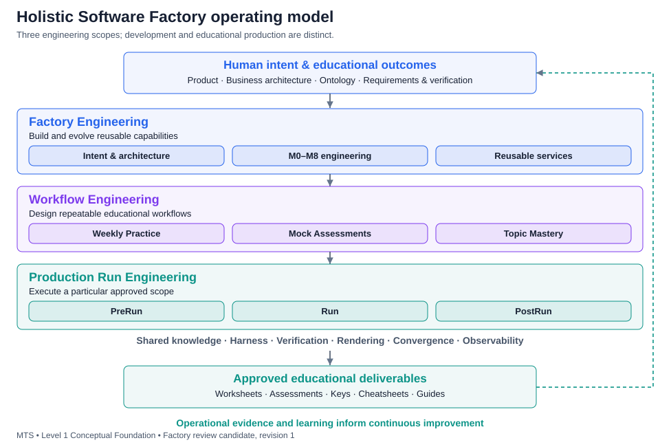

Factory Engineering builds reusable capabilities; Workflow Engineering designs repeatable educational workflows (Weekly Practice, Mock Assessments, Topic Mastery); Production Run Engineering executes a particular approved scope. M0–M8 engineering stations are distinct from production phases. Shared rendering, verification, context and observability serve all scopes.

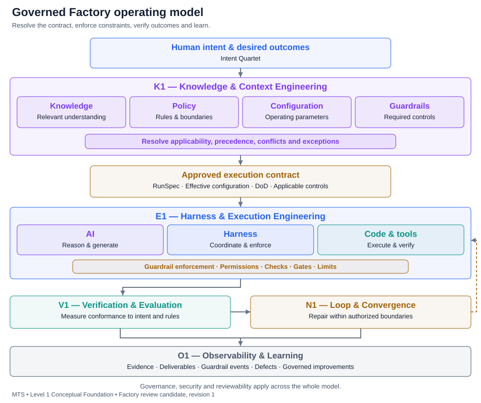

Intent establishes the desired outcome; context resolves relevant knowledge and effective controls; the approved execution contract governs execution. Verification measures conformance, bounded convergence corrects gaps, observability captures evidence and learning. Governance/security and reviewability are cross-cutting.

## K1 — Knowledge & Context Map

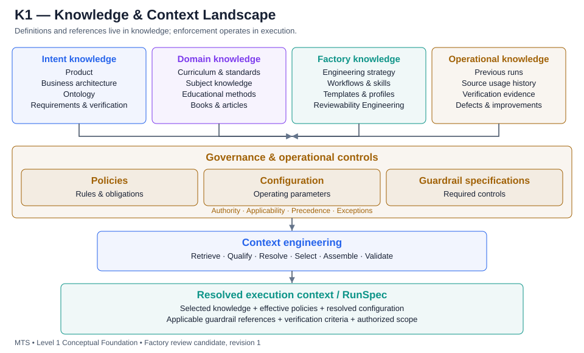

| Knowledge | Authoritative location to resolve |
|---|---|
| Product and business semantics | [Intent quartet](../../../README.md#sources-and-authority) |
| Methodology | [Factory strategy](../../../strategy/ai-sdlc/ai-sdlc-software-factory-strategy.md) |
| Curriculum, content and templates | Approved run-specific Sheets/Drive references; resolve actual IDs before execution |
| Governance and operating controls | Applicable policy, configuration, guardrail specifications, authority and exception records; resolve versions and precedence |
| Operational history | Prior release evidence and source usage; verify location and version before reuse |

Historical material is evidence, not authority. Missing required context or a conflict blocks affected work until resolved. No vector store is required initially.

### Policy, Configuration & Guardrails

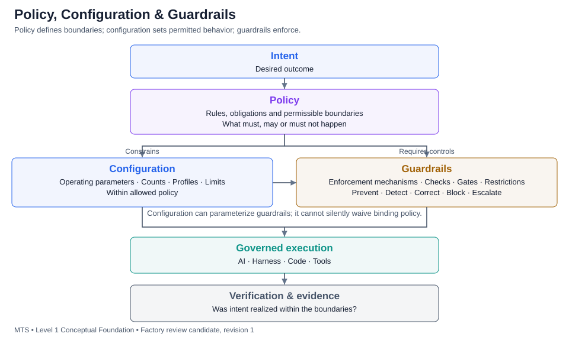

| Concept | Meaning |
|---|---|
| Intent | Desired outcome |
| Knowledge | Available information, facts, expertise and instructions |
| Policy | Rules defining obligations, prohibitions and permissions |
| Configuration | Parameters customizing permitted behavior |
| Guardrail | Mechanism preventing, detecting or restricting unacceptable behavior |
| Context | Relevant knowledge and effective operating instructions assembled for a task |
| RunSpec | Approved execution contract for a particular production run |
| Definition of Done | Conditions establishing satisfactory completion |
| Evidence | Inspectable records supporting verification and decisions |

Policy constrains configuration and requires controls; configuration supplies settings to guardrails where applicable. Not every setting is policy; not every policy is configurable. K1 resolves definitions, applicability and guardrail specifications/references; E1 implements/enforces controls; V1 verifies compliance and effectiveness; N1 respects repair limits; O1 records activations, violations and authorized exceptions; R1 owns decision rights and S1 governs security controls.

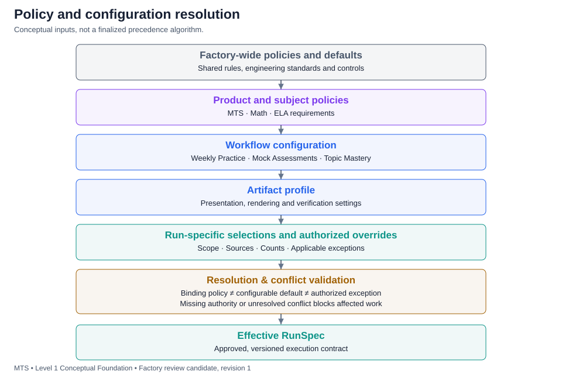

Resolve factory defaults and binding policies, product/subject rules, workflow configuration, artifact profiles and run-specific selections/authorized overrides. Distinguish binding policy from defaults and permitted exceptions; do not silently override policy. Conflicts or missing required controls block affected work. Exact precedence algorithm, taxonomy and placement belong to Level 2, actual files/resolvers/validators to Level 3, schemas and code to Level 4. Definitions here are conceptual; reconcile with the authoritative ontology at I2 rather than mint competing IDs.

Guardrail lifecycle: define → resolve → approve → enforce → verify → converge within authority → observe and improve. Controls may prevent, detect, trigger authorized correction, block or escalate; mechanisms include instructions, configuration validation, deterministic checks, independent evaluation, permissions and human gates. Instruction-based controls guide but cannot guarantee compliance; enforce critical boundaries independently where feasible.

| Scenario | Policy | Configuration | Guardrail |
|---|---|---|---|
| Math weekly student worksheet | Applicable two-page maximum | max_pages: 2 | Actual PDF page count; inspect readability/content integrity |
| ELA weekly worksheet | Legibility takes precedence over target page count | Target pages: 2 | Visual inspection; escalate conflicts |
| Answer correctness | Independent applicable review | Subject/check profile | Block release on unresolved incorrect answers |
| Curriculum and sources | Approved scope, permissions and fidelity | Selected grade/topics/source | Scope, provenance and source comparison |
| Source-based mock | Preserve required content/figures | Applicable scaling/page profile | Detect distortion/clipping/content loss |
| Convergence | Bounded repair | Approved ceilings | Stop or escalate at limit |
| Publication | Human-authorized revisions only | Destination/release set | Revision gate and readback |
| Reviewability | Preserve approved visuals | SVG/naming profile | Source hash/readback |

Example: resolve two-page Math profile in RunSpec, render, verify actual page count plus readability and intact content, adjust permitted layout and rerender, log attempts and final result. A passing page count alone does not prove satisfactory presentation.

## E1 — Harness & Execution Engineering

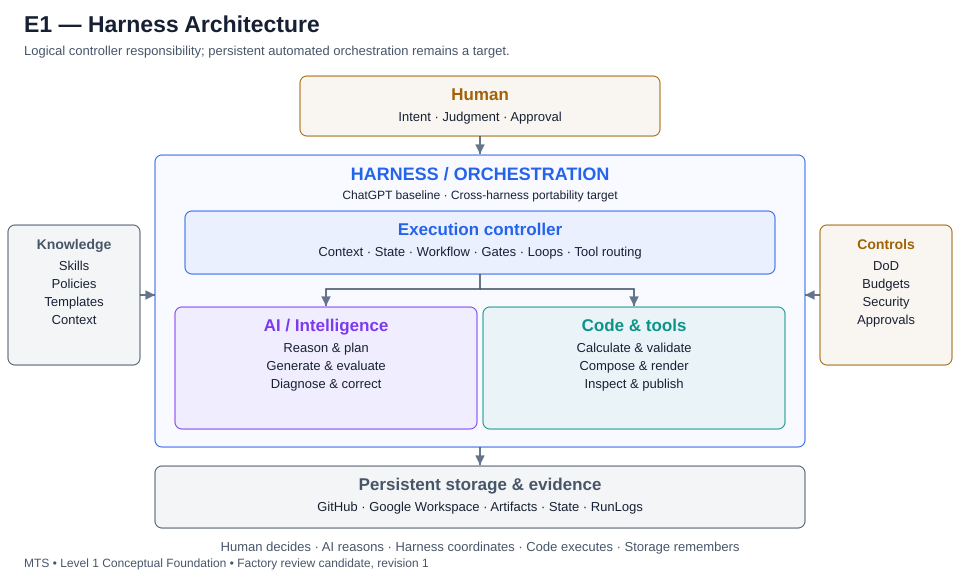

Human decides; AI reasons; harness coordinates and enforces; code/tools execute and verify; storage preserves. The controller is a logical target responsibility, not a claim of deployed orchestration. ChatGPT conversation-driven execution is the observed baseline; cross-harness equivalence and persistent controller behavior remain unproven.

## E1 — Execution Lifecycle Map

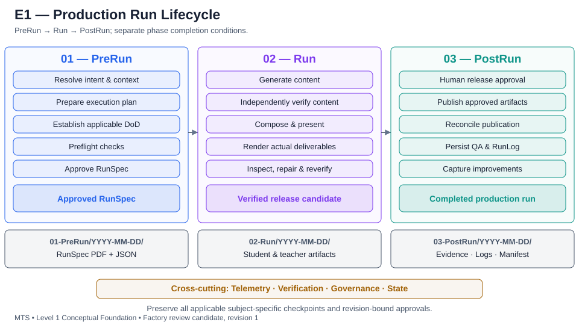

| Stage | Input → output |
|---|---|
| PreRun | Intent and context → approved revision-bound RunSpec |
| Run | Approved spec → verified candidate and QA evidence |
| PostRun | Candidate and human authority → reconciled release and closeout |

Preserve all applicable subject-specific gates (including existing Math checkpoints). A failed review returns to the affected step. See [business process rules](../../../business-architecture.md#business-rules) and [V1](03-definition-of-done.md).

### Shared artifact production

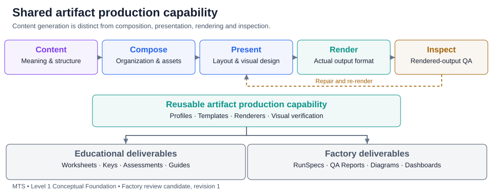

Content → composition → presentation → rendering → actual output inspection; correct defects and reverify. Reusable profiles, templates, rendering and visual checks support educational deliverables and factory artifacts (RunSpecs, reports, diagrams, dashboards). See [FA-04-MAT architecture](02-architecture.md#educational-artifact-production--fa-04-mat) and V1's separate presentation/rendered-output layers.

## N1 — Convergence & Recovery Map

Legacy MVP R1 (Convergence & Recovery) maps to canonical N1; responsibility is canonical R1 (legacy A1).

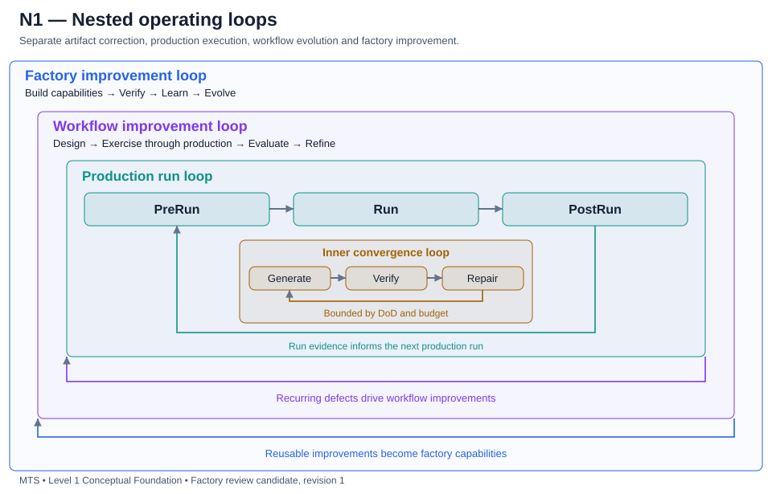

| Loop | Purpose |
|---|---|
| Inner convergence | Correct affected artifact or step against stable criteria |
| Production run | Complete particular governed run; next-run evidence informs planning |
| Workflow improvement | Refine repeatable process using recurring defects and evidence |
| Factory improvement | Promote approved reusable capability improvements |

Repeated execution alone does not prove convergence. Measure progress against the stable target; distinguish execution repair, specification correction and intent/authority escalation.

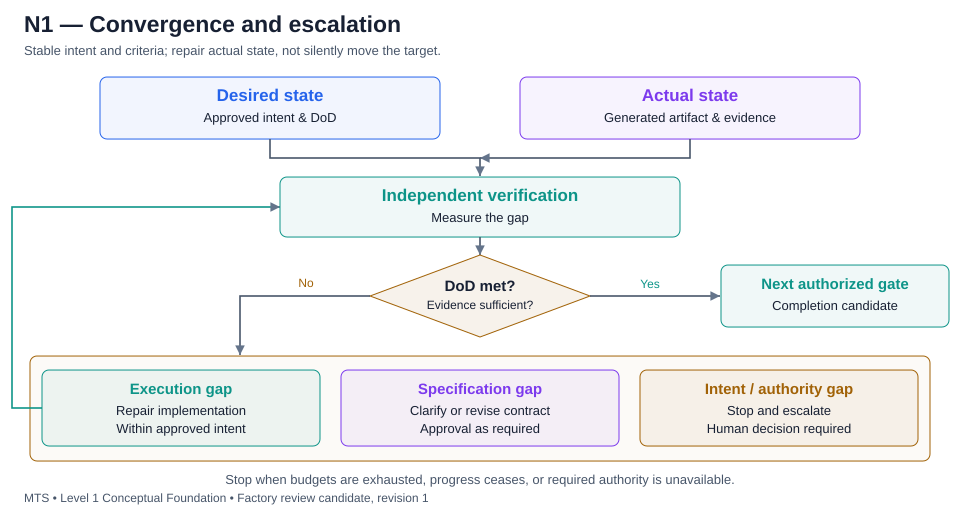

Freeze intent and criteria for the attempt. Log failed criterion IDs, evidence, correction and progress. Define retry/time budget in the approved slice contract; no numeric limit is assumed here. Stop on repeated no progress, missing authority or exhausted budget. Route semantic/intent changes to accountable owners, not silent criterion weakening. Use the strategy's distinct repair/specification/intent convergence routes.

## O1 — Observability & Learning Map

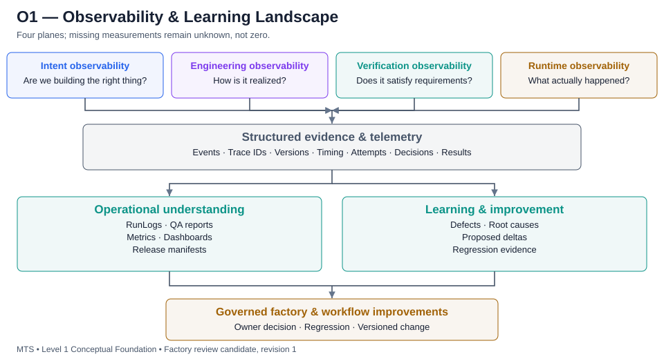

Minimum events: run and correlation ID; domain/workflow or station; phase/step/attempt; actor/tool version; input/output and requirement IDs; timestamps; estimate and actual active/wait durations where measured; status; criterion results and evidence; error/correction; approval/exception; release reference. Record during execution, not reconstructed as if contemporaneous. Start with append-only structured records; dashboard later.

Review four planes from the [strategy](../../../strategy/ai-sdlc/ai-sdlc-software-factory-strategy.md#3a-intent-to-outcome-observability): intent completeness, engineering realization, verification coverage, runtime outcome. Track elapsed time, attempts, blocked steps, applicable vs executed vs passed checks, and publication reconciliation separately. Include policy/guardrail activations, violations, authorized overrides, rendering time, layout defects and rerender attempts; distinguish active human review from approval waiting. Unknown measurements remain unknown.

**Open before first pilot:** exact authoritative source/config paths, slice budget, event schema and storage references, gate owners and invocation path. No executable orchestration or instrumentation is claimed by these views.

## Enforce the architecture overlays during a run

| Overlay | PreRun | Run / convergence | PostRun |
|---|---|---|---|
| Q1 | Resolve quality profile and checks | Verify, repair affected gaps, regress | Reconcile coverage and defects |
| T1 | Record actual tools, versions, access | Use approved tools; escalate unauthorized substitutions | Persist provenance |
| B1 | Approve time/retry/resource ceilings | Track known consumption; stop or escalate at limit or missing mandatory measurement | Report estimates vs actuals and cost per accepted output where measurable |
| R1 (legacy A1) | Identify gate owners and revision | Separate producer and verifier; renew affected approvals | Human authorizes exact release; reconcile |
| S1 | Classify sources/data, credentials and destination | Treat input as untrusted, restrict access, stop on suspected security incident | Sanitize evidence and confirm permitted publication |

## Persistence & delivery

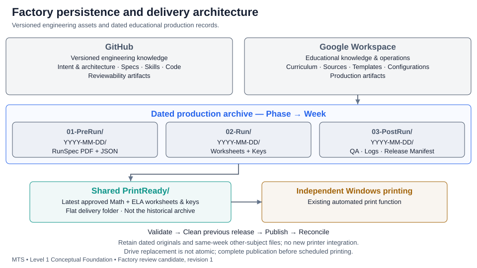

GitHub holds versioned engineering knowledge; Google Workspace holds educational knowledge and operational artifacts according to access policy. Weekly archives remain phase-first: 01-PreRun/YYYY-MM-DD (RunSpec PDF/JSON), 02-Run/YYYY-MM-DD (worksheets/keys), 03-PostRun/YYYY-MM-DD (QA, logs, manifests, learning); date is instructional Monday. Shared PrintReady is flat, latest approved Math + ELA worksheets and keys only. No printer handshake or change to independent Windows printing is authorized.

Baseline storage pattern from [legacy workflow mapping](https://github.com/krishna-chaitanya-kondapi/mts-crossmodel/blob/master/specs/generate_weekly_practice_worksheets/README.md): phase-first dated PreRun, Run and PostRun folders; flat approved PrintReady consumed independently by Windows printing. Validate complete in-scope batch before replacement, retain dated originals, preserve the other subject on same-week correction, serialize publishing and verify readback. Drive replacement is not atomic; finish before printing. Recovery remains a proposed control until tested live.

Minimum new telemetry: actual tool/model versions, resource usage where available, budget status, approval/invalidation events, sanitized security incidents and release recovery outcomes. Never log tokens, sensitive source content or student information. The legacy run mapping records incomplete telemetry and partial gate/publisher integration; do not report these as fully automated. See [Q1–S1](02-architecture.md#q1--quality-attribute-matrix) and [V1](03-definition-of-done.md).

## Engineering discipline alignment

| Discipline | Review perspectives |
|---|---|
| Intent | P1, L1, I1, V1 |
| Knowledge & Context | K1, I1 |
| Harness | E1, C1, T1 |
| Verification & Evaluation | V1, Q1 |
| Loop & Convergence | N1, E1, V1 |
| Observability & Learning | O1, B1, Q1 |
| Governance & Security | R1, S1 |

Reviewability Engineering is cross-cutting, not an additional perspective. See [standard](../../../strategy/reviewability-engineering/REVIEWABILITY-STANDARD.md).

## As-is baseline versus target

| Capability | Historical baseline | Target |
|---|---|---|
| Context | Drive, Sheets, GitHub, conversation | Explicit resolved manifest/precedence |
| Execution | Conversation-driven tools | Persistent repeatable orchestration |
| Artifact production | Google Docs/ReportLab/PDF tooling | Reusable composition and rendering |
| Verification | Math recomputation, partial ELA QA | Complete applicable evidence |
| Convergence | Conversation-driven repair | Bounded targeted repair/reverification |
| Authority | Human chat approvals | Revision-bound enforcement |
| Observability | Partial logs and QA | Contemporaneous structured telemetry |
| Publication | Shared PrintReady | Verified reliable release |
| Reviewability | Approved conceptual views | Progressive evidence-backed elaboration |

No fresh production or security test is claimed. Underlying quartet and pilot FCC remain unratified. Exact policy precedence and control implementation remain open.

## Review approval and source fidelity

Human approved refined Factory conceptual content including Policy, Configuration & Guardrails, then explicitly approved all twelve canonical SVGs in conversation on 2026-11-20. Scope: Factory/MTS, Level 1, K1/E1/N1/O1, To-Be with historical baseline. Approval is for this review view only; not implementation or release authority. Original draft visual footers are retained for exact fidelity. Source baseline: 1d9080fa71054684b51a49cc33a71bfbfe30e55b.

| Canonical companion | SHA-256 (approved source manifest) | Git blob |
|---|---|---|
| [factory-mts-E1-factory-operating-model-to-be.svg](diagrams/04-factory/factory-mts-E1-factory-operating-model-to-be.svg) | `24ce8178d6dde404f6f236c9d00e9a8e6d4c346af58392416453c2e83e4a8573` | `60916bc9d44c2fc45c827faea805a389619ef1c1` |
| [factory-mts-E1-governed-operating-model-to-be.svg](diagrams/04-factory/factory-mts-E1-governed-operating-model-to-be.svg) | `0bf3994add9d620048f3984bba6921824903144878b5d4611fcfc329d51426e6` | `c16306d1c6a1983d019bd014decafec733183376` |
| [factory-mts-K1-knowledge-landscape-to-be.svg](diagrams/04-factory/factory-mts-K1-knowledge-landscape-to-be.svg) | `48262293bc2a6c4d2b03680ddf49c9323b6a2d963cc61916832b1a60475e05df` | `6cd398d6fce954636ed1d091b36a94e707c1ae79` |
| [factory-mts-K1-policy-configuration-guardrails-to-be.svg](diagrams/04-factory/factory-mts-K1-policy-configuration-guardrails-to-be.svg) | `318a3764764904f0ba1026a7eb75387e53ddb1125162e76513efd6f0046731ee` | `cb458fe28bd545f87b2c37f3c24b08acffe58ebe` |
| [factory-mts-K1-policy-configuration-resolution-to-be.svg](diagrams/04-factory/factory-mts-K1-policy-configuration-resolution-to-be.svg) | `f28e75a2238c7fb12ee04f1cf11592479925ad41b0fb45e090b95283b4e4b724` | `c485501746f613ade8e945c0a8e5651e04dc38b7` |
| [factory-mts-E1-harness-architecture-to-be.svg](diagrams/04-factory/factory-mts-E1-harness-architecture-to-be.svg) | `0c581e7f874de5613cd888f89c18b2eb66c42c165ffac650859c1dc54871299d` | `c3da3980d10c4b4b1e645ea56393a85407171c5c` |
| [factory-mts-E1-production-run-lifecycle-to-be.svg](diagrams/04-factory/factory-mts-E1-production-run-lifecycle-to-be.svg) | `b35c38c02b2462853892f281a84fe321c25913afc2d06e3c078a739d0dad491d` | `c29c8b70a6a8ac0770af63c821323e4e1b055e17` |
| [factory-mts-E1-artifact-production-to-be.svg](diagrams/04-factory/factory-mts-E1-artifact-production-to-be.svg) | `07f2dc7003bd60ac20fd2e0a49576d8bfcc6b5f58f1f1ff8fc83075a3ab19597` | `c6157606b29f158ee785b4f8d1940bf4f8c160ee` |
| [factory-mts-N1-nested-operating-loops-to-be.svg](diagrams/04-factory/factory-mts-N1-nested-operating-loops-to-be.svg) | `641a65da1c09c88c2fe47954838ff661001bf08a170a4c0d93618d655a3f9214` | `9e3857ab3d191b4e0c8e8b3cdb5c817078a04bd7` |
| [factory-mts-N1-convergence-escalation-to-be.svg](diagrams/04-factory/factory-mts-N1-convergence-escalation-to-be.svg) | `76df53a3cd353fa3450a9c7ac5cb98a989465cd684242078c0d5348618005b8d` | `6995043045a81ae17d56b1c6a1a9858e1514dc60` |
| [factory-mts-O1-observability-landscape-to-be.svg](diagrams/04-factory/factory-mts-O1-observability-landscape-to-be.svg) | `b205e15b7b9e190662708ddbd8aa002312f965fd710a6467c91238b3807b032b` | `22f68e1212644309d5f5ed96a1cfe23a255aabf3` |
| [factory-mts-E1-persistence-delivery-to-be.svg](diagrams/04-factory/factory-mts-E1-persistence-delivery-to-be.svg) | `51de5005876c23780fb06a0bbbf4d46465ec651754f24deb9eb940fb927345dc` | `0f59be16791e03139fb457fa8cafe2328e9d19c0` |

Approved previews were rendered from these standalone transcriptions, not exact exports of earlier inline graphics. Persistence uses exact Git blob matches. Independent post-commit browser rendering is a separate verification condition.

---

[Previous: 03-definition-of-done](03-definition-of-done.md) · [Level 1 index](README.md) · [Next level](../level-2-logical-detail-and-structured-contracts/README.md)
