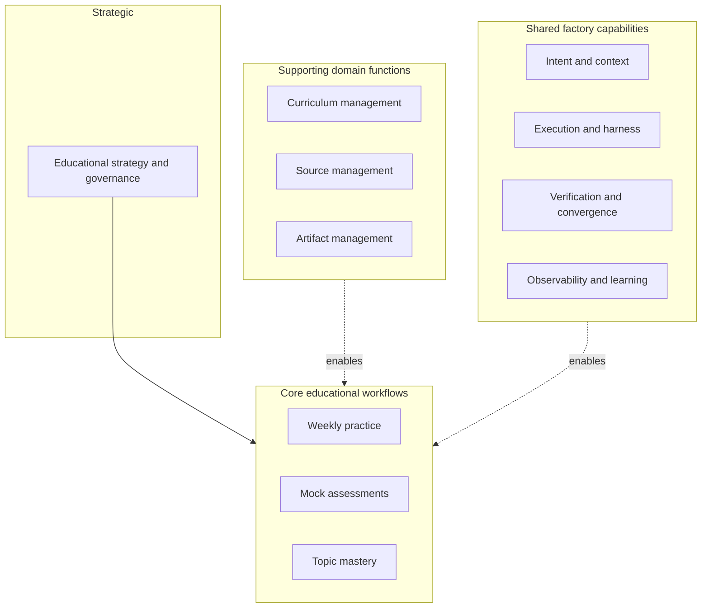
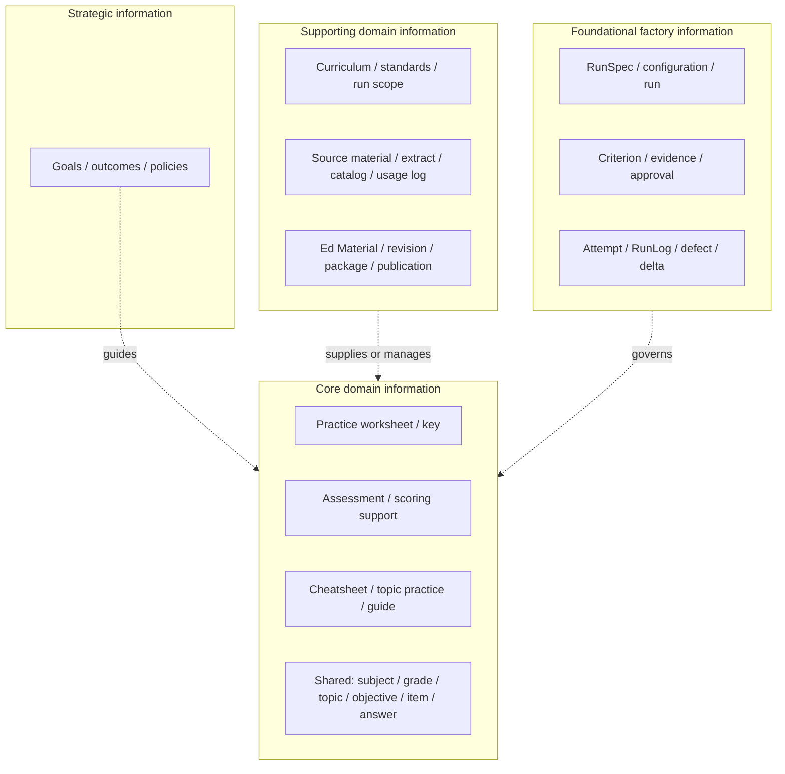
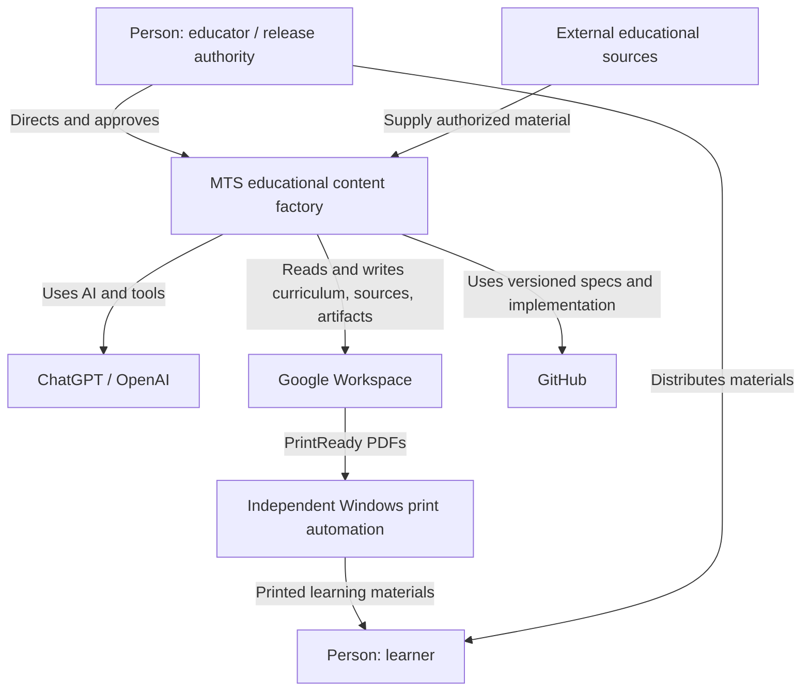

# Level 1 — Three-axis architecture
**ID:** RVC-ARCH-MTS-L1 · **State:** To-be conceptual review with known operating context · **Status:** Draft · **Owner:** MTS architecture owner (role)

## L1 — Business Process Landscape (RVC-L1-BPL)

Source Management covers discovery, access/qualification, arrangement, cataloging, selection and usage tracking. It supports all workflows without dominating the landscape.

| Review grouping | Existing product-area trace |
|---|---|
| Core workflows | FA-03-ASM, FA-04-MAT |
| Curriculum | FA-01-CUR |
| Sources | FA-02-SRC |
| Artifact management | FA-04-MAT, FA-06-REL |
| Quality and improvement | FA-05-QLT, FA-07-IMP |

See [canonical capability and process catalog](../../../business-architecture.md#functional-areas-and-capabilities). Grouping is a review perspective; it does not redefine approved capability boundaries.

## I1 — Domain Concept Map (RVC-I1-DCM)

These are conceptual groups, not inheritance or cardinality. Use the [ontology entity catalog](../../../ontology.md#entity-catalog) for canonical definitions. Source catalog and usage-log concepts are review proposals where not yet mapped; resolve semantic deltas there rather than mint competing IDs.

## C1 — System Context (RVC-C1-SCD)

MTS is the logical product boundary; ChatGPT is the observed hosting/harness environment for earlier educational runs, not proof that this new repository is deployed. Google Workspace includes Drive, Sheets and Docs. No script-level invocation is asserted here. Verify actual usage per slice against release evidence.

## Cross-axis review

| Function | Information | Participating systems |
|---|---|---|
| Weekly practice / mock / topic mastery | Ed Material, item, support, objective | MTS, AI, Workspace |
| Curriculum and source management | Curriculum, source, usage | Workspace, external sources |
| Release and improvement | Revision, approval, evidence, defect | MTS, Workspace, GitHub, independent printer where applicable |

Quality and responsibility overlays: educational correctness, source permission, readability, traceability, independent checks, human release authority and safe recovery. Resolve detailed boundaries at C2 only when a slice requires them. See [3D strategy](../../../strategy/ai-sdlc/ai-sdlc-software-factory-strategy.md#4-m4-the-3d-architecture-kernel).
