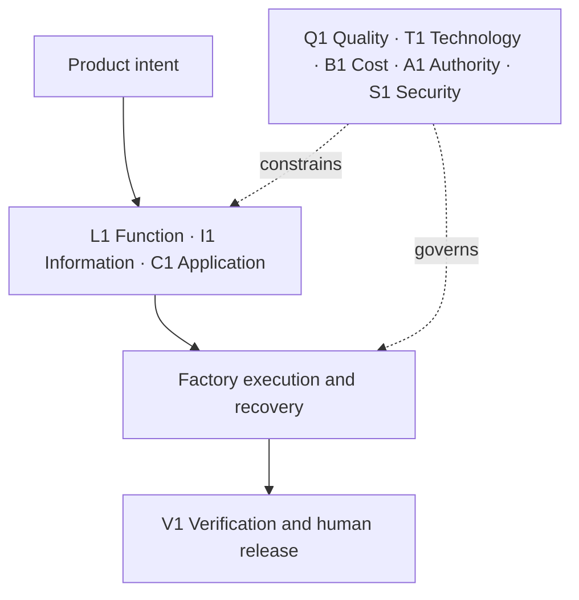
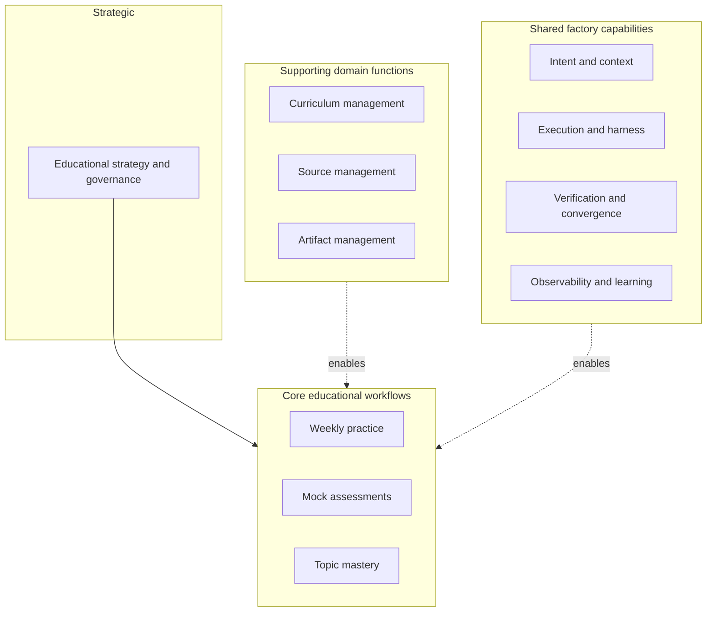
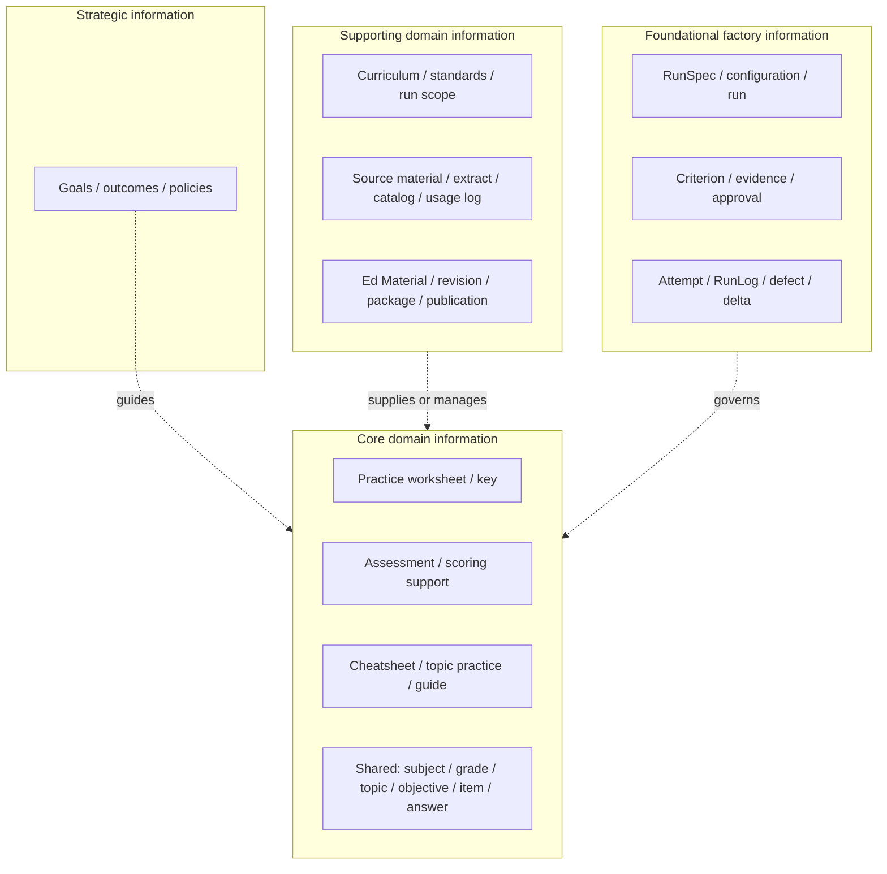
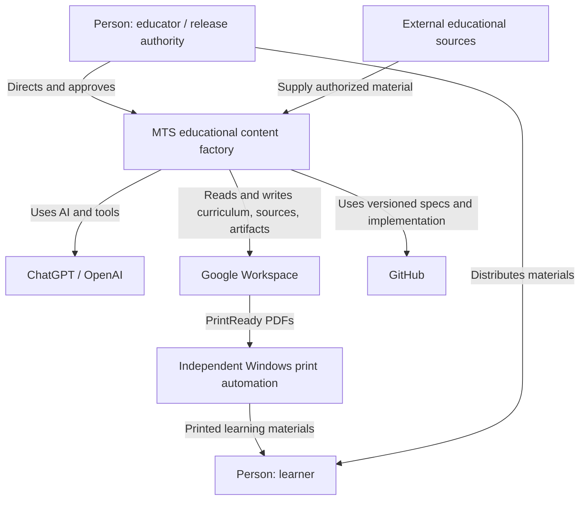
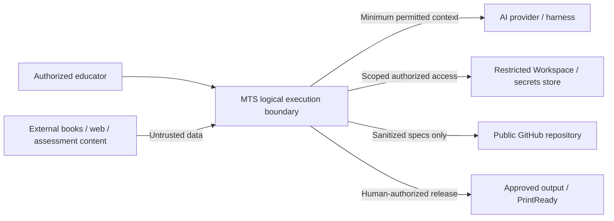

# Level 1 — Architecture axes and overlays
**ID:** RVC-ARCH-MTS-L1 · **State:** To-be conceptual review with known operating context · **Status:** Draft · **Owner:** MTS architecture owner (role)

## Holistic overview

Three axes explain what MTS does, what information it manages and which systems participate. Five overlays constrain all three. Use the current implementation as the starting point, not as proof that every target control works. The minimum controls below guide [execution](FACTORY.md) and [completion](DEFINITION-OF-DONE.md).

**Baseline:** [legacy weekly implementation mapping](https://github.com/krishna-chaitanya-kondapi/mts-crossmodel/blob/master/specs/generate_weekly_practice_worksheets/README.md), derived from the November 16, 2026 Math/ELA retrospective, and inspected legacy gate/publisher/printer code. The current repository contains an [MCQ validator](../../../src/mts_factory/assessment/mcq_quality.py), [schema](../../../contracts/assessment/mcq-question-bank.schema.json) and [tests](../../../tests/test_mcq_quality.py); presence is not execution evidence. Baseline labels: **Observed** = recorded in prior workflow mapping; **Repo** = code exists; **Partial** = integration or coverage incomplete; **Proposed** = new target. No fresh production run or security audit was conducted.

## L1 — Business Process Landscape (RVC-L1-BPL)

Source Management covers discovery, access/qualification, arrangement, cataloging, selection and usage tracking. It supports all workflows without dominating the landscape.

| Review grouping | Existing product-area trace |
|---|---|
| Core workflows | FA-03-ASM, FA-04-MAT |
| Curriculum | FA-01-CUR |
| Sources | FA-02-SRC |
| Artifact management | FA-04-MAT, FA-06-REL |
| Quality and improvement | FA-05-QLT, FA-07-IMP |

See [canonical capability and process catalog](../../../business-architecture.md#functional-areas-and-capabilities). Grouping is a review perspective; it does not redefine approved capability boundaries.

## I1 — Domain Concept Map (RVC-I1-DCM)

These are conceptual groups, not inheritance or cardinality. Use the [ontology entity catalog](../../../ontology.md#entity-catalog) for canonical definitions. Source catalog and usage-log concepts are review proposals where not yet mapped; resolve semantic deltas there rather than mint competing IDs.

## C1 — System Context (RVC-C1-SCD)

MTS is the logical product boundary; ChatGPT is the observed hosting/harness environment for earlier educational runs, not proof that this new repository is deployed. Google Workspace includes Drive, Sheets and Docs. No script-level invocation is asserted here. Verify actual usage per slice against release evidence.

## Cross-axis review

| Function | Information | Participating systems |
|---|---|---|
| Weekly practice / mock / topic mastery | Ed Material, item, support, objective | MTS, AI, Workspace |
| Curriculum and source management | Curriculum, source, usage | Workspace, external sources |
| Release and improvement | Revision, approval, evidence, defect | MTS, Workspace, GitHub, independent printer where applicable |

All five overlays below apply to these axes. Resolve detailed boundaries at C2 only when a slice requires them. See [3D strategy](../../../strategy/ai-sdlc/ai-sdlc-software-factory-strategy.md#4-m4-the-3d-architecture-kernel).

## Q1 — Quality Attribute Matrix

| Quality goal | Minimum expectation / review method | Baseline |
|---|---|---|
| Correctness and suitability | Independent Math solving and ELA evidence/rubric review; applicable checks accounted for | Partial: prior Math recomputation and ELA QA recorded, full QA coverage not demonstrated |
| Reliability and recoverability | Complete or explicitly blocked run; targeted correction, safe resume; inspect failure/restart evidence | Partial: chat-managed repair observed, persistent automated recovery not proven |
| Performance | Agree run window; compare measured active, wait and elapsed durations to estimate | Partial: complete prior telemetry unavailable |
| Usability | Actual PDF readability, counts, parity and profile checked | Observed checks; comprehensive coverage not established |
| Maintainability and portability | Separate subject workflows, portable specs; regression and cross-harness tests | Repo assets exist; cross-harness equivalence unverified |
| Auditability | Revision-bound decisions and traceable evidence, no silent gaps | Partial: prior release records and reconstructed logs; completeness pending |

Numerical targets beyond existing approved criteria are TBD with the owner before a pilot. See [V1](DEFINITION-OF-DONE.md).

## T1 — Technology Landscape

| Layer | Current baseline | Boundary / next decision |
|---|---|---|
| Human / intelligence | Educator, OpenAI GPT | Human retains authority |
| Harness | ChatGPT project and tool calls (observed) | Codex, Claude, Copilot portability proposed; no equivalence claim |
| Execution | Python, Drive/Docs/Sheets connectors, Google Docs and PDF tooling (observed); legacy Math renderer/verification modules (Repo) | Pin actual model/tool/code versions per run; do not assume legacy invocation |
| Knowledge / persistence | Google Drive, Sheets, GitHub, JSON/YAML/Markdown | Resolve references and access per run |
| Delivery | Drive flat PrintReady; independent Windows printer (observed architecture; script Repo) | Preserve dated originals; non-atomic replacement; schedule before print |

References: [legacy component mapping](https://github.com/krishna-chaitanya-kondapi/mts-crossmodel/blob/master/specs/generate_weekly_practice_worksheets/README.md), [publisher](https://github.com/krishna-chaitanya-kondapi/mts-crossmodel/blob/master/scripts/publish_weekly_artifacts.py), [printer](https://github.com/krishna-chaitanya-kondapi/mts-crossmodel/blob/master/scripts/print_worksheets.py). Combined publisher rollback and full ELA integration remain partial.

## B1 — Cost & Resource Model

| Driver | Capture per run |
|---|---|
| Retrieval, generation, verification, repair | Model/tool calls, tokens and attributable charges where exposed; attempts |
| Human review | Active intervention and approval wait separately |
| Compute and storage | Measured execution duration, applicable charges and allocated subscriptions where known |
| Unit economics | Total attributable cost / accepted deliverables, with explicit allocation and known/unknown coverage |

Baseline: complete actual runtime and cost were not available for the previous weekly run. Do not substitute estimates for actuals or assume unavailable usage is zero. Approve time, retry and any monetary ceilings before execution; stop at a ceiling or when required budget monitoring is unavailable. No dollar or token target is invented.

## A1 — Responsibility & Authority Matrix

| Activity | Human | AI / harness | Code / tools |
|---|---|---|---|
| Intent / scope | Own, approve | Draft and resolve context | Validate inputs |
| Generate | Direct | Reason, generate, coordinate | Transform, render |
| Verify | Adjudicate | Separate semantic review | Independent objective checks |
| Repair | Approve material changes | Diagnose, coordinate correction | Recheck and invalidate stale evidence |
| Release | Authorize exact revision | Prepare, orchestrate | Enforce gate, publish and reconcile |
| Learn | Approve deltas | Analyze and propose | Capture evidence |

Baseline: human chat approvals and independent Math checks observed; [legacy gates](https://github.com/krishna-chaitanya-kondapi/mts-crossmodel/blob/master/src/mts/workflow_management/gates.py) implement revision-scoped approval and invalidation (Repo). Keep all five applicable Math checkpoints; two primary boundaries do not replace them. Full live gate enforcement remains partial.

## S1 — Trust Boundary & Security Map

| Concern | Minimum proposed control / current gap |
|---|---|
| Privacy and secrets | Keep student/family records, private source copies, tokens and sensitive logs out of public GitHub. Legacy printer uses external OAuth token file (Repo); credential handling not audited. |
| Access | Verify identity, destination and least necessary permissions. Inspected legacy publisher/printer request broad Drive OAuth scope; narrower scope feasibility and actual grants require review. |
| Untrusted material | Treat sources as data, not instructions; validate provenance and permitted transformation. Prompt-injection defense not verified. |
| Release integrity | Require revision-bound human approval and destination reconciliation; no bypass or destructive operation outside approved scope. Live enforcement partial. |
| Audit and recovery | Log sanitized security events; stop/escalate on suspected disclosure, unauthorized access or unsafe recovery. No security test evidence asserted. |

Repository visibility was reported public at initial scaffold inspection. Treat as public unless verified otherwise. Do not store real secrets or protected content in these review lenses.

## Overlay evolution — minimum depth by decision

| View | Level 1: boundaries | Level 2: design | Level 3: realization | Level 4: inspect |
|---|---|---|---|---|
| Q1 | Goals | Quality scenarios | Fitness tests | Threshold/test internals |
| T1 | Landscape | Choices/ADRs | Component mapping | Dependencies/config |
| B1 | Drivers and ceilings | Slice estimates | Usage measurement | Optimization |
| A1 | Decision rights | Activity ownership | Gate enforcement | Authorization logic |
| S1 | Assets/trust | Threat model | Implemented controls | Config/security tests |

Elaborate only as needed for the selected slice. These are review lenses, not additional mandatory documents or approved new requirements.
