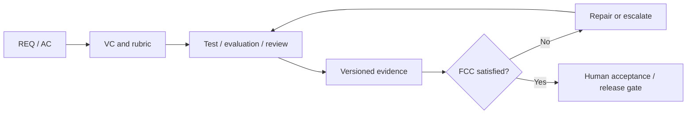

# V1 — Definition of Done Matrix
**ID:** RVC-V1-MTS · **State:** To-be review contract · **Status:** Draft · **Owner:** product/quality owner (roles)

Completion is evidence against the approved scope, not confidence in generated content. The actual run uses a revision-bound completion contract (FCC) selecting applicable criteria, thresholds, rubrics, regression scope, budgets, evidence and human gates.

## Minimum completion review

The nine existing shared controls are referenced below, not redefined. Each link goes to the governing verification criterion and corresponding acceptance condition.

| Stage | Criterion | Evidence / pass condition | Method |
|---|---|---|---|
| PreRun / Run | [VC-MTS-001](../../../requirement-verification-mapping.md#vc-mts-001) Scope | All obligations accounted for; no unauthorized scope | Contract and output reconciliation |
| PreRun / Run | [VC-MTS-002](../../../requirement-verification-mapping.md#vc-mts-002) Sources | Applicable lineage, permission, fidelity and discrepancies resolved | Source inspection/comparison |
| Run | [VC-MTS-003](../../../requirement-verification-mapping.md#vc-mts-003) Correspondence | Item/support identity, revision and option mapping match | Deterministic comparison |
| Run | [VC-MTS-004](../../../requirement-verification-mapping.md#vc-mts-004) Independent review | All applicable items reviewed; no unresolved blocking findings | Independent subject review/eval |
| All | [VC-MTS-005](../../../requirement-verification-mapping.md#vc-mts-005) Revision evidence | Changed inputs invalidate affected stale evidence | Impact and regression checks |
| Run | [VC-MTS-009](../../../requirement-verification-mapping.md#vc-mts-009) Rendered usability | Actual exports meet agreed profile and semantic/visual conditions | PDF checks and visual review |
| PostRun | [VC-MTS-006](../../../requirement-verification-mapping.md#vc-mts-006) Release | Mandatory evidence and human decisions authorize exact reconciled set | Gate and readback inspection |
| PostRun | [VC-MTS-007](../../../requirement-verification-mapping.md#vc-mts-007) Coverage | Count only confirmed released content | Release/coverage join |
| All / PostRun | [VC-MTS-008](../../../requirement-verification-mapping.md#vc-mts-008) Improvement | Material gaps traced to correction/regression or explicit block | Evidence chain review |

## Stage and overall gate

| Stage | Proposed minimum exit |
|---|---|
| PreRun | Scope, applicable criteria, inputs, budget, destinations and approval pinned |
| Run | Complete candidate, applicable content and export checks satisfied, evidence revision-bound |
| PostRun | Human approval, exact publication reconciliation, coverage and mandatory RunLog/evidence persisted |
| Overall | Every mandatory applicable condition satisfied or explicitly authorized exception under governing policy; no silent omissions |

Mandatory failures, unknown applicability or missing evidence block the affected gate unless governing policy explicitly permits an authorized exception. Human acceptance is separate from verification; outcome validation may continue after release. Record applicable, not designed, not executed, blocked, passed, failed, inconclusive, not applicable and authorized waived distinctly.

**DoD for the first slice must still be instantiated.** The [mapping](../../../requirement-verification-mapping.md) explicitly records partial capability coverage; this review view does not close those gaps. Agree subject-specific rubric/thresholds, exception authority, gate owners and RunLog requirements before execution. Factory telemetry and usage-log requirements that lack canonical checks need approved requirement deltas. See [completion and evidence accounting](../../../requirement-verification-mapping.md#completion-and-evidence-accounting) and [strategy verification design](../../../strategy/ai-sdlc/ai-sdlc-software-factory-strategy.md#3c-verification-driven-development-and-hierarchical-evidence).

## Overlay completion checks — proposed additions for pilot instantiation

These are review check candidates, not newly approved VC IDs. Existing mapped criteria remain authoritative; where no criterion covers a control, obtain an approved requirement/VC delta before representing it as mandatory verified scope.

| Overlay | Candidate condition | Evidence / disposition |
|---|---|---|
| Q1 | Applicable quality profile and checks complete; agreed performance/recovery limits met | VC-MTS-004/009 and independent results; new recovery/performance criteria as required |
| T1 | Approved dependencies and versions recorded; actual invocation traceable | Run manifest and compatibility evidence; proposed delta |
| B1 | Approved budget and retry ceilings respected; mandatory usage recorded or explicitly blocked | Estimate/actual ledger, attempt events; proposed delta |
| A1 | All applicable gates signed for exact revisions; stale approvals rejected | VC-MTS-005/006, approval records and invalidation tests |
| S1 | Source permission and destination valid; no restricted data/credentials in public outputs; approved access and security controls verified | VC-MTS-002/006 for source/release; security checklist/test evidence and new criteria for uncovered controls |
| O1 | Mandatory RunLog and evidence complete, with actual/unknown measurements distinguished | VC-MTS-008 supports improvement trace; telemetry completeness requires delta |

PreRun: resolve applicability, owners, thresholds and evidence before approval. Run: failed mandatory applicable controls trigger bounded repair or block; security incidents stop affected actions and escalate. PostRun: human release authority does not silently waive unmet criteria; authorized exceptions are separately reported under policy. Missing evidence is not a pass. No new runtime verification was performed in this documentation revision.
