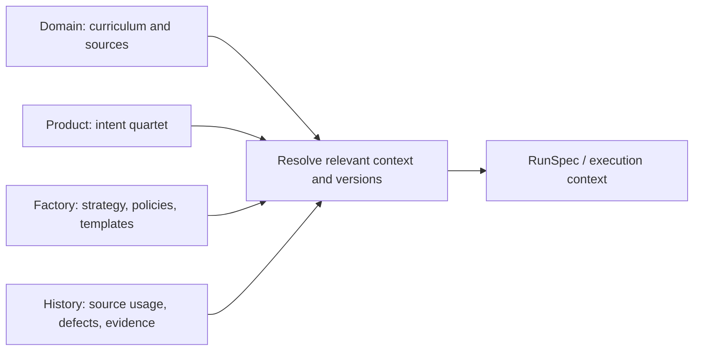
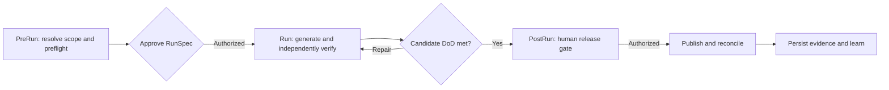
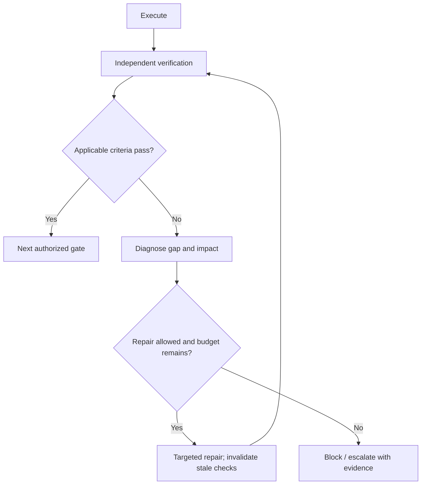
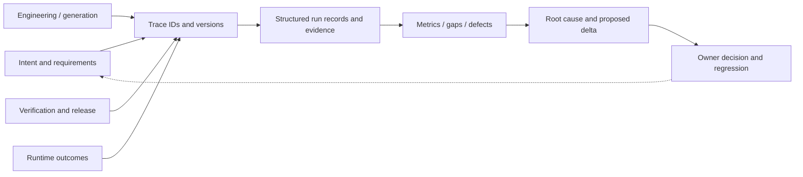

# Level 1 — Factory operating model
**ID:** RVC-FACTORY-MTS-L1 · **State:** To-be minimum operating model · **Status:** Draft · **Owner:** factory owner (role)

The engineering factory uses M0–M8 to build the product. The educational product uses PreRun / Run / PostRun to generate materials. Both need verifiable completion, correction and observation; their run IDs and evidence must remain distinguishable.

## K1 — Knowledge & Context Map

| Knowledge | Authoritative location to resolve |
|---|---|
| Product and business semantics | [Intent quartet](../../../README.md#sources-and-authority) |
| Methodology | [Factory strategy](../../../strategy/ai-sdlc/ai-sdlc-software-factory-strategy.md) |
| Curriculum, content and templates | Approved run-specific Sheets/Drive references; resolve actual IDs before execution |
| Operational history | Prior release evidence and source usage; verify location and version before reuse |

Historical material is evidence, not authority. Missing required context or a conflict blocks affected work until resolved. No vector store is required initially.

## E1 — Execution Lifecycle Map

| Stage | Input → output |
|---|---|
| PreRun | Intent and context → approved revision-bound RunSpec |
| Run | Approved spec → verified candidate and QA evidence |
| PostRun | Candidate and human authority → reconciled release and closeout |

Preserve all applicable subject-specific gates (including existing Math checkpoints). A failed review returns to the affected step. See [business process rules](../../../business-architecture.md#business-rules) and [V1](DEFINITION-OF-DONE.md).

## R1 — Convergence & Recovery Map

Freeze intent and criteria for the attempt. Log failed criterion IDs, evidence, correction and progress. Define retry/time budget in the approved slice contract; no numeric limit is assumed here. Stop on repeated no progress, missing authority or exhausted budget. Route semantic/intent changes to accountable owners, not silent criterion weakening. Use the strategy's distinct repair/specification/intent convergence routes.

## O1 — Observability & Learning Map

Minimum events: run and correlation ID; domain/workflow or station; phase/step/attempt; actor/tool version; input/output and requirement IDs; timestamps; estimate and actual active/wait durations where measured; status; criterion results and evidence; error/correction; approval/exception; release reference. Record during execution, not reconstructed as if contemporaneous. Start with append-only structured records; dashboard later.

Review four planes from the [strategy](../../../strategy/ai-sdlc/ai-sdlc-software-factory-strategy.md#3a-intent-to-outcome-observability): intent completeness, engineering realization, verification coverage, runtime outcome. Track elapsed time, attempts, blocked steps, applicable vs executed vs passed checks, and publication reconciliation separately. Unknown measurements remain unknown.

**Open before first pilot:** exact authoritative source/config paths, slice budget, event schema and storage references, gate owners and invocation path. No executable orchestration or instrumentation is claimed by these views.
