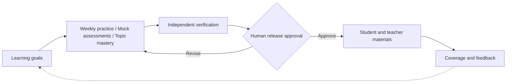

# P1 — Product Intent Canvas
**ID:** RVC-P1-MTS · **State:** To-be review scope · **Status:** Draft · **Owner:** MTS product owner

MTS helps educators turn learning goals into trustworthy Math and ELA materials. The reusable software factory builds and improves the product; the educational execution workflows produce materials. They are not interchangeable.

| Review dimension | Minimum intent |
|---|---|
| Users | Educators, subject reviewers, release operators, learners |
| Core focus | Weekly worksheets and keys; mock assessments and scoring support; topic cheatsheets, practice and guides |
| Supporting | Curriculum, source and artifact management |
| Outcome | Correct, suitable, traceable and approved materials |
| Boundaries | Math and ELA; no unapproved scope, source transformation or publication |
| Evidence | Approved scope, independent review, source fidelity, exact release reconciliation and learning record |

The three workflow families are a review grouping, not a replacement for the existing FA IDs. Diagnostic assessments and standalone lessons retain their existing later status pending scope approval; broader analytics remain deferred.

**Authority:** [Product intent and outcomes](../../../product.md), [business architecture](../../../business-architecture.md), [verification mapping](../../../requirement-verification-mapping.md). The quartet remains draft/review; full-product creation sufficiency is not established. See [V1](DEFINITION-OF-DONE.md) for evidence gates.
