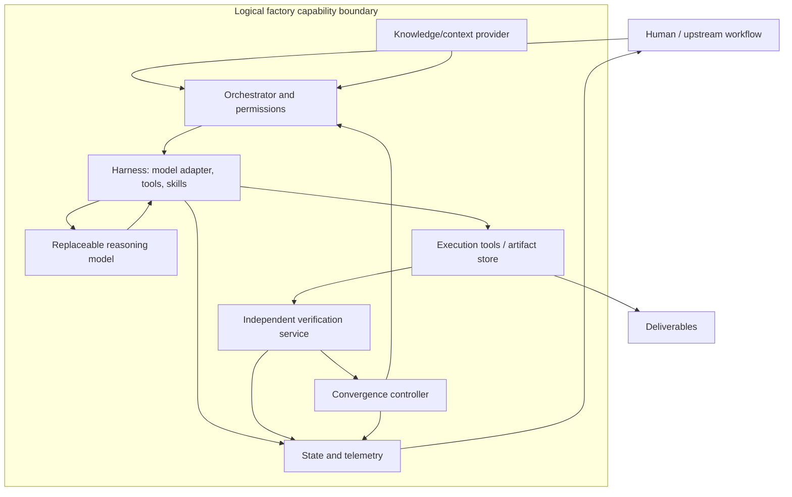
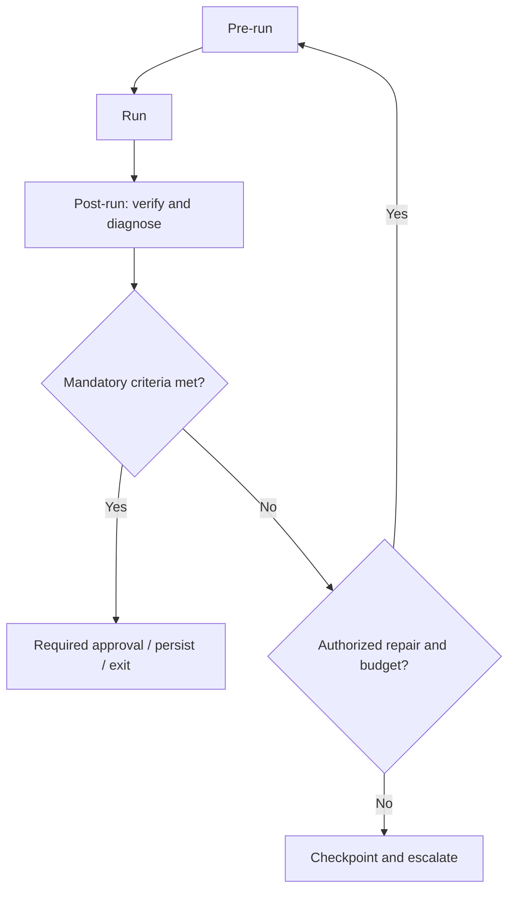

# AI-native engineering foundation

**Status:** Proposed, 2026-11-20. Companion to the [governing strategy](ai-sdlc-software-factory-strategy.md); no new execution or release authority.

## Holistic overview

Intent describes desired reality; knowledge describes relevant reality; harnesses act; verification compares; convergence closes gaps; observation and learning improve the system. Reviewability enables human judgment across all six. The factory creates software and operates repeatable AI generation workflows. M0–M8 remain the software lifecycle, not a replacement for these disciplines.

| View | Question |
|---|---|
| Conceptual foundation | What principles govern the system? |
| Engineering disciplines | What capabilities are required? |
| Lifecycle stations | Where is software work performed? |
| Run lifecycle | How does an execution complete? |
| Governance | Who may decide, change or approve? |

## Contents

1. [Intent sufficiency](#intent-sufficiency)
2. [Knowledge and harness architecture](#knowledge-and-harness-architecture)
3. [Run and convergence contract](#run-and-convergence-contract)
4. [Reviewability and documentation](#reviewability-and-documentation)
5. [First-principles comparison](#first-principles-comparison)
6. [Delta register and adoption](#delta-register-and-adoption)

## Intent sufficiency

The [Intent Quartet](ai-software-factory-intent-quartet-deepdive.md) is the minimum sufficient intent contract for a declared scope: product, business architecture, ontology, requirement–verification mapping. M1 owns product/ontology, M2 business architecture, M3 requirements/verification. Separate catalogs are optional physical storage, not additional logical intent homes. Pin sources, preserve IDs, and assess creation, completion, removal and change adequacy. Current MTS full-product sufficiency is not established by this proposal.

## Knowledge and harness architecture

| Concept | Responsibility | MTS example |
|---|---|---|
| Knowledge | Govern persistent facts and rules | Curriculum standards |
| Ontology | Define shared meaning and invariants | Grade, skill, assessment |
| Context | Select relevant versioned information | Grade 5 fractions objectives |
| Working memory | Hold current execution state | Selected question IDs |
| Persistent state | Preserve resumable state and evidence | Approved RunSpec and checkpoints |

Knowledge lifecycle: capture → validate → version → discover → select/load → use with provenance → review/update or retire. RAG, graphs and Markdown wikis are implementation options. Retrieved text is not automatically authority.

This is a proposed logical C2-style view, not an inventory of deployed containers. Separate verification authority from producer self-assessment. Model-specific adapters discover canonical repository instructions, resolve relevant artifacts and policies, record versions and resume from persisted checkpoints. Missing authority or context blocks execution.

## Run and convergence contract

| Phase | Required behavior |
|---|---|
| Pre-run | Resolve scope, inputs, pinned knowledge, permissions, prerequisites, budgets and completion contract. |
| Run | Execute authorized workflow with trace IDs and checkpoints. |
| Post-run | Independently verify artifacts, evaluate rubrics, record evidence, diagnose gaps. |
| Converge | Apply smallest authorized repair, reverify affected criteria and regressions; stop for no progress, exhausted budget or missing authority. |
| Exit | Persist artifacts, evidence, state, decision and next action; distinguish verified, accepted, blocked and escalated. |

Four loop scopes: individual run, workflow execution, product evolution, factory evolution. These are distinct from existing L1 execution repair, L2 specification learning and L3 intent/outcome learning routes. A run may require several attempts; keep stable run identity with attempt IDs and preserve before/after evidence.

Definition of Done = applicable requirements + verification layers + criteria and rubrics + thresholds + evidence rules + required approvals. Reuse the existing FCC pattern for run-level deliverables. Never hide failed mandatory conditions behind averages. A worksheet run checks file integrity, question counts, independently recomputed answers, grade/skill alignment, page limits, figure readability, source provenance and teacher approval where applicable. Actual thresholds come from approved specifications, not this example.

Product learning changes product behavior or intent; factory learning changes reusable templates, workflows, verification or context discovery. Example: repair a clipped worksheet figure, then strengthen shared layout checks. Record separate affected owners and impact.

## Reviewability and documentation

Reviewability governs comprehension, challenge, decision and approval. Documentation, visuals, review methods and evidence navigation are enabling practices. Follow the existing [review methodology](../reviewability-engineering/README.md). A substantial authoritative artifact starts with an approximately two-page holistic overview, then a table of contents and purpose-driven drill-down. Use implementation examples and compare/contrast tables; favor Feynman-style first principles and Michael Clay Thompson-inspired language precision. Analogies clarify, not replace definitions. Version canonical guidance, make it discoverable from harness entrypoints and adopt changes through human review. The separate documentation-engineering-level-1-review branch must be reconciled before adoption; do not duplicate its companion or assume it is merged.

## First-principles comparison

| AI engineering | Computing | Human anatomy and physiology |
|---|---|---|
| Intent | Target state/specification | Regulated set point |
| Knowledge | Persistent data | Long-term memory |
| Context | Arguments and runtime state | Sensory input and working memory |
| Reasoning model | Decision logic | Brain |
| Harness | Runtime, OS, APIs and I/O | Neural pathways, organs and effectors |
| Verification | Assertions and comparators | Sensory feedback mechanisms |
| Loop | Iteration and event loops | Regulatory feedback |
| Convergence | Iterative approach to target | Homeostasis |
| Observability | Logs and traces | Receptors and signaling |
| Learning | Persistent updates | Neuroplasticity/adaptation |
| Guardrails | Isolation and access control | Immunity and protective reflexes |

Functional analogies only; biological regulation is not equivalent to intentional software requirements.

## Delta register and adoption

| ID | Change | Review disposition |
|---|---|---|
| D01 | Six disciplines plus reviewability | Proposed in strategy overview |
| D02 | Intent sufficiency | Elevate existing quartet; retain adequacy checks |
| D03 | Knowledge/context architecture | Proposed above |
| D04 | Harness architecture | Logical view above; deployment inventory pending |
| D05 | Deliverable DoD | Generalize FCC; retain evidence authority |
| D06 | Pre/run/post contract | Proposed above |
| D07 | Four loop scopes | Preserve L1–L3 correction routes |
| D08 | Product vs factory learning | Distinguish owners and deltas |
| D09 | Reviewability integration | Preserve existing methodology |
| D10 | Documentation guidance | Reconcile parallel branch before adoption |
| D11 | Conceptual reading sequence | Overview links to this companion; folder migration deferred |
| D12 | Mental models | Comparison above; separate diagrams pending |
| D13 | Artifact ownership | Logical quartet vs physical catalogs |
| D14 | Cross-harness continuity | Discovery and checkpoint contract; implementation pending |
| D15 | Taxonomy | Distinguish conceptual level, station, review depth, correction route, loop scope, automation level; renaming deferred |

Preserve M0–M8, 3D architecture, NFR and responsibility overlays, atomic IDs, traceability, TEVV, vertical slices, A0–A5, configuration boundaries and human authority.

Proposed eventual document organization: conceptual foundation; factory architecture; engineering methodology; factory operations; governance/adoption/evolution. This revision retains existing section anchors and aging illustrations as lifecycle drill-downs to avoid breaking links. Full physical restructuring, refreshed diagrams, Level 1 artifact reconciliation and executable contracts require subsequent review.

Review gate: confirm discipline taxonomy, logical architecture, loop scopes, DoD boundaries, and documentation ownership. Reconcile child documents and parallel documentation branch; validate links and rendered diagrams; record approved decisions before promoting this proposal or implementing automation.
