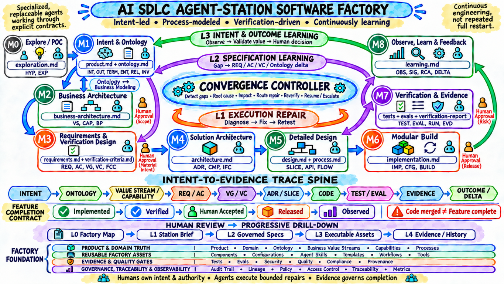
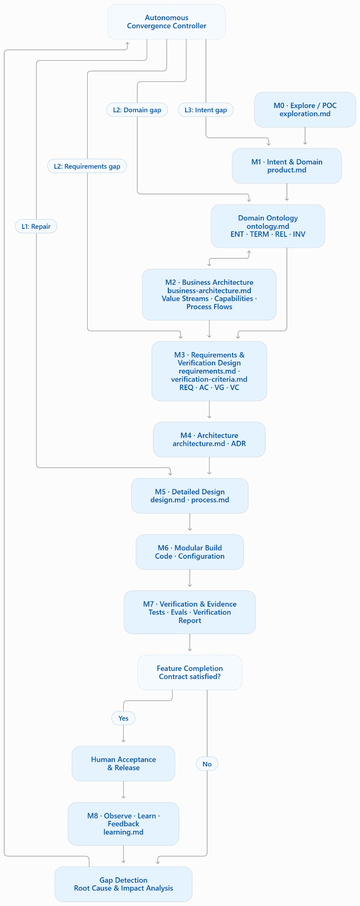
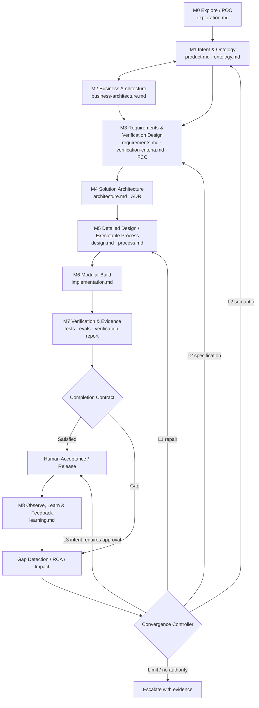
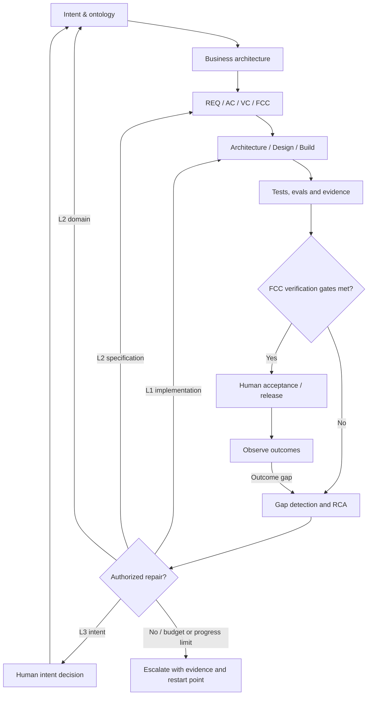
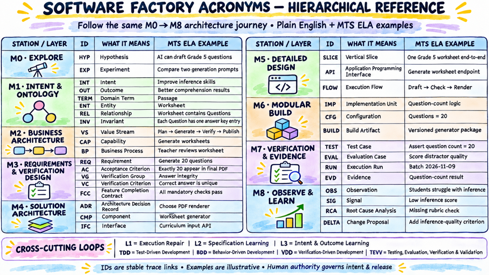
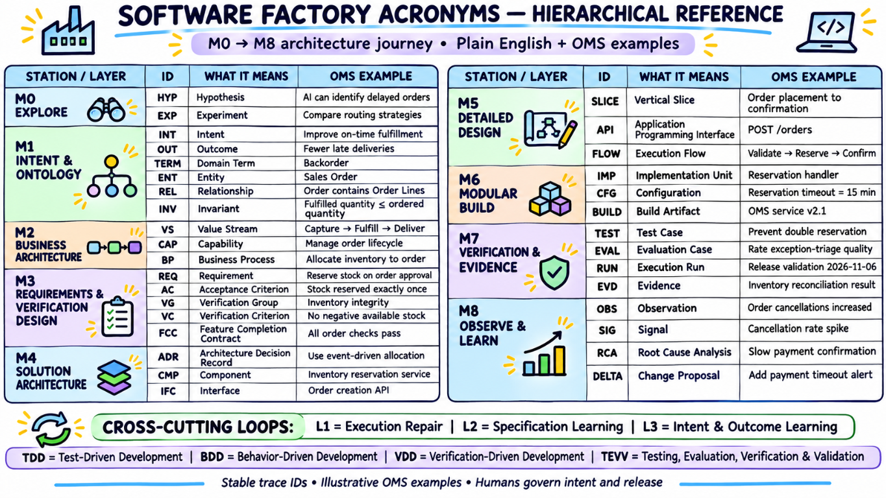

# AI-SDLC Software Factory Strategy

**Purpose:** Turn governed human intent into independently verified, human-accepted, observable software outcomes through reusable agent stations and bounded, persistent learning loops.

**Version:** 2026-11-06 architecture revision · **Status:** Proposed for human ratification; existing approvals and release authority are preserved.

**Operating principle:** **Humans own intent, judgment and authority. AI accelerates elaboration and execution. Deterministic systems provide evidence.**

---

## Table of Contents

- [Strategy at a glance](#strategy-at-a-glance)
- [1. The Software Factory Model](#1-the-software-factory-model)
- [2. Non-Negotiable Factory Constitution](#2-non-negotiable-factory-constitution)
- [3. M0–M8 Adoptable Production Lifecycle](#3-m0m8-adoptable-production-lifecycle)
  - [The minimum trace chain](#the-minimum-trace-chain)
  - [3A. Intent-to-Outcome Observability](#3a-intent-to-outcome-observability)
  - [3B. Human-Reviewable Artifact System by Agent Station](#3b-human-reviewable-artifact-system-by-agent-station)
  - [3C. Verification-Driven Development and Hierarchical Evidence](#3c-verification-driven-development-and-hierarchical-evidence)
  - [3D. Closed-Loop Convergence and Recovery](#3d-closed-loop-convergence-and-recovery)
- [4. M4: The 3D Architecture Kernel](#4-m4-the-3d-architecture-kernel)
- [5. Iterative Constraint Resolution](#5-iterative-constraint-resolution)
- [6. The Repeatable Unit: A Modular Vertical Slice](#6-the-repeatable-unit-a-modular-vertical-slice)
- [7. Factory Asset Architecture](#7-factory-asset-architecture)
- [8. Reference Repository Blueprint](#8-reference-repository-blueprint)
- [9. Quality and Verification System](#9-quality-and-verification-system)
- [10. Product Core, Configuration and Customization](#10-product-core-configuration-and-customization)
- [11. Controlled Automation Ladder](#11-controlled-automation-ladder)
- [12. Factory Roles and Responsibility](#12-factory-roles-and-responsibility)
- [13. Adoption Strategy: POC to Software Factory](#13-adoption-strategy-poc-to-software-factory)
- [14. First 90-Day Implementation Plan](#14-first-90-day-implementation-plan)
- [15. Measures That Prevent “More Code” from Masquerading as Progress](#15-measures-that-prevent-more-code-from-masquerading-as-progress)
- [16. Pioneer and Implementation Practices Incorporated](#16-pioneer-and-implementation-practices-incorporated)
- [17. Definition of a Working Software Factory](#17-definition-of-a-working-software-factory)
- [Appendix A — Acronym References](#appendix-a--acronym-references)

---

## Strategy at a glance

The factory organizes governed work into specialized M0–M8 stations, with humans retaining authority and evidence guiding completion and learning.



*Overview of the stations, trace spine, completion contract and factory foundation.*

The convergence flow below shows how gaps are routed to the affected station for repair, specification learning or human decision.



*Detailed station flow, including gap detection, verification, acceptance and bounded convergence.*

---

## 1. The Software Factory Model

A software factory is not a large code generator. It is a reusable production system that repeatedly transforms governed human intent into observable, supportable software.

```text
Human intent and desired outcomes
    ↓
Product intent and governed domain ontology
    ↓
Business architecture: value streams, capabilities and business flows
    ↓
Requirements, acceptance criteria and hierarchical verification criteria
    ↓
Feature completion contract and 3D solution architecture
    ↓
Executable process design and modular vertical slices
    ↓
Independent tests, evals, versioned evidence and human acceptance
    ↓
Runtime outcomes, gap detection, root cause and governed deltas
    ↺ bounded convergence to the affected station
```

The factory has four inseparable parts:

| Part | Purpose | Durable assets |
|---|---|---|
| **Product system** | Preserve what, why and shared meaning | `product.md`, `ontology.md`, `business-architecture.md`, requirements, acceptance and verification criteria |
| **Production system** | Define how work moves | lifecycle, phase contracts, workflows, commands, reusable templates |
| **Engineering system** | Build repeatable product slices | architecture, modules, APIs, code, configuration, tests, CI/CD |
| **Learning system** | Diagnose and converge from evidence | telemetry, evaluations, observations, gap/RCA ledger, completion contracts, decisions, bounded repairs, updated specs |

The product is the output. The factory is the reusable system that keeps producing and improving products.

---

## 2. Non-Negotiable Factory Constitution

1. **Intent before implementation.** Every material change traces to an approved human intent, outcome or constraint.
2. **One fact, one authoritative home.** Other artifacts reference it instead of copying it.
3. **Living specifications are production assets.** Product, requirements, architecture and tests evolve together.
4. **No unresolved critical ambiguity crosses a gate.** Record an assumption only when its risk and owner are explicit.
5. **Architecture is analyzed in 3D.** Functionality, applications/interfaces/technology and entities/data are resolved together.
6. **Non-functional qualities and responsibility govern all three dimensions.** They are overlays, not afterthoughts.
7. **Build modular, bounded, end-to-end vertical slices.** Each slice must be demonstrable and independently verifiable.
8. **Externalize variability.** Stable product behavior belongs in product artifacts; legitimate variation belongs in configuration or extension mechanisms.
9. **Evidence beats confidence.** Generated code is incomplete until executed, tested and observed.
10. **Automation is earned.** A phase moves from manual to assisted to semi-automated to highly automated only after its contract and controls are dependable.
11. **Humans retain authority.** Business intent, risk acceptance, architecture exceptions and production release boundaries remain explicitly owned.
12. **Every defect improves the factory.** Fix the instance, then strengthen the relevant spec, template, test, rule, tool or feedback loop.

---

## 3. M0–M8 Adoptable Production Lifecycle

Each level is a **logical capability and quality gate**, not necessarily a separate team or waterfall phase. Small changes may traverse the model quickly; complex concepts use Iterative Constraint Resolution to zoom in, resolve and rejoin the flow.

| Level | Factory capability | Required inputs | Repeatable activities | Authoritative outputs | Exit evidence / gate |
|---|---|---|---|---|---|
| **M0 — POC / Vibe Coding** | Explore cheaply | problem hypothesis, time box | prototype, compare approaches, test feasibility | disposable prototype, findings, risks, go/stop decision | learning captured; production code is not assumed |
| **M1 — Intent & Domain Ontology** | Preserve purpose and shared meaning | sponsor intent, users, domain sources | define outcomes, scope, domain terms/entities/relationships/invariants; steward semantic changes | `product.md`, `ontology.md`, intent/outcome map | human owner confirms intent; domain steward confirms semantics |
| **M2 — Business Architecture** | Model value delivery before detailed requirements | M1 truth and stakeholder process evidence | model value streams, functional areas, capabilities, business flows, rules, decisions and handoffs | `business-architecture.md`; VS/CAP/BP maps | value delivery and process boundaries are understandable, technology independent |
| **M3 — Requirements & Verification Design** | Make business behavior independently assessable | M1–M2, constraints and NFRs | derive REQs/ACs, group VCs, specify verification methods and FCC; resolve ambiguity and edge cases | `requirements.md`, `verification-criteria.md`, feature completion contract | REQ/AC/VC coverage and measurable success are reviewed |
| **M4 — 3D Architecture & Trade-offs** | Make coherent choices | M1–M3 plus enterprise constraints | analyze functionality, anatomy and flow together; resolve boundaries, alternatives, ownership and trade-offs | C1/C2 views, high-level ERD, interface map, NFR tactics, responsibility map, ADRs | architecture satisfies scenarios; decisions and owners recorded |
| **M5 — Detailed Design & Executable Process** | Make slices implementable | approved M4 boundaries, M2 business flow and M3 specs | define C3/C4 components, APIs, executable workflow/process, state, algorithms, migrations and test seams | `design.md`, `process.md`, slice packet, contracts | slice and its executable orchestration are bounded and testable |
| **M6 — Iterative Modular Vertical-Slice Build & Integration** | Produce working increments | approved slice packet | code plus configuration; contract-first integration; migrations; documentation; incremental PRs | executable slice, tests, build artifacts, provenance | build, policy, contract and integration gates pass |
| **M7 — Verification & Evidence** | Produce independent, inspectable evidence | executable slice, VC catalog, FCC | deterministic tests, rubric evals, inspection, review, regressions, coverage reconciliation, independent challenge | tests/evals, immutable EVD, `verification-report`, gap ledger | evidence meets FCC verification gates; exceptions authorized |
| **M8 — Observe, Learn & Feedback** | Detect value and operations gaps | released behavior, teacher/user feedback, operational signals | compare outcomes, detect semantic and runtime gaps, perform RCA, propose DELTAs, route to owning station | `learning.md`, OBS/SIG/RCA/DELTA, change proposals | lessons update authoritative artifacts with approvals |

**Sequence interpretation:** M2 describes the *business's* process before detailed requirements; M5 describes the *software/agent execution* process after requirements and architecture. Early requirements and discovery inform M2; the model is iterative, never a one-pass waterfall. Existing M0 and M8 remain stable; the revised M2/M3 ownership is a deliberate migration from the previous station numbering.

#### One-page agent-station architecture



The station diagram is a logical workflow, not a proof of implemented automation. `ontology.md` is a **governing semantic contract**: changes to `TERM/ENT/REL/INV` relationships trigger dependency and evidence impact analysis. The Convergence Controller is cross-cutting; L1/L2/L3 describe different routes rather than separate permanent teams.

### The minimum trace chain

```text
Intent/Outcome → Ontology → Value Stream/Capability/Business Process
  → Requirement/Acceptance Criterion → Verification Group/Criterion/FCC
  → Architecture Decision → Slice/Executable Flow → Code/Config/Build
  → Test/Eval/Review → Versioned Evidence → Human Acceptance/Release
  → Runtime Outcome → Observation/RCA/Delta → Affected upstream station
```

No factory artifact is complete if its upstream intent or downstream evidence cannot be found.

### 3A. Intent-to-Outcome Observability

The factory requires more than runtime logs. It must make the **state of every approved requirement observable from intent through production outcome**.

There are four complementary observability planes:

| Plane | Primary question | Required evidence |
|---|---|---|
| **Intent observability** | Are we implementing the complete and current requirement? | intent ID, requirement ID/version, acceptance criteria, scope, owner, requirement-delta history |
| **Engineering observability** | Where and how is it being implemented? | architecture/design decisions, task/slice IDs, code/config changes, commits, builds and responsible station runs |
| **Verification observability** | What proves that it works completely? | requirement-derived tests/evals, coverage result, negative/edge cases, quality scenarios, approved exceptions |
| **Runtime observability** | Does the released behavior produce the intended outcome? | deployment/version, traces, logs, metrics, user/business outcome, incidents and feedback |

Operational telemetry alone can help diagnose a defect while still leaving half a requirement unimplemented. Therefore, the factory must maintain both:

1. **Execution telemetry:** what the system and agent stations did.
2. **Semantic traceability:** why each action exists and which requirement, scenario and outcome it satisfies.

#### Requirement trace graph

Every governed change participates in this graph:

```text
Intent / Outcome
  → Domain Ontology (TERM / ENT / REL / INV)
    → Value Stream / Capability / Business Process
      → Requirement + AC + Quality Scenario + VC + FCC
        → 3D Architecture Decision + Modular Slice + Executable Flow
          → Detailed Design + Contract
        → Code / Configuration / Data Migration
          → Build + Test / Evaluation / Review + Versioned Evidence
            → Human Acceptance / Release / Deployment
              → Runtime Signal / User Outcome / Feedback
                → RCA / Learning / Delta → Affected authoritative station
```

Each node has a stable ID and version. Each relationship is explicit—for example `implements`, `constrains`, `verified_by`, `released_as`, `observed_by`, `supersedes` or `produced_delta`.

#### Requirement Coverage Ledger

Maintain a machine-readable ledger generated from authoritative artifacts and rendered as a human-reviewable table.

| Field | Meaning |
|---|---|
| Requirement ID and version | Stable identity of the governed requirement |
| Intent/outcome link | Why the requirement exists |
| Owner and approver | Human authority and decision responsibility |
| Acceptance criteria | Observable functional completion conditions |
| Ontology and business links | Canonical entities, relationships, value streams, capabilities and processes |
| Verification criteria and FCC | Grouped independent checks, applicability, threshold and completion rule |
| Quality scenarios | Non-functional completion conditions |
| Architecture/design links | Where the requirement is allocated and resolved |
| Slice and implementation links | Code, configuration, data and migration realization |
| Verification links | Tests, evaluations, reviews and exceptions |
| Release/runtime links | Build, deployment, telemetry and outcome evidence |
| Status | `Unelaborated`, `Ready`, `In progress`, `Implemented`, `Verified`, `Released`, `Observed`, `Accepted`, `Superseded` |
| Coverage gaps | Missing behavior, scenario, evidence, environment or responsibility |
| Requirement-delta links | Learning that changed the requirement and downstream impact |

The ledger must distinguish:

- **implemented** — code/config/data exists;
- **verified** — all mapped acceptance and quality evidence passes;
- **released** — the verified implementation is deployed;
- **observed** — runtime signals confirm the expected behavior;
- **accepted** — the accountable human confirms the intended outcome is satisfied.

No requirement is considered complete merely because a ticket is closed or code is merged.

#### Completeness and consistency gates

Before release, the factory automatically and/or humanly checks:

- every in-scope requirement maps to at least one slice;
- every acceptance criterion and relevant quality scenario maps to evidence;
- every implementation element maps back to an approved requirement or enabling decision;
- every applicable interface/data contract has producer and consumer verification;
- every exception has an owner, rationale, risk, expiry/review date and compensating control;
- no superseded requirement is being implemented accidentally;
- requirement, design, code and test versions are mutually consistent;
- deployment and telemetry identify the exact requirement-bearing build.

#### Station run log and trace context

Every station execution emits a structured, append-only run record:

```yaml
run_id: RUN-...
correlation_id: FLOW-...
station: M0..M8
actor: human | agent | workflow
actor_version: model-or-tool-version
input_artifact_ids: []
input_versions: []
requirement_ids: []
decisions_and_assumptions: []
actions_and_tool_calls: []
output_artifact_ids: []
evidence_ids: []
status: proposed | running | blocked | passed | failed | approved
approver: human-owner
timestamps: {}
cost_and_usage: {}
errors_and_exceptions: []
next_station_or_delta_route: ...
```

Logs must be searchable by requirement, slice, artifact, build, deployment, station, agent, human owner and time. Sensitive reasoning is not required; record inputs, decisions, actions, evidence and outcomes needed for reconstruction and audit.

#### Minimum observability views

The factory should expose five review views from the same trace data:

1. **Requirement completeness:** what is missing before the requirement is truly complete?
2. **Forward trace:** where did this intent become architecture, implementation, evidence and runtime behavior?
3. **Backward trace:** why does this code, configuration, test or deployment exist?
4. **Delta impact:** which artifacts, tests, owners and releases are affected by a new requirement delta?
5. **Flow health:** where is work blocked, repeatedly failing or accumulating exceptions?

### 3B. Human-Reviewable Artifact System by Agent Station

Every M-station owns an authoritative artifact contract. Agents may draft and maintain the artifacts; accountable humans review the one-page view and approve the gate.

#### Progressive drill-down model

| Level | Intended reader and purpose | Content rule |
|---|---|---|
| **L0 — Factory Map** | executive/team orientation | one visual showing M0–M8, learning loop, owners and current flow status |
| **L1 — One-Page Station Brief** | human gate review | purpose, inputs, key decisions, deltas, risks, outputs, evidence, trace coverage and approval |
| **L2 — Governed Specification** | product/architecture/engineering review | complete structured artifact for the station, linked rather than duplicated |
| **L3 — Executable Assets** | agents, developers and CI/CD | schemas, contracts, code, configuration, tests, workflows, dashboards |
| **L4 — Evidence and History** | audit, learning and reconstruction | immutable run logs, versions, decisions, approvals, results, runtime evidence and deltas |

The L1 brief is not another source of truth. It is a generated or carefully maintained **review lens** containing concise decisions and links to authoritative L2–L4 artifacts.

#### Universal one-page station brief template

Each station maintains `M<n>-<station>-BRIEF.md` using this contract:

```markdown
# M<n> — <Station Name> | Review Brief

## 1. Purpose and Current Decision
Outcome sought, decision required, status and accountable owner.

## 2. Inputs and Trace Scope
Linked intent/requirement/delta IDs, artifact versions and assumptions.

## 3. What Changed
Concise delta from the previously approved baseline.

## 4. Key Content / Decisions
The 3–7 items a human must understand; alternatives and trade-offs where relevant.

## 5. Coverage and Gaps
Requirements covered, missing mappings, unresolved constraints and exceptions.

## 6. Evidence
Tests, evaluations, analyses, prototypes, runtime signals or review results.

## 7. Outputs and Downstream Impact
Authoritative artifact links, affected stations, contracts, owners and releases.

## 8. Risks, Responsibility and Escalations
Risks, controls, responsible parties, approval boundaries and stop conditions.

## 9. Human Gate
Approve | Approve with conditions | Return for revision | Stop
Approver, date, conditions and next review.
```

#### Canonical artifact and atomic-entity model per station

Each station has one primary Markdown artifact that explains the coherent whole. Precise traceability uses smaller atomic entities with stable IDs. The primary artifact links to those IDs; it does not replace them or duplicate their complete content.

| Station | Primary artifact | Atomic trace entities | Canonical ID namespaces | Suggested atomic storage | Human gate focuses on |
|---|---|---|---|---|---|
| **M0 — Explore / POC** | `exploration.md` | hypothesis, experiment, finding | `HYP-001`, `EXP-001`, `FND-001` | `docs/exploration/experiments/EXP-001.md` | what was tested and learned; go, pivot or stop; whether any POC asset may enter production |
| **M1 — Intent & Ontology** | `product.md`, `ontology.md` | intent, outcome, domain term, entity, relation, invariant | `INT-001`, `OUT-001`, `TERM-001`, `ENT-001`, `REL-001`, `INV-001` | `docs/product/intents/INT-001.md`; `docs/domain/entities/ENT-001.md` | outcome and canonical meaning are clear and owned |
| **M2 — Business Architecture** | `business-architecture.md` | value stream, capability, business process, functional area, business rule, variation | `VS-001`, `CAP-001`, `BP-001`, `FA-001`, `RULE-001`, `VAR-001` | `docs/business-architecture/processes/BP-001.md` | business flow and capabilities are sufficiently modeled before detailed REQs |
| **M3 — Requirements & Verification Design** | `requirements.md`, `verification-criteria.md` | requirement, acceptance criterion, quality scenario, constraint, verification group/criterion, completion contract | `REQ-001`, `AC-001.1`, `QAS-001`, `CST-001`, `VG-001`, `VC-001`, `FCC-001` | `docs/requirements/REQ-001.md`; `docs/verification/criteria/VC-001.md` | requirements and verification criteria are linked, independently assessable and scoped |
| **M4 — 3D Architecture** | `architecture.md` | architecture decision, component, interface, responsibility; reuses domain entities and quality scenarios | `ADR-001`, `CMP-001`, `IFC-001`, `RESP-001`; reuse `ENT-*`, `QAS-*` | `docs/architecture/adr/ADR-001.md`; architecture catalog entries under `components/`, `interfaces/`, `responsibilities/` | 3D coherence, alternatives, boundaries, quality tactics, ownership and trade-offs |
| **M5 — Detailed Design** | `design.md`, `process.md` | vertical slice, executable flow, design component, API/event contract, state, algorithm | `SLICE-001`, `FLOW-001`, `DC-001`, `API-001`, `EVT-001`, `STATE-001`, `ALG-001` | `docs/design/slices/SLICE-001.md`; executable contracts under `contracts/` | whether executable flow implements M2 business behavior and M3 acceptance conditions |
| **M6 — Modular Build** | `implementation.md` | implementation unit, configuration item, migration, build | `IMP-001`, `CFG-001`, `MIG-001`, `BUILD-001` | `docs/implementation/IMP-001.md`; configuration and migrations beside executable assets | whether the approved design is realized in the identified build with provenance |
| **M7 — Verification & Evidence** | `verification.md` and generated verification report | test, eval, execution run, evidence, gap, exception | `TEST-001`, `EVAL-001`, `RUN-001`, `EVD-001`, `GAP-001`, `EXC-001` | `tests/`; `evals/`; `evidence/EVD-001.json`; `docs/exceptions/EXC-001.md` | mandatory FCC evidence and independent coverage have been established |
| **M8 — Observe, Learn & Feedback** | `learning.md` | observation, signal, feedback, RCA, learning, delta | `OBS-001`, `SIG-001`, `FDB-001`, `RCA-001`, `LRN-001`, `DELTA-001` | `docs/learning/LRN-001.md`; `deltas/DELTA-001.md`; telemetry | outcome gaps are diagnosed and routed without silent semantic drift |

`TERM-*` is reserved for domain vocabulary and `CST-*` for requirements constraints. This prevents the earlier ambiguity of using `CON-*` for two different concepts.

#### Aggregate artifact versus atomic entity

```text
architecture.md                         # coherent human-readable architecture
├── CMP-001  Order Service              # atomic component
├── IFC-001  Order Submission API       # atomic interface
├── ENT-001  Order                      # reused domain entity
├── RESP-001 Order ownership            # atomic responsibility
├── QAS-003  Availability scenario      # reused quality scenario
├── ADR-001  Event-driven submission    # atomic decision file
└── ADR-002  Order data ownership       # atomic decision file
```

Use a separate file when an entity has its own lifecycle, owner, approval, alternatives or history—especially `REQ-*`, `ADR-*`, `SLICE-*`, `EXC-*` and `DELTA-*`. Lightweight catalog entities may remain addressable records inside the primary artifact or a structured catalog, provided their IDs remain stable and linkable.

#### Canonical cross-station trace example

```text
INT-001
  → OUT-002
    → ENT-001 / REL-001 / INV-001
      → VS-001 / CAP-001 / BP-003 / RULE-008
        → REQ-012 / AC-012.1 / QAS-003
          → VG-001 / VC-004 / FCC-001
            → ADR-001 / CMP-001 / IFC-002
              → SLICE-004 / FLOW-001 / API-002
            → IMP-021 / CFG-004 / BUILD-019
              → TEST-041 / EVAL-006 / RUN-001 / EVD-052
                → Human approval / Release / OBS-014 / SIG-009
                  → RCA-002 / LRN-003 / DELTA-006
```

This chain is navigable in both directions. A requirement shows its realization and evidence; a code, configuration, test or runtime signal shows the intent and decision that justify its existence.

#### Artifact navigation contract

Every primary artifact and independently stored atomic entity begins with a small metadata block:

```yaml
artifact_id: ARCHITECTURE | REQ-012 | ADR-001 | SLICE-004 | EVD-052 | ...
artifact_type: intent | requirement | architecture | design | implementation | evidence | learning
station: M0..M8
status: draft | review | approved | superseded
version: ...
owner: ...
approvers: []
source_ids: []
requirement_ids: []
atomic_entity_ids: []
delta_ids: []
supersedes: []
downstream_ids: []
last_verified_against: []
```

Every station summary provides direct links to its primary artifact, atomic entities, executable assets and evidence/history. Every deeper artifact links back to its governing intent, requirement and station artifact. This creates a navigable system rather than a folder of disconnected documents.

#### Template governance

- Store canonical templates under `templates/stations/M0` through `M8`.
- Version templates separately from product artifacts.
- Generate a project artifact from a pinned template version.
- Preserve user-authored and approved content when templates evolve.
- Review templates using representative products before promotion to the golden path.
- Treat template changes as factory changes: test them, record provenance and measure downstream effects.
- Keep the one-page briefs concise; move detail into linked drill-downs rather than shrinking fonts or duplicating content.

---

### 3C. Verification-Driven Development and Hierarchical Evidence

**Working umbrella label:** Verification-Driven Development (VDD). This is a proposed factory operating model, not a claim of a separately standardized methodology. **TDD** applies to deterministic behavior; **BDD** describes stakeholder-understandable scenarios; **eval-driven design** applies to judgment-bearing AI behavior. All are guided by pre-specified, independently inspectable evidence.

| Term | Meaning | Factory usage |
|---|---|---|
| Testing | Executing or examining a target to detect defects and assess quality | Deterministic, integration, security, exploratory checks |
| Verification | Objective evidence that specified requirements are met | AC/VC pass and evidence coverage |
| Validation | Objective evidence that intended use and stakeholder needs are met | Human and operational outcome acceptance |
| Evaluation (eval) | Measurement against a rubric, benchmark or other criteria | Quality of LLM questions, reasoning, distractors, agent decisions |
| Acceptance criterion (AC) | Product condition for acceptance of a requirement | Exactly 20 questions in final PDF |
| Verification criterion (VC) | Independently assessable condition and evidence rule | Rendered count matches approved requirement |

Verification is not synonymous with testing; reviews, static analysis and inspections can provide evidence. An eval may support verification or validation, but an AI judge's score is not proof of a deterministic invariant. For high-risk semantic evaluations, calibrate against expert examples and record disagreement, uncertainty and adjudication.

**`verification-criteria.md` contract:** Each group (`VG-*`) has purpose, parent, risk and applicability. Each criterion (`VC-*`) contains stable ID, statement, linked `REQ/AC/QAS`, test condition, method, oracle or rubric, threshold, severity, independent evaluator requirement, evidence specification, ownership, version and applicability. Links are many-to-many: one AC may require multiple VCs and one reusable VC may cover several ACs. Groups organize reporting; they do not replace explicit AC↔VC links.

**Feature Completion Contract (`FCC-*`):** Immutable-for-a-run snapshot of applicable requirements, mandatory VCs, pass/threshold rules, regression scope, evidence expectations, authorized exceptions, budgets, human gates and post-release observation. Separate `IMPLEMENTED`, `VERIFIED`, `AWAITING_ACCEPTANCE`, `ACCEPTED`, `RELEASED`, `OBSERVED`, `BLOCKED`, `ESCALATED`; code merged is not feature complete. Acceptance can precede release, while long-term outcome validation legitimately continues after release.

**Verification report:** Generate a drill-downable human-readable report from trace relationships and append-only execution evidence. It contains (1) version/scope/run summary, (2) applicable vs explicitly out-of-scope vs deferred counts, (3) CAP→REQ→AC→VC→TEST/EVAL/REVIEW→RUN→EVD drill-down and alternate VG view, (4) failure/RCA and attempt history, (5) independent verification metadata, and (6) FCC and human decision. Use `NOT_APPLICABLE`, `NOT_DESIGNED`, `NOT_EXECUTED`, `BLOCKED`, `PASSED`, `FAILED`, `INCONCLUSIVE`, `WAIVED` (authorized). Report coverage, execution, pass percentage and acceptance separately; never treat unverified or excluded items as passes.

### 3D. Closed-Loop Convergence and Recovery

The factory contains **three distinct loops**, not an unbounded retry arrow:

| Loop | Trigger | Return destination | Decision authority |
|---|---|---|---|
| **L1 Execution repair** | Broken build, failed test, runtime defect, layout regression | M5/M6 design, code or configuration; rerun M7 | Bounded authorized repairs |
| **L2 Specification learning** | Missing/contradictory REQ, AC, VC, semantic rule or architecture condition | M1 ontology, M2 business process, M3 requirements/VC or M4 ADR | Approvals proportionate to scope and risk |
| **L3 Intent/outcome learning** | Actual user value, usability or learning outcomes diverge from desired outcomes | M1 intent and M2 business value stream, then downstream changes | Human product/domain owner |

**Convergence Controller:** A cross-cutting orchestrator, not another serial agent station. At every cycle it reads the FCC, trace graph, evidence and persisted state; identifies gaps; classifies symptom versus cause; records competing RCA hypotheses and evidence; computes blast radius; routes the smallest authorized repair to its owning station; executes independent verification and regressions; measures progress; checkpoints; repeats or escalates. A semantic change to `ontology.md` must traverse its `TERM/ENT/REL/INV` consumers, invalidating affected downstream evidence until rerun.



**Safety and convergence policy:** Per-feature/per-defect attempt ceilings, cost and wall-time budgets, retry backoff, no-progress and oscillation detection, reversible isolation, source access limits, policy/security gates, no criterion weakening to create a green result, approval for material changes, and human-controlled deployment. Every repair states the hypothesis, changed artifacts, verification scope and observed result. Independent verification must not rely solely on the producer's self-assessment. A blocked dependency or missing authority causes an explicit pause rather than a fabricated success.

**Resumability:** The model-neutral work-item ledger persists `work_id`, intent, FCC snapshot, artifact versions and hashes, current station, pending gaps, `RUN` and trace IDs, evidence, RCA hypotheses, decisions, attempt history, budget, approvals, next action and stop reason. Any supported model/harness can resume at the last safe checkpoint without reopening settled decisions.

**Observation planes:** Intent/outcome, business-process, requirements/ontology, verification, agent execution and operational telemetry. Use structured logs, traces, metrics and events with shared `work_id`, `req_id`, `vc_id`, `run_id`, `attempt_id`, `artifact_hash`. Apply privacy and retention controls; no sensitive hidden chain-of-thought logging is required.

**Factory measures:** Verified feature completion rate; first-pass verification; verified REQ/AC/VC coverage; mean repair iterations; diagnosis accuracy; defect recurrence; escaped defects; human intervention rate; cost per independently verified and human-accepted feature. Distinguish actual observability from a dashboard that merely reports code merged.

## 4. M4: The 3D Architecture Kernel

The five architecture concerns are organized as **three primary dimensions plus two governing overlays**.

| Model role | Architecture concern | Body analogy | Questions answered |
|---|---|---|---|
| **Dimension 1** | Functional | **Physiology** | What capabilities and processes must occur? In what hierarchy and phases? |
| **Dimension 2** | Applications, interfaces and technology | **Anatomy** | Which body parts realize the behavior? How are they bounded and connected? What technology is justified? |
| **Dimension 3** | Informational: entities and data | **Circulation / flow** | What flows between parts? What are its meaning, lifecycle, relationships and ownership? |
| **Governing overlay** | Non-functional | **Health and fitness** | How secure, reliable, scalable, usable, observable and maintainable must every intersection be? |
| **Governing overlay** | Responsibility | **Control and accountability** | Which human, team, AI agent or software component decides, performs, approves and operates? |

Example: `Circulate blood` is the physiology; `heart, arteries and veins` are anatomy; `blood` is the information being transported. Health constraints apply throughout, while control and accountability determine who or what regulates, monitors and intervenes.

### 3D resolution rule

For every meaningful capability, create a small matrix:

| Functional phase | Application/interface/technology | Entities and data | Quality scenarios | Responsibility |
|---|---|---|---|---|
| What must happen? | Where and through which contracts? | What enters, changes and exits? | How well and under what failure modes? | Who owns, approves, operates and responds? |

If any column is materially unknown, the concept remains an architectural constraint and must not be hidden inside implementation.

---

## 5. Iterative Constraint Resolution

The factory advances by resolving the most limiting uncertainty—not by creating every document in full detail up front.

```text
Detect → Prioritize → Bound → Analyze in 3D → Resolve
      → Integrate → Verify → Record learning → Next constraint
```

For each constraint:

1. State the observable limitation or unanswered decision.
2. Identify the outcome it blocks and the risk of deferral.
3. Bound the smallest useful investigation or vertical slice.
4. Analyze physiology, anatomy and information flow together.
5. Apply non-functional scenarios and responsibility ownership.
6. Compare alternatives and record the decision in an ADR.
7. Build or simulate enough to obtain evidence.
8. Update the authoritative artifacts and constraint backlog.

Use spikes only for learning. A spike becomes product work only after its learning is translated into governed design and production-quality acceptance criteria.

---

## 6. The Repeatable Unit: A Modular Vertical Slice

The preferred work package is a thin, end-to-end slice that crosses only the layers necessary to deliver one observable outcome.

Every slice must contain:

| Slice element | Minimum content |
|---|---|
| Intent | user/business outcome and source |
| Scope | included behavior, exclusions and assumptions |
| 3D design | functional phase, components/interfaces/technology, entities/data |
| Overlays | relevant NFR scenarios and responsibility/approval boundaries |
| Contracts | API, event, file, UI or workflow contracts and compatibility rules |
| Variation | product behavior vs configuration vs approved extension |
| Evidence | acceptance examples, tests, evaluations and observable runtime signals |
| Release | migration, rollout, rollback and operational ownership |

Prefer a sequence of complete slices over horizontal layers such as “build all APIs, then all UIs.” A slice should be small enough for focused review and large enough to produce end-to-end evidence.

---

## 7. Factory Asset Architecture

Use four artifact classes to keep context deterministic and economical.

| Artifact class | Purpose | Typical formats | Rule |
|---|---|---|---|
| **Knowledge** | Facts, concepts and context | `.md`, ontology, examples, curated references | explanatory; provenance-preserved |
| **Configuration** | Approved variability | `.yaml`, `.json`, policy tables, feature flags | schema-validated; no hidden code |
| **Command** | Thin human/agent entry point | `.md`, CLI command | declares inputs, output and invoked workflow |
| **Workflow** | Orchestrated production procedure | `.yaml`, `.md`, pipeline definition | restartable, observable and gate-aware |
| **Skill** | Reusable reasoning or specialized task method | instruction package + references/templates | bounded purpose; versioned and testable |
| **Code** | Deterministic execution | source, scripts, services | used where repeatability matters more than interpretation |
| **Tests & evaluations** | Executable evidence | test code, fixtures, eval datasets, rubrics | derived from intent and failure history |
| **Templates & output** | Reusable skeletons and deliverables | repo templates, docs, manifests | parameterized; product/customization separated |

Principle: **reason with knowledge, vary with configuration, enter through commands, orchestrate with workflows, reuse expertise through skills, and execute deterministically with code.**

---

## 8. Reference Repository Blueprint

```text
/
├── product.md                     # audience, problem, purpose, boundaries, outcomes
├── ontology.md                    # shared entities, terms, relationships and invariants
├── business-architecture.md       # domain value streams, capabilities, business flows
├── requirements.md                # product requirements and acceptance conditions
├── verification-criteria.md       # hierarchical, reusable VC catalog
├── AGENTS.md                      # concise agent operating contract and pointers
├── README.md                      # human entry point and local quick start
├── docs/
│   ├── intent/                    # intent and outcome records
│   ├── domain/                    # canonical ontology entities and relationships
│   ├── business-architecture/     # value streams, capabilities and business flows
│   ├── requirements/              # scenarios, constraints, AC and FCC records
│   ├── verification/              # VC catalogs, coverage reports, evidence views
│   ├── process/                   # executable workflows and automation modes
│   ├── architecture/
│   │   ├── c1-context.md
│   │   ├── c2-containers.md
│   │   ├── data-model.md
│   │   ├── interfaces.md
│   │   ├── quality-scenarios.md
│   │   ├── responsibilities.md
│   │   └── adr/
│   ├── design/                    # slice design packets
│   ├── operations/                # SLOs, runbooks, recovery
│   └── learning/                  # decisions, incidents, constraints, retrospectives
├── source-material/               # preserved historical inputs; see source-material/README.md
├── evidence/                      # immutable test/eval/run evidence references
├── state/                         # resumable work items and convergence checkpoints
├── specs/                         # living feature/slice specifications
├── contracts/                     # OpenAPI, AsyncAPI, schemas, conformance cases
├── config/                        # externalized product/project configuration
├── extensions/                    # bounded customization mechanisms
├── src/                           # product code
├── tests/
│   ├── unit/
│   ├── integration/
│   ├── contract/
│   ├── e2e/
│   ├── security-performance/
│   └── evals/                     # AI behavior datasets, rubrics and thresholds
├── workflows/                     # agent and delivery workflows
├── skills/                        # reusable task expertise
├── templates/                     # golden-path skeletons
├── scripts/                       # deterministic developer/factory operations
├── observability/                 # dashboards, alerts, telemetry contracts
├── infra/                         # infrastructure as code
└── .github/
    ├── workflows/                 # reusable CI/CD and provenance workflows
    ├── CODEOWNERS
    ├── pull_request_template.md
    └── agent instructions         # tool-specific thin adapters, if needed
```

### Historical source material and consolidation

Preserve previous-stage artifacts as non-authoritative inputs in `source-material/<domain>/<subject>/<artifact-type>/` (for example, `source-material/mts/ela/product/` and `source-material/mts/math/product/`). Use date-plus-revision filenames (`product-YYYY-MM-DD-v1.md`, `-v2.md`, etc.) for historical snapshots, and dated snapshot folders only when multiple artifacts form one coherent baseline. Keep original content and provenance; use `undated-v1` when the original date is unknown rather than inventing one. Snapshot revision numbers are distinct from formal document versions. Consolidate shared meaning into existing authoritative specifications while retaining subject-specific requirements and recording source-to-target disposition. The lightweight operating convention and inventory live in [`source-material/README.md`](../../source-material/README.md).

### Context architecture

Keep root instructions short. Use them as a map to authoritative, scoped files. Load context progressively by task rather than injecting the whole repository. Generated summaries never silently replace authoritative sources.

---

## 9. Quality and Verification System

This section describes implementation techniques that realize the governing `REQ/AC ↔ VG/VC ↔ TEST/EVAL/RUN/EVD ↔ FCC` contracts in §3C. Verification outcomes must be derived from versioned evidence; the report is a view, not a parallel manual truth source. Human validation and risk acceptance are distinct decisions. See §3D for the three feedback loops and autonomous repair limits.

Verification has three complementary layers:

| Layer | Best for | Examples |
|---|---|---|
| **Deterministic gates** | objective correctness and policy | compile, lint, schema, unit, contract, dependency, security, license, migration checks |
| **Model-based evaluations** | semantic or judgment-bearing quality | requirement coverage, design coherence, answer quality, unsafe behavior, style rubric |
| **Human verification** | intent, trade-offs and accountable risk | product acceptance, architecture decision, UX judgment, production authorization |

Required behavior:

- Run the existing baseline tests before changing code.
- Add or update tests with the behavior change.
- Execute the real product path; do not accept unexecuted generated code.
- Convert manually discovered failures into permanent regression evidence.
- Use independent review for high-risk changes; the producer should not be the only evaluator.
- Keep retries bounded. Repeated failure becomes a constraint requiring human analysis, not an infinite agent loop.
- Produce an evidence bundle for every releasable slice.

### Evidence bundle

```text
spec/version + commit + build provenance + test/eval results
+ security/compliance checks + deployment record + runtime signals
+ approved exceptions + accountable owners
```

---

## 10. Product Core, Configuration and Customization

Use this decision order whenever variability appears:

1. **Product core:** Is it invariant behavior that should work for every adopter?
2. **Configuration:** Is it an anticipated variation expressible as validated data or policy?
3. **Extension:** Is it legitimate bounded behavior behind a stable interface?
4. **Fork/custom code:** Is isolation unavoidable and its lifecycle explicitly funded?

Business rules should be externalized only when their semantics, validation, ownership, versioning and test coverage are clear. Moving arbitrary logic into YAML does not make it maintainable.

Every configuration field needs:

- schema, type and allowed range;
- default and backward-compatibility behavior;
- owning role;
- security classification;
- validation and test cases;
- effective-date/version semantics when business behavior changes over time.

---

## 11. Controlled Automation Ladder

Automation is selected **per functional phase**, not once for the entire product.

| Level | Operating mode | Human role | Promotion evidence |
|---|---|---|---|
| **A0 Manual** | humans perform the phase | perform and document | process and decision points understood |
| **A1 Assisted** | AI recommends or drafts | direct and verify each output | repeated usefulness and safe boundaries |
| **A2 Semi-automated** | workflow performs routine sequence | approve checkpoints and exceptions | stable contracts, metrics and rollback |
| **A3 Conditional autonomy** | workflow completes normal cases | handle escalations | exception detection and SLOs proven |
| **A4 High automation** | autonomous for most cases | govern policy and rare risks | sustained reliability and auditability |
| **A5 Full automation** | closed-loop operation within a bounded domain | retain authority over policy and shutdown | only where consequence, reversibility and evidence justify it |

The same product can contain A0 discovery, A1 architecture, A3 test execution and A4 deployment verification. Mixed automation is a design strength.

---

## 12. Factory Roles and Responsibility

Roles may be people, teams or explicitly bounded agents, but accountability remains human.

| Role | Accountable for |
|---|---|
| Product intent owner | purpose, users, outcomes, scope and priority |
| Domain steward | ontology, rules, examples and semantic consistency |
| Architecture owner | 3D coherence, NFR tactics, boundaries and ADRs |
| Factory/platform owner | templates, workflows, skills, golden paths and developer experience |
| Slice owner | end-to-end delivery and evidence for a bounded outcome |
| Quality/security owner | independent gates, evaluation policy and exceptions |
| Operations owner | SLOs, telemetry, deployment, recovery and learning |
| AI agent | bounded elaboration/execution with declared permissions, inputs and outputs |

For every workflow action define: **propose, execute, verify, approve, operate and escalate**. Never use “AI owns it” as a responsibility assignment.

---

## 13. Adoption Strategy: POC to Software Factory

Do not attempt to automate the full lifecycle first. Establish a dependable path for one product and one representative slice, then generalize what survives evidence.

### Stage 0 — Inventory the POC

- Freeze a reproducible POC baseline.
- Capture what was learned, what is disposable and what may be reusable.
- Identify unverified assumptions, hidden dependencies, security gaps and missing tests.
- Select one valuable, bounded production outcome.

**Exit:** explicit go/stop/pivot decision and named product owner.

### Stage 1 — Establish product truth

- Create `product.md`, `ontology.md` and scope boundaries.
- Model business value streams, capabilities and processes before elaborating detailed requirements.
- Convert prompt history and tribal knowledge into authoritative artifacts.
- Define measurable requirements, ACs, grouped VCs, FCCs, examples and quality scenarios.
- Create trace IDs or stable links between intent, requirements and evidence.

**Exit:** humans can reconstruct why the selected slice should exist, how it delivers business value, and how its completion will be verified.

### Stage 2 — Resolve architecture in 3D

- Map phases/capabilities, C1/C2 components and high-level entity flow.
- Apply non-functional scenarios and responsibility boundaries.
- Record alternatives and ADRs.
- Decide product core, configuration and extension points.

**Exit:** the slice has coherent boundaries, contracts and owners.

### Stage 3 — Build the first production slice

- Create the detailed slice packet.
- Implement in small, reviewable changes.
- Add deterministic tests, semantic evals where relevant and manual exploration.
- Demonstrate one bounded L1 repair cycle with independently recorded before/after evidence.
- Add CI, secrets handling, dependency controls, observability, rollout and rollback.

**Exit:** a user-visible outcome runs in a production-like environment with an evidence bundle.

### Stage 4 — Extract the golden path

- Identify the assets that were truly reusable.
- Convert them into versioned templates, workflows, schemas, skills and reusable CI.
- Parameterize approved variation; do not clone product-specific assumptions.
- Scaffold a second slice or product from the golden path.

**Exit:** a second use case is faster without sacrificing evidence or traceability.

### Stage 5 — Operate and scale the factory

- Publish a self-service product/slice creation path with reviewed inputs.
- Maintain a catalog of templates, components, APIs and owners.
- Measure flow, quality, adoption, cost and runtime outcomes.
- Use learning and incident data to improve the factory assets centrally.

**Exit:** teams can repeatedly create conforming software, and factory improvements compound across products.

---

## 14. First 90-Day Implementation Plan

| Period | Focus | Deliverables |
|---|---|---|
| **Days 1–15** | POC assessment, intent and ontology | baseline, product owner, `product.md`, `ontology.md`, risk/constraint backlog, initial metrics |
| **Days 16–30** | Business architecture, verification design and 3D architecture | `business-architecture.md`, REQ/AC/VC/FCC, C1/C2, entity flow, first ADRs |
| **Days 31–50** | First modular production slice | slice packet, executable process, code/config separation, baseline tests/evals and trace coverage |
| **Days 51–65** | Evidence and L1 convergence | CI, security gates, immutable evidence, verification report, seeded-defect repair loop, rollback |
| **Days 66–75** | Controlled release and L2/L3 learning | human approval, outcome signals, RCA/delta routing, updated specs and ontology |
| **Days 76–90** | Factory extraction | golden-path template, reusable workflows/skills, second-slice trial, adoption guide |

Start with one team and one representative product. A factory is proven by the second successful use, not by the sophistication of its first framework.

---

## 15. Measures That Prevent “More Code” from Masquerading as Progress

### Product outcomes

- user outcome achieved;
- time to validated learning;
- adoption, task success and outcome quality;
- escaped requirement defects.

### Flow

- intent-to-evidence lead time;
- slice size and cycle time;
- wait time at gates;
- rework caused by ambiguity or architecture drift.

### Quality and operations

- acceptance/contract pass rate;
- escaped defects and change failure rate;
- reliability/SLO attainment and recovery time;
- security, privacy and compliance findings;
- trace completeness.

### Factory effectiveness

- percentage of work using a golden path;
- reuse rate of templates, components, workflows and tests;
- time to scaffold and validate a second product/slice;
- factory-origin defects versus product-origin defects;
- cost per accepted slice and human review time;
- automation level by phase, with exception and rollback rates.

Do not use generated lines of code, prompts executed or agent hours as success measures.

---

## 16. Pioneer and Implementation Practices Incorporated

| Source | Practice adopted into this model |
|---|---|
| [Andrej Karpathy — Software 2.0](https://karpathy.medium.com/software-2-0-a64152b37c35) | Define desired behavior through examples/evaluation criteria; treat data and feedback as programmable assets; optimize where behavior can be repeatedly evaluated. |
| [Addy Osmani — How to write a good spec for AI agents](https://addyo.substack.com/p/how-to-write-a-good-spec-for-ai-agents) | Use concise evolving specs, small tasks, read-only planning, explicit boundaries, self-checks and domain expertise instead of giant prompts. |
| [OpenAI — Harness engineering](https://openai.com/index/harness-engineering/) | Humans steer; agents execute inside a legible repository with enforceable architecture, tools, feedback loops, self-review and continuous entropy reduction. |
| [GitHub Spec Kit](https://github.com/github/spec-kit) | Make specifications living executable assets; use constitution → specify → plan → tasks → implement → converge; package reusable processes without agent lock-in. |
| [Simon Willison — Agentic Engineering Patterns](https://simonwillison.net/guides/agentic-engineering-patterns/) | Run tests first, execute generated software, perform exploratory/manual verification and convert discovered failures into regression tests. |
| [Backstage Software Templates](https://backstage.io/docs/features/software-templates/) | Offer reviewed, parameterized golden paths that scaffold components and register their ownership instead of copying repositories manually. |
| [GitHub reusable workflows](https://docs.github.com/en/actions/how-tos/reuse-automations/reuse-workflows) and [artifact attestations](https://docs.github.com/en/actions/how-tos/secure-your-work/use-artifact-attestations) | Centralize delivery policy, reduce workflow duplication and preserve verifiable build provenance. |
| [Microsoft Agentic SDLC Starter](https://github.com/microsoft/agentic-sdlc-starter) | Assess ambiguity, resolve it, generate structured specifications, build from governed inputs and validate output against guardrails. |

These sources are design inputs, not a mandate to copy any one framework. The factory remains model-, agent-, IDE-, language- and cloud-portable.

---

## 17. Definition of a Working Software Factory

The model is working when:

- a new team can begin from a reviewed golden path rather than a blank repository;
- a human can trace any production behavior back to intent and forward to evidence;
- agents can find authoritative context without large prompt dumps;
- modular slices can be built, verified, released and rolled back independently;
- product core and customization do not contaminate each other;
- quality, security and operational requirements are enforced by reusable gates;
- production learning updates specifications, evaluations and factory assets;
- the second and third products become faster while retaining or improving quality;
- humans spend more time on intent, trade-offs and learning, and less on repetitive translation.

That is the transition from **AI-assisted project delivery** to an **adoptable AI Software Factory**.

---

## Appendix A — Acronym References

These visual references give illustrative station acronyms and domain examples. The strategy's station definitions and artifact contracts remain authoritative.

### MTS ELA examples



### OMS examples


