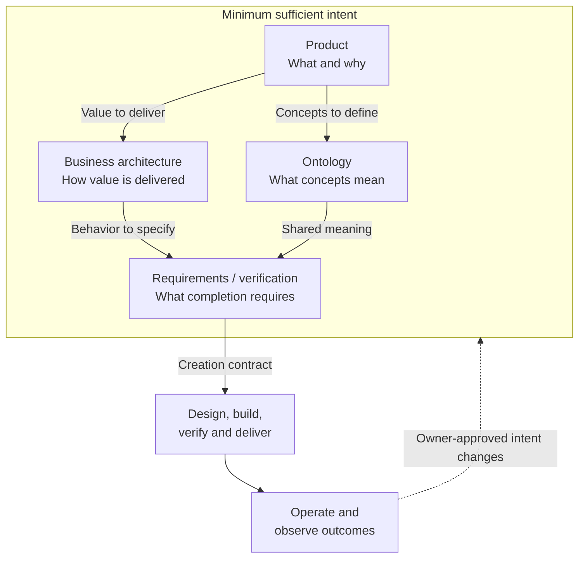

# AI Software Factory: Intent Quartet Deep Dive

```yaml
artifact_id: STRATEGY-INTENT-QUARTET
artifact_type: strategy-companion
station: M1-M3
status: draft
version: 0.3
owner: MTS product owner / factory methodology owner
approvers: []
source_ids: [strategy/ai-sdlc/ai-sdlc-software-factory-strategy.md]
requirement_ids: []
atomic_entity_ids: []
delta_ids: []
supersedes: []
downstream_ids: [PRODUCT-MTS, BUSINESS-ARCHITECTURE-MTS, ONTOLOGY-MTS, REQUIREMENT-VERIFICATION-MAPPING-MTS]
last_verified_against: []
```

## Holistic Overview

**The intent quartet is the least set of documents and content a human or agent needs to create the intended product end to end, without inventing missing intent.**

Think of it as four connected answers: **what to create, how it delivers value, what its concepts mean, and what proves it is complete**. This child of the [factory strategy](ai-sdlc-software-factory-strategy.md) explains how to write and assess those answers. It remains a draft, not implementation or release authority.



Product and ontology belong to M1, business architecture to M2, and requirements/verification to M3. The remaining factory stations derive the solution and produce evidence.

**Minimum is not shorthand for incomplete.** Cover the declared product/release scope, including failures, quality, authority and intended use. Exclude unrelated future scope explicitly. Link necessary versioned sources and policies; do not depend on forgotten chat or unstated legacy behavior.

**Current MTS status:** The [product](../../product.md), [business architecture](../../business-architecture.md), [ontology](../../ontology.md) and [mapping](../../requirement-verification-mapping.md) are not yet sufficient for full-product creation. Shared controls exist, but subject behavior, profiles and completion criteria remain [gaps](../../requirement-verification-mapping.md#gaps-and-next-decisions).

## 1. Content Placement: One Fact, One Home

| Document | Minimum content | MTS example |
|---|---|---|
| Product | Users, problem, deliverables, outcomes, scope/exclusions, priorities, imposed constraints and decision owners | Teachers need trustworthy Math/ELA materials; learner analytics are deferred. |
| Business architecture | Value streams, capabilities, triggers, actors, inputs/outputs, normal/failure/recovery paths, rules, variation and external handoffs | A human authorizes publication; the operator reconciles delivery. |
| Ontology | Terms, entity identity/revisions, relationships, information ownership, states, valid transitions and invariants | An Ed Material can have several artifact revisions; staging is not delivery. |
| Requirements and verification | Functional and quality obligations, interface/data constraints, applicability, thresholds, acceptance criteria, independent checks, evidence and intended-use validation | Selected student items and key entries must match by identity and revision. |

A promise, rule, invariant and check may describe different parts of one obligation. Do not independently maintain the same priority, definition, threshold or approval policy in several homes.

### Requirements and criteria are logical owners, not mandatory extra files

The fourth document must contain actual requirements and verification design, not links to unspecified future work. The strategy's requirement, criterion and completion-contract records can be addressable sections here. Existing catalogs may be pinned and linked if the creator can access them.

Split a record only when its owner, lifecycle, history or size warrants a drill-down; retain its ID. Design, code, tests, evidence and execution state are downstream artifacts, not extra intent homes. The quartet does not prescribe every engineering choice.

### How to test minimum and sufficiency

| Test | Question |
|---|---|
| **Creation** | Can a competent human or agent derive design, build, verification, delivery and operation without asking the original author to supply missing product decisions? |
| **Completion** | Can an independent evaluator judge conformance and intended-use acceptance, including failed or partial delivery? |
| **Removal** | Would removing this fact or extra intent document make creation or completion ambiguous? If not, remove it or mark it optional explanation. |
| **Change** | Can a changed rule or meaning identify affected consumers, invalidate stale evidence and guide repair without redefining success? |

Record the assessed scope, versions, reviewer and gaps. These tests establish intent adequacy, not defect-free execution or a single mandatory architecture.

## 2. Relationships and Traceability

Keep stable IDs and specific, versioned links:

```text
Intent/outcome -> meaning -> business behavior -> requirement -> acceptance/check
  -> design/build -> independent evidence -> human decision/release
  -> observation/root cause -> approved change to the owning artifact
```

Links are many-to-many: one outcome needs several capabilities; one acceptance condition may need several checks. Forward links expose omissions; backward links explain why behavior exists. Qualify source namespaces so historical IDs do not collide.

## 3. Deep-Dive Procedure

1. **Name the creation scope.** Separate the product/release commitment, current execution slice and future portfolio. Confirm owners and access to versioned dependencies.
2. **Walk the whole.** Explain the path from request through delivery, operation and outcome evaluation. Include alternate, failure, recovery and change paths.
3. **Fill the four homes.** Resolve conflicting sources without overwriting provenance or human decisions. Check behavior, information, quality, permissions, accessibility, privacy and responsibility.
4. **Assess sufficiency.** Apply the four tests above. Mark obligations covered, partial, open, deferred or excluded, with reasons and owners. Missing material in-scope intent blocks adequacy.
5. **Build incrementally.** Derive bounded slices and their completion contracts. A sufficient slice does not prove the wider product is sufficient; do not silently defer committed scope.

Use common rules and explicit exceptions instead of enumerating every possible subject/profile combination. Representative examples challenge completeness; they cannot replace missing obligations.

## 4. Human Review Without Overload

Follow the strategy's [overview-first writing standard](ai-sdlc-software-factory-strategy.md#documentation-standard-for-artifact-markdown): explain the whole simply, show useful relationships, then provide necessary detail.

Routine review uses the existing overview plus a small change packet: decision, baseline, important changes, coverage/risk delta, evidence limits and affected consumers. Aim for 3-7 consequential items per batch; split larger changes without hiding risks. High-risk decisions still require the linked detail and evidence.

Review coherence first, then creation sufficiency and minimality. Record approve, approve with conditions, revise or stop for the named scope/version. An amendment approval is not whole-document ratification. Measure review effort and reopened decisions before setting improvement targets.

## 5. Intent-Supported Convergence

| Cause | Loop and action |
|---|---|
| Implementation violates unchanged approved intent | **L1:** Repair design/code/configuration; independently reverify. |
| Meaning, business flow or requirement/check is missing or contradictory | **L2:** Propose a change in its owning artifact, obtain approval and update affected consumers/evidence. |
| Conforming output does not serve the intended need | **L3:** Human owner revisits intent/outcomes and business value. |

Apply the [parent convergence policy](ai-sdlc-software-factory-strategy.md#3d-closed-loop-convergence-and-recovery). Before execution, pin a completion contract: scope/versions, mandatory checks and thresholds, evidence, exceptions, regressions, human gates, observation obligations and budgets.

Persist work ID, versions/hashes, gaps, root-cause hypotheses, attempts/results, authority, remaining budget, next action and stop reason. Pause on missing authority, critical ambiguity, blocked dependencies, exhausted budgets, no progress or oscillation. Never weaken criteria, drop scope, fabricate independent review or reuse stale evidence to create a pass. Recheck affected consumers; preserve unrelated evidence.

## 6. Exit Conditions and MTS Refinement

| State | Required basis |
|---|---|
| Coherent | The four documents explain one whole, with clear owners, links and unresolved choices. |
| Minimum sufficient intent | The named product/release scope passes creation, completion, removal and change tests; material intent gaps are closed. |
| Slice ready | Scoped requirements/checks, completion contract, authority and budgets are approved. |
| Verified / released / observed / accepted | Separate execution evidence, human decisions, confirmed delivery and outcome evidence support each claim. |

MTS already has intent/outcome IDs, a capability/process/rule catalog, semantic records and nine draft shared controls. Preserve its priorities, five Math checkpoints and ELA independent review/release authority. Next, close the [named scope's gaps](../../requirement-verification-mapping.md#gaps-and-next-decisions); document existence or mapped-ID counts are not proof of sufficiency.
