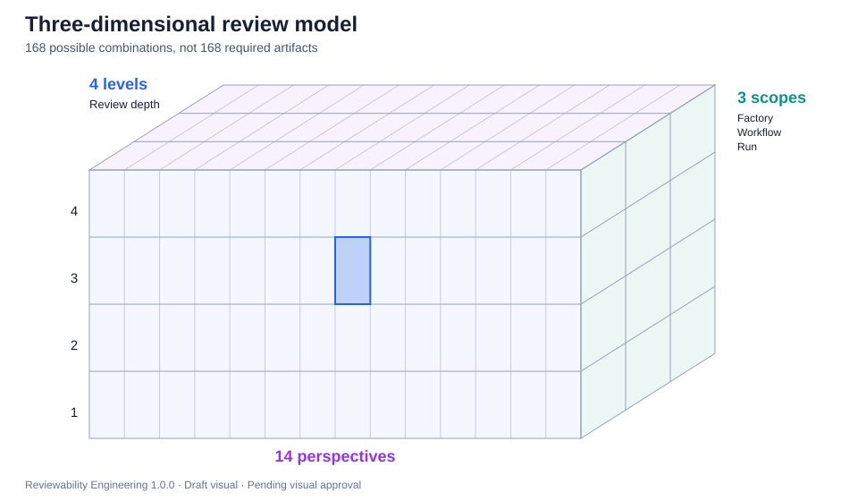
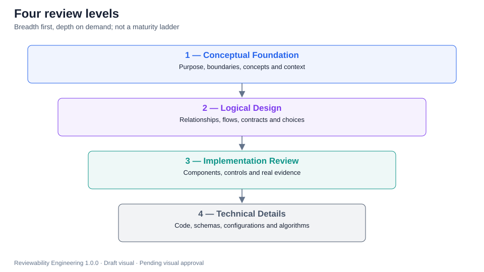
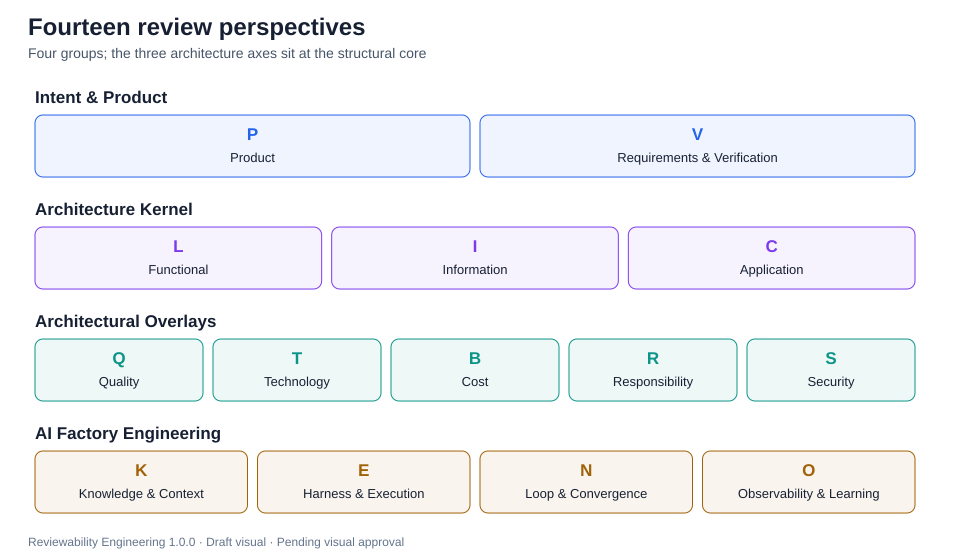

# Reviewability Engineering

**Version 1.1.0 · initial adopted guidance · visual examples draft pending review.** A reusable discipline for making intent, architecture, implementation, execution and verification progressively understandable, inspectable, verifiable and governable by humans.

**Define comprehensively. Apply progressively. Elaborate selectively. Evolve continuously.** The complete review methodology is defined here; MTS need only produce the minimum sufficient views for the next safe decision or demonstrable slice.

Four review levels × fourteen perspectives × three engineering scopes = 168 classification combinations, not 168 required documents. Each applicable Level 1 perspective needs a suitable primitive visualization, with justified exceptions documented; consolidate where useful.

## Start here

| Need | Source |
|---|---|
| Complete guidance, identifiers, naming, fidelity, governance and RE-01–RE-15 | [Reviewability standard](REVIEWABILITY-STANDARD.md) |
| Select a review view | [Pattern registry](review-patterns.yaml) |
| Review actual end-to-end implementation | [L3-IPS pattern](patterns/L3-IPS.md) |
| Agent procedure | [Reviewability skill](../../skills/reviewability-engineering/SKILL.md) |
| Apply to MTS | [MVP workspace](../../specs/mvp/README.md) |
| Evolution | [Changelog](CHANGELOG.md) |

The Intent Quartet and governing AI-SDLC strategy remain authoritative for product intent and factory architecture. This discipline defines how to review them, not substitute for them. Existing RVC-qualified IDs and A1/R1 legacy IDs remain resolvable; see registry aliases.

All five SVGs in this initial package are newly authored canonical-source **drafts**, not byte-exact exports of earlier inline conversation graphics. Their approval and visual fidelity are not inferred from the authorization to persist the standard. Future visual approval must bind the exact rendered source revision.

## Companion documentation guidance
[Documentation Engineering v0.1](../documentation-engineering/README.md) is a proposed companion for authorized pilots. Existing RE criteria, review levels, canonical fidelity and approvals remain authoritative; combine applicable DE and RE checks in one report.
