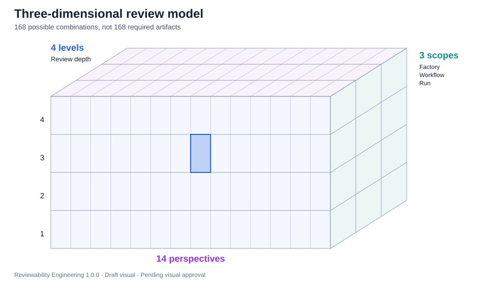
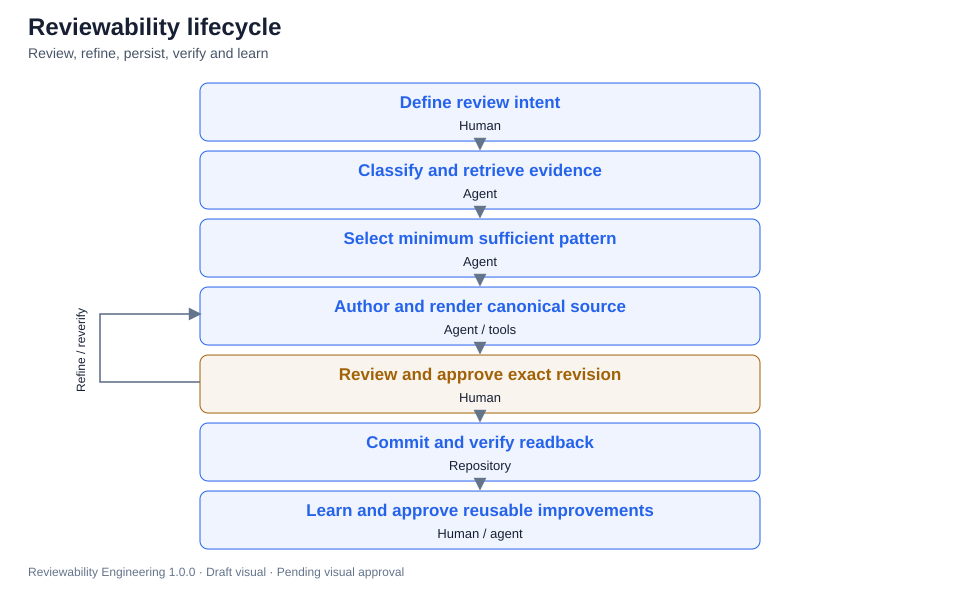
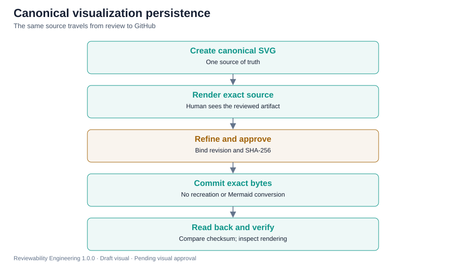

# Reviewability Engineering — standard

Version: 1.1.0. Status: initial guidance adopted for use, independent of ratification of the parent factory strategy. Visual examples are draft. Authority: this document governs review method; the [registry](review-patterns.yaml) governs view identifiers and mappings. Source business facts remain in their owning artifacts. The table below is a human-readable projection of the registry.

## 1. Purpose and principles

Make intent, architecture, implementation, execution and verification progressively understandable, inspectable, verifiable and governable by humans. Visualization first when useful; breadth before depth; progressive disclosure; evidence before confidence; one fact one authoritative home; exact visual-source persistence; human authority; minimum sufficient documentation. A review must answer a real question, not produce an ornamental document. Reviewability is not approval, implementation maturity or proof of correctness.

## 2. Three-dimensional review model

Classify each review by scope (factory/workflow/production-run), perspective (what aspect), and depth (1–4). These are independent: 3 × 14 × 4 = 168 possible combinations, not a mandate to produce 168 files. A view may cover multiple perspectives with primary and secondary IDs. Subject, pattern, state, revision and evidence are additional metadata. Distinguish this review model from M4's structural axes (function × information × application), M0–M8 stations, automation ladder, station artifact hierarchy and L1/L2/L3 recovery routes.

## 3. Review depth

| Level | Meaning | Review question |
|---|---|---|
| 1 — Conceptual Foundation | Purpose, scope, landscape, concepts and boundaries | What exists and why? |
| 2 — Logical Design | Structures, relationships, flows, contracts and trade-offs | How is it designed to work? |
| 3 — Implementation Review | Actual or proposed realization, technologies, components, controls and evidence | How is it realized? |
| 4 — Technical Details | Underlying mechanics, code, schemas, configurations, algorithms | How exactly does it work internally? |

As-is and to-be apply at every level. No automatic waterfall or maturity implication. C1–C4 retain established C4 meanings; a C4 container is an independently running/deployable application or data store, not necessarily a Docker container. The shared depth mapping is a navigation convention: a logical ERD can be I3 without claiming physical implementation. L and I levels are local conventions inspired by standard modeling practices.

## 4. Review perspectives and preferred views

Every applicable Level 1 perspective should have a suitable primitive visualization that communicates its essential structure, relationships or boundaries. Tables and explanatory text supplement the visual rather than automatically replacing it. Consolidate views when a shared visual explicitly covers each perspective; explain any justified exception rather than generating decorative graphics. Preserve canonical sources and review them using the visual fidelity contract.

| Perspective | 1 — Conceptual Foundation | 2 — Logical Design | 3 — Implementation Review | 4 — Technical Details |
|---|---|---|---|---|
| Product (P) | Product landscape | Capability model | Deliverable map | Feature specification |
| Requirements & Verification (V) | Definition of Done map | Verification matrix | QA evidence dashboard | Test specification |
| Functional (L) | Business process landscape | Logical process swimlane | Implementation process swimlane | Technical execution flow |
| Information (I) | Domain concept map | Ontology & taxonomy map | Logical ERD | Physical information model |
| Application (C) | System context | Containers | Components | Code |
| Quality (Q) | Quality attribute map | Quality scenario matrix | Fitness test dashboard | Test trace |
| Technology (T) | Technology landscape | Technology decisions / ADR | Component technology mapping | Dependency graph |
| Cost (B) | Cost drivers & budgets | Resource estimates | Consumption dashboard | Resource optimization |
| Responsibility (R) | Decision rights map | Activity ownership / RACI | Gate enforcement map | Authorization logic |
| Security (S) | Trust boundary map | Threat model | Implemented control mapping | Security configuration |
| Knowledge & Context (K) | Knowledge landscape | Context model / flow | Context lineage | Retrieval specification |
| Harness & Execution (E) | Harness architecture | Orchestration flow | Implementation sequence | Tool call flow |
| Loop & Convergence (N) | Convergence goals / feedback map | Feedback loop design | Iteration / repair trace | State machine |
| Observability & Learning (O) | KPI tree / measurement objectives | Metrics & event model | Operational dashboard / RunLog | Instrumentation |

The Intent Quartet maps Product→P, Business Architecture→L, Ontology→I, Requirements/Verification→V. Architecture Kernel: L, I, C; overlays Q, T, B, R, S. Seven discipline mapping: Intent→P/L/I/V; Knowledge & Context→K/I; Harness→E/C/T; Verification & Evaluation→V/Q; Loop & Convergence→N/E/V; Observability & Learning→O/B/Q; Governance & Security→R/S. These are review lenses, not competing engineering disciplines or a change to station numbering. Quality is about systemic attributes; V about requirement satisfaction and completion evidence.

## 5. Engineering scopes

Factory: reusable capabilities, standards and architecture that build and improve software. Workflow: repeatable educational product process (weekly practice, mock assessment, topic mastery). Production run: a particular dated execution, PreRun → Run → PostRun; inputs, approved RunSpec, artifacts, QA, release and telemetry. Distinguish factory development stations from educational production lifecycle. Scope can be narrowed to a vertical slice or artifact.

## 6. Patterns and catalog

The registry contains all 56 primary mappings. Detailed pattern contracts are elaborated on demand, starting with [L3-IPS](patterns/L3-IPS.md). I2 includes taxonomy (IS-A classification) and ontology (meaning, typed relationships, constraints); I3 ERD expresses attributes and cardinality; I4 physical schemas may be relational, JSON/YAML, files or graphs. Supplementary views: entity lifecycle/state diagram, DFD, data lineage, CRUD matrix, ownership matrix, knowledge graph, sequence diagram, interface matrix. They are cross-level/cross-perspective tools: select according to the review question. Use diagrams, matrices, dashboards, short explanatory prose, evidence or code extracts as appropriate. Avoid redundant diagrams and pseudo-precision.

## 7. Review methodology

1. Clarify decision, audience, scope, perspective, depth, state and applicable pattern.
2. Retrieve current authoritative sources and actual implementation/run evidence. Record source path, revision, date and evidence limitations. Do not equate code presence with invocation or intended flow with actual trace.
3. Start with the conceptual whole; choose a bounded vertical slice for deeper review only where useful. Reuse or update existing views before adding files.
4. Produce the minimum sufficient visual and explanation; make handoffs, relationship direction, boundaries, decision criteria and exceptions visible. Label unknowns and proposed components.
5. Validate facts, cross-axis alignment, trace IDs, readability and artifact fidelity. Review with human, refine original source, reverify affected checks.
6. Persist approved revisions, read back and verify; record gaps and reusable improvements. Draft persistence is permitted with explicit status and no claim of approval.

## 8. Artifact standards and naming

Identity: Scope — Subject — Perspective & Level — Review Pattern — State. Filename: `[scope]-[subject]-[perspective-level]-[pattern]-[state].[ext]` with kebab-case scope/subject/state and stable qualified IDs. Examples: `workflow-weekly-worksheet-L3-IPS-as-is.svg`, `factory-mts-I2-ontology-to-be.svg`, `factory-mts-C1-system-context-to-be.svg`, `run-2026-11-16-V3-verification-evidence-as-is.html`. Run filenames include the date or run ID. Use relative links. In progressive review workspaces with consolidated documents, organize visual companions within the same review level under `diagrams/<numbered-document-stem>/`; preserve canonical filenames, bytes and IDs. Elsewhere, colocate visual companions with explanatory Markdown. Name review-level folders `level-<number>-<descriptive-name>`, number primary reading documents in dependency order, provide a README index and previous/index/next navigation, and verify all affected references after moves. Avoid copying authoritative schemas, code, evidence or domain facts; cite exact revisions.

Metadata (front matter or manifest): artifact_id, discipline/version, scope, subject, perspective(s), level, pattern, state (as-is/to-be), status (draft/review/approved/superseded), revision, owner, source_references, evidence_limits, visual file/format/sha256, approval record and commit reference when available. Unknown or missing values remain null/explicitly unknown. No synthetic approval or invented checksums. Artifact ID remains stable across revisions. Preserve existing trace IDs; legacy RVC prefix is an alias, not a new framework. Existing MVP A1 means Authority (canonical R1); existing MVP R1 means Convergence & Recovery (canonical N1). Resolve legacy IDs by namespace/context; never map bare R1 ambiguously or silently rename existing records.

## 9. Visual design, fidelity and persistence

Create canonical SVG source first for static diagrams. Render that exact artifact for human review (an image preview derived from the SVG is acceptable; a separately authored view is not). Refine the same source. Use readable type, sufficient contrast, aligned lanes and labels, meaningful arrows, consistent colors, accessible title/description and self-contained portable SVG. Avoid clipping, overlapping text/arrows, tiny labels and decorative complexity. Markdown complements the visual with decisions, evidence and exceptions. For interactive dashboards use an appropriate self-contained source and record review inputs/state; do not replace interaction with misleading screenshots.

Human approval binds the reviewed revision and SHA-256. Commit exact bytes, fetch from the target commit, compare SHA-256 and inspect rendered output; preserve source, layout, typography, colors and meaning. Byte equality does not guarantee identical rendering across environments, so record rendering differences. No recreation in Mermaid or another medium unless explicitly requested. Existing conversation graphics whose source cannot be exported require a disclosed draft replacement and visual approval before claiming fidelity. Draft check-in is allowed; never label it approved. Exclude credentials, student records and private source materials from public repos.

## 10. Definition of Done

| ID | Criterion |
|---|---|
| RE-01 | Purpose and review question explicit |
| RE-02 | Engineering scope established |
| RE-03 | Perspective and depth identified |
| RE-04 | Suitable pattern selected |
| RE-05 | Accurate source-grounded content |
| RE-06 | Important relationships and boundaries visible |
| RE-07 | Appropriate abstraction level |
| RE-08 | As-is/to-be and implementation maturity distinguished |
| RE-09 | Readability, rendered visual inspection and applicable Level 1 primitive coverage |
| RE-10 | Naming and metadata conform |
| RE-11 | Supplementary explanation adds meaning without duplication |
| RE-12 | Canonical visual source preserved |
| RE-13 | Persistence fidelity verified via readback and checksum |
| RE-14 | Decisions, limitations and unresolved questions disclosed |
| RE-15 | Human approval recorded where required |

Use PASS, FAIL, NOT_VERIFIED, NOT_APPLICABLE with reason/evidence. Do not pass missing evidence; unresolved blocking failures prevent final approval. Explicit accepted exceptions remain disclosed. For draft artifacts, record pending checks. A review artifact's DoD is distinct from the underlying product/run DoD. Reverify changed content and retain approval provenance.

## 11. Governance, evolution and learning

Human owns intent, material changes, exceptions, visual approval and release boundaries. Apply→identify gap→propose refinement→human approval→persist→reuse. Improve domain artifact in its home; promote reusable lessons into this standard or registry only with owner approval. Major version for breaking semantics/identifiers, minor for backward-compatible new patterns/perspectives, patch for clarifications/corrections. Preserve aliases, historical revisions and discipline version recorded by consumers. Git history plus meaningful changelog; no separate process application required. Avoid duplicated facts; register a view once and link. Do not reinterpret a review as permission to change architecture, code or production.

## 12. Cross-project and cross-harness reuse

AGENTS.md enables repository discovery; [skill](../../skills/reviewability-engineering/SKILL.md) defines procedure. Harness-specific instructions should reference these, not duplicate rules. ChatGPT conversations outside this project must be given a canonical repository reference and access; do not assume automatic discovery. Human shorthand such as “I2 review”, “C1–C3”, “L3 As-Is”, “V3 and O3 for latest run” maps to the registry. Qualify namespace when ambiguous. Keep the discipline model-neutral and portable. Consider a separate shared repository only when multiple projects actively consume it; pin a version if extracted.

## 13. Progressive application to MTS

[specs/mvp](../../specs/mvp/README.md) is the application, not the definition. Retain four consolidated Level 1 documents (Product, Architecture, Definition of Done, Factory). Review broadly, clarify gaps against quartet and strategy, select a bounded slice, elaborate applicable L2–L4 views, build/verify, record evidence and learn. Weekly Practice (worksheet/key), Mock Assessments (assessment/key), Topic Mastery (cheatsheets, practice/key, guides) are the working focus; subject workflows remain separate where needed and share factory capabilities. Do not change approved scope or release gates. A production run review distinguishes human approval, verified evidence and delivery; e.g. legacy November 16 release was successful but not proof of complete automation or complete QA. Link evidence from its authoritative location. A Level 1 review is not authorization to build/release. Defer extra documents, not the complete methodology.

Implementation maturity: full definitions and 56 registry mappings now; detailed patterns, automated validators, dashboards and deeper MTS views incrementally. Existing historical IDs remain intact.
