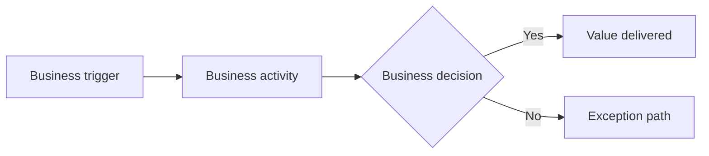

# M2 — Business Architecture | Station Brief Template

**Work / owner / status:** `WORK-___` · TBD · DRAFT  
**Primary output:** `business-architecture.md` · `VS-*`, `CAP-*`, `BP-*`, `FA-*`, `RULE-*`, `VAR-*`

## Value delivery
Who receives value, from what trigger, through which activities, to which measurable outcome?

## High-level process flow

## Capability and process map
| VS | CAP | BP / handoff | Domain terms | Outcome link |
|---|---|---|---|---|
| `VS-___` | `CAP-___` | `BP-___` | `ENT/REL-*` | `OUT-___` |

## Review gate
Confirm owner, decisions, business rules, exceptions, variations and coverage. Model business process independent of software implementation; detailed agent/software orchestration belongs to M5.

**Human decision:** PENDING · Unresolved gaps and next action: TBD.
